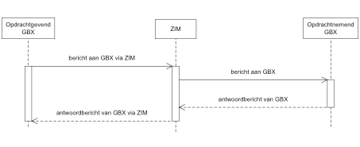
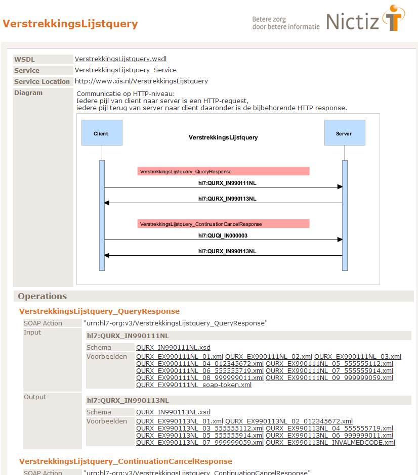
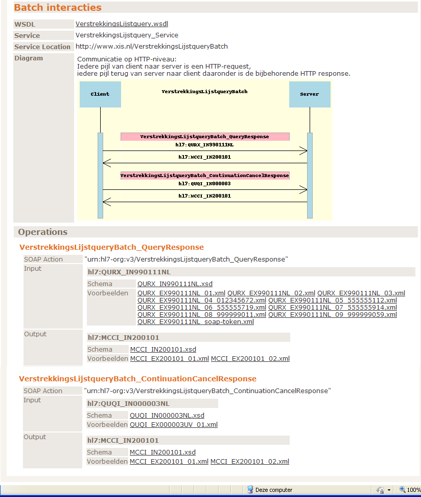

[AORTA 8.5.2](../../../index.md) / [Aansluit- en Implementatiewijzer Kern](../../../aansluit-en-implementatiewijzer-kern.md) / [Berichttransport](../../berichttransport.md) / [AORTA_Trp_IH_Berichttransport](../aorta_trp_ih_berichttransport.md)

# AORTA en WSDL

Een WSDL in AORTA dient als documentatie en contract, omdat de WSDL precies beschrijft aan wat voor service de gegevensleverancier zich gecommitteerd heeft.

|  | Beschrijvingen van webservices worden opgesteld in WSDL 1.1. ; |
| --- | --- |

## Inhoud WSDL

Deze paragraaf beschrijft de inhoud van een AORTA WSDL stap voor stap.

De uitwerking maakt gebruik van een voorbeeldtransactie: VerstrekkingsLijstquery. Volgens het interactiediagram bestaat deze transactie uit:

- de vraag QURX_IN990111NL (Medication Dispense List Query);

- het antwoord QURX_IN990113NL (Medication Dispense List Query Response).

Ieder bericht is in HL7v3 gedefinieerd met een XML Schema. Zo is er een XML Schema QURX_IN990111NL.xsd, QURX_IN990113NL.xsd, etcetera. In de XML Schema's ligt de structuur van het bericht vast, inclusief de HL7v3-Transmission en -Control Act Wrappers.

In de WSDL worden allereerst benodigde XML Schema's gedeclareerd als WSDL Types. Hieronder volgt een uitleg aan de hand van een voorbeeld.

| CODE  `<?xml version="1.0" encoding="UTF-8"?> <definitions xmlns:xsd="http://www.w3.org/2001/XMLSchema" xmlns:soap="http://schemas.xmlsoap.org/wsdl/soap/" xmlns="http://schemas.xmlsoap.org/wsdl/" xmlns:hl7="urn:hl7-org:v3" targetNamespace="urn:hl7-org:v3" name="VerstrekkingsLijstquery"> <documentation> WSDL implementatie van VerstrekkingsLijstquery </documentation> <types> <xsd:schema targetNamespace="urn:hl7-org:v3" elementFormDefault="qualified"> <xsd:include schemaLocation="../schemas_codeGen/QURX_IN990111NL.xsd"/> </xsd:schema> <xsd:schema targetNamespace="urn:hl7-org:v3" elementFormDefault="qualified"> <xsd:include schemaLocation="../schemas_codeGen/QURX_IN990113NL.xsd"/> </xsd:schema> </types>` |
| --- |

Eerst is er een inleidend deel, daarna worden schema’s gekoppeld. De schema's worden opgenomen met een schema-include om een en ander beknopt, leesbaar en onderhoudbaar te houden. Er zijn in dit geval twee schema's:

- xsd (Medication Dispense Event List Query)

- xsd (Medication Dispense Event List Query Response)

Vervolgens worden de nodige berichten gedeclareerd als WSDL Message. De berichten krijgen een unieke naam: die van de interactie.

| CODE  `<message name="QURX_IN990111NL"> <part name="body" element="hl7:QURX_IN990111NL"/> </message> <message name="QURX_IN990113NL"> <part name="body" element="hl7:QURX_IN990113NL"/> </message>` |
| --- |

Er zijn ook twee verschillende berichten:

- QURX_IN990111NL (Medication Dispense List Query)

- QURX_IN990113NL (Medication Dispense List Query Response)

De verschillende samenhangende interacties uit het Storyboard worden vertaald naar WSDL Port Types. Hierin zijn bij elkaar horende in- en outputs gekoppeld tot WSDL operations.

| CODE  `<portType name="VerstrekkingsLijstquery_PortType"> <operation name="VerstrekkingsLijstquery_QueryResponse"> <input message="hl7:QURX_IN990111NL"/> <output message="hl7:QURX_IN990113NL"/> </operation> </portType>` |
| --- |

Hierboven is een operation getoond volgens het synchrone model van berichtenuitwisseling: het antwoord op de query komt synchroon binnen over hetzelfde SOAP en HTTP request/response paar. Dit levert de volgende operation op: VerstrekkingsLijstquery_QueryResponse. Deze bestaat weer uit de eerder gedefinieerde berichten, die als input en output message zijn gedefinieerd.

In sommige gevallen is bij een HL7v3-interactie die verzonden wordt meer dan één interactie als antwoord mogelijk. WSDL staat dit niet toe: iedere WSDL-operation mag maximaal één input en één output hebben. De oplossing is een samengesteld xsd element te maken waarin alle HL7v3-antwoordinteracties mogelijk zijn. In onderstaand fragment is deze stijl te zien. Er wordt aan het schema één extra element toegevoegd, met een keuze tussen beide HL7v3-interacties. Dit element heet [request-interaction-id]Response. Dit element wordt vervolgens gebruikt in de message definitie en de operation, zodat de operation weer een enkele output heeft.

| CODE  `<types> <xsd:schema targetNamespace="urn:hl7-org:v3" elementFormDefault="qualified" xmlns:hl7="urn:hl7-org:v3" xmlns:xsd="http://www.w3.org/2001/XMLSchema"> ... <xsd:include schemaLocation="../schemas/COMT_IN800310.xsd" /> </xsd:schema> <xsd:schema targetNamespace="urn:hl7-org:v3" elementFormDefault="qualified" xmlns:hl7="urn:hl7-org:v3" xmlns:xsd="http://www.w3.org/2001/XMLSchema"> <xsd:include schemaLocation="../schemas/COMT_IN800320.xsd" /> </xsd:schema> <xsd:schema targetNamespace="urn:hl7-org:v3" elementFormDefault="qualified" xmlns:hl7="urn:hl7-org:v3" xmlns:xsd="http://www.w3.org/2001/XMLSchema"> <xsd:element name="COMT_IN800300Response"> <xsd:complexType> <xsd:choice> <xsd:element ref="hl7:COMT_IN800310"/> <xsd:element ref="hl7:COMT_IN800320"/> </xsd:choice> </xsd:complexType> </xsd:element> </xsd:schema> </types> ... <message name="COMT_IN800300Response"> <part name="body" element="hl7:COMT_IN800300Response" /> </message> <portType name="OverdrachtVerantwoordelijkheid_PortType"> ... <operation name="OverdrachtVerantwoordelijkheid_VerzoekOverdrachtVervallen"> <input message="hl7:COMT_IN800300" /> <output message="hl7:COMT_IN800300Response" /> </operation> </portType>` |
| --- |

De WSDL Port Types worden gekoppeld aan WSDL Bindings waar meer details over de SOAP-interactie gegeven worden. Hier wordt gespecificeerd dat de stijl van gegevensuitwisseling ”document/literal” is.

In de Binding wordt ook de waarde van SOAPAction bepaald. Deze SOAPAction komt terug in de HTTP Header, zie [paragraaf 4.4](xml-soap-en-http.md#http-binding).

| CODE  `<binding type="hl7:VerstrekkingsLijstquery_PortType" name="VerstrekkingsLijstquery_Binding"> <soap:binding style="document" transport="http://schemas.xmlsoap.org/soap/http"/> <operation name="VerstrekkingsLijstquery_QueryResponse"> <soap:operation soapAction="urn:hl7-org:v3/VerstrekkingsLijstquery_QueryResponse"/> <input> <soap:body use="literal"/> </input> <output> <soap:body use="literal"/> </output> </operation> </binding>` |
| --- |

Ten slotte wordt van de WSDL Bindings een WSDL Service gemaakt, die het webadres van een specifieke webservice geeft.

| CODE  `<service name="VerstrekkingsLijstquery_Service"> <port binding="hl7:VerstrekkingsLijstquery_Binding" name="VerstrekkingsLijstquery_Port"> <!--Deze service location URI verwijst niet naar een echt bestaande webservice. --> <soap:address location="http://www.xis.nl/VerstrekkingsLijstquery"/> </port> </service> </definitions>` |
| --- |

De waarde van "location" is hier nog fictief. Zie [paragraaf 5.2](aorta-en-wsdl.md#AORTAenWSDL-Locatievaneenwebservice) voor meer details.

## Locatie van een webservice

De ZIM of een GBx vervullen in HL7v3-terminologie zogenaamde Application Roles. Een WSDL beschrijft de webservice voor iedere Application Role. Nictiz levert WSDL’s waarin alleen de locatie (de url) van de service nog niet definitief is. Ieder GBx die een webservice aanbiedt in AORTA, biedt ook de echte locatie van de webservice.

Voor het opvragen van medicatie is er bijvoorbeeld een "VerstrekkingsLijstquery.wsdl" bestand waarin de locatie van de webservice nog niet definitief is ingevuld. Als locatie staat er:

| <!--Deze service location URI verwijst niet naar een echt bestaande webservice. --> ;   CODE  `<soap:address location="http://www.gbx.nl/VerstrekkingsLijstquery" />` |
| --- |

Voor ieder GBx komt er dan een specifieke invulling van de locatie. Stel dat er een GBx is met het (fictieve) adres [http://www.gbx1.nl](http://www.gbx1.nl), dan kan de ZIM deze webservice aanroepen met onderstaande webservice locatie.

| CODE  `<soap:address location="http://www.gbx1.nl/VerstrekkingsLijstquery" />` |
| --- |

De padnamen zijn verplicht: [http://www.gbx1.nl/VerstrekkingsLijstquery](http://www.gbz.nl/VerstrekkingsLijstquery) is goed, [http://www.gbx1.nl/VerstrekkingsLijstquery**.py**](http://www.gbz.nl/Verstrekkingsquery.py) of

[http://www.gbx1.nl/**Mijn**VerstrekkingsLijstquery](http://www.gbz.nl/MijnVerstrekkingsquery) is dat niet.

Een GBx-applicatie mag maar één hostname gebruiken voor alle webservices die de GBx-applicatie aanbiedt. Dus in bovenstaand voorbeeld wordt de webservice locatie van een Voorschriftquery van dezelfde GBx-applicatie:

| CODE  `<soap:address location="http://www.gbx1.nl/Voorschriftquery" />` |
| --- |

Dit om te voorkomen dat de ZIM een registratie moet bijhouden van alle webservices per GBx, met de bijbehorende plicht voor GBx'en om deze aan te melden en wijzigingen door te geven.[^1]

## Opvragen patiëntgegevens en “batch” wsdl’s

Opvragen patiëntgegevens betreft een berichtuitwisselingspatroon in AORTA, waarbij een initiërend GBx een opvraging doet via de ZIM aan nul of meer reagerende GBZ’en. De ZIM bundelt de antwoorden van de reagerende systemen in een zogenaamde batch wrapper en retourneert dit batch bericht aan het initiërende systeem. Zie onderstaand sequentiediagram in Figuur 7 voor een illustratie hiervan met twee reagerende GBZ’en bij een VerstrekkingsLijstQuery (zie [Ontw OPV] voor een volledig overzicht).

Figuur 7 - sequentie diagram opvragen patiëntgegevens: VerstrekkingsLijstQuery

Dit berichtuitwisselingspatroon vindt zijn weerslag in de WSDL’s. Immers, het request/response paar tussen een initiërend GBx en de ZIM kent een ander antwoordbericht (namelijk een batch bericht) dan het request/response paar tussen ZIM en reagerend GBZ. Bij opvragen patiëntgegevens zijn er dan ook twee WSDL-ports gedefinieerd, een batch versie voor de webservice-port tussen initiërend GBx en de ZIM en een ‘normale’ versie voor de webservice-port tussen ZIM en reagerend GBZ.

Een voorbeeld hiervan is de VerstrekkingsLijstQuery, deze kent de volgende twee WSDL-service ports:

- VerstrekkingsLijstQueryBatch_Port (aangeroepen door initiërend GBx bij ZIM),

- VerstrekkingsLijstQuery_Port (aangeroepen door ZIM bij reagerend GBZ).

[Paragraaf 5.5](aorta-en-wsdl.md#AORTAenWSDL-WSDLdocumentatie) bevat illustraties van de html-documentatie van deze webservice in Figuur 8 en Figuur 9.

Merk op dat reagerende GBZ’en niet allemaal dezelfde AORTA release hoeven te ondersteunen en dat een batch antwoordbericht van de ZIM derhalve berichten met verschillende versies kan bevatten. Eén batch antwoordbericht kan dus zowel AORTA 6 als AORTA 7 berichten bevatten.

## Versionering van webservices

Het kan voorkomen dat een webservice wijzigt bij een nieuwe AORTA publicatie, bijvoorbeeld omdat:

- een input of output bericht wijzigt;

- het pad van de webservice locatie wijzigt;

- een operation wijzigt of toegevoegd of verwijderd wordt;

- de soap action wijzigt.

De meest waarschijnlijke wijziging is overigens bij de eerstgenoemde: het input of output bericht.

Als er iets wijzigt in de webservice, krijgt de webservice een (nieuw) versienummer, dat zich als volgt manifesteert:

- in de waarde van het definitions/service/@name attribuut, bijvoorbeeld: “VerstrekkingsLijstquery_02_Service”;

- in de waarde van het definitions/service/port/soap:address/@location attribuut, bijvoorbeeld: “[http://www.gbx.nl/02/VerstrekkingsLijstquery](http://www.gbx.nl/02/VerstrekkingsLijstquery)”;

- in de bestandsnaam van de wsdl, bijvoorbeeld “VerstrekkingsLijstquery-02.wsdl”;

- in de waarde van het definitions/@name attribuut, bijvoorbeeld “VerstrekkingsLijstquery_02”;

- in de waarde van het definitions/documentation element, bijvoorbeeld “WSDL implementatie van VerstrekkingsLijstquery_02”.

De eerste twee genoemde wijziging zijn het belangrijkst: een nieuwe servicenaam en een nieuwe (verplichte) padnaam voor de webservice locatie. Deze padnaam bevat het versienummer direct na de hostnaam van het GBx en/of ZIM.

## WSDL documentatie

Bij ieder WSDL bestand wordt ook documentatie in HTML formaat geleverd. Deze bevat een grafische weergave van de communicatie op HTTP-niveau en een overzicht van de relevante parameters uit de WSDL. Figuur 8 en Figuur 9 bevatten een illustratie van deze HTML-documentatie voor VerstrekkingsLijstQuery.wsdl.

Figuur 8 - Schermafdruk WSDL-documentatie VerstrekkingsLijstQuery

Figuur 9 - Schermafdruk WSDL-documentatie VerstrekkingsLijstQueryBatch

[^1]: In AORTA kunnen IP-adressen gebruikt worden voor adressering. In de voorbeelden worden URI's gebruikt. In beide gevallen gelden de verplichte padnamen.
