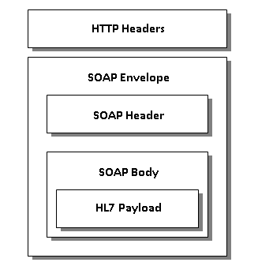
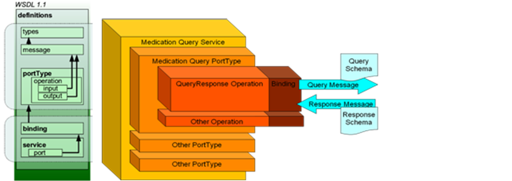
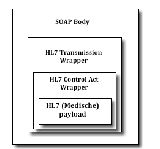

[AORTA 8.5.2](../../../index.md) / [Aansluit- en Implementatiewijzer Kern](../../../aansluit-en-implementatiewijzer-kern.md) / [Berichttransport](../../berichttransport.md) / [AORTA_Trp_IH_Berichttransport](../aorta_trp_ih_berichttransport.md)

# Berichtuitwisselingsstandaarden

Het transport van documenten in AORTA is gebaseerd op een aantal standaarden: SOAP, WSDL, WS-I Basic Profile, Web Service Security (WSS) en relevante delen van de HL7v3-standaard (met name Transmission Infrastructure en Query Infrastructure). Dit hoofdstuk licht deze standaarden kort toe.

## SOAP

SOAP 1.1 – Simple Object Access Protocol – is een “de facto standaard” voor uitwisseling van gegevens over – onder andere - internet. AORTA gebruikt SOAP 1.1.

Een SOAP-document is een XML-document. Het bestaat uit drie onderdelen:

- De SOAP Envelope is het omringende deel.

- De SOAP Header is een optionele verzameling headers die bijvoorbeeld meta-informatie over het bericht kunnen bevatten. Eventuele tokens, zoals bijvoorbeeld voor authenticatie, worden opgenomen in de SOAP Header.

- De SOAP Body bevat het eigenlijke bericht. De Body bevat de "data", de Header de bijbehorende "metadata".

SOAP kent een mapping op HTTP, waarbij HTTP als transportmechanisme gebruikt wordt om een SOAP-document te transporteren. Zie Figuur 1 voor een overzicht van een SOAP bericht.

Figuur 1 - Overzicht SOAP bericht

De verschillende onderdelen zien er als volgt uit.

| CODE  `<?xml version="1.0" encoding="utf-8"?> <Envelope ... namespace declaraties ... > <Header> ... headers ... </Header> <Body> ... payload ... </Body> </Envelope>` |
| --- |

De SOAP Envelope is het omsluitende XML-element. Dit element bevat de SOAP Headers en de SOAP Body. Er hoeven geen headers aanwezig te zijn; een SOAP Body is wel verplicht. SOAP Headers worden meestal gebruikt voor meta-informatie die te maken heeft met authenticatie, beveiliging, transactiemanagement of betalingen. De Body bevat de "payload", de eigenlijke gegevens die verzonden worden.

## WSDL

WSDL– Web Services Description Language – is een taal om Web Services te beschrijven. Het is een hulpmiddel en het vereenvoudigt het bouwen van interoperabele Web Services. WSDL 1.1 is een W3C Note, die als “de facto” standaard geldt. AORTA gebruikt WSDL 1.1.

WSDL dient de volgende doelen:

- Eenduidige en machine leesbare beschrijving van de Web Service.

- Invoer voor een codegenerator die een deel van de voor de Web Service benodigde code genereert.

Een WSDL document bestaat uit de volgende onderdelen:

- Hier worden abstracte XML-structuren beschreven in XML Schema formaat.

- Met de elementen en elementtypen uit de Types worden Messages samengesteld – dit zijn generieke berichten gedefinieerd in XML.

- Een PortType is een logische “applicatiepoort” die één of meer Operations ondersteunt. Een Operation bestaat uit één of meer Inputs en Outputs. Deze Inputs en Outputs verwijzen naar de Messages die hierboven beschreven zijn. Een Message beschrijft dus de interne structuur van één of meer Inputs of Outputs.

- Een Binding verbindt een – logisch – PortType met een specifiek transportprotocol, zoals SOAP over HTTP. Alle Operations, Inputs en Outputs uit de Port Type worden toegewezen aan SOAP.

- Een Service bestaat uit één of meer fysieke Ports. Een Port verbindt een Binding met een locatie, normaal gesproken een URI waarmee de Port over het Internet aangeroepen kan worden.

Twee manieren van een grafische weergave van de onderdelen van een WSDL zijn opgenomen in Figuur 2.

Figuur 2 – Twee grafische weergaven van wsdl onderdelen

## WS-I Basic Profile

WS-I Basic Profile 1.0 is een specificatie gepubliceerd door WS-I, een ad hoc consortium van voornamelijk softwareleveranciers. Het Basic Profile beschrijft hoe SOAP 1.1 en WSDL 1.1 gebruikt kunnen worden om interoperabele Web Services te bouwen en geeft richtlijnen over hoe SOAP en WSDL het beste gebruikt kunnen worden. Op deze wijze corrigeert het Basic Profile veel van de tekortkomingen van SOAP en WSDL. AORTA volgt het Basic Profile tenzij anders aangegeven.

## HL7v3

HL7v3 kent verder een aantal onderdelen die te maken hebben met het transport van gegevens. HL7v3 definieert de volgende onderdelen:

- In de Transmission Wrapper worden metagegevens opgeslagen die te maken hebben met het bericht zelf: id, datum waarop het is aangemaakt, afzender, geadresseerde en dergelijke.

- De Trigger Event Control Act Wrapper bevat gegevens over de gebeurtenis die aanleiding was het bericht te versturen. Ook zijn hierin gegevens opgenomen die te maken hebben met de verwerking van het bericht, bijvoorbeeld het aantal records dat een query terug moet sturen (er zijn veel specialisaties van deze wrapper).

- De Batch Wrapper kan gebruikt worden om meerdere berichten van dezelfde of verschillende soort in te pakken.

Tezamen met de eigenlijke (medische) gegevens, de payload, vormen deze wrappers een XML-document. De inhoud van de SOAP Body is weergegeven in Figuur 3.

Figuur 3 - Inhoud SOAP Body
