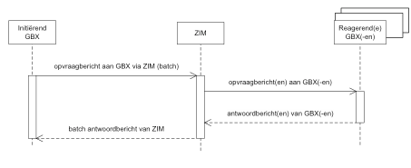
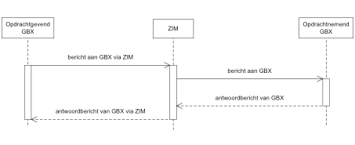
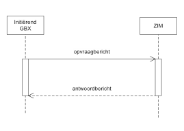
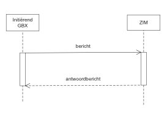

[AORTA 8.5.2](../../../index.md) / [Aansluit- en Implementatiewijzer Kern](../../../aansluit-en-implementatiewijzer-kern.md) / [Berichttransport](../../berichttransport.md) / [AORTA_Trp_IH_Berichttransport](../aorta_trp_ih_berichttransport.md)

# Betrouwbaar transport

Dit hoofdstuk beschrijft betrouwbare uitwisseling van berichten in AORTA. De eisen aan een GBx voor betrouwbaar transport zijn beschreven in [PvE GBx Rollen]. Dit hoofdstuk dient vooral om deze eisen nader toe te lichten.

Betrouwbaar transport stelt – in het algemeen - de volgende eisen:

- een bericht wordt eenmaal verwerkt (duplicaatdetectie en –verwijdering);

- berichten worden afgeleverd in de volgorde waarin ze verzonden zijn;

- er is garantie dat een bericht ofwel afgeleverd wordt, ofwel dat het falen gemeld wordt.

Voor betrouwbaar transport moet ieder systeem voorzieningen treffen tegen het falen van systemen. Een voorbeeld hiervan is dat een ontvanger een bericht persistent opslaat, voordat een antwoord verzonden wordt. Daarnaast is het van belang dat ieder bericht een unieke identificatie bevat zodat een ontvanger duplicaten kan detecteren. Betrouwbare aflevering kan dan worden ingevuld op de volgende wijze:

- een verzender zendt een bericht aan een ontvanger;

- de ontvanger slaat het bericht persistent op en retourneert een antwoordbericht;

- wanneer de verzender een antwoordbericht ontvangt, is de status van de verzending bekend bij deze verzender;

- wanneer de verzender geen antwoordbericht ontvangt, mag deze een nieuwe poging doen;

- de ontvanger detecteert of het bericht al eerder verwerkt is; is dit het geval, dan verwerkt de ontvanger het bericht deze keer niet en informeert de verzender met een antwoordbericht;

- wanneer na herhaalde pogingen geen antwoordbericht komt, wordt de gebruiker (of diens beheerder) van het verzendende systeem gewaarschuwd.

## Herhaald uitvoeren

Herhaald uitvoeren is een essentieel onderdeel van betrouwbaar transport. Het is mogelijk dat ergens in de keten een bericht niet verwerkt is zoals het door de verzender bedoeld was. De verzender zal een foutmelding of een waarschuwingsmelding ontvangen. De verzender kan hierdoor getriggerd worden om hetzelfde verzoek nogmaals te verzenden. Er zijn verschillende manieren om een actie herhaald uit te voeren. AORTA onderscheidt de volgende mogelijkheden:

- Herhalen met een duplicaat bericht. Een duplicaat is exact hetzelfde bericht als het origineel, inclusief wrappers. Dit betekent dus dat het bericht nogmaals verzonden wordt met een identiek message-id en bij tokenauthenticatie een identiek transactietoken.

- Herhalen met een nieuw bericht. Een nieuw bericht bevat weliswaar hetzelfde functionele verzoek, maar heeft (minimaal) een nieuw message id en bij tokenauthenticatie ook een nieuw transactietoken.

Wanneer de ZIM een bericht gaat verwerken, wordt het transactietoken op “gebruikt” gezet. Dit token kan dan niet nogmaals gebruikt worden. Bij tokenauthenticatie is een nieuwe poging met een duplicaat bericht dan ook alleen zinvol wanneer het originele bericht niet bij de ZIM is aangekomen. Het is dus sterk afhankelijk van waar in de keten zich een uitzonderingssituatie voordoet.

## Duplicaatdetectie

Als gevolg van het toepassen van herhaald uitvoeren wordt duplicaatdetectie van belang. AORTA onderscheidt de volgende vormen:

- Duplicaatdetectie op transportniveau. Hierbij worden duplicaat berichten gedetecteerd aan de hand van een identieke transmission wrapper, meer specifiek op basis van het message id.

- Duplicaatdetectie op applicatieniveau. Hierbij worden duplicaten gedeteceerd aan de hand van de HL7v3-payload, meer specifiek op basis van het patiëntstuk-id (in HL7v3 ingevuld door “Act id”). Het betreft hier niet per definitie duplicaat berichten, er kan ook sprake zijn van nieuwe berichten met duplicaat payload.

Het kan zijn dat een bericht niet als duplicaat geldt op transportniveau, maar wel een duplicaat blijkt te zijn op applicatieniveau. Het betreft dan een nieuw bericht met een nieuw message id, maar met een duplicaat payload. Andersom kan dit niet: een duplicaat op transportniveau is altijd ook een duplicaat op applicatieniveau. Dit laatste is overigens de verantwoordelijkheid van de zender: een duplicaatbericht moet identiek zijn aan het originele bericht. De ontvanger mag hiervan uitgaan en hoeft de payload dus niet te evalueren wanneer een duplicaat gedetecteerd wordt op transportniveau.

Merk op dat het ook mogelijk is dat er nieuwe berichten zijn met hetzelfde patiëntstuk-id en nieuwe, bijgewerkte payload. Als dit mogelijk is, zal duplicaatdetectie op applicatieniveau niet van toepassing zijn.

De ZIM voert duplicaatdetectie op transportniveau uit bij tokenauthenticatie: duplicaat transactietokens worden geweigerd. Dit geldt niet in het geval van het GBP waar een DigiD-SAML-token kan worden hergebruikt. Inschrijf- en mandaattokens kunnen ook hergebruikt worden. Programma’s van eisen stellen duplicaatdetectie op applicatieniveau verplicht voor specifieke berichten.

## Beveiliging en betrouwbaarheid

Omdat herhaald uitvoeren onderdeel is van betrouwbaar transport, ontstaat een aanvullend risico voor aanvallen, zoals een “Denial of Service” (DoS) aanval of bij tokenauthenticatie een “Replay Attack”.

Een DoS aanval is een poging met een grote hoeveelheid berichten een server zo te belasten dat deze het normale, valide verkeer niet meer aankan. De verplichting om een bericht te beantwoorden geldt niet bij een vermoeden van een DoS aanval. (Duplicaat) berichten hoeven niet verwerkt te worden wanneer er een vermoeden is van een DoS aanval.

Bij een replay attack steelt een aanvaller een bericht en verzendt dit opnieuw. De ZIM weigert duplicaat transactietokens en pareert zo dergelijke replay attacks.

## Toepassing betrouwbaar transport in AORTA

Deze paragraaf beschrijft welke algemene aspecten van betrouwbaar transport van toepassing zijn voor AORTA. Daarom hier eerst nogmaals de eisen die geïntroduceerd zijn in het begin van dit hoofdstuk:

- een bericht wordt eenmaal verwerkt (duplicaatdetectie en –verwijdering);

- berichten worden afgeleverd in de volgorde waarin ze verzonden zijn;

- er is garantie dat een bericht ofwel afgeleverd wordt, ofwel dat het falen gemeld wordt.

AORTA ondersteunt eenmalige verwerking en aflevergarantie, en niet volgordelijkheid.

Het garanderen van volgordelijkheid van berichten is geen vereiste omdat er (nog) geen use case is om dit aan de *ontvangende* kant te garanderen. Sommige berichten moeten wel in de goede volgorde afgehandeld worden, bijvoorbeeld: een heraanmelding verwijsindex moet na een aanmelding plaatsvinden en een afmelding moet na een aanmelding plaatsvinden. De verantwoordelijkheid voor volgordelijkheid ligt hier echter bij de verzender. Indien volgordelijkheid van belang is mag het GBx een tweede bericht pas verzenden, wanneer het eerste bericht succesvol afgehandeld is.

|  | Aflevering van berichten in de volgorde waarin ze verzonden zijn wordt niet ondersteund. ; |
| --- | --- |

De aflevergarantie dwingt af dat er altijd gepoogd wordt om een antwoordbericht te versturen.

|  | Ieder HL7v3-bericht in AORTA moet beantwoord worden met een antwoordbericht, behalve wanneer er een vermoeden is van een DoS aanval. ; |
| --- | --- |

In AORTA gelden de volgende uitgangspunten:

- De verzender is verantwoordelijk om te achterhalen hoe het bericht verwerkt is.

- Bij ontvangst van een antwoordbericht kan de verzender zeker weten dat het bericht ten minste één keer is afgeleverd.

- Bij het niet ontvangen van een antwoordbericht weet de verzender niets zeker over de aflevering van het bericht. Normaliter zal de verzender dan (automatisch) opnieuw proberen en wanneer dit blijvend niet lukt een beheerder of gebruiker alarmeren alsnog actie te ondernemen.

- De ontvanger is verantwoordelijk om te voorkomen dat een actie onterecht een tweede keer wordt verwerkt. De ontvanger moet dan duplicaatdetectie toepassen.

## Uitwisselingspatronen

AORTA maakt onderscheid tussen de volgende primaire uitwisselingspatronen:

- Opvragen patiëntgegevens. Opvragen van GBX1 via ZIM aan GBX2.

- Versturen patiëntgegevens. Versturen van GBX1 via ZIM naar GBX2.

AORTA maakt onderscheid tussen de volgende ondersteunende uitwisselingspatronen:

- Opvragen van gegevens. Opvragen van GBX1 aan ZIM.

- Versturen van gegevens. Versturen van GBX1 naar ZIM.

### Primaire uitwisselingspatronen

Opvragen patiëntgegevens betreft opvragingen van een initiërend GBx aan één of meerdere reagerende GBx-en via de ZIM. De vraag wordt gesteld aan de ZIM, de ZIM divergeert de vraag naar de juiste GBx(-en). In het geval er sprake is van een generieke opvraag met context, stuurt de ZIM een specifiek bouwsteen opvraagbericht naar de juiste GBx-en. Het is mogelijk dat een GBx meerdere bouwsteen opvraagberichten te verwerken krijgt. Deze reagerende GBx-en sturen hun antwoord naar de ZIM. De ZIM bundelt deze antwoorden in een batch antwoord voor het initiërende GBx. Onderstaande figuur illustreert dit uitwisselingspatroon.

Figuur 10 - Opvragen patiëntgegevens

Versturen patiëntgegevens betreft berichten van een initiërend GBx aan een reagerend GBx via de ZIM. De ZIM stuurt dit bericht door naar het ontvangende, reagerende GBx. Het antwoord van dit reagerende GBx wordt ontvangen door de ZIM en doorgestuurd naar het initiërende GBx. Onderstaande figuur illustreert dit uitwisselingspatroon.

Figuur 11 - Versturen patiëntgegevens

### Ondersteunende uitwisselingspatronen

Opvragen van gegevens betreft opvragingen van een GBx aan de ZIM. Onderstaande figuur illustreert dit uitwisselingspatroon.

Figuur 12 - Opvragen gegevens

Versturen van gegevens betreft berichten van een GBx aan de ZIM. Onderstaande figuur illustreert dit uitwisselingspatroon.

Figuur 13 - Versturen gegevens

De invulling van betrouwbaar transport verschilt tussen deze uitwisselingspatronen en dan met name tussen opvragen en versturen. De volgende twee paragrafen lichten toe hoe AORTA betrouwbaar transport invult voor opvragen patiëntgegevens en opvragen gegevens respectievelijk versturen patiëntgegevens en versturen gegevens.

### Opvragen patiëntgegevens en opvragen gegevens

Bij opvragen patientgegevens en opvragen gegevens gaat het om het opvragen van informatie. Er wordt dus niets gewijzigd in de geadresseerde applicatie. Het staat het initiërende GBx daarom vrij om nieuwe pogingen te ondernemen. Het verdient de voorkeur om mislukte opvragingen altijd terug te melden aan de gebruiker en deze gebruiker vrij te laten om nieuwe pogingen uit te voeren. Een nieuwe poging wordt daarmee altijd gedaan met een nieuw bericht.

### Versturen patiëntgegevens en versturen gegevens

Bij versturen patiëntgegevens en versturen gegevens gaat het om een systeem dat een bericht verstuurt aan een ander systeem. [PvE GBx Rollen] specificeert algemene eisen voor betrouwbaar transport. De verschillende programma’s van eisen definiëren per specifiek bericht welke eisen met betrekking tot betrouwbaar transport van toepassing zijn.

Bij het opstellen van deze programma’s van eisen geldt de richtlijn dat wanneer het niet schadelijk is om een bericht een tweede keer te versturen, dit dan ook toegestaan is.

Bij versturen gegevens geldt dat de ZIM duplicaatdetectie op applicatieniveau toepast. Het is daarom toegestaan en zelfs aanbevolen om een retry-mechanisme in te bouwen voor versturen, bijvoorbeeld het (her)aanmelden en afmelden van gegevens in de verwijsindex.

Op het moment van schrijven van deze implementatiehandleiding zijn er twee interacties voor versturen patiëntgegevens bekend:

- Waarneemretourbericht (bedoeld voor rapportage van HAP naar huisarts).

- Voorschriftbericht.

Hoewel het voor de hand ligt om bij het Waarneemretourbericht duplicaatdetectie op applicatieniveau te implementeren, is dit niet expliciet geëist van het reagerende GBZ. Het opnieuw verwerken van hetzelfde bericht is hooguit lastig voor de zorgverlener, maar niet gevaarlijk voor de patiënt. Het is daarom ook voor dit bericht toegestaan om een retry mechanisme te gebruiken.

Op het moment van schrijven van de specificaties voor AORTA 2013, zijn er nog geen gekwalificeerde systemen voor het voorschriftbericht. In AORTA 2013 is duplicaatdetectie op applicatieniveau geëist voor het voorschriftbericht. Ook bij het versturen van het voorschriftbericht is het daarom toegestaan om een retry-mechanisme in te bouwen.

Overigens blijven de specificaties in de programma’s van eisen leidend voor de vereiste implementatie van betrouwbaar transport. De beschrijving in deze gids dient slechts als toelichting.
