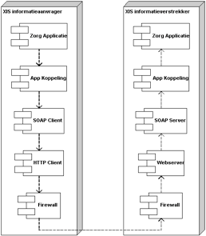
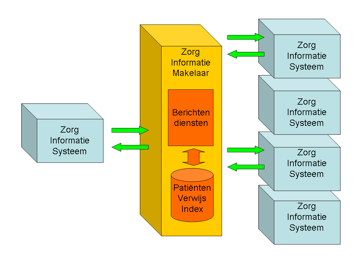

[AORTA 8.5.2](../../../index.md) / [Aansluit- en Implementatiewijzer Kern](../../../aansluit-en-implementatiewijzer-kern.md) / [Berichttransport](../../berichttransport.md) / [AORTA_Trp_IH_Berichttransport](../aorta_trp_ih_berichttransport.md)

# Informatiestromen

## AORTA en gegevensuitwisseling

In AORTA vindt gegevensuitwisseling plaats op basis van SOAP/HTTP over met TLS beveiligde verbindingen en hierbij zijn webservices beschreven in WSDL.

WSDL is, strikt gesproken, optioneel. Veel tools genereren op basis van WSDL een deel van de code. Het is echter ook mogelijk de webservice te bouwen zonder WSDL, en in die zin is gebruik van WSDL optioneel.

## Globaal overzicht informatiestroom

Een SOAP-interactie kent een client en een server. De SOAP client stuurt een request naar de server via HTTP, en ontvangt het antwoord via HTTP.

Een dergelijke interactie stelt verschillende eisen aan de client en de server. Een client hoeft alleen een verbinding te hebben en beschikbaar te zijn op het moment dat de aanroep gedaan wordt. De server zal echter continu moeten luisteren op een poort of er een aanroep binnenkomt. De pijlen in Figuur 4 geven het verloop van een SOAP request aan. Een response volgt de omgekeerde weg.

Figuur 4 - AORTA interactie

## SOAP en de ZIM

In bovenstaande beschrijving is alleen gesproken over berichtenuitwisseling tussen een client en een server. In AORTA worden berichten echter grotendeels uitgewisseld tussen een client en server via de Zorg Informatie Makelaar (ZIM), zie Figuur 5.

Figuur 5 - Berichtenuitwisseling via de ZIM

*Voorbeeld van AORTA berichtenuitwisseling.*

Een ziekenhuis vraagt een overzicht van medicijnverstrekkingen voor een patiënt op. De opvraging van het ziekenhuis is geadresseerd aan de ZIM. De ZIM is verantwoordelijk voor het opzoeken van de applicaties die deze gegevens kunnen leveren en zendt de opvraging door aan één of meer applicaties. De ZIM zal de adressering van de berichten aanpassen: deze doorgezonden opvragingen zijn geadresseerd aan de zorginstellingen die over de gevraagde medicatiegegevens beschikken. Alle berichten zijn SOAP berichten. In SOAP client/server terminologie betekent dit het volgende. Het opvragende, initiërende zorg informatiesysteem is client, de ZIM fungeert als server voor dit systeem. Wanneer de ZIM de opvragingen doorstuurt is de ZIM client en zijn de reagerende zorg informatiesystemen die de gevraagde gegevens opleveren server. De ZIM is vervolgens weer, als server, verantwoordelijk voor het doorsturen van de antwoorden aan het initiërende ziekenhuis.

*Voorbeeld van AORTA berichtenuitwisseling o.b.v. context.*

Een ziekenhuis vraagt een overzicht van medicijnverstrekkingen voor een patiënt op. In het opvraagbericht wordt de juiste contextcode opgenomen behorende bij “het opvragen van een overzicht van medicijnverstrekkingen”. De opvraging van het ziekenhuis is geadresseerd aan de ZIM. De ZIM is verantwoordelijk voor het opzoeken van de applicaties die deze gegevens kunnen leveren. Hiervoor zoekt de ZIM de juiste bouwstenen op behorende bij de context en bepaalt welke bouwsteeninteracties verzonden moeten worden naar welke bronsystemen. Het is mogelijk dat een bronsysteem meerdere bouwsteeninteracties ontvangt. Alle berichten zijn SOAP berichten. In SOAP client/server terminologie betekent dit het volgende. Het opvragende, initiërende zorg informatiesysteem is client, de ZIM fungeert als server voor dit systeem. Wanneer de ZIM de opvragingen doorstuurt is de ZIM client en zijn de reagerende zorg informatiesystemen die de gevraagde gegevens opleveren server. De ZIM is vervolgens weer, als server, verantwoordelijk voor het doorsturen van de antwoorden aan het initiërende ziekenhuis. Het doorsturen van de ontvangen antwoorden gebeurt met behulp van een batchwrapper. Alle antwoorden zijn hiermee opgenomen in één antwoordbericht.
