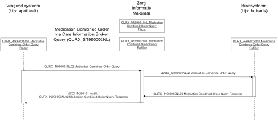

[AORTA 8.5.2](../../../index.md) / [Aansluit- en Implementatiewijzer Kern](../../../aansluit-en-implementatiewijzer-kern.md) / [Berichttransport](../../berichttransport.md) / [AORTA_Trp_IH_Berichttransport](../aorta_trp_ih_berichttransport.md)

# XML, SOAP en HTTP

## XML

Berichten worden uitgewisseld in XML 1.0.

UTF-8 is voor XML de meest gangbare Unicode-encoding. Encoding wordt aangegeven in een XML-prolog:

```
<?xml version="1.0" encoding="utf-8"?>
```

Berichten worden uitgewisseld en gelogd in UTF-8 encoding.

## SOAP berichtformaat

Berichten worden verpakt volgens de SOAP 1.1 standaard.

Het HL7v3-bericht wordt opgenomen in de SOAP Body van de SOAP Envelope.

Hieronder staat een voorbeeld van een HL7v3-bericht dat is verpakt in een SOAP Envelope. Het betreft een opvraag van medicatieverstrekkingen. De voorbeelden in dit document gaan uit van een opvraag met behulp van een zorgtoepassing specifieke interactie. De opbouw van een generieke interactie is in grote lijnen hetzelfde. Eventuele afwijkingen ten opzichte van de voorbeelden worden in het hoofdstuk besproken.

| CODE  `<?xml version="1.0" encoding="utf-8"?> <soapenv:Envelope xmlns:soapenv="http://schemas.xmlsoap.org/soap/envelope/" xmlns:xsi="http://www.w3.org/2001/XMLSchema-instance"> <soapenv:Body> <QURX_IN990111NL xmlns="urn:hl7-org:v3"> <id extension="0032616767" root="2.16.840.1.113883.2.4.6.2.451.12.21"/> <creationTime value="20040910170245"/> ... andere elementen van de Transmission Wrapper... <ControlActProcess moodCode="EVN"> <subject> <QueryByParameterPayload> ... verdere inhoud ... </QueryByParameterPayload> </subject> </ControlActProcess> </QURX_IN990111NL> </soapenv:Body> </soapenv:Envelope>` |
| --- |

Het voorbeeld is hieronder in stukken geknipt en van commentaar voorzien.

De prolog met UTF-8 declaratie.

| CODE  `<?xml version="1.0" encoding="utf-8"?>` |
| --- |

SOAP Envelope met daarin namespace declaraties.

| CODE  `<soapenv:Envelope xmlns:soapenv="http://schemas.xmlsoap.org/soap/envelope/" xmlns:xsi="http://www.w3.org/2001/XMLSchema-instance">` |
| --- |

SOAP Body met daarin het omsluitende element van de opvraging van medicatieverstrekkingen. Omdat dit element de HL7v3-namespace tot default namespace maakt, maken alle elementen daarin automatisch deel uit van de HL7v3-namespace.

```
 <soapenv:Body>

    <QURX_IN990111NL xmlns="urn:hl7-org:v3"> 
```

Elementen uit de Transmission Wrapper van HL7v3.

| CODE  `<id extension="0032616767" root="2.16.840.1.113883.2.4.6.2.451.12.21"/> <creationTime value="20040910170245"/> ... andere elementen van de Transmission Wrapper...` |
| --- |

De Control Act Wrapper.

| CODE  `<ControlActProcess moodCode="RQO"> <subject>` |
| --- |

Het feitelijke bericht, een opvraging naar medicatie van een bepaald PatientId.

| CODE  `<QueryByParameterPayload> ... verdere inhoud ... </QueryByParameterPayload>` |
| --- |

Afsluiting van de onderdelen.

| CODE  `</subject> </ControlActProcess> </QURX_IN990111NL> </soapenv:Body> </soapenv:Envelope>` |
| --- |

## SOAP Header attributen

Er zijn verschillende soorten SOAP Headers mogelijk. De beveiliging implementatiehandleidingen [IH BA DigiD]  
[IH BA PKIO-pas][IH BA Transactietoken][IH BA Mandaattoken][IH BA Inschrijftoken] [IH tokens generiek] beschrijven deze headers. Deze paragraaf beschrijft de mogelijke attributen van SOAP-headers.

SOAP 1.1 kent twee attributen voor headers, namelijk “actor” en “mustUnderstand”. De hierna volgende paragrafen beschrijven deze achtereenvolgens.

### SOAP actor

SOAP headers kunnen verschillende bestemmingen hebben. AORTA kent de Zorg Informatie Makelaar (ZIM) en het Goed Beheerde Informatiesysteem (GBx),   
zie [Arch AORTA] voor een uitleg van deze begrippen.

Het attribuut soap:actor geeft aan welke "actor" een bepaalde header moet verwerken. Met de soap:actor wordt in AORTA een functie aangegeven: bijvoorbeeld de ZIM of het GBx dat als eindbestemming dient. De soap:actor geeft in AORTA dus geen adres van een specifiek GBx.

| CODE  `<soap:Header xmlns:soap="http://schemas.xmlsoap.org/soap/envelope/"> ... <wss:Security xmlns:wss= "http://docs.oasis-open.org/wss/oasis-wss-wssecurity-secext-1.1.xsd" soap:actor="http://www.aortarelease.nl/actor/gbx" soap:mustUnderstand="1"> ... </wss:Security> </soap:Header>` |
| --- |

Voor de headers voor tokenauthenticatie en andere headers gericht aan de ZIM wordt aangeraden de waarde [http://www.aortarelease.nl/actor/zim](http://www.aortarelease.nl/actor/zim) te gebruiken. Voor headers gericht op een GBx is de waarde [http://www.aortarelease.nl/actor/gbx](http://www.aortarelease.nl/actor/gbx) verplicht.

| CODE  `<ao:authenticationTokens ... soap:actor="http://www.aortarelease.nl/actor/zim"> <wss:Security ... soap:actor="http://www.aortarelease.nl/actor/gbx">` |
| --- |

Andere waarden voor actor zijn niet toegestaan. De ZIM dient een header gericht aan een GBx ongewijzigd door te geven aan het GBx van bestemming.

### SOAP mustUnderstand

Het SOAP mustUnderstand attribuut geeft aan of de ontvanger de header moet verwerken. Dit geldt voor de bestemming (actor) van de header, zoals beschreven in voorgaande [paragraaf 4.3.1](xml-soap-en-http.md#XML,SOAPenHTTP-SOAPactor). Het mustUnderstand attribuut werkt dus samen met het actor attribuut. Een ontvanger die niet de bestemming van de header vertegenwoordigt, dus niet de actor is, verwerkt de header sowieso niet. De ZIM moet een header zonder actor interpreteren alsof die voor de ZIM bedoeld is.

De waarde van het mustUnderstand attribuut kan “1” of “0” zijn. Afwezigheid van het mustUnderstand attribuut is gelijk aan waarde “0”.

Als de header een SOAP mustUnderstand attribuut bevat met waarde “1”, dan is de actor verplicht om deze header correct te verwerken òf moet de actor het gehele bericht weigeren met een SOAP:MustUnderstand fout, zie [paragraaf 4.5.2](xml-soap-en-http.md#XML,SOAPenHTTP-SOAPFaults).

Als de header een SOAP mustUnderstand attribuut bevat met waarde “0”, dan mag de actor deze header verwerken, maar het hoeft niet. Het is dan niet toegestaan om een SOAP mustUnderstand fout te genereren ten gevolge van deze header.

## HTTP Binding

HTTP voegt aan een te transporteren document – bijvoorbeeld een SOAP-document – een aantal HTTP Headers toe. HTTP uitwisseling vindt altijd in paren plaats – een HTTP request wordt beantwoord met een HTTP response. HTTP kent een aantal verschillende methoden – zoals GET (opvragen van een resource), PUT (afleveren van een resource) en POST (wijzigen van een resource). Voor SOAP is alleen POST van belang.

SOAP 1.1 definieert een binding op HTTP waarbij SOAP requests en responses met HTTP POST worden uitgewisseld. Daarbij wordt het SOAP request als HTTP request met de method POST verzonden naar een server, die (behoudens fouten) een SOAP response, verpakt in een HTTP response, terugzendt als antwoord op de POST. Hieronder een voorbeeld van een SOAP request – response over HTTP. Dit voorbeeld is gebaseerd op het volgende interactiediagram, een fragment van “medicatieverstrekkingen opvragen”.



Figuur 6 – Interactiediagram “medicatieverstrekkingen opvragen”

Hieronder het verzoek, dus zowel het HTTP als het SOAP request, als de HL7v3-interactie QURX_IN990111NL (Medication Dispense List Query).

| CODE  `POST /VerstrekkingsLijstquery HTTP/1.1 Host: www.zim.nl SOAPAction: "urn:hl7-org:v3/VerstrekkingsLijstquery_QueryResponse" Connection: Close Content-Length: 1874 Content-Type: text/xml; charset=UTF-8 <?xml version="1.0" encoding="utf-8"?> <soapenv:Envelope xmlns:xsi="http://www.w3.org/2001/XMLSchema-instance" xmlns:soapenv="http://schemas.xmlsoap.org/soap/envelope/"> <soapenv:Body> <QURX_IN990111NL xmlns="urn:hl7-org:v3"> ... inhoud ... </QURX_IN990111NL> </soapenv:Body> </soapenv:Envelope>` |
| --- |

Eerst wordt de HTTP methode genoemd (POST), en de versie, dan volgen een aantal headers met HTTP gegevens. SOAP 1.1 verplicht het noemen van "text/xml" als Content-Type.

|  | Merk op: de HTTP Header "Content-Type" moet waarde "text/xml" bevatten. ; |
| --- | --- |

SOAP 1.1 verplicht het gebruik van een SOAPAction HTTP Header bij SOAP over HTTP. De quotes eromheen zijn verplicht volgens het WS-I Basic Profile, om te voorkomen dat een header met en zonder quotes als verschillend geïnterpreteerd kunnen worden. Een HTTP Server kan deze SOAPAction gebruiken om het verkeer binnen een Goed Beheerd Zorgsysteem (GBZ), Goed Beheerd Patiëntenportaal (GBP), Goed Beheerd Klantenloket (GBK) of ZIM verder te routeren naar de verwerkende applicatie zonder het SOAP bericht zelf te hoeven openen.

Hieronder een voorbeeld van de HTTP response op de POST methode. Dit is tevens de SOAP response, en de HL7v3-interactie QURX_IN990113NL (Medication Dispense List Query Response):

| CODE  `HTTP/1.1 200 OK Content-Length: 7904 Content-Type: text/xml;charset=utf-8 Date: Wed, 03 Feb 2010 12:59:18 GMT Server: Apache-Coyote/1.1 <?xml version="1.0" encoding="utf-8"?> <soapenv:Envelope xmlns:soapenv="http://schemas.xmlsoap.org/soap/envelope/" xmlns:xsi="http://www.w3.org/2001/XMLSchema-instance"> <soapenv:Body> <QURX_IN990113NL xmlns="urn:hl7-org:v3"> ... inhoud ... </QURX_IN990113NL> </soapenv:Body> </soapenv:Envelope>` |
| --- |

Eerst wordt de HTTP-versie aangegeven en de status (200 OK). Vervolgens weer enige HTTP Headers en dan de SOAP Envelope.

Het is belangrijk in te zien dat er requests / responses zijn op drie verschillende niveaus:

- een HTTP request / response paar

- een SOAP request / response paar

- een HL7v3-interactie en een HL7v3-antwoordinteractie.

Deze drie niveaus zijn in principe onafhankelijk van elkaar. In dit voorbeeld is er voor gekozen het HL7v3-antwoord in de SOAP response te verpakken, en die weer in de HTTP response. Dit is echter niet noodzakelijk. Het is bijvoorbeeld heel goed mogelijk de HL7v3-interactie in een apart HTTP request/response paar te verpakken, en het HL7v3-antwoord in een tweede HTTP request/response paar. De HTTP Binding van SOAP bepaalt de manier waarop een SOAP request en response op HTTP afgebeeld worden. De SOAP Binding van HL7v3 bepaalt de wijze waarmee een HL7v3-request en -response (bijvoorbeeld een QueryContinuation en QueryResponse) afgebeeld worden op SOAP.

In AORTA is er, behoudens HTTP- en SOAP-fouten, altijd een HTTP Response met daarin een SOAP Body die een HL7v3-interactie bevat. Een SOAP request/response paar wordt dus gebonden op één HTTP request/response paar en er wordt voor deze response altijd een HL7v3-interactie gemodelleerd.

## Bij HTTP- en SOAP-fouten kan niet altijd een HL7v3-bericht en/of SOAP response worden geconstrueerd.HTTP errors en SOAP Faults

Foutafhandeling kan plaatsvinden op diverse niveaus. Fouten op TCP-niveau of lager in de stack (IP tot en met fysiek medium) worden hier niet besproken. Relevant zijn fouten op de volgende niveaus:

- HTTP;

- SOAP;

- HL7v3.

Bij alle fouten moet onderscheid gemaakt worden tussen foutsituaties waarbij de fout ligt bij het bericht dat ingezonden wordt (client fouten) en de server (server fouten). Wanneer er iets mis is met het bericht (volgens de ontvanger), is het niet zinvol hetzelfde bericht later nogmaals te sturen: dat zal tot dezelfde fout leiden. Wanneer er iets mis is met de server, is dat vaak tijdelijk. Dan is later opnieuw proberen wel zinvol.

| **Protocol** ; | **Client fouten** ; | **Server fouten** ; |
| --- | --- | --- |
| HTTP ; | HTTP statuscode in de range 4xx ; | HTTP statuscode in de range 5xx ; |
| SOAP ; | soap:Client faults ; | soap:Server faults ; |
| HL7v3 ; | Error met typecode CE (Commit Error) ; | Error met typecode CR (Commit Reject) ; |

Bij alle fouten heeft het de voorkeur in beschikbare tekst elementen (zoals SOAP:detail of HTTP Body) meer informatie op te nemen omtrent de fout.

### HTTP-foutsituaties

|  | AORTA volgt de door WS-I Basic Profile gedefinieerde richtlijnen voor HTTP-fouten bij gebruik van SOAP. ; |
| --- | --- |

De meest relevante richtlijnen zijn opgenomen in onderstaande tabel.

| Code ; | Basic Profile tekst ; | Toelichting ; |
| --- | --- | --- |
| R1140 ; | A MESSAGE SHOULD be sent using HTTP/1.1. ; |  |
| R1107 ; | A RECEIVER MUST interpret SOAP messages containing only a soapenv:Fault element as a Fault. ; | Een applicatie mag dus niet alleen naar HTTP 200 OK kijken voor het bepalen van het succes. Hetzelfde geldt voor HL7v3-fouten: als het HL7v3-bericht een foutsituatie aangeeft, is het een fout, ook al is de HTTP status 200 OK. ; |
| R1111 ; | An INSTANCE SHOULD use a "200 OK" HTTP status code for responses that contain a SOAP message that is not a SOAP fault. ; | Aanbevolen wordt om alleen HTTP 200 OK te gebruiken als HTTP succes code. ; |
| R1124 ; | An INSTANCE MUST use a 2xx HTTP status code for responses that indicate a successful outcome of a request. ; | Ontvangers dienen HTTP responses met andere 2xx succes statussen wel te kunnen accepteren. ; |
| R1125 ; | An INSTANCE MUST use a 4xx HTTP status code for responses that indicate a problem with the format of the request. ; |  |
| R1113 ; | An INSTANCE SHOULD use a "400 Bad Request "HTTP status code, if the request message is a malformed HTTP request, or not well-formed XML. ; |  |
| R1126 ; | An INSTANCE MUST use a "500 Internal Server Error" HTTP status code if the response message is a SOAP Fault. ; |  |

De ontvanger van een HTTP response dient de HTTP status te controleren, en alle geldige HTTP statussen te accepteren en behandelen. Met name de HTTP "408 Request Timeout" dient behandeld te worden, zie hoofdstuk 6.

### SOAP Faults

SOAP kent een Fault element dat onderdeel is van de SOAP Body en daar maar één keer mag voorkomen. Het SOAP Fault element heeft vier subelementen, hieronder kort toegelicht.

faultcode

Een verplicht element. De waarde van dit element moet namespace gekwalificeerd zijn. SOAP kent zelf vier foutcodes die verderop in deze paragraaf genoemd worden.

faultstring

Een verplicht element die een voor mensen leesbare uitleg bevat over de aard van de opgetreden fout.

faultactor

Dit element is bedoeld om informatie te geven over wie de fout gegenereerd heeft. Het lijkt op het SOAP actor attribuut, maar geeft de bron van de fout aan in plaats van het einddoel van de header. Applicaties die niet het eindpunt (ultimate destination) zijn van het SOAP bericht, moeten het faultactor element opnemen. Applicaties die wel het einddoel zijn, mogen het faultactor element opnemen.

Voor fouten gegenereerd door de ZIM is de waarde "[http://www.aortarelease.nl/actor/lsp](http://www.aortarelease.nl/actor/lsp)" verplicht (NB: deze waarde komt niet overeen met die van de SOAP actor, zie par 4.3.1). Voor fouten gegenereerd door de GBx wordt aangeraden de waarde "[http://www.aortarelease.nl/actor/gbx](http://www.aortarelease.nl/actor/gbx)" te gebruiken. Andere waarden voor faultactor zijn niet toegestaan.

detail

Het element detail is bedoeld voor applicatie specifieke foutinformatie die gerelateerd is aan het Body element van het SOAP request. Het is verplicht wanneer de inhoud van het Body element niet succesvol verwerkt kon worden. Het mag niet gebruikt worden voor foutinformatie over de header. Wanneer het element detail aanwezig is, betekent dit dat de fout gerelateerd is aan de verwerking van het element Body. Wanneer het element detail niet aanwezig is, dan is de fout niet gerelateerd aan de verwerking van het element Body.

SOAP kent de faultcodes zoals opgesomd in onderstaande tabel. Deze faultcodes kunnen worden opgenomen in het element faultcode en moeten dan ook namespace gekwalificeerd zijn.

| **Naam** ; | **Toelichting** ; |
| --- | --- |
| VersionMismatch ; | De SOAP Envelope heeft een ongeldige namespace, wat gebruik van een SOAP-versie die niet ondersteund wordt kan aangeven. Wanneer de SOAP Envelope een andere namespace heeft dan ""[http://schemas.xmlsoap.org/soap/envelope/](http://schemas.xmlsoap.org/soap/envelope/)" MOET deze Fault gegenereerd worden. ; |
| MustUnderstand ; | Er is een SOAP Header aanwezig die niet bekend is, maar met mustUnderstand = "1". In dit geval MOET deze Fault gegenereerd worden. ; |
| Client ; | Deze Faults kunnen gebruikt worden bij syntaxfouten in het SOAP bericht of HL7v3-payload. Het gaat daarbij bijvoorbeeld om berichten die niet voldoen aan de wsdl. Voor semantische fouten in de HL7v3-payload gebruikt AORTA HL7v3-foutberichten (Accept Acknowledgements). Een applicatie is niet verplicht zelf SOAP Client Faults te gebruiken, maar dient ze wel te accepteren. ; |
| Server ; | Deze Fault mag alleen gebruikt worden wanneer de ontvangende applicatie niet in staat is de HL7v3-payload te verwerken omdat de lokale HL7v3-applicatie niet beschikbaar is. Een applicatie is niet verplicht zelf SOAP Server Faults te gebruiken, maar dient ze wel te accepteren. ; |

Het WS-I Basic Profile definieert een aantal richtlijnen voor het gebruik van SOAP Faults. De meest relevante zijn opgenomen in onderstaande tabel.

| **Code** ; | **Basic Profile tekst** ; | **Toelichting** ; |
| --- | --- | --- |
| R1000 ; | When a MESSAGE contains a soapenv:Fault element, that element MUST NOT have element children other than faultcode, faultstring, faultactor and detail ; | SOAP staat dit wel toe, maar WS-I Basic Profile dus niet. ;  Het child element detail, mag zelf wel child elementen hebben, zie ook R1002. ; |
| R1001 ; | When a MESSAGE contains a soapenv:Fault element its element children MUST be unqualified ; | Dus faultcode, faultstring, faultactor and detail moeten unqualified zijn. ; |
| R1002 ; | A RECEIVER MUST accept fault messages that have any number of elements, including zero, appearing as children of the detail element. Such children can be qualified or unqualified. ; | AORTA laat het gebruik van het detail element in principe vrij. Echter, het gebruik van de gekwalificeerde child elementen code en text wordt aanbevolen. Zie hieronder voor de voorbeelden. ; |
| R1003 ; | A RECEIVER MUST accept fault messages that have any number of qualified or unqualified attributes, including zero, appearing on the detail element. The namespace of qualified attributes can be anything other than "[http://schemas.xmlsoap.org/soap/envelope/](http://schemas.xmlsoap.org/soap/envelope/)". ; | AORTA laat de te gebruiken namespaces voor de child elementen van het detail element vrij. Echter, het gebruik van de volgende namespace is een suggestie: [http://www.aortarelease.nl/actor/[specificpart]/soapFault/detail](http://www.aortarelease.nl/actor/[specificpart]/soapFault/detail). ;  Bijvoorbeeld voor de ZIM: ;  http:// [www.aortarelease.nl/actor/lsp/soapFault/detail](http://www.aortarelease.nl/actor/lsp/soapFault/detail) ;  en bijvoorbeeld voor het GBK: ;  http:// [www.aortarelease.nl/actor/gbk/soapFault/detail](http://www.aortarelease.nl/actor/gbk/soapFault/detail). ; |
| R1016 ; | A RECEIVER MUST accept fault messages that carry an xml:lang attribute on the faultstring element. ; | Het attribuut xml:lang geeft aan in welke taal de faultstring staat. In AORTA is alleen nederlands of engels toegestaan en is het gebruik van het attribuut xml:lang voor de zender optioneel. ; |
| R1004 ; | When a MESSAGE contains a faultcode element the content of that element SHOULD be one of the fault codes defined in SOAP 1.1 or a namespace qualified fault code. ; | Een gekwalificeerde foutcode is toegestaan, dus bijvoorbeeld: ;  zim:AUTERR ;  Waarbij de prefix zim in een bijbehorend xmlns:zim attribuut correct gedefinieerd moet worden. ; |
| R1031 ; | When a MESSAGE contains a faultcode element the content of that element SHOULD NOT use of the SOAP 1.1 "dot" notation to refine the meaning of the Fault. ; | AORTA staat het gebruik van de zogenaamde “dot” notatie niet toe. ; |

Ter illustratie hieronder een voorbeeld van een correcte en een incorrecte SOAP Fault in AORTA.

| CORRECT: ;   CODE  `<soapenv:Fault xmlns:soap='http://schemas.xmlsoap.org/soap/envelope/' > <faultcode>soapenv:Client</faultcode> <faultstring>Het input document is niet valide.</faultstring> <faultactor>http://www.aortarelease.nl/actor/lsp</faultactor> <detail> <lsp:code xmlns:lsp= 'http://www.aortarelease.nl/actor/lsp/soapFault/detail'> MissingMandatoryElement </lsp:code> <lsp:text xmlns:lsp= 'http://www.aortarelease.nl/actor/lsp/soapFault/detail'> Een verplicht element mist in het input document: ….. </lsp:text> </detail> </soapenv:Fault>` |
| --- |

| INCORRECT: ;   CODE  `<soapenv:Fault xmlns:soap='http://schemas.xmlsoap.org/soap/envelope/' > <!-- Onderstaande is fout omdat "dot" notatie niet is toegestaan --> <faultcode>soapenv:Client.ZIM.XSD_VALIDATION_ERR</faultcode> <!-- Onderstaande is fout omdat child elementen van soapenv:Fault niet namespace gekwalificeerd mogen zijn --> <soapenv:faultstring> Het input document is niet valide</soapenv:faultstring> <soapenv:faultactor>http://www.aortarelease.nl/actor/lsp</soapenv:faultactor> <detail> <code>MissingMandatoryElement</code> <text>Een verplicht element mist in het input document: …..</text> <lsp:extraInfo xmlns:lsp= 'http://www.zim.nl/soapFault/detail'> Het missende element is verplicht geworden in release…. </lsp:extraInfo> </detail> </soapenv:Fault>` |
| --- |

|  | Bij ontvangst van een bericht dat geen well-formed XML bevat, wordt bij voorkeur een HTTP response met status 400 'Bad Request' gegeven. Een applicatie dient ook rekening te houden met een SOAP Client Fault of een HL7v3 Accept Acknowledgement Error. ; |
| --- | --- |

Dit omdat het niet exact te bepalen is welke fouten een applicatie het eerst dient te signaleren. Er is bijvoorbeeld geen verplichting eerst het hele XML-document te parsen om op well-formedness te controleren voordat verdere verwerking plaatsvindt. Bij niet well-formed XML hoeft geen SOAP Fault of HL7v3-error gegeven te worden.

|  | Een applicatie dient altijd op een bericht te reageren - uiteraard zolang de applicatie überhaupt tot reageren in staat is. Een uitzondering is wanneer een applicatie reden heeft aan te nemen dat er sprake is van een malicieuze actie, zoals een Denial Of Service aanval. ; |
| --- | --- |

|  | Wanneer een applicatie niet op HL7v3-niveau kan reageren, bijvoorbeeld omdat er geen zinnige HL7v3-interactie uit het bericht te destilleren valt, of omdat er geen geschikte HL7v3-reactie voorhanden is, heeft de volgende reactie de voorkeur: ;  · als er een fout is in de SOAP syntax, (bijvoorbeeld soapenv:Envelope zonder soapenv:Body of soapenv:Fault): een SOAP Client Fault, met HTTP status 500 'Internal Server Error'; ;  · als er een andere fout is in de syntax, een reactie met HTTP status 400 'Bad Request'; ;  · wanneer er geen fout is in de syntax, maar er serverproblemen zijn, een reactie met HTTP Status 500 'Internal Server Error', eventueel gevuld met een SOAP Server Fault. ; |
| --- | --- |

|  | Bij foutafhandeling dient het principe gevolgd te worden: "wees strikt in wat je zendt, en tolerant bij fouten die je ontvangt". De afhandeling als hier geschetst heeft de voorkeur, bij ontvangst van onverwachte fouten dient een applicatie echter adequaat te reageren, bijvoorbeeld door de fout te loggen voor menselijke afhandeling. ; |
| --- | --- |

RFC 2616 (HTTP/1.1) beveelt het gebruik van een entity (HTTP berichtinhoud) aan bij een response met status 4xx of 5xx. "... Except when responding to a HEAD request, the server SHOULD include an entity containing an explanation of the error situation, and whether it is a temporary or permanent condition." Aanbevolen wordt uiteraard RFC 2616 hier te volgen. Deze specificatie geeft geen verdere richtlijnen voor de op te nemen boodschap. In de meeste gevallen zullen de toelichtingen bestemd zijn voor menselijk gebruik (systeembeheerders en applicatieontwikkelaars), omdat het ernstige fouten betreft.

### HL7v3-fouten

HL7v3 kent eigen foutberichten. Deze vallen buiten de scope van dit document. Wel wordt in de tabel hieronder aangegeven welke HTTP status gebruikt dient te worden bij HL7v3-fouten.

| Code ; | Naam ; | Toelichting (zie HL7v3 voor details) ; | HTTP Status ; |
| --- | --- | --- | --- |
| AA ; | Application Acknowledgement Accept ; | Succesvolle verwerking. ; | 200 OK ; |
| AE ; | Application Acknowledgement Error ; | Fout in bericht (permanent). ; | 200 OK ; |
| AR ; | Application Acknowledgement Reject ; | Fout, maar niet in inhoud of formaat van bericht (tijdelijk). ; | 200 OK ; |
| CA ; | Accept Acknowledgement Commit Accept ; | Geaccepteerd. ; | 200 OK ; |
| CE ; | Accept Acknowledgement Commit Error ; | Niet geaccepteerd (permanent). ; | 200 OK[^1] ; |
| CR ; | Accept Acknowledgement Commit Reject ; | Niet geaccepteerd (tijdelijk). ; | 200 OK ; |

|  | HL7v3 Application en Accept Acknowledgements worden behandeld als succes op HTTP niveau. ; |
| --- | --- |

### Fout bij de ZIM als tussenstation

Wanneer een versturend GBx een bericht zendt aan een ontvangend GBx, kan het ontvangende GBx een foutmelding genereren. De ZIM dient daar als volgt mee om te gaan:

- HL7 foutmeldingen dienen net als een gewoon HL7 antwoord ongewijzigd teruggegeven te worden aan het versturende GBx;

- SOAP Faults dienen net als een gewoon SOAP antwoord ongewijzigd teruggegeven te worden aan het versturende GBx;

- HTTP fouten worden vertaald naar HL7 fouten, waarbij HTTP client fouten naar HL7 client fouten vertaald worden en HTTP server fouten naar HL7 server fouten:HTTP fouten in de 4xx range worden vertaald naar een HL7 SYNGBX error uit LSP-tabel (OID 2.16.840.1.113883.2.4.6.6.1.1000) met typecode CE en als weergavenaam het applicatieId en de HTTP resultaatcode.HTTP fouten in de 5xx range worden vertaald naar een HL7 RTEDEST error uit HL7-tabel (OID 2.16.840.1.113883.5.1100) met typecode CR en als weergavenaam het applicatieId en de HTTP resultaatcode.

In het geval van opvragen van patiëntgegevens door een initiërend GBx wordt een eventuele foutmelding gegenereerd door het reagerende GBX door de ZIM in het batchopleverbericht opgenomen zoals hierboven beschreven. De ZIM zal in het uiteindelijk opleverbericht een extra foutmelding opnemen over de aard van de aanwezige foutmeldingen in het batchopleverbericht.

## HTTP Redirects

Het gebruik van HTTP redirects is niet toegestaan.

In de internationale standaarden die AORTA voorschrijft, met name [Basic Profile], staat dat voor HTTP Redirects alleen 307 gebruikt mag worden. De betekenis van 307 is "temporary redirect". De rest is in [Basic Profile] expliciet verboden vanwege interoperabiliteitsproblemen. In AORTA zijn ook de 307 redirects verboden.

[^1]: In versie 1.1 en eerder was dit "400: Bad Request". Het gebruik van een HTTP status anders dan 2xx voor SOAP berichten die geen SOAP Fault zijn, staat echter op gespannen voet met SOAP 1.1 en WS-I Basic Profile 1.0, en deze beide standaarden worden gevolgd in AORTA. Er was dus sprake van een inconsistentie.
