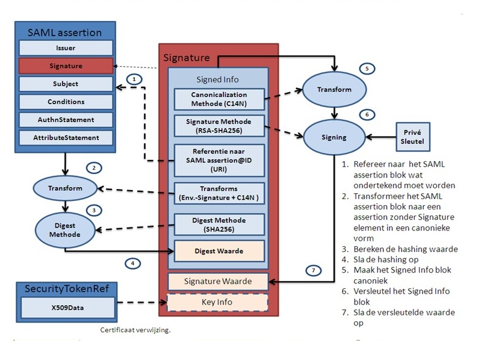

[AORTA 8.5.2](../../index.md) / [Aansluit- en Implementatiewijzer Kern](../../aansluit-en-implementatiewijzer-kern.md) / [Token specificaties](../token-specificaties.md)

# AORTA SAML tokens

AORTA SAML tokens spelen een cruciale rol in de authenticatie en autorisatie binnen het Landelijk Schakelpunt (LSP). Ze zorgen ervoor dat zorgaanbieders en zorgverleners veilig toegang kunnen krijgen tot patiëntgegevens binnen de AORTA-architectuur.

AORTA SAML tokens zijn SAML 2.0 Assertions die digitale waarborgen bieden over de identiteit en rechten van een gebruiker of systeem. Deze waarborgen worden uitgegeven en ondertekend door een Identiteitsprovider (IdP), een systeem van een organisatie of gebruiker die verantwoordelijk is voor de uitgegeven waarborgen die in de assertion (waarborg) worden benoemd. De waarborgen zijn cryptografisch verifieerbaar.

## Waarborgen

De waarborgen in een SAML token kunnen onderverdeeld worden in de volgende typen:

- **Identiteitswaarborg**: Bevestigt de identiteit van de gebruiker of het systeem van een organisatie.Attributen: *Subject NameID, UZI-nummer, URA, BSN, …*

- **Authenticatiewaarborg**: Geeft aan hoe de gebruiker is geauthenticeerd.Attributen: *Authenticatieniveau (bv. eIDAS hoog), gebruikte authenticatiemethode (bv. smartcardPKI of X.509 certificaat)*

- **Autorisatiewaarborg**: Bevat de toegangsrechten en bevoegdheden van de gebruiker.Attributen: *Rolcode, Mandaat (welke handelingen toegestaan zijn), Scope (welke gegevens toegankelijk zijn)*

- **Organisatiewaarborg**: Bevestigt de organisatie waaraan de gebruiker is gekoppeld.Attributen: *Zorgaanbieder (URA), Organisatie-ID, Locatie*

- **Contextuele waarborg**: Bevat extra informatie over de transactie of sessie.Attributen: *Tijdstempel, Geldigheidsduur, Sessie-ID*

De waarborgen in het SAML-token worden gevalideerd door de dienstverlener (SP) die toegang tot het LSP verleent. De dienstverlener of poortwachter tot het LSP is de XSG. Deze bepaalt op basis van de SAML Assertions of een gebruiker toegang krijgt tot de gevraagde informatie.

De Identiteitsprovider in de AORTA-architectuur speelt hierbij een cruciale rol in de authenticatie en autorisatie en is direct gekoppeld aan de verschillende typen uitgegeven certificaten. De IdP gebruikt de certificaten, die o.a. op de UZI-passen staan, om de identiteit en rechten van zorgverleners, zorgmedewerkers op naam en systemen van zorgaanbieders te verifiëren en te waarborgen binnen het LSP. Dit onderscheid is nodig omdat *zorgverleners*, *zorgmedewerkers*op naam en *systemen*van zorgaanbieders elk een andere rol en verantwoordelijkheden hebben binnen de AORTA-architectuur en het Landelijk Schakelpunt (LSP).

We hebben de volgende SAML Assertions, die verschillende waarborgen bevatten.

- **Transactietoken**. Bevat waarborgen over de transactie context, de identiteit van de gebruiker, authenticatiemiddel, rol en zorgaanbieder.

- **Mandaattoken**. Bevat waarborgen over de identiteit, rol en zorgaanbieder welke *zorgverlener*het mandaat heeft uitgegeven. Alleen *zorgverleners*geven een mandaat.

- **Inschrijftoken**. Bevat waarborgen over de identiteit, rol en zorgaanbieder welke *zorgmedewerker of zorgverlener*de BSN verificatie van een patiënt heeft uitgevoerd.

| **Transactietoken ondertekend met** ; | **Mandaattoken ondertekend met** ; | **Inschrijftoken ondertekend met** ; | **Valide** ; |
| --- | --- | --- | --- |
| UZI server-certificaat ; | Zorgverlenerspas ; | Niet ; | Nee ; |
| UZI server-certificaat ; | Zorgverlenerspas ; | Zorgverlenerspas ; | Ja ; |
| UZI server-certificaat ; | Zorgverlenerspas ; | Medewerkerspas op naam ; | Ja ; |
| UZI server-certificaat ; | Zorgverlenerspas ; | ZORG-ID Mobiel ; | Ja ; |
| UZI server-certificaat ; | Zorgverlenerspas ; | ZORG-ID Smartcard ; | Nog in ontwikkeling. ; |
| UZI server-certificaat ; | Medewerkerspas op naam ; | Zorgverlenerspas ; | Nee ; |
| Medewerkerspas op naam ; | Zorgverlenerspas ; | Niet ; | Nee ; |
| Medewerkerspas op naam ; | Zorgverlenerspas ; | Zorgverlenerspas ; | Ja ; |
| Medewerkerspas op naam ; | Zorgverlenerspas ; | Medewerkerspas op naam ; | Ja ; |
| Medewerkerspas op naam ; | Zorgverlenerspas ; | ZORG-ID Mobiel ; | Ja ; |
| ZORG-ID Smartcard ; | Zorgverlenerspas ; | Zorgverlenerspas ; | Nog in ontwikkeling ; |
| Medewerkerspas op naam ; | Medewerkerspas op naam ; | Zorgverlenerspas ; | Nee ; |
| Zorgverlenerspas ; | Niet nodig ; | Niet nodig ; | Ja ; |

- Indien het transactietoken door het *systeem van een zorgaanbieder*wordt ondertekend MOET er ook een mandaattoken en een inschrijftoken als waarborg meegestuurd worden.

- Indien het transactietoken door een *zorgmedewerker op naam* wordt ondertekend MOET er ook een mandaattoken en een inschrijftoken als waarborg meegestuurd worden.

- Alleen een *zorgverlener*mag een mandaattoken ondertekenen als waarborg.

- Het inschrijftoken mag zowel door een *zorgmedewerker op naam* als door een *zorgverlener*ondertekend worden.

- Het *systeem van een zorgaanbieder*mag geen inschrijftoken ondertekenen als waarborg.

## Vertrouwensniveaus

Verschillende vertrouwensniveaus zijn gebaseerd op de mate van zekerheid die nodig is voor authenticatie en identificatie van gebruikers, en zijn afgeleid van de kaders zoals de NEN7510, eIDAS en de architectuur van AORTA.

Hieronder een samengesteld overzicht van vertrouwensniveaus gericht op het LSP.

- **Vertrouwensniveau: Laag**

- **Toepassing**: Toegang tot informatie met beperkte risico’s of niet-zorginhoudelijke gegevens (bijvoorbeeld systeemstatus of algemene berichten).

- **Identiteitsvaststelling**: Zelf aangemelde gegevens, minimale verificatie. Voor Nederlandse ingezetenen betreft dit de Basisregistratie Personen (BRP).

- **Authenticatie**: één factorauthenticatie, zoals gebruikersnaam en wachtwoord.

- **Beveiligingseisen**: Basismaatregelen, zoals TLS-versleuteling.

- **Risico**: Geschikt voor toepassingen waarbij een lage mate van zekerheid volstaat.

- **Vertrouwensniveau: Midden**

- **Toepassing**: Zorginhoudelijke gegevens waarvoor enige mate van zekerheid over de identiteit van de gebruiker vereist is, bijvoorbeeld bij inzage door zorgverleners.

- **Identiteitsvaststelling**: Identiteitsverificatie op basis van een erkend middel zoals ZORG-ID Smart of een UZI-servercertificaat.

- **Authenticatie**: twee factorauthenticatie (2FA), bijvoorbeeld:Gebruikersnaam + wachtwoord én een SMS-code.UZI-servercertificaat (voor server-naar-servercommunicatie).

- **Beveiligingseisen**: Versleuteling (bijvoorbeeld PKIoverheid-certificaten) en controle op herkomst en integriteit van gegevens. Er moet sprake zijn van dynamische authenticatie. Dit betekent dat de (cryptografische) gegevens voor de authenticatie veranderen bij ieder gebruik.

- **Risico**: Voor toepassingen waarbij vertrouwelijkheid en integriteit essentieel zijn, zoals het opvragen van patiëntinformatie door zorgmedewerkers als ze geautoriseerd zijn of mandaat hebben.

- **Vertrouwensniveau: Hoog**

- **Toepassing**: Kritieke interacties zoals het versturen van voorschriften, autoriseren van behandelingen, of toegang tot gevoelige patiëntgegevens.

- **Identiteitsvaststelling**: Tenminste éénmaal fysieke identiteitscontrole bij registratie, bijvoorbeeld een UZI-pas gekoppeld aan het BIG-register om ***zorgverleners***te identificeren en te verifiëren.

- **Authenticatie**: Sterke authenticatie, zoals:UZI-pas (PKIoverheid-certificaten).

- **Beveiligingseisen**: Gebruik van digitale handtekeningen en encryptie met hoge sterkte, logging van alle transacties.

- **Risico**: Voor toepassingen waar maximale zekerheid vereist is vanwege juridische of veiligheidsrisico’s.

Zorgmedewerkers zijn doorgaans niet geregistreerd in het BIG-register. Zij kunnen echter ook een UZI-pas krijgen voor toegang tot zorginformatiesystemen, maar *zonder*de *koppeling*aan het *BIG-register*. Hun pas wordt wel gebruikt voor authenticatie en autorisatie, maar hebben niet dezelfde bevoegdheden als zorgverleners die in het BIG-register staan.

**Belangrijke documenten en standaarden voor vertrouwensniveaus:**

- **NEN7510 & NEN7512**: Richtlijnen voor informatiebeveiliging in de zorg.

- **eIDAS-verordening**: Internationale standaard voor vertrouwensniveaus.

- **AORTA-architectuur**: Specifieke kaders voor interoperabiliteit binnen de zorg.

- **VZVZ-specificaties**: Documentatie van het LSP, inclusief eisen voor UZI-passen en servercertificaten.

## De opbouw van een SAML assertion

Een **SAML (Security Assertion Markup Language) assertion** is een XML-gebaseerd beveiligingstoken dat informatie bevat over een gebruiker en zijn of haar rechten binnen een bepaald systeem. SAML assertions worden vaak gebruikt bij federatieve authenticatie en autorisatieprocessen.

Een SAML assertion bestaat uit verschillende componenten:

- **Header (Issuer & Metadata)**De entiteit (zorgaanbieder) die de waarborgen heeft uitgegeven.Geeft aan of de assertion ondertekend is en welke cryptografische algoritmes zijn gebruikt.

- **Subject**Bevat informatie over de gebruiker (zorgverlener, zorgaanbieder of patiënt) waarvoor de waarborg is uitgegeven.Kan een unieke identifier bevatten, zoals een UZI-nummer of BSN.Kan een authenticatiemethode specificeren, zoals authenticatie met een smartcard.

- **Conditions**Definieert de geldigheidsduur van de assertion (bijvoorbeeld van `NotBefore` tot `NotOnOrAfter`).Kan beperkingen bevatten, zoals een beperking tot een bepaalde doelgroep of systeem.

- **Statements****Authentication Statement**: Beschrijft de authenticatie van de gebruiker, inclusief de manier waarop de gebruiker is geauthenticeerd en tijdstip van authenticatie.**Attribute Statement**: Beschrijft kenmerken over de waarborg, zoals UZI-nummer, beroepsgroep, interactie, scope, etc.

- **Signature (Digitale Handtekening)**De digitale handtekening om integriteit en authenticiteit te waarborgen van de uitgegeven waarborgen. Het wordt ondertekend met de privé-sleutel van de uitgever, die de ontvanger vervolgens kan verifiëren met de publieke sleutel van de uitgever.

Signed SAML assertion

Informatie, velden, elementen of attributen die in de SAML asssertion beschreven zijn, zijn **obsolete**wanneer het **verouderd en niet langer aanbevolen** is voor gebruik in *nieuwe implementaties*, maar mogelijk nog wel wordt ondersteund voor *backward compatibility*.

Dit betekent:

- Het **kan nog aanwezig zijn in bestaande systemen**, maar wordt niet meer actief ontwikkeld of verbeterd.

- Het **kan in de toekomst worden verwijderd**, waardoor afhankelijkheid ervan wordt afgeraden.

- Nieuwe implementaties **moeten het niet meer gebruiken**, en bestaande systemen worden aangemoedigd om te migreren naar een alternatief.
