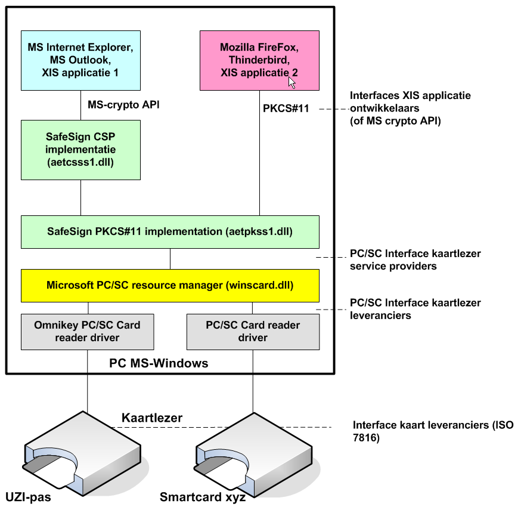

[AORTA 8.5.2](../../../../index.md) / [Aansluit- en Implementatiewijzer Kern](../../../../aansluit-en-implementatiewijzer-kern.md) / [Token specificaties](../../../token-specificaties.md) / [AORTA SAML tokens](../../aorta-saml-tokens.md) / [AORTA_Auth_IH_Berichtauthenticatie_UZI](../aorta_auth_ih_berichtauthenticatie_uzi.md)

# Bijlage B Technische context (gebruik UZI-pas)

## Inleiding

Voor realisatie van de cryptografische beveiligingsfuncties wordt binnen AORTA gebruik gemaakt van de Private Key Infrastructuur (PKI) die geboden wordt door het UZI-register. Het UZI-register verstrekt smartcards (UZI-passen) aan zorgverleners en medewerkers van zorgaanbieders. De UZI-pas bevat X.509 certificaten voor authenticatie, vertrouwelijkheid en elektronische handtekeningen en de bijbehorende private keys. Bij zogenaamde Medewerkerpassen niet op naam ontbreekt het handtekeningcertificaat, maar deze pas is binnen AORTA niet bruikbaar.

De UZI-pas is een smartcard. Deze bevat een NXP microprocessor, operating systeem (NXP JCOP) en de nodige (Java Card) programmatuur om kleine programma's te kunnen draaien. Zie [UZITS] voor details. De smartcard ondersteunt het RSA algoritme voor public/private key cryptografie, het door NCSC als “goed” beoordeelde SHA algoritme voor hashing en AES algoritmen voor symmetrische versleuteling.

De smartcard kan benaderd worden via de meegeleverde SafeSign middleware van AET. Zie voor actuele versies van de software:

[http://www.uziregister.nl/uzipas/gebruikuzipas/paszonderabonneenummer/](http://www.uziregister.nl/uzipas/gebruikuzipas/paszonderabonneenummer/)

[http://www.uziregister.nl/ondersteuning/handleidingeneninstallatie/](http://www.uziregister.nl/ondersteuning/handleidingeneninstallatie/)

Het UZI-register ondersteunt deze middleware op Windows; Linux (SuSe en RedHat distributie) en MacOS X operating systeem[^1].

## Application Programming Interfaces voor benadering UZI-pas

De AET middleware biedt twee interfaces om de smartcard te benaderen:

- De [PKCS#11] interface. Dit is een leveranciers onafhankelijke standaard API -ook wel Cryptoki genoemd- voor cryptografische modules om cryptografische informatie te benaderen (certificaten, sleutels) en om cryptografische functies aan te roepen die op deze modules worden uitgevoerd (zoals het ondertekenen van data). Deze interface is platformonafhankelijk en wordt voor de UZI-pas ondersteund op Windows, Linux en MacOS.

- [MSCrypto] MS CryptoAPI is een microsoftstandaard en biedt een API om cryptografische functies aan te roepen die door een zogenaamde Cryptographic Service Provider worden uitgevoerd.

Naast verschil in platformondersteuning is een belangrijk verschil het abstractieniveau:

- PKCS#11 is een API die specifiek is ontwikkeld voor smartcards en andere hardware modules. Deze biedt tot in detail inzicht in de stappen die uitgevoerd worden en de objecten op de UZI-pas die benaderd worden. Dit geeft de ontwikkelaar meer controle over het gebruik van de UZI-pas.

- MS CryptoAPI is een interface op een hoger abstractieniveau en is niet ‘smartcard aware’. Er worden crypto functies aangeroepen, maar de programmeur hoeft daarbij niet te weten dat sommige functies in specifieke hardware uitgevoerd worden (zoals het signen van data op de UZI-pas zelf).

Het gebruik van de PKCS#11 interface heeft de voorkeur vanwege de volgende overwegingen:

- Open standaard die breed gedragen is in de industrie;

- Platform (Operating System) onafhankelijk;

- Performance is beter en beter te optimaliseren;

- Meer controle over het exacte aanroepen van de UZI-pas vanuit de toepassing.

Dit is de reden dat in de voorbeelden alleen PKCS#11 functies zijn genoemd.

## Software architectuur voor benadering UZI-pas

Onderstaand figuur geeft schematisch en globaal weer welke software componenten gebruikt worden bij het aanroepen van de UZI-pas vanuit een XIS-applicatie. Beide interfaces zijn hierbij weergegeven.

Figuur 1: Software architectuur bij gebruik UZI-pas op MS-Windows PC

#### Toelichting standaard interfaces

Rechts in de figuur zijn de belangrijkste standaard interfaces aangegeven. Deze interfaces realiseren de volgende zaken:

- Generieke interfaces voor XIS-applicatie ontwikkelaars: PKCS#11 en MS Crypto API (Cryptographic Service Provider). Deze standaarden schermen de technische complexiteit van de UZI-pas af en maakt de XIS-applicatie onafhankelijk van de kaartlezer, hardware van de UZI-pas en het operating system op de UZI-pas;

- De PC/SC interface voor middleware en kaartlezer software. Deze standaard maakt het gebruik van de UZI-pas mogelijk met kaartlezers van diverse leveranciers (Omnikey, Gemplus, etc.) en van verschillende fysieke interfaces met de PC (USB, PCMCIA, Serieel). De PC/SC resource managers (winscard.dll) zijn componenten van het operating system en zorgt dat meerdere applicaties logisch gezien tegelijkertijd met 1 UZI-pas kunnen communiceren. Dit is hieronder apart toegelicht;

- De ISO 7816 standaard. Deze maakt het mogelijk om in de toekomst smartcards te gebruiken van andere leveranciers (hardware chip en card operating system) onafhankelijk van de in gebruik zijnde kaartlezers en applicaties.

#### Toelichting PC/SC resource management

Met de SafeSign middleware is het mogelijk dat meerdere client-applicaties logisch gezien 'tegelijkertijd' gebruik maken van de UZI-pas, bijvoorbeeld Outlook, IE, FireFox en één of meer lokale XIS-clients.

Op het laagste niveau kan de UZI-pas slechts communiceren met één applicatie omdat het (zoals de meeste smartcards) een ‘single-threaded device’ is dat sequentieel alle communicatie afhandelt. Dit hoeft geen probleem te zijn want bij printers of database records kan er uiteindelijk ook maar één applicatie tegelijk gebruik maken van de resource. De PC/SC resource manager van MS-Windows dwingt af dat iedere applicatie afzonderlijk de UZI-pas 'claimt' en de communicatie afhandelt. Op dat moment blokkeren de andere toepassingen totdat de communicerende toepassing klaar is. Vervolgens kan een andere toepassing communiceren met de UZI-pas. De SafeSign middleware communiceert dus altijd via de PC/SC resource manager met de UZI-pas.

Ondanks het resource management vanuit het OS en de middleware zijn er wel een aantal richtlijnen vanuit de PC/SC standaard voor de applicaties[^2]. Ook als er op hoog abstractieniveau ontwikkeld wordt –door gebruik te maken van third party libraries- is het van groot belang om de onderliggende PC/SC architectuur goed te begrijpen. Tevens dient men te verifiëren dat de applicatierichtlijnen uit de PC/SC standaard ingevuld zijn, samengevat:

- Communiceer alleen met de pas als het nodig is;

- Geef geen reset naar de smartcard;

- Claim geen exclusieve toegang tot de smartcard behalve als dat noodzakelijk is;

- Beëindig connecties bij afsluiten van de applicatie[^3].

## Gebruik van UZI-pas voor authenticatie

Op de website van het UZI-register is een [AETSDK] beschikbaar die toelichting geeft bij de stappen die nodig zijn voor het ondertekenen van een authenticatie challenge met behulp van PKCS#11 functies.

Deze stappen zijn bij tokenauthenticatie identiek aan de huidige authenticatie met TLS voor zover het gaat om het aanroepen van de UZI-pas. Het verschil zit in de "challenge/data/digestvalue/hashwaarde" die ondertekend wordt. Bij tokenauthenticatie is dat de hash-waarde van het security token en bij implementatie van een TLS client is dat de hash-waarde die conform de TLS specificaties wordt berekend tijdens de TLS handshake fase.

De stappen voor het gebruik van de UZI-pas zijn:

- Laad de PKCS #11 library

- Initialiseer de PKCS #11 library (C_Initialize)

- Zoek een token[^4] (C_GetSlotList, C_WaitForSlotEvent)

- Open een session met het token (C_OpenSession)

- Zoek het authenticatiecertificaat op het token (C_FindObjects...)

- Log in met PIN (C_Login)

- Zoek de bijbehorende sleutel (C_FindObjects...)

- Teken de challenge/digestvalue (C_Sign...)

- Log uit (C_Logout)

- Beëindig sessie (C_CloseSession)

- Sluit PKCS #11 af (C_Finalize)

Voor een verdere toelichting wordt verwezen naar de [AETSDK] die een presentatie bevat waarin iedere PKCS#11 functie aanroep is toegelicht. Daarnaast bevat de SDK ook voorbeeldcode.

[^1]: AET Europe B.V. –de leverancier van SafeSign- ondersteunt meer operating systemen dan het UZI-register.

[^2]: Deel 7 bevat de *Application Domain and Developer Design Considerations.* Paragraaf 3.3 gaat over *Device Sharing and Control*. Zie [www.pcscworkgroup.com](http://www.pcscworkgroup.com).

[^3]: De middleware zorgt ervoor dat PKCS#11 of Crypto API aanroepen niet onnodig gecombineerd worden, maar dat kleine atomaire transacties uitgevoerd worden met de smartcard.

[^4]: In de PKCS#11 context is een ‘token’ een hardware token: een smartcard.
