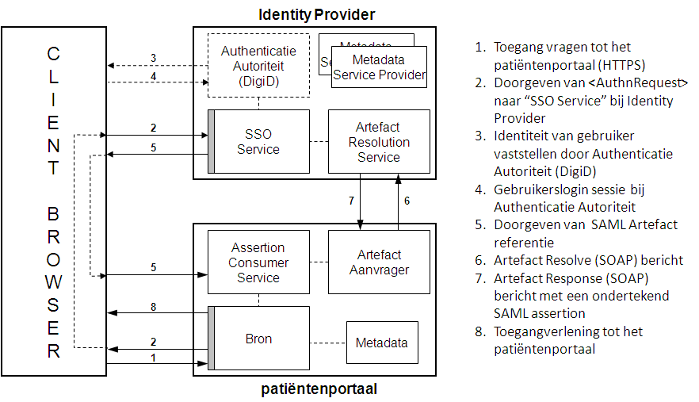

[AORTA 8.5.2](../../../../index.md) / [Aansluit- en Implementatiewijzer Kern](../../../../aansluit-en-implementatiewijzer-kern.md) / [Token specificaties](../../../token-specificaties.md) / [AORTA SAML tokens](../../aorta-saml-tokens.md) / [GBP AORTA_Auth_IH_Berichtauthenticatie_DigiD](../gbp-aorta_auth_ih_berichtauthenticatie_digid.md)

# SSO (profiel, verificatie, meldingen)

## Bijlage B Het SSO profiel

Het Single Sign-On profiel (SSO) is een SAML profiel dat aangeeft hoe gebruik te maken van het SAML authenticatie vraag en antwoord protocol in combinatie met verschillende SAML-bindings, zoals SOAP en HTTP. De communicatie bij authenticatie gaat tussen een Identity Provider (partij die verantwoordelijk is voor de waarmerking van de gebruiker) en een Service Provider (partij die een applicatie of bron beschikbaar stelt voor de gebruiker).

Noot: Het patiëntenportaal (GBP) vervult de rol van de Service Provider. De Identity Provider (IdP) wordt vervuld door DigiD.

Het volgende figuur illustreert het proces (stappen 1 t/m 8) voor de verwezenlijking van het SSO profiel. De stappen zijn in deze bijlage uitgewerkt.



Voorbeeld van configuratie waarden voor een fictieve testomgeving:

| **Entiteit** ; | **Waarde** ; |
| --- | --- |
| Domein patiëntenportaal ; | "testportal.aorta-zorg.nl" ; |
| Domein Identity Provider ; | "federatie.overheid.nl" ; |
| Assertion Consumer Service ; | "https://testportal.aorta-zorg.nl:443/topa-prototype/saml/SSO" ; |
| SSO Service ; | "https://federatie.overheid.nl/aselectserver/server/saml20_sso" ; |
| Artefact Resolution Service ; | "https://federatie.overheid.nl/aselectserver/server/saml20_artifact" ; |
| Authenticatie Autoriteit ; | "https://federatie.overheid.nl/aselectserver/server" ; |

Noot: Omdat niet *alle* internet browsers een ongelimiteerde URL ondersteunen, wordt er gebruik gemaakt van HTTP artefact binding (zie de pijlen 6 en 7 in bovenstaand figuur).

**Stap 1: Het HTTP Request voor het patiëntenportaal**

Een patiënt verzoekt via een cliënt (internet) browser toegang tot het patiëntenportaal (GBP). Dit is een standaard HTTP/TLS verzoek, hiervoor worden geen beperkingen opgelegd.

**Stap 2: Het afgeven van een <AuthnRequest>**

De 2e stap is implementatie afhankelijk. Voor het authenticeren van burgers is DigiD de aangewezen authenticatie-autoriteit. Het patiëntenportaal stuurt de gebruiker via een HTTP-Redirect door naar een voorgedefinieerde Identity Provider waar de gebruiker wordt geauthenticeerd. Voor dit geval geeft het patiëntenportaal een <AuthnRequest> door. De <AuthnRequest> is van het complexe type AuthnRequestType dat afgeleid is van het abstracte complexe type RequestAbstractType. Zie voor alle SAML elementen en types [SAML Assertion Protocol].

De locatie van de "SSO Service", die binnen het Identity Provider domein actief is, wordt out-of-band doorgegeven met behulp van een SAML Metadata bestand. Dit bestand bevat tevens de publieke X509-certificaten voor de ondertekening en eventuele encryptie. Encryptie wordt vooralsnog niet gebruikt.

```
<md:IDPSSODescriptor ... >


<!-- Metadata van de SSO Service als onderdeel van de Identity Provider -->

   <md:SingleSignOnService WantAssertionsSigned="true"

   Binding="urn:oasis:names:tc:SAML:2.0:bindings:HTTP-Redirect"

  Location="https://federatie.overheid.nl/aselectserver/server/saml20_sso"/>

  ...

</md:IDPSSODescriptor>
```

Het <SingleSignOnService> element is van het complexe type IndexedEndpointType en onderdeel van het <IDPSSODescriptor> element uit het metadata bestand dat een specifiek profiel (dienstverlening) reflecteert ter ondersteuning van het SSO profiel van de Identity Provider.

Het <SingleSignOnService> metadata element bestaat uit de volgende attributen:

| **Naam (@=attribuut)** ; | **Omschrijving** ; | **Vereist** ; |
| --- | --- | --- |
| @WantAssertionsSigned ; | Geeft aan dat, naast het gehele ArtefactResonse bericht, de assertion zelf ook ondertekend moet zijn ; | Ja ; |
| @Binding ; | Specificeert de binding dat door de "SSO Service" wordt ondersteund. De binding wordt via een URI geïdentificeerd. Bijvoorbeeld: "urn:oasis:names:tc:SAML:2.0:bindings:HTTP-Redirect". ; | Ja ; |
| @Location ; | De locatie van de "SSO Service". Ook een URI attribuut. ; | Ja ; |

Het patiëntenportaal initieert de SAML binding. In antwoord op het authenticatie verzoek wordt een antwoord aan het patiëntenportaal geleverd als onderdeel van de "SSO Service".

```
<?xml version="1.0" encoding="UTF-8"?>

<!-- Authenticatie verzoek via HTTP Redirect -->

<samlp:AuthnRequest AssertionConsumerServiceURL="https://testportal.aorta-zorg.nl:443/topa-prototype/saml/SSO"

 Destination="https://federatie.overheid.nl/aselectserver/server/saml20_sso"

 ID="authntoken_2.16.528.1.1007.3.3.1234567.1_0123456789"

 IssueInstant="2009-06-24T11:46:53Z"

 ProviderName="testportal.aorta-zorg.nl"

 Version="2.0"

 xmlns:samlp="urn:oasis:names:tc:SAML:2.0:protocol">

<!-- Aanvrager van het authenticatie verzoek -->

 <saml:Issuer xmlns:saml="urn:oasis:names:tc:SAML:2.0:assertion">https://testportal.aorta-zorg.nl:443/topa-prototype/saml/SSO</saml:Issuer>

 <!-- Authenticatie-context -->

 <samlp:RequestedAuthnContext Comparison="exact">

  <saml:AuthnContextClassRef

xmlns:saml="urn:oasis:names:tc:SAML:2.0:assertion">urn:oasis:names:tc:SAML:2.0:ac:classes:MobileTwoFactorContract</saml:AuthnContextClassRef>

 </samlp:RequestedAuthnContext>

 <!-- Partijen waar toegang voor gevraagd wordt -->

 <saml:Conditions>

  <saml:AudienceRestriction>

   <saml:Audience>urn:IIroot:2.16.840.1.113883.2.4.6.6:IIext:1</saml:Audience>

<!-- Root en extensie van de ZIM -->

   <saml:Audience>urn:IIroot:?:IIext:?</saml:Audience>

  </saml:AudienceRestriction>

 </saml:Conditions>

</samlp:AuthnRequest>
```

Het SAML authenticatie verzoek <AuthnRequest> bestaat uit verschillende attributen en elementen. De elementen worden in hiërarchische (top-down) volgorde beschreven en hebben de volgende betekenis:

| **Naam (@=attribuut)** ; | **Omschrijving** ; | **Vereist** ; |
| --- | --- | --- |
| @ID ; | Unieke identificatie van het (authenticatie) verzoek. De waarden van de ID-attribuut in een verzoek en de InResponseTo attribuut in het bijbehorende antwoord moeten overeenkomen. ; | Ja ; |
| @Version ; | De SAML versie van dit (authenticatie) verzoek. De aanduiding voor de versie van SAML gedefinieerd in deze specificatie wordt "2.0". ; | Ja ; |
| @IssueInstant ; | Tijdsmoment van uitgifte van het (authenticatie) verzoek. De tijdswaarde is gecodeerd in UTC. ; | Ja ; |
| @Destination ; | Een URI referentie waarnaar het (authenticatie) verzoek wordt verzonden, dit om malafide activiteiten te voorkomen. De ontvangende partij dient de URI verwijzing te controleren met de locatie waar het bericht is ontvangen. Indien dit niet overeenkomt, moet het bericht genegeerd en verwijderd worden. ; | Nee ; |
| @AssertionConsumerServiceURL ; | Hiermee wordt aangegeven waar het antwoord van het (authenticatie) verzoek heen gestuurd moet worden, De responder moet ervoor zorgen dat de opgegeven waarde in feite verbonden is aan het verzoek. ; | Nee ; |
| @ProviderName ; | Leesbare naam van de aanvrager van het (authenticatie) verzoek. Wordt gebruikt door de gebruiker van de Identity Provider. ; | Ja ; |
| saml:Issuer ; | Geeft de entiteit die het (authenticatie) verzoek heeft gegenereerd. ; | Ja ; |
| saml:Conditions ; | Via de condities kan de aanvrager van het (authenticatie) verzoek de geldigheid en/of gebruik van de verkregen assertion beperken. De responder *kan* wijzigingen of aanvullingen in de assertion invoeren als zij dit nodig acht aan de hand van de gegeven condities. Paragraaf 2.3.3 Geldigheid ;  Geldigheid beschrijft kaders van de SAML condities waaraan het (authenticatie) verzoek moet voldoen ; | Ja ; |
| saml:Subject ; | De entiteit die het (authenticatie) verzoek genereert kan een <Subject> element toevoegen waarin het onderwerp van de verklaring(en) staat voor de ontvangende assertion. Dit element mag geen <SubjectConfirmation> elementen in het verzoek bevatten. ; | Nee ; |
| samlp:RequestedAuthnContext ; | Specificeert in welke context de authenticatie statement wordt afgegeven, in antwoord op het (authenticatie) verzoek. ;  Indien dit element aanwezig is, *moet* het antwoord een <AuthnContext> bevatten. ; | Nee ; |

<AuthnContext> (authenticatie-context)wordt gedefinieerd als de informatie, naast de authenticatie assertion zelf, dat een vertrouwde partij kan eisen voordat zij een besluit neemt over het afgeven van een assertion. De authenticatie-context kan informatie bevatten over de actuele authenticatie methode (de "sterkte" van het gebruikte authenticatiemiddel) die gebruikt wordt.

Binnen de SAML specificatie zijn verschillende mogelijke authenticatie-contexten gespecificeerd die gebruikt kunnen worden als referentiekader voor de communicatie tussen de aanvrager en uitvoerder van het authenticatieverzoek. Dit moet met de software leverancier verder afgestemd worden, zie ook AuthnContextClassRef. Het <RequestedAuthnContext> element is van het complexe type RequestedAuthnContextType en bevat één of meerdere elementen en attributen. Zie ook [SAML Assertion Protocol] en [SAML Authn Context] voor de verschillende voorgedefinieerde context klassen voor authenticatie.

| **Naam (@=attribuut)** ; | **Omschrijving** ; | **Vereist** ; |
| --- | --- | --- |
| @Comparison ; | Specificeert welke vergelijkingsmethode gebruikt wordt om de gevraagde context klasse te evalueren. Standaard is de waarde "exact". Dit houdt in dat de inhoud van de authenticatie assertion exact moet matchen met tenminste een van de opgegeven authenticatie-context klassen. Andere mogelijke waarden zijn: "minimum", "maximum", of "better". ; | Nee ; |
| saml:AuthnContextClassRef ; | Is een URI naar een voorgedefinieerde context klasse voor authenticatie, zie [SAML Authn Context]. De URI waarde die nu bij DigiD als voorbeeld wordt gebruikt is "urn:oasis:names:tc:SAML:2.0:ac:classes:PasswordProtectedTransport". De PasswordProtectedTransport klasse is van toepassing wanneer een opdrachtgever een authenticatie autoriteit een gebruiker laat verifiëren met een wachtwoord dialoog via een beveiligde sessie. ; | Nee ; |

Noot: DigiD kan verschillende authenticatiemiddelen hanteren om de identiteit van een gebruiker vast te stellen. Bij wijziging van de SAML contexten (saml:AuthnContextClassRef) kan de authenticatiesterkte wijzigen.

Noot: De huidige PasswordProtectedTransport heeft een te lage authenticatiesterkte en (AORTA) niveau voor patiënten die gebruik willen maken van het patiëntenportaal. In het [PvE VZVZ Portaal] staan de vereiste authenticatieniveau’s benoemd.

Mogelijke authenticatieniveau’s zijn hieronder opgenomen:

| **Authenticatieniveau (AORTA)** ; | **AuthnContextClassRef** ;  **(SAML)** ; | **Comparison (SAML)** ; | **Authenticatiesterkte (DigiD)** ; |
| --- | --- | --- | --- |
| Midden, waarbij een burger aan de hand van een wachtwoord en een tijdelijk eenmalige code, die hij per SMS ontvangt (per authenticatiepoging), authenticeert; ; | urn:oasis:names:tc:SAML:2.0:ac:classes:MobileTwoFactorContract ; | exact ; | 20 ; |
| AORTA vertrouwensniveau midden [^1], gelijk aan het vorige niveau waarbij de burger eenmalig op zijn fysieke verschijning tegen zijn WID is geverifieerd (een zogeheten face2face controle) ; | urn:oasis:names:tc:SAML:2.0:ac:classes:MobileTwoFactorContract ; | better ; | 22 ; |
| Substantieel; gebruikers kunnen met de DigiD app een eenmalige controle uitvoeren op een paspoort, rijbewijs of identiteitskaart. Hierna is zijn of haar DigiD app geschikt om in te loggen op het niveau substantieel. ; | urn:oasis:names:tc:SAML:2.0:ac:classes:Smartcard ; | exact ; | 25 ; |

Authenticatieniveau basis en hoog worden momenteel nog niet ondersteund.

**Stap 3 en 4: Identificeren van een Gebruiker door de Identity Provider**

De authenticatie-autoriteit bij de Identity Provider moet de identiteit van de gebruiker vast stellen. Het authenticatieverzoek hiertoe wordt gedaan door het patiëntenportaal die het element <RequestedAuthnContext> in het verzoek toevoegt. De authenticatie-autoriteit start een dialoog op met de gebruiker om deze te identificeren aan de hand van het <RequestedAuthnContext>, zie [SAML Authn Context] .

Eis: Voor bepaalde patiëntenportaalfunctionaliteit moet het authenticatieniveau of betrouwbaarheidsniveau door de authenticatie-autoriteit worden afgegeven zoals is opgenomen in de [PvE VZVZ portaal].

**Stap 5: Het antwoord van de Identity Provider**

Ongeacht of de identificatie van een patiënt door de Identity Provider wel of niet lukt, wordt er een antwoord naar het patiëntenportaal gestuurd in de vorm van een artefact. Het patiëntenportaal maakt gebruik van het artefact resolution profiel. Het patiëntenportaal maakt hierbij gebruik van een callback aanroep naar de Identity Provider, om het <Response> bericht met behulp van een SOAP binding over authenticatie op te halen. De locatie van de "Assertion Consumer Service" kan met behulp van metadata van het patiëntenportaal worden bepaald. De Identity Provider moet middelen hebben om vast te stellen dat deze locatie wordt gecontroleerd door het patiëntenportaal.

Het patiëntenportaal geeft aan welke SAML binding en specifieke "Assertion Consumer Service” gebruikt wordt voor het <AuthnRequest> bericht. De Identity Provider moet deze instellingen volgen.

Wanneer de authenticatie via de "SSO Service" van de Identity Provider succesvol verlopen is, wordt de gebruiker terug naar het patiëntenportaal gedirigeerd.

```
Redirect to https://aselectserver/server/saml20_assertion?

SAMLart=AAQAABhQELuXX%3D
```

Bovenstand voorbeeld toont en SAML artefact referentie afgegeven door de "SSO Service" voor de "Assertion Consumer Service".

**Stap 6: Het opvragen van een Artefact**

Het patiëntenportaal maakt gebruik van het artefact resolution profiel, zie [SAML Profiles], om via een callback de <AuthnRequest> bericht te achterhalen waarin het uiteindelijke SAML authenticatie antwoord staat.Het artefact resolution profiel maakt gebruik van SOAP binding, wat ook in het SAML metadata bestand van de Identity Provider voor het patiëntenportaal is vastgelegd.

```
<md:IDPSSODescriptor ... >

  <md:ArtifactResolutionService

   xmlns:md="urn:oasis:names:tc:SAML:2.0:metadata"

   Binding="urn:oasis:names:tc:SAML:2.0:bindings:SOAP"    Location="https://federatie.overheid.nl/aselectserver/server/saml20_artifact"

   index="0"

   isDefault="true" />

  ...

</md:IDPSSODescriptor>
```

Het <ArtifactResolutionService> element is van het complexe type IndexedEndpointType en onderdeel van het <IDPSSODescriptor> element uit het SAML metadata bestand dat weer een specifiek profiel (dienstverlening) reflecteert ter ondersteuning van het SSO profiel van de Identity Provider.

Het <ArtifactResolutionService> element bestaat uit de volgende attributen en elementen:

| **Naam (@=attribuut)** ; | **Omschrijving** ; | **Vereist** ; |
| --- | --- | --- |
| @Binding ; | Specificeert de binding dat door de "Artefact Resolution Service" wordt ondersteund. De binding wordt via een URI geïdentificeerd. Bijvoorbeeld: "urn:oasis:names:tc:SAML:2.0:bindings:SOAP". ; | Ja ; |
| @Location ; | De locatie van de "Artefact Resolution Service". Ook een URI attribuut. ; | Ja ; |
| @index ; | Een unieke integer waarde die aan de "Artefact Resolution Service" wordt toegekend, waarnaar in het protocol bericht wordt verwezen. ; | Ja ; |
| @isDefault ; | Wordt gebruikt om een standaard (Artefact Resolution) Service aan te wijzen uit een geïndexeerde set van diensten. ; | Nee ; |

Het patiëntenportaal stuur een <ArtifactResolve> bericht met het gegeven <Artifact> referentie naar een "Artefact Resolution Service". De locatie van deze service kan weer met behulp van het SAML metadata bestand worden bepaald. Het opvragen van het artefact gebeurd via een beveiligde sessie met behulp van SOAP over HTTP.

```
<?xml version="1.0" encoding="UTF-8"?>

<soap11:Envelope xmlns:soap11="http://schemas.xmlsoap.org/soap/envelope/"

         xmlns:saml="urn:oasis:names:tc:SAML:2.0:assertion"

         xmlns:samlp="urn:oasis:names:tc:SAML:2.0:protocol">

   <soap11:Body>

     <samlp:ArtifactResolve

      ID="samlart_2.16.528.1.1007.3.3.1234567.1_0123456789"

      IssueInstant="2009-06-24T11:47:01Z"

      Version="2.0">

      <saml:Issuer

        Format="urn:oasis:names:tc:SAML:2.0:nameidformat:entity">https://testportal.aorta-zorg.nl:443/topa-prototype/saml/SSO</saml:Issuer>

      <samlp:Artifact>AAQAABhQELuXX=</samlp:Artifact>

     </samlp:ArtifactResolve>

   </soap11:Body>

</soap11:Envelope>
```

Het <ArtifactResolve> element is van het complexe type ArtifactResolveType dat is afgeleid van RequestAbstractType en bestaat uit de volgende attributen en elementen:

| **Naam (@=attribuut)** ; | **Omschrijving** ; | **Vereist** ; |
| --- | --- | --- |
| @ID ; | Unieke identificatie van het Artefact verzoek. De waarde van het ID-attribuut in een verzoek en het InResponseTo attribuut in het bijbehorende antwoord moeten overeenkomen. ; | Ja ; |
| @IssueInstant ; | Tijdsmoment van uitgifte van het Artefact verzoek. De tijdswaarde is gecodeerd in UTC. ; | Ja ; |
| @Version ; | De versie van dit SAML Artefact verzoek. De aanduiding voor de versie van SAML gedefinieerd in deze specificatie wordt "2.0". ; | Ja ; |
| saml:Issuer ; | Geeft de entiteit die het Artefact verzoek doet. ; | Ja ; |
| samlp:Artifact ; | Artefact (referentie) waarde die de aanvrager heeft ontvangen en deze wenst te vertalen in het protocol boodschap die zij vertegenwoordigd. In dit geval is dat het antwoord op een authenticatie verzoek. ; | Ja ; |

Eis: Er wordt bij een unieke artefact verzoek, maximaal één en eenmalig een artefact response bericht gegeven door de "Artefact Resolution Service", in antwoord op het verzoek.

**Stap 7: De ArtifactResponse met de SAML assertion**

Het uiteindelijke antwoord betreffende de authenticatie van een gebruiker staat in het <ArtifactResponse>. De "Artefact Resolution Service" geeft altijd een <Status> terug over de <ArtifactResponse>. De <ArtifactResponse> bevat de <Response> van de Identity Provider, of de identificatie en authenticatie van een gebruiker wel of niet gelukt is. Dit wordt ook weer met een <Status> aangegeven, maar dan voor de <Response>. Verder bevat de <Response> het uiteindelijke SAML assertion element <Assertion>.

```
<?xml version="1.0" encoding="UTF-8"?>

<soap11:Envelope xmlns:soap11="http://schemas.xmlsoap.org/soap/envelope/"

         xmlns:saml="urn:oasis:names:tc:SAML:2.0:assertion"

         xmlns:samlp="urn:oasis:names:tc:SAML:2.0:protocol">

  <soap11:Body>

   <samlp:ArtifactResponse

    Destination="Destination unknown"

    ID="_b2d765569da660eff830c352d5bb4da2"

    InResponseTo="samlart_2.16.528.1.1007.3.3.1234567.1_0123456789"

    IssueInstant="2009-06-24T11:47:05Z" Version="2.0">

     <saml:Issuer

      Format="urn:oasis:names:tc:SAML:2.0:nameidformat:entity">https://testportal.aorta-zorg.nl:443/topa-prototype/saml/SSO</saml:Issuer>

     <samlp:Status>

      <samlp:StatusCode Value="urn:oasis:names:tc:SAML:2.0:status:Success"/>

     </samlp:Status>

     <samlp:Response ID="EE7E3DF7EBC86438"

      InResponseTo="authntoken_2.16.528.1.1007.3.3.1234567.1_0123456789"

      IssueInstant="2009-06-24T11:46:59Z" Version="2.0">

      <saml:Issuer

       Format="urn:oasis:names:tc:SAML:2.0:nameidformat:entity">https://testportal.aorta-zorg.nl:443/topa-prototype/saml/SSO</saml:Issuer>

      <samlp:Status>

        <samlp:StatusCode Value="urn:oasis:names:tc:SAML:2.0:status:Success"/>

      </samlp:Status>

      <saml:Assertion

       ID="__2c81606885bf79c716eb2c082a2249a5"

       IssueInstant="2009-06-24T11:46:59Z"

       Version="2.0"

       xmlns:saml="urn:oasis:names:tc:SAML:2.0:assertion">

        ...

      </saml:Assertion>

     </samlp:Response>

   </samlp:ArtifactResponse>

  </soap11:Body>

</soap11:Envelope>
```

Het <ArtifactResponse> element is van het complexe type ArtifactResonseType dat een uitbreiding is van StatusResponseType en bestaat uit de volgende attributen en elementen:

| **Naam (@=attribuut)** ; | **Omschrijving** ; | **Vereist** ; |
| --- | --- | --- |
| @ID ; | Unieke identificatie van het antwoord van de "Artefact Resolution Service". ; | Ja ; |
| @Version ; | De aanduiding voor de SAML versie gedefinieerd in deze specificatie wordt "2.0". ; | Ja ; |
| @IssueInstant ; | Tijdsmoment van uitgifte van het antwoord. De tijdswaarde is gecodeerd in UTC. ; | Ja ; |
| @InResponseTo ; | Moet de waarde bevatten die overeen komt met het ArtifactResolve@ID bericht. ; | Nee ; |
| saml:Issuer ; | Geeft de entiteit die het artefact verzoek heeft ingediend. ; | Nee ; |
| samlp:Status ; | Een code die de status van het desbetreffende verzoek weergeeft. Dit element heeft weer verplicht het samlp:Statuscode element in zich. Als het opvragen van het artefact geslaagd is, wordt de waarde "urn:oasis:names:tc:SAML:2.0:status:Success" teruggeven. Als het opvragen van het artefact niet geslaagd is wordt een foutcode gegenereerd, zie verder SSO meldingen voor de verschillende foutcodes. ; | Ja ; |
| samlp:Response ; | Het bericht element dat bestaat uit 0 of meerdere assertions die aan een (authenticatie) verzoek voldoen. ; | Nee ; |

Het <Response> element is van het complexe type ResponseType en bevat de volgende elementen en attributen:

| **Naam (@=attribuut)** ; | **Omschrijving** ; | **Vereist** ; |
| --- | --- | --- |
| @ID ; | Unieke identificatie van het antwoord op het authenticatie verzoek. ; | Ja ; |
| @Version ; | De aanduiding voor de SAML versie gedefinieerd in deze specificatie wordt "2.0". ; | Ja ; |
| @IssueInstant ; | Tijdsmoment van uitgifte van het antwoord. De tijdswaarde is gecodeerd in UTC. ; | Ja ; |
| @InResponseTo ; | Moet de waarde bevatten die overeen komt met het AuthnRequest@ID bericht. ; | Ja ; |
| saml:Issuer ; | Geeft de entiteit die het authenticatie verzoek heeft gegenereerd. ; | Ja ; |
| samlp:Status ; | Een code die de status van het desbetreffende verzoek weergeeft. Dit element heeft weer verplicht het samlp:Statuscode element in zich. Als het authenticatie verzoek geslaagd is, wordt de waarde "urn:oasis:names:tc:SAML:2.0:status:Success" teruggeven. Als het authenticatie verzoek niet geslaagd is wordt een foutcode gegenereerd, zie verder SSO meldingen voor de verschillende foutcodes. ; | Ja ; |
| saml:Assertion ; | Dit type specificeert de basis informatie die gemeenschappelijk is voor alle afgegeven beweringen (assertion) door een vertrouwde partij of autoriteit. ; | Nee ; |

Eis: Indien de samlp:Status <> "urn:oasis:names:tc:SAML:2.0:status:Success" moet er geen saml:Assertion element teruggegeven worden.

Het <Assertion> element is van het complexe type AssertionType. De opbouw en inhoud van het <Assertion> element wordt in paragraaf 2 Het SAML authenticatietoken besproken**.**

Het <Assertion> element valt in de gedeclareerde namespace van “urn:oasis:names:tc:SAML:2.0:assertion”.

Eis: Indien er een Assertion wordt afgegeven **moet** de Identity Provider deze Assertion signeren in het daarvoor aangewezen Signature veld, zie paragraaf 2.4 Algoritmes.

**Stap 8: Toegang verlening**

Ter voltooiing van het SSO profiel, verwerkt het patiëntenportaal de <Response> en de daarbij behorende <Assertion>, en verleent of weigert hij de gebruiker of patiënt toegang tot het patiëntenportaal door antwoord te geven op het HTTP Request waarmee bij stap 1 werd begonnen.

De verleende <Assertion> is het locaal geldig toegangsbewijs voor de patiënt om bepaalde handelingen te mogen uitvoeren op het patiëntenportaal, die in verbinding staat met de ZIM, die als (web)service fungeert waartussen beveiligde SOAP berichten worden uitgewisseld met behulp van SAML authenticatietokens.

Eis: De verleende assertion moet door het patiëntenportaal verwijderd worden na afloop van een TLS-sessie met het LSP respectievelijk na afloop van gebruik van de sessie door een patiënt of na het verstrijken van 15 minuten gerekend vanaf het afgiftemoment door DigiD.

## Bijlage C SSO verificatie

Het goedbeheerde patiëntenportaal (GBP) moet voor elk bericht dat naar de ZIM doorgestuurd wordt een bijbehorende SAML authenticatietoken hebben. Deze tokens worden opgevraagd bij de Identity Provider (IdP) met behulp van een artefact referentie, zie stap 6 van Het SSO profiel. Het uiteindelijke antwoord van de IdP, een artefact response, bevat een SAML assertion over een patiënt, zie stap 7 van Het SSO profiel.

Voordat het GBP de assertion als SAML authenticatietoken gebruikt, moeten onderstaande controles uitgevoerd worden. Als het uiteindelijke antwoord van de IdP hieraan niet voldoet, mag de assertion niet gebruikt worden als SAML authenticatietoken tussen het GBP en het LSP.

De volgende controles moeten door het patiëntenportaal uitgevoerd worden:

- Controleer of het attribuut "InResponseTo" van het <ArtifactReponse> gelijk is aan de ID van het oorspronkelijke <ArtifactResolve> bericht;

- Controleer of het attribuut "InResponseTo" van het <Response> gelijk is aan de ID van het oorspronkelijke <AuthnRequest> bericht;

- Verifieer het attribuut "Issuer" van het <ArtifactResponse> element of die overeenkomt met de Assertion Consumer Service URL;

- Verifieer het attribuut "Status" van het <ArtifactResponse> element of die overeenkomt met de waarde "urn:oasis:names:tc:SAML:2.0:status:Success";

- Verifieer het attribuut "Issuer" van het <Response> element of die overeenkomt met de Assertion Consumer Service URL;

- Verifieer het attribuut "Status" van het <Response> element of die overeenkomt met de waarde "urn:oasis:names:tc:SAML:2.0:status:Success".

## Bijlage D SSO meldingen

De volgende statuscodes (URI referenties) worden door SAML onderkend en geretourneerd binnen het SSO profiel waar van toepassing (De volgende tabel is deels overgenomen uit [SAML Assertion Protocol]).

De SAML meldingen worden alleen binnen het SSO profiel gebruikt. Dat wil zeggen dat de meldingen alleen voorkomen tussen het patiëntenportaal (GBP) en de Identity Provider (IdP).

Een statuscode is een Uniforme Resource Name (URN) en is als volgt opgebouwd:

"urn:"<Namespace Identifier>":"<Name Specific String>

Voorbeeld: “urn:oasis:names:tc:SAML:2.0:status:Success”

In de statuscode tabel wordt alleen de omschrijving en de specifieke string getoond.

| **Omschrijving** ; | **Namespace Specific String** ; |
| --- | --- |
| The request could not be performed due to an error on the part of the requester. ; | Requester ; |
| The request could not be performed due to an error on the part of the SAML responder or SAML ; | Responder ; |
| The SAML responder could not process the request because the version of the request message was incorrect. ; | VersionMismatch ; |
| The responding provider was unable to successfully authenticate the principal. ; | AuthnFailed ; |
| The specified authentication context requirements cannot be met by the responder. ; | NoAuthnContext ; |
| The SAML responder or SAML authority is able to process the request but has chosen not to respond. ; | RequestDenied ; |
| The SAML responder or SAML authority does not support the request. ; | RequestUnsupported ; |
| The SAML responder cannot process any requests with the protocol version specified in the request. ; | RequestVersionDeprecated ; |
| The SAML responder cannot process the request because the protocol version specified in the request message is a major upgrade from the highest protocol version supported by the responder. ; | RequestVersionTooHigh ; |
| The SAML responder cannot process the request because the protocol version specified in the request message is too low. ; | RequestVersionTooLow ; |
| The resource value provided in the request message is invalid or unrecognized. ; | ResourceNotRecognized ; |
| The response message would contain more elements than the SAML responder is able to return. ; | TooManyResponses ; |
| The responding provider does not recognize the principal specified or implied by the request. ; | UnknownPrincipal ; |
| The SAML responder cannot properly fulfill the request using the protocol binding specified in the ;  request. ; | UnsupportedBinding ; |

[^1]: De AuthnContextClassRef is niet te onderscheiden van Authenticatieniveau midden. Hier dient rekening mee te worden gehouden bij de verwerking van het token. De service die dit authenticatieniveau vereist dient zodanig geconfigureerd te worden dat het de aanvullende maatregelen (F2F-token) ook controleert.
