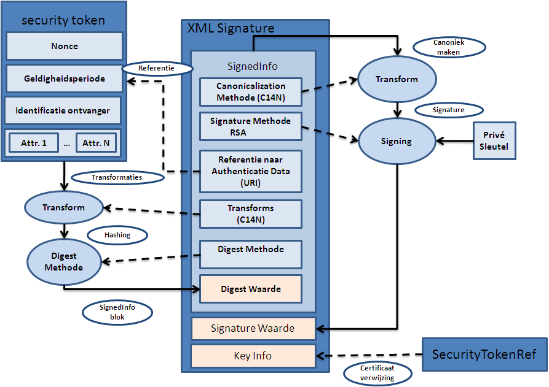

[AORTA 8.5.2](../../../../index.md) / [Aansluit- en Implementatiewijzer Kern](../../../../aansluit-en-implementatiewijzer-kern.md) / [Token specificaties](../../../token-specificaties.md) / [AORTA SAML tokens](../../aorta-saml-tokens.md) / [GBx AORTA_Auth_IH_Security_tokens_generiek](../gbx-aorta_auth_ih_security_tokens_generiek.md)

# Digitaal tekenen

## Inleiding

Om de integriteit te waarborgen wordt (een subset van) het security token ondertekend met behulp van XML Signature. De ontvanger kan dan onomstotelijk vaststellen dat het security token ondertekend is met de privé sleutel behorend bij het certificaat van de verzender.



**Figuur 1: Security token met (SHA1) XML Signature**

## Inhoud van de XML Signature

De XML Signature bij het security token ziet er als volgt uit (de lange Base 64 strings zijn fictieve waarden en afgekort):

```
<ds:Signature xmlns:ds="http://www.w3.org/2000/09/xmldsig#">

    <ds:SignedInfo>

       <ds:CanonicalizationMethod Algorithm="http://www.w3.org/2001/10/xml-exc-c14n#"/>

      <ds:SignatureMethod Algorithm="http://www.w3.org/2000/09/xmldsig#rsa-sha256"/>

      <ds:Reference URI="#security_token_Nonce">

           <ds:Transforms>

               <ds:Transform Algorithm="http://www.w3.org/2000/09/xmldsig#enveloped-signature"/>

               <ds:Transform Algorithm="http://www.w3.org/2001/10/xml-exc-c14n#"/>

           </ds:Transforms>

           <ds:DigestMethod Algorithm="http://www.w3.org/2000/09/xmlenc#sha256"/>

           <ds:DigestValue>xx5...Gus2g=</ds:DigestValue>

       </ds:Reference>

    </ds:SignedInfo>

    <ds:SignatureValue>bULmRGKBlhyPbumKDxrrT...SiGWaarde</ds:SignatureValue>

    <ds:KeyInfo>

        <!-- KEYINFO bevat informatie over gebruikte certificaat -->

    </ds:KeyInfo>

</ds:Signature>
```

Er volgt nu een bespreking van alle XML Signature elementen.

### Het <Signature> element

<ds:**Signature** xmlns:ds="http://www.w3.org/2000/09/xmldsig#">

De XML Signature begint met het Signature blok en een verwijzing naar de XML Signature namespace.   
Het Signature blok kan onderdeel zijn van het security token of refereert naar het security token.

### Het <SignedInfo> element

<ds:**SignedInfo**>

Vervolgens komt het SignedInfo blok. Dit blok bevat de gegevens die daadwerkelijk getekend worden.

### Het <CanonicalizationMethod> element

<ds:**CanonicalizationMethod** Algorithm="[http://www.w3.org/2001/10/xml-exc-c14n#](http://www.w3.org/2001/10/xml-exc-c14n)"/>

Het SignedInfo blok zelf moet in de juiste canonieke vorm gebracht worden. Voor de digitale handtekening wordt het Exclusive XML Canonicalization zonder comments gebruikt [EXCC14N]. Deze vorm van canoniek maken, gaat goed om met namespaces van XML documenten die ingebed zijn in andere documenten.

Aangezien het security token wordt samengevoegd met het onderliggend bericht, dat weer is ingebed in een SOAP envelop, is het gebruik van Exclusive XML Canonicalization verplicht.

### Het <SignatureMethod> element

<ds:**SignatureMethod** Algorithm="http://www.w3.org/2000/09/xmldsig#rsa-sha1"/>

De methode van tekenen. Voor de digitale handtekening wordt gebruik gemaakt van een RSA handtekening over een digest. Voor de gebruikte algoritmes zie 4.3.

### Het <Reference> element

<ds:**Reference** URI="#security_token_Nonce">

Een referentie naar het token dat getekend is. De referentie is een placeholder en de waarde die wordt overgenomen in een relatieve URI (dus voorzien van een "#" als prefix) moet globaal uniek zijn (i.v.m. het samenvoegen van mogelijk meerdere security tokens in een enkel document).

### Het <Transforms> element

<ds:**Transforms**>  
 <ds:Transform Algorithm="http://www.w3.org/2001/10/xml-exc-c14n#"/>  
</ds:**Transforms**>

Er worden een aantal transforms gedaan over het token. De minimale set van transforms is de exclusieve canonicalisatie.

### Het <DigestMethod> element

<ds:**DigestMethod** Algorithm="http://www.w3.org/2000/09/xmlenc#sha256"/>

Van het canonieke SignedInfo blok van het token wordt een digest berekend. Het gebruik van SHA256 of hoger DigestMethod wordt voor eerste implementatie voorgeschreven.

### Het <DigestValue> element

<ds:**DigestMethod** Algorithm="[http://www.w3.org/2000/09/xmlenc#sha256"/](digitaal-tekenen.md)>

Van het canonieke SignedInfo blok van het token wordt een digest berekend. Het gebruik van SHA256 of hoger DigestMethod wordt voor eerste implementatie voorgeschreven.

### Het <SignatureValue> element

<ds:**SignatureValue**>bULmRGKBlhyPbumKDxrrT...SiGWaarde</ds:**SignatureValue**>

Over (de canonieke vorm van) het SignedInfo blok wordt een digest berekend waarover een RSA handtekening gezet wordt. Dit volgens de methode zoals vermeld in de eerder vermelde SignatureMethod. De waarde van de RSA handtekening wordt met Base 64 gecodeerd en opgenomen in de XML Signature. De handtekening is dus niet over het token zelf, maar over een digest van een SignedInfo blok, waarin een digest van het token staat.

### Het <KeyInfo> element

<ds:**KeyInfo**>  
 <!-- KEYINFO bevat informatie over gebruikte certificaat -->  
</ds:**KeyInfo**>

Het `<KeyInfo>`-element wordt gebruikt in XML Signature (XMLDSIG) om informatie te verstrekken over de cryptografische sleutel die verband houdt met een digitale handtekening. Het doel van dit element is om de verificatie van de handtekening mogelijk te maken. Het kan een verscheidenheid aan informatie bevatten, afhankelijk van de specifieke toepassing en vereisten. Een belangrijk element die gedefinieerd is binnen `<KeyInfo>` is de X.509-certificaatinformatie, het `<X509Data>`-element, die wordt gebruikt om de sleutel te valideren. Dit element kan sub-elementen bevatten zoals het `<X509Certificate>-` en `<X509IssuerSerial>-`element.

Verdere uitleg over `<KeyInfo>` en `<X509Data>` wordt nader toegelicht in [paragraaf 4.4](digitaal-tekenen.md#certificaten) Certificaten,.

</ds:Signature>

Einde van de XML Signature.

## Algoritmes

Voor ieder security token bestaat er een aparte beveiligingsimplementatie handleiding in AORTA. Een dergelijke handleiding specificeert welke algoritmes voor dat specifieke token toegestaan zijn.

Voor het berekenen van hashwaarden wordt het door NCSC als “goed” beoordeelde SHA algoritme gebruikt. Voor de digitale handtekening wordt RSA (asymmetrische encryptie algoritme) gebruikt.

In de XML Signature wordt tweemaal gerefereerd aan deze waarden. Eenmaal voor het <SignatureMethod> element en eenmaal voor <DigestMethod> element. In deze elementen wordt een subset gebruikt van de URI’s zoals gespecificeerd in [XMLSECURI]:

**Tabel AORTA.STK.t3100 - Algoritmes**

| **Functie** ; | **Algoritme** ; | **URI (voorbeeld)** ; |
| --- | --- | --- |
| Signature ; | RSA+SHA-512 of SHA-384 of SHA-256 ; | <SignatureMethod Algorithm="http://www.w3.org/2000/09/xmldsig#rsa"/> ; |
| Digest ; | SHA-512 of SHA-384 of SHA-256 ; | <DigestMethod Algorithm="http://www.w3.org/2000/09/xmldsig#"/> ; |
| Signature ; | RSA+SHA-256 ; | <SignatureMethod Algorithm="http://www.w3.org/2001/04/xmldsig-more#rsa-sha256"/> ; |
| Digest ; | SHA-256 ; | <DigestMethod Algorithm="http://www.w3.org/2001/04/xmlenc#sha256"/> ; |

## Certificaten

Voor ieder security token bestaat er een aparte beveiligingsimplementatie handleiding in AORTA. Een dergelijke handleiding specificeert welke certificaten zijn toegestaan en hoe deze opgenomen worden in het bericht.   
Een certificaat koppelt de identiteit van een actor aan een publieke sleutel. Alleen de houder van het certificaat beschikt over de privé sleutel en kent de toegangscode tot het authenticatiemiddel.

Een vertrouwde partij (*trusted third party*) geeft certificaten uit. Deze partij wordt de uitgever (*issuer*) genoemd. Om aan te tonen dat deze uitgever daadwerkelijk het certificaat heeft uitgegeven, ondertekent de uitgever het certificaat met zijn privé sleutel. Controle van deze ondertekening kan plaatsvinden door deze te controleren tegen de publieke sleutel in het certificaat van de uitgever. De controle moet voor de gehele keten een keer plaatsvinden tot aan het vertrouwde (root) certificaat.

Daarna kan dit (nu ook vertrouwde) certificaat opgenomen worden in de softwareomgeving.

De volgende CA's (*Certificate Authority*) spelen een belangrijke rol in AORTA:

- PKIoverheid. PKIoverheid heeft eigen CA's. Deze vallen allen onder de Root CA van de Staat der Nederlanden. Daaronder is een opdeling in verschillende domeinen, onder andere één voor burgers en één voor overheid en bedrijven (organisaties). De huidige hiërarchie (G2) worden certificaten ondertekend met SHA-256 en worden langere sleutels gebruikt. Deze hiërarchie wordt de tweede generatie (G2, Niet te verwarren met de G2 van het UZI-register, deze sluit aan bij de **eerste** generatie van PKIoverheid.) genoemd. PKIoverheid is in 2017 over gegaan op een nieuwe hiërarchie, de derde generatie G3. Zie informatie op de Logius website.

- UZI-register van het CIBG. Het UZI-register is een intermediate CA onder PKIoverheid. Het CIBG is een uitvoeringsorganisatie van het ministerie van VWS, welke een programma voert met diverse CA's voor de zorgsector. Zij voeren dit uit onder de PKIoverheid richtlijnen en hiërarchie. Het CIBG treedt hierbij zowel als Register Authority als Certificate Authority op. Er worden certificaten (voor zorgverleners, medewerkers op naam, medewerkers niet op naam en voor servers verstrekt voor gebruik in de Zorgsector. In de certificaten van zowel UZI-passen als –server- certificaten wordt de identiteit van de houder, het UZI-nummer en aanverwante informatie opgenomen. Er zijn momenteel twee generaties (G2 en G21) van UZI-register CA's in gebruik. De G21 generatie CA's zijn ondertekend met SHA-256 en sluit aan bij G2 van PKIoverheid. Voor de derde generatie UZI-certificaten, zie informatie op de UZI-register website.

- (NIEUW 8.3.0.0) ZORG-ID Token. Het ZORG-ID Token certificaat is een intermediate CA onder ZORG-ID. Deze certificaten worden gebruik bij de ZORG-ID Smartcard om zorgmedewerkers te kunnen authentiseren.

De gangbare *technische vorm* van certificaten zijn X.509 versie 3 certificaten. X.509v3 is een specificatie van de ITU, zie [X509]. In een X.509 certificaat zijn technische en organisatorische kenmerken opgenomen en wordt er een koppeling gelegd tussen de identiteit van een actor en een publieke sleutel. Verder is het mogelijk om naast standaard attributen extra kenmerken in het certificaat op te nemen, die door de uitgever als X.509v3 extensies in het certificaat worden gezet.

**Tabel AORTA.STK.t3110 – X.509v3 attributen**

| **Attribuut** ; | **Betekenis** ; |
| --- | --- |
| Serial number ; | Een serie nummer van het certificaat. Het betreft een serie nummer van de uitgevende CA. Dit nummer moet uniek zijn per *issuer*, maar hoeft niet oplopend te zijn. ; |
| Signature Algorithm ; | Dit geeft aan met welk cryptografisch algoritme dit certificaat door de uitgever is ondertekend. ; |
| Issuer ; | Dit geeft de DN (Distinguished Name) van de uitgever van het certificaat aan. Dit geeft ook gelijk aan wie dit certificaat heeft ondertekend. Deze komt overeen met het subject in het CA certificaat van de uitgever. ; |
| Validity ; | Met twee datums wordt het interval aangegeven, waarbinnen het certificaat geldig is. De tijd is normaal opgegeven in UTC, tenzij een expliciete tijdzone is opgenomen. ; |
| Subject ; | De DN van de houder aan wie het certificaat behoort. Dit geeft de identiteit aan, die aan de publieke sleutel is gekoppeld. ; |
| Subject Public Key Info ; | Dit bevat de benodigde informatie over de publieke sleutel. Het beschrijft het algoritme voor de sleutel (bv. RSA) en de specifieke numerieke delen van die sleutel. ; |
| Signature ; | Dit bevat de ondertekening van het certificaat. Deze wordt gedaan door de uitgever, en kan worden gecontroleerd met de publieke sleutel in het certificaat van de uitgever. ; |

Zoals eerder vermeld, wordt in de certificaten van zowel UZI-passen, smartcards als –server- certificaten de identiteit van de houder opgenomen. Dit gebeurt in de subjectAltName extensie als een othername, met een vaste indeling.   
De waarde hierin is een ASN.1 IAString met een OID (Object Identifier) van 2.5.5.5. De string heeft de volgende vaste notatie:

<OID CA>-<versie-nr>-<UZI-nr>-<pastype>-<Abonnee-nr>-<rol>-<AGB-code>

**Tabel AORTA.STK.t3120 – X.509v3 extensie subjectAltName.otherName**

| Veld ; | Betekenis ; |
| --- | --- |
| OID CA ; | Dit is de OID van de CA en wijzigt niet per generatie en is generiek per type pas. Voor een complete lijst, zie [UZI CA Model]. ; |
| versie-nr ; | 1 voor alle UZI-register certificaten. ; |
| UZI-nr ; | Het UZI-nummer. ; |
| Pastype ; | Een codering met 1 karakter. Voor het type certificaat, of pastype, bestaan een aantal standaard waarden: Z (Zorgverlener), N (Medewerker op naam), M (Medewerker niet op naam) en S (Servercertificaat). ; |
| Abonnee-nr ; | Voor UZI passen is dit het URA (UZI-Register Abonnee) nummer. ; |
| Rol ; | Aanduiding van een medisch beroep. Wanneer er geen rol is (servers, medewerkers) wordt op het certificaat rolcode 00.000 gebruikt. ; |
| AGB-code ; | De AGB-code van de abonnee (zorgaanbieder) van deze server. Deze wordt binnen AORTA niet gebruikt. ; |

De UZI-pas of smartcard die gebruikt wordt voor het ondertekenen van het security token moet een zorgverlener- of een medewerkerspas op naam zijn. Hoewel het pastype gecodeerd is opgenomen in het certificaat (in het subjectAltName attribuut), dient een applicatie op basis van de uitgevende CA vast te stellen wat het pastype van de UZI-pas of smartcard is. De OID van de CA wijzigt niet per generatie.

**Tabel AORTA.STK.txxx – X.509v3 extensie 2.16.840.1.113883.2.4.3.111.20.5 (Custom Extension copied Certificate)**

| Veld ; | Betekenis ; |
| --- | --- |
| proof ; | Het bewijs is een **JSON Web Token (JWT)**, een compact en URL-vriendelijk mechanisme dat wordt gebruikt om informatie veilig tussen twee partijen over te dragen in **JSON-formaat**. ;  Een JWT bestaat uit drie delen, gescheiden door puntjes (`.`): ;  **Header:** ;  Bevat metadata over de token, zoals: ;  `typ`: Het type token (`JWT`) ;  `alg`: Het gebruikte signatuuralgoritme (bijvoorbeeld `RS256` voor **RSA met SHA-256**) ;  `x5c`: Een verwijzing naar het publieke certificaat (non-repudiation) waarmee de handtekening kan worden geverifieerd ;  `iat`: Tijdstip van ondertekening ;  **Payload:** ;  Bevat de **claims**, oftewel verklaringen over de entiteit (de zorgmedewerker). De volgende claims worden vastgelegd: ;  `ura`: het abonneenummer van de zorgaanbieder ;  `uziNumber`: het unieke identificatienummer van de zorgverlener ;  `roleCode`: de functionele rol van de zorgmedewerker ;  **Signature:** ;  De token wordt **digitaal ondertekend** om de integriteit te waarborgen. Dit gebeurt als volgt: ;  De **header** en **payload** worden **Base64URL-encoded** ;  Beide worden samengevoegd en met de **privésleutel** (uit de UZI-, PKIO-pas, Zorg-ID Smartcard of ZORG-ID Mobiel) ondertekend ;  De gegenereerde handtekening wordt als derde deel toegevoegd ;  Het uiteindelijke JWT ziet er als volgt uit: ;  xxxxx.yyyyy.zzzzz ;  Waarbij: ;  `xxxxx` = Base64URL-encoded header ;  `yyyyy` = Base64URL-encoded payload ;  `zzzzz` = Base64URL-encoded digitale handtekening ; <span id="latestDigitaaltekenen-GebruikvanX.509-certificaten"></span>**Gebruik van X.509-certificaten** Het certificaat bevat de **publieke sleutel** die wordt gebruikt om de JWT-handtekening te **verifiëren**. ;  De bijbehorende **privésleutel** bevindt zich op de **UZI-pas, PKIO-pas, ZORG-ID Smartcard** of **ZORG-ID Mobiel** en wordt gebruikt om de JWT te **ondertekenen**. ; <span id="latestDigitaaltekenen-X.509KeyUsagevereisten"></span>**X.509 KeyUsage vereisten** De smartcard moet een certificaat bevatten met de juiste **X.509 keyUsage-extensie**, zoals: ;  `digitalSignature` (voor ondertekening) ;  `nonRepudiation` (voor niet-afwijzing) ; |

**Tabel AORTA.STK.t3130 – X.509v3 extensie keyUsage**

| **Naam** ; | **Sleuteltype (KeyUsage)** ; | **Hexadecimaal gebruik** ; |
| --- | --- | --- |
| authenticiteitcertificaat ; | digitalSignature ;  De naamgeving van deze keyUsage is verwarrend. De term "digital signature" verwijst naar de gebruikte techniek, die wordt gebruikt voor authenticatie en digitale handtekeningen. De term "non-repudiation" verwijst naar de functionaliteit die met de digitale handtekening wordt geboden." Een (verouderde) opvatting is, dat een certificaat voor elektronische handtekeningen beide bits op moet hebben staan. In PKI standaarden ter uitwerking van de Europese richtlijnen voor elektronische handtekeningen van o.a. PKIoverheid is dit niet echter toegestaan, om ondubbelzinnig duidelijk te maken dat een handtekeningcertificaat niet voor "gewone" authenticatiedoeleinden gebruikt mag worden. ; | 0x80 ; |
| handtekeningcertificaat ; | NonRepudiation ; | 0x40 ; |

|  | Elk security token dient getekend te worden met het juiste certificaat. Dit wordt verder in de verschillende beveiligingsimplementatie handleidingen beschreven. ; |
| --- | --- |

|  | De ontvanger van het security token dient te controleren of het certificaat met de juiste keyUsage gebruikt is. ; |
| --- | --- |

|  | De ontvanger dient te controleren of het certificaat door de juiste CA is uitgegeven en geldig is ondertekend. De keten dient gecontroleerd te worden tot een vertrouwd certificaat (bijvoorbeeld een root certificaat van het UZI-register waarvan de keten eerder vertrouwd is). ; |
| --- | --- |

|  | De ontvanger dient te controleren of het certificaat niet verlopen of ingetrokken is, inclusief de certificaten in de keten tot een vertrouwd certificaat. ; |
| --- | --- |

Om de handtekening te verifiëren, moet de ontvanger over de bijbehorende publieke sleutel beschikken. De ondertekenaar kan deze op verschillende manieren aan de ontvanger ter beschikking stellen:

- door het certificaat met de publieke sleutel mee te zenden als binaire security token (BinarySecurityToken) of als sleutelinformatie (keyInfo).

- door een verwijzing naar het certificaat mee te zenden; de ontvanger moet deze dan met bijvoorbeeld het LDAP protocol ophalen.

De opties worden in de volgende paragrafen in detail verder uitgewerkt. De eerste optie maakt de ontvanger flexibel. Als namelijk de afzender met een nieuw certificaat komt, hoeft de ontvanger niet zijn administratie voor zijn certificaten (store) bij te werken. De tweede optie heeft als voordeel dat de grootte van de berichten kleiner is.

Afhankelijk van de toepassing van het security token, wordt voor een optie gekozen.

In het testtraject worden testpassen gebruikt. Het gebruik hiervan wordt verder niet uitgewerkt in deze handleiding. De opbouw en werking is identiek, al staat de hiërarchie los van PKIoverheid.

### Certificaat meezenden als BinarySecurityToken

```
<wss:Security ...>

  <wss:BinarySecurityToken

    wsu:Id="signing-cert"

    ValueType="http://docs.oasis-open.org/wss/2004/01/oasis-200401-wss-x509-token-profile-1.0#X509v3"

    EncodingType="http://docs.oasis-open.org/wss/2004/01/oasis-200401-wss-soap-message-security-1.0#Base64Binary">MIIFd...PZaIvdgXOQ==

  </wss:BinarySecurityToken>

  <Signature ...>

    <SignedInfo ...>...</SignedInfo>

    <SignatureValue>...</SignatureValue>

    <KeyInfo>

      <wss:SecurityTokenReference>

        <wss:Reference URI="#signing-cert"  ValueType="http://docs.oasis-open.org/wss/2004/01/oasis-200401-wss-x509-token-profile-1.0#X509v3" />

      </wss:SecurityTokenReference>

    </KeyInfo>

  </Signature>

</wss:Security>
```

Een bespreking per punt:

<wss:Security ...>

Bovenstaand is de WSS Security header.

```
  <wss:BinarySecurityToken

    wsu:Id="signing-cert"

    ValueType=http://docs.oasis-open.org/wss/2004/01/oasis-200401-wss-x509-token-profile-1.0#X509v3

    EncodingType="http://docs.oasis-open.org/wss/2004/01/oasis-200401-wss-soap-message-security-1.0#Base64Binary">MIIFd...PZaIvdgXOQ==

  </wss:BinarySecurityToken>
```

Bij het opnemen van het certificaat wordt een BinarySecurityToken element opgenomen met het hele certificaat in Base 64 codering. De wsu:Id moet matchen met de referentie later, maar de invulling is verder vrij. Wel moet deze waarde uniek zijn binnen het gehele document, aangezien het een ID is. De waarden voor ValueType en EncodingType zijn vast en verplicht.

```
  <Signature ...>

    <SignedInfo ...>...</SignedInfo>

    <SignatureValue>...</SignatureValue>
```

De Signature zoals beschreven.

```
    <KeyInfo>

      <wss:SecurityTokenReference>
```

De KeyInfo, met een verwijzing naar het BinarySecurityToken met het certificaat.

```
        <wss:Reference URI="#signing-cert" ValueType="http://docs.oasis-open.org/wss/2004/01/oasis-200401-wss-x509-token-profile-1.0#X509v3" />
```

De verwijzing in de URI moet kloppen met de wsu:Id in het BinarySecurityToken element. ValueType is vast en verplicht.

```
     </wss:SecurityTokenReference>

    </KeyInfo>

  </Signature>

</wss:Security>
```

Afsluiting van de elementen.

### Certificaat meezenden als KeyInfo

```
<wss:Security ...>

  ...

  <Signature ...>

    <SignedInfo ...>...</SignedInfo>

    <SignatureValue>...</SignatureValue>

    <KeyInfo>

     <X509Data>

          <!—- Het certificaat -->   

              <X509Certificate>MIIFd...PZaIvdgXOQ==</X509Certificate>

         </X509Data>

    </KeyInfo>

  </Signature>

</wss:Security>
```

Een bespreking per punt:

```
<wss:Security ...>
```

Bovenstaand is de WSS Security header.

```
   <Signature ...>

    <SignedInfo>...</SignedInfo>

    <SignatureValue>...</SignatureValue>
```

De Signature zoals beschreven. De Signature en het daarbij gebruikte certificaat met de publieke sleutel kan als KeyInfo in het security token geïntegreerd zijn.

```
<KeyInfo>

  <X509Data>

   <!—- Het certificaat -->                                     

   <X509Certificate>MIIFd...PZaIvdgXOQ==</X509Certificate>

  </X509Data>

</KeyInfo>
```

De KeyInfo, met het hele X509 certificaat in Base 64 codering.

```
  </Signature>

</wss:Security>
```

Afsluiting van de elementen.

### Certificaatverwijzingen

Bij het opnemen van een verwijzing naar het certificaat, wordt de volgende constructie opgenomen.

```
<KeyInfo>

  <wss:SecurityTokenReference>

    <X509Data xmlns="http://www.w3.org/2000/09/xmldsig#">

      <X509IssuerSerial>

        <X509IssuerName>CN=De Auteur CA,O=Nictiz,C=NL</X509IssuerName>

        <X509SerialNumber>359724...41160195</X509SerialNumber>

      </X509IssuerSerial>

    </X509Data>

  <RetrievalMethod 
    
    URI="ldap://ldap.voorbeeld.nl/cn=CA,o=ZORG-ID,c=NL" 
    Type="http://www.w3.org/2000/09/xmldsig#X509Data"
  />

  </wss:SecurityTokenReference>

</KeyInfo>
```

Een bespreking per punt:

```
<KeyInfo>

  <wss:SecurityTokenReference>
```

Het begin van de certificaatverwijzing. <KeyInfo> valt in de eerder gedeclareerde namespace van XML Signatures. <SecurityTokenReference> valt onder de WSS namespace, zie [paragraaf 2.4.](kaders-en-uitgangspunten.md#Namespaces)

```
<X509Data xmlns="http://www.w3.org/2000/09/xmldsig#">
```

De certificaatverwijzing zelf zit weer in de namespace van XML Signatures.

```
<X509IssuerSerial>
```

Begin van de certificaatgegevens.

```
<X509IssuerName>CN=De Auteur CA,O=Nictiz,C=NL</X509IssuerName>
```

De DN (Distinguished Name) van de CA (Certificate Authority). Dit geeft ook gelijk aan wie dit certificaat heeft ondertekend. Deze komt overeen met het subject in het CA certificaat van de uitgever. De attributen die in een DN van een security token zitten zijn CN (CommonName), O (OrganizationName) en C (CountryName), in die volgorde. De attributen worden van de waarden gescheiden door een = teken, van elkaar gescheiden met komma's en opgenomen zonder spaties, met uitzondering van de spaties in de waarden zelf, zoals beschreven in [LDAP]. De attribuutwaarden van een DN worden per CA verder in de verschillende beveiligingshandleidingen uitgewerkt.

```
<X509SerialNumber>359724...41160195</X509SerialNumber>
```

Het decimale serialNumber van het certificaat, conform [X509CRL]. Het betreft een serie nummer van de uitgevende CA. Dit nummer is uniek per issuer, maar hoeft niet oplopend te zijn.

```
     </X509IssuerSerial>

   </X509Data>

  
```

Afsluiten van de X509Data elementen

```
 <RetrievalMethod

   URI="ldap://ldap.voorbeeld.nl/cn=ZORG-ID Token CA,o=ZORG-ID,c=NL"
   Type="http://www.w3.org/2000/09/xmldsig#X509Data"

  />
```

Een <RetrievalMethod>, is een *optioneel* element en kan worden gebruikt om te verwijzen naar een externe bron, zoals een LDAP-server, waar de certificaatgegevens (zoals de CA of serie nummer van het certificaat) kan worden opgehaald. Het element bevat een `URI`-attribuut dat de locatie aangeeft en een optioneel `Type`-attribuut om het type gegevens te specificeren.

- `URI`Beschrijft de locatie van de LDAP-bron waar de gegevens kunnen worden opgehaald.Structuur:`ldap://`: Geeft aan dat LDAP als protocol wordt gebruikt.`ldap.voorbeeld.nl`: De hostnaam of het IP-adres van de LDAP-server.`cn=ZORG-ID Token CA`: De Distinguished Name (DN) van het object in de LDAP-directory. Hier wordt verwezen naar een specifiek CA.`o=ZORG-ID,c=NL`: De organisatie en het land in de LDAP-directorystructuur.

- `Type` (optioneel)Beschrijft het type gegevens dat wordt opgehaald.Voor een X.509-certificaat gebruik je:  
[http://www.w3.org/2000/09/xmldsig#X509Data](http://www.w3.org/2000/09/xmldsig#X509Data).

```
  </wss:SecurityTokenReference>

</KeyInfo>
```

Afsluiting van de elementen.
