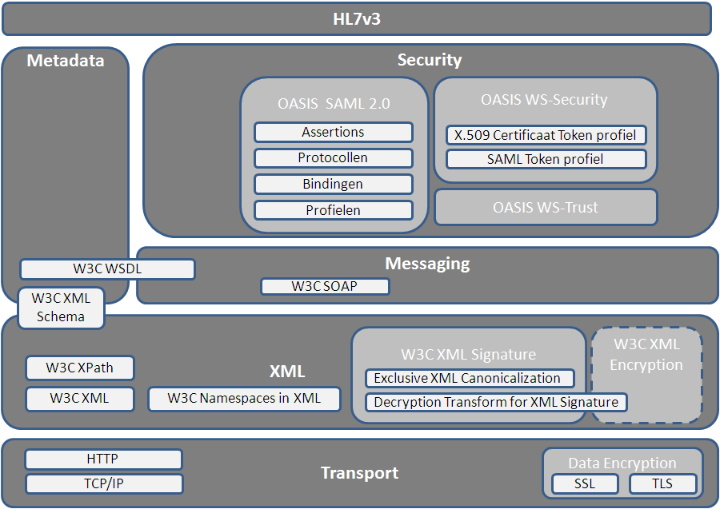
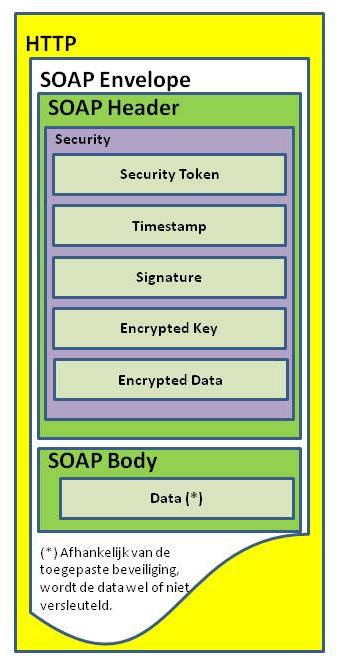

[AORTA 8.5.2](../../../../index.md) / [Aansluit- en Implementatiewijzer Kern](../../../../aansluit-en-implementatiewijzer-kern.md) / [Token specificaties](../../../token-specificaties.md) / [AORTA SAML tokens](../../aorta-saml-tokens.md) / [GBx AORTA_Auth_IH_Security_tokens_generiek](../gbx-aorta_auth_ih_security_tokens_generiek.md)

# Technologieën en standaarden

## Bijlage B Technologieën en standaarden

Deze bijlage geeft een overzicht van de gebruikte technologieën en standaarden en beschrijft die profielen die nodig zijn om berichten van securitytokens te voorzien, voor de uitwisseling van beveiligingsgerelateerde informatie tussen vertrouwde partijen en die voldoen aan de eisen van authenticiteit.  
   
**Figuur 2: Technologieën en standaarden**

### XML Signature

XML Signature [XMLSIG] beschrijft de mogelijkheid om XML documenten of delen hiervan te ondertekenen. Een deel van de XML wordt gesigneerd (als tekst) en de signature wordt als XML bestand (Signature element) toegevoegd aan het XML document.

### XML Canonicalization

XML Canonicalization [XMLC14N] (kortweg C14N genaamd) is een methode om ervoor te zorgen dat XML altijd in dezelfde syntactische vorm aanwezig is. Met XML is het mogelijk dat software "onderweg" de vorm aanpast. Zo is in XML bijvoorbeeld per definitie <tag/> equivalent aan <tag></tag>. Voor een signature is dit echter niet hetzelfde. Met C14N wordt een XML uitdrukking in een canonieke vorm gebracht. Daarna kan dan op eenduidige wijze de signature gegenereerd worden. De ontvanger kan dan ook vóór het verifiëren van de ondertekening de canonieke vorm genereren, zodat het juiste – canonieke – document wordt vergeleken met de signature.

Er zijn twee vormen van canoniek maken: Inclusive en Exclusive [EXCC14N]. De tweede vorm is de meest gebruikte voor Web Services. Het verschil tussen Inclusive en Exclusive Canonicalization zit in de wijze waarop namespace declaraties worden meegenomen. Bij Inclusive Canonicalization worden namespace declaraties uit een inkapselend document gewoon meegenomen: dat betekent dat de signature verandert wanneer een document ingekapseld wordt. Dat maakt Inclusive Canonicalization ongeschikt voor ingekapselde documenten, zoals een HL7v3 bericht in een SOAP Envelope. Daarmee is Exclusive Canonicalization de gebruikte optie voor AORTA.

Voorbeeld van een bericht vóór het canoniek maken:

```
<?xml version="1.0" encoding="UTF-8"?>

<soap:Envelope xmlns:soap="http://schemas.xmlsoap.org/soap/envelope/">

  <soap:Body>

    <MFMT_IN002101 xmlns="urn:hl7-org:v3"

      xmlns:xsi="http://www.w3.org/2001/XMLSchema-instance"

      xsi:schemaLocation="urn:hl7-org:v3 ../schemas/MFMT_IN002101.xsd">

      <id extension="34234" root="2.16.528.1.1007.3.2.700222.1"/>

      <creationTime value="20040417161000"/>

      <versionCode code="NictizEd2005-Okt"/>

      <interactionId extension="MFMT_IN002101" root="2.16.840.1.113883.1.6"/>

      <profileId root="2.16.840.1.113883.2.4.3.11.1" extension="810"/>

      <processingCode code="P"/>

      <processingModeCode code="T"/>

      <acceptAckCode code="AL"/>
```

Hetzelfde bericht canoniek, exclusive zonder commentaar:

```
<soap:Envelope xmlns:soap="http://schemas.xmlsoap.org/soap/envelope/">

  <soap:Body>

    <MFMT_IN002101 xmlns="urn:hl7-org:v3" xmlns:xsi=http://www.w3.org/2001/XMLSchema-instance xsi:schemaLocation="urn:hl7-org:v3 ../schemas/MFMT_IN002101.xsd">

      <id extension="34234" root="2.16.528.1.1007.3.2.700222.1"></id>

      <creationTime value="20040417161000"></creationTime>

      <versionCode code="NictizEd2005-Okt"></versionCode>

      <interactionId extension="MFMT_IN002101" root="2.16.840.1.113883.1.6"></interactionId>

      <profileId extension="810" root="2.16.840.1.113883.2.4.3.11.1"></profileId>

      <processingCode code="P"></processingCode>

      <processingModeCode code="T"></processingModeCode>

      <acceptAckCode code="AL"></acceptAckCode>
```

Te zien valt dat:

- de XML declaratie is verwijderd;

- attributen per element alfabetisch zijn gesorteerd;

- namespace declaraties voor een element in lexicografische volgorde eerder komen dan andere attributen van dat element;

- lege elementen een eind-tag krijgen.

Whitespace – spaties, tabs, regeleindes – zijn significant in XML. XML is immers begonnen als opmaaktaal voor documenten, en in een document is whitespace relevant.

Canoniek maken laat de whitespace dus ongemoeid, behalve newlines die bij canoniek als een linefeed worden opgenomen.

### WS-Security

Web Services Security (WS-Security) is een OASIS (Organization for the Advancement of Structured Information Standards) standaard die de integriteit, authenticiteit en vertrouwelijkheid van gegevens op *bericht niveau* garandeert (en koppelt daardoor de beveiliging los van het gebruikte communicatie kanaal).

WS-Security biedt tevens een mechanisme voor het gebruik van WS-Security tokens om deze aan berichten te koppelen. In WS-Security is een WS-Security token een XML structuur met beveiligingsgegevens. Omdat WS-Security geen specifieke type WS-Security tokens vereist, gebruiken we in de rest van dit document de term "security token" voor "WS-Security token".

  
**Figuur 3: SOAP bericht met WS-Security**

WS-Security voegt zijn gegevens toe aan de SOAP header door een <Security> element te definiëren waarbinnen een aantal beveiligingsaspecten worden geregeld, zoals:

- Vertrouwelijkheid. Berichten kunnen (deels) versleuteld worden. Hiervoor wordt de XML Encryption (W3C) specificatie geïmplementeerd.

- Integriteit. Berichten kunnen digitaal ondertekend worden zodat zowel de zendende als de ontvangende partij ervan zijn verzekerd dat de inhoud niet door derden is gewijzigd. Hiervoor wordt de XML Signature specificatie (W3C) geïmplementeerd.

- Geldigheidsduur. Berichten kunnen voor een bepaalde duur geldig en bruikbaar zijn.

- Authenticatie en autorisatie. In de SOAP header(s) kunnen verschillende type WS-Security tokens gebruikt worden, zoals:gebruikersnaam en wachtwoord van een gebruiker in tekstformaat;X.509 certificaat voor de authenticatie van gebruikers;SAML Assertion (bewering) over entiteiten.

WS-Security kent diverse profielen die het gebruik van de verschillende security tokens (WS-Security tokens) beschrijft en hoe deze in de SOAP header geplaatst moeten worden.

In de volgende paragrafen wordt WS-Trust als uitbreiding van WS-Security besproken en de WS-Security profielen X.509 Certificaat Token en SAML Token.

Er zijn twee versies van WS-Security, 1.0 [WSS] en 1.1 [WS Soap Message Security], verschenen in 2004 respectievelijk 2006. De 1.1-specificatie benadrukt verbeteringen aan "security token" ondersteuning, berichtbijlagen en het beheer van rechten.

#### WS-Trust

WS-Trust [WS Trust] is eveneens een OASIS standaard en definieert uitbreidingen op WS-Security voor het verkrijgen en valideren van security tokens en voor het vormgeven van trust relaties. De reden voor het bestaan van WS-Trust is dat WS-Security alleen niet goed schaalt in een complexe omgeving, zoals AORTA.

Indien er meerdere applicaties bestaan, verdeeld over verschillende security domeinen is het moeilijk om security tokens op de juiste manier te verkrijgen en te valideren. WS-Trust voorziet in een ontkoppelpunt voor het valideren van security tokens en het uitgeven of transformeren van deze security tokens in een bepaalde vorm (bijvoorbeeld een SAML token uit het ene domein transformeren in een SAML token uit een ander domein). Dit ontkoppelpunt heet "Security Token Service" (STS).

Binnen AORTA wordt gebruik gemaakt van WS-Trust 1.4.

#### 509 Certificate Token Profile

Dit profiel [WSX509] beschrijft het gebruik van X.509 certificaat als "security token" in WS-Security. Dit profiel definieert de opties voor het invoegen van een X.509 certificaat en gerelateerde gegevens. Hiervan zijn voor ons relevant:

- 509 certificaat in binaire vorm (geserialiseerd na Base64 encoding)

- Verwijzing naar X.509 certificaat aan de hand van de naam van de uitgevende CA en het serienummer van het certificaat binnen die CA (X509IssuerSerial).

Binnen AORTA wordt gebruik gemaakt van WS-Security X.509 profiel 1.0.

#### SAML Token Profile

Dit profiel [WS SAML Token Profile] beschrijft het invoegen van SAML assertions als "security token" in WS-Security voor SAML v2.0. Hiervan is van belang hoe de SAML assertion in de header geplaatst moet worden:

- Attaching Security Tokens met SAML v2.0

## SAML

Security Assertion Markup Language (SAML) [SAML Core] is een op XML gebaseerde OASISstandaard voor de uitwisseling van beveiligingsgerelateerde informatie.

De uitwisseling van de beveiligingsgerelateerde informatie gebeurt op basis van assertions. Een assertion is een uitspraak of bewering van een vertrouwde autoriteit (partij die verantwoordelijk is voor de waarmerking van die uitspraak) over een gebruiker en wordt door de Service Provider (partij die een applicatie of bron beschikbaar stelt voor de gebruiker) gebruikt om te bepalen of de gebruiker toegang mag krijgen tot een opgevraagde dienst of informatie. Uitspraken die een assertion kunnen bevatten zijn op te delen in een drietal categorieën:

- Authenticatie uitspraken: Deze uitspraken vertellen iets over het feit of de gebruiker zijn identiteit eerder succesvol kenbaar heeft gemaakt bij een Identity Provider. Voorbeelden van authenticatie assertions zijn: "Dit is arts X" en "Op datum D en tijdstip T heeft patiënt Y zich geauthenticeerd bij DigiD".

- Autorisatie uitspraken: Een dergelijke uitspraak vertelt tot welke delen van aangeboden diensten en/of informatie een gebruiker toegang heeft. In dit geval vertrouwt de dienstverlener volledig op de Identity Provider voor fijnmazige afscherming van de dienst, in plaats van zelf autorisatie bepalingen te maken. Een voorbeeld van een autorisatie uitspraak: "Patiënt P heeft toegang tot dossier D". Voor patiëntauthenticatie wordt geen gebruik gemaakt van deze uitspraken.

- Attribuut uitspraken: Een attribuut uitspraak geeft aan wat de kenmerken van een gebruiker zijn, zoals die bekend zijn bij een Identity Provider. Een voorbeeld van een attribuut uitspraak: "Patiënt P heeft burgerServiceNummer 123456789".

Verder beschrijft de SAML standaard onder andere:

- Verschillende mechanismen (protocollen) voor het opvragen en het verkrijgen van assertions, authenticatie verzoek, artifacts, name identifiers en logout verzoek [SAML Core];

- Bindingen met transport protocollen zoals HTTP en SOAP [SAML Binding];

- Standaard manieren (profielen) voor gebruik van SAML [SAML Profiles]

SAML heeft de WS-Security standaard geadopteerd. Met behulp van het SAML Token profile is het mogelijk om één of meerdere assertions als "security token" in SOAP berichten mee te sturen en digitaal te ondertekenen.

Binnen AORTA wordt gebruik gemaakt van HTTP over TLS-verbindingen met NCSC beveiligingsniveau “goed” om de vertrouwelijkheid van de assertions te waarborgen [SAML Security].

In de volgende paragrafen worden SAML2.0 profielen [SAML Profiles] beschreven, met referenties aan de OASIS SAML 2.0 specificaties.

#### SSO (Single Sign-On) Profile

Het Single Sign-On profiel (SSO) [SAML Profiles] is een SAML profiel dat aangeeft hoe gebruik te maken van het SAML authenticatie vraag en antwoord protocol in combinatie met verschillende SAML-bindings, zoals SOAP en HTTP. De communicatie bij authenticatie gaat tussen een Identity Provider (partij die verantwoordelijk is voor de waarmerking van de gebruiker) en een Service Provider (partij die een applicatie of bron beschikbaar stelt voor de gebruiker).

Voor het SSO profiel zijn de volgende twee aspecten van belang:

- Bepalen of de berichten door de Identity Provider of door de Service Provider worden geïnitieerd.

- Bepalen welke binding er gebruikt wordt voor de berichtuitwisseling tussen Identity Provider en Service Provider.

Het eerste aspect heeft te maken met waar de gebruiker start met het SSO proces voor de berichtuitwisseling. SAML ondersteunt twee algemene berichtstromen ter ondersteuning van het SSO proces. Binnen AORTA initieert de Service Provider het SSO profiel.

Het tweede aspect heeft te maken met de verschillende SAML bindingen (HTTP, SOAP of Artefact), die gebruikt worden tussen het uitwisselen van informatie tussen de Identity Provider en de Service Provider. Binnen AORTA maken we gebruik van Artefacts, die op SOAP/HTTP gebaseerd zijn.

Voor het SSO profiel zijn de volgende twee SAML berichten van belang; een verificatieverzoek bericht van de Service Provider naar een Identity Provider en het antwoord daarop dat van de Identity Provider naar de Service Provider wordt verzonden.

#### Artifact Resolution Profile

Het Artefact Resolution profiel [SAML Profiles] is een SAML profiel dat aangeeft hoe gebruik te maken van SAML artefacten in combinatie met SAML-bindings. De communicatie vindt plaats tussen de artefact opvrager (Service Provider) en de artefact resolution service (Identity Provider).

De artefact opvrager initieert het profiel door een vraag over een artefact naar de artefact resolution service te versturen. De artefact resolution service reageert hierop door (altijd) antwoord op de vraag te geven.

Een SAML artefact is een klein gestructureerd data object van een vast formaat dat verwijst naar een groter SAML protocol bericht [SAML Binding], bijvoorbeeld een SAML assertion. Een SAML artefact wordt in URL ingebed en overgebracht via een HTTP-bericht.
