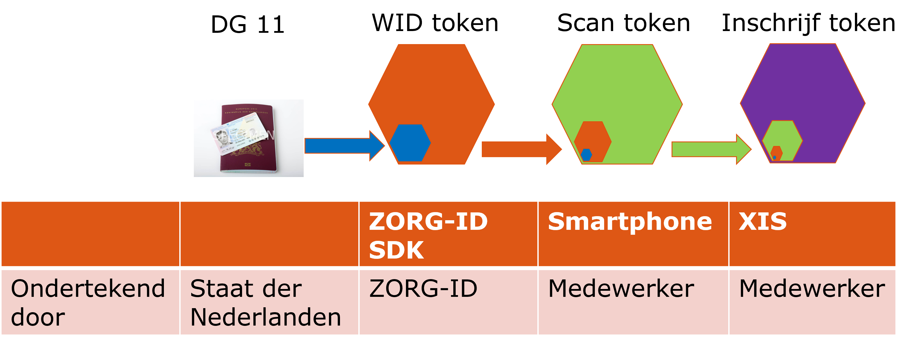

[AORTA 8.5.2](../../../../index.md) / [Aansluit- en Implementatiewijzer Kern](../../../../aansluit-en-implementatiewijzer-kern.md) / [Token specificaties](../../../token-specificaties.md) / [AORTA SAML tokens](../../aorta-saml-tokens.md) / [ZORG-ID AORTA_Auth_IH_Scantoken_en_WID_token](../zorg-id-aorta_auth_ih_scantoken_en_wid_token.md)

# Het SAML Scan en WID token

In dit hoofdstuk wordt de inhoud van het SAML scantoken besproken. Het SAML scantoken bevat een geverifieerd BSN en is ondertekend door een zorgverlener/medewerker. Het SAML scantoken is een op XML gebaseerde SAML assertion en heeft tot doel de *assertions* (bewijs van een bewering) over te brengen tussen partijen.

Alle XML voorbeelden in het document dienen door de betrokken partijen tijdens het bouwen van de uitwisseling getest, en waar nodig, in samenspraak met VZVZ aangepast te worden voor een juiste optimale werking.

## Structuur

Het SAML scantoken is een afgegeven SAML assertion met betrekking tot het, uit de chip van een ingescand Wettelijk Identificatie Document (WID) uitgelezen, BSN. Het scantoken wordt in zijn geheel Base64 geëncodeerd toegevoegd aan het inschrijftoken die gebruikt wordt bij berichtauthenticatie voor het landelijk EPD. Het SAML scantoken is ondertekend met behulp van het door ZORG-ID uitgegeven identiteitscertificaat van een zorgverlener/medewerker.

Het scantoken bevat op haar beurt een Base64 geëncodeerd attribuut waarin zich het WID_token bevindt. Het WID_token is de waarborg dat de WID data zijn verkregen middels ZORG-ID. Het WID token is qua structuur en inhoud vrijwel identiek aan het scantoken. Enige verschillen zijn:

- Het WID_token is ondertekend met het ZID servercertificaat

- Het WID_token heeft een extra attribuut met de Base64 geëncodeerde WID_raw_data

Dientengevolge kan overal waar in de hiernavolgende tekst ‘scantoken’ vermeld staat ook WID_token gelezen worden tenzij in de paragraaf duidelijk onderscheid tussen beide tokens gemaakt wordt.



Figuur 1 Structuur, Uitleg zie tekst

Figuur 1 representeert de uiteindelijke structuur. De door de scan uitgelezen datagroep 11, ondertekend door de staat der Nederlanden, wordt toegevoegd aan het WID token. Het WID token wordt ondertekend met ZORG-ID servercertificaat en toegevoegd aan het Scantoken. Het Scantoken wordt ondertekend met het identiteitscertificaat van de medewerker die de scan heeft gedaan en toegevoegd aan het inschrijftoken. Het Inschrijftoken wordt eveneens ondertekend met een ZORG-ID identiteitscertificaat.

Er wordt gebruik gemaakt van SAML v2.0 [SAML Core].

## Assertion

De assertion heeft de volgende structuur (de waarden die in het token gebruikt worden zijn fictief):

| Element/@Attribute ; | 0..1 ; | Omschrijving ; |
| --- | --- | --- |
| @ID ; | 1 ; | Unieke identificatie van de Assertion ; |
| @Version ; | 1 ; | Versie van het SAML Protocol. Vaste waarde moet zijn 2.0 ; |
| @IssueInstant ; | 1 ; | Tijdstip van uitgifte van de Assertion. ; |
| Issuer ; | 1 ; | De URA van de organisatie waarbinnen de medewerker die de scan uitvoert werkzaam is. ; |
| @NameQualifier ; | 0 ; | Niet gebruiken ; |
| @SPNameQualifier ; | 0 ; | Niet gebruiken ; |
| @Format ; | 1 ; | Format="urn:oasis:names:tc:SAML:2.0:nameid-format:entity" ; |
| @SPProviderID ; | 0 ; | Niet gebruiken ; |
| Signature ; | 1 ; | Scantoken: Bevat de handtekening over de assertion zoals gezet met behulp van het door Zorg-ID aangemaakte identiteitscertificaat van de medewerker die de scan uitvoert. ;  WID_token: Bevat de handtekening over de assertion zoals gezet met behulp van het Zorg-ID servercertificaat. ; |
| Subject ; | 1 ; | BSN van de patient waarvan de BSN gevalideerd is. ; |
| BaseID ; | 0 ; | Niet gebruiken ; |
| NameID ; | 1 ; | Bevat de gevalideerde BSN. ; |
| EncryptedID ; | 0 ; | Niet gebruiken ; |
| SubjectConfirmation ; | 1 ; | Moet aanwezig zijn. ; |
| @Method ; | 1 ; | 'urn:oasis:names:tc:SAML:2.0:cm:sender-vouches’ ; |
| SubjectConfirmationData ; | 1 ; | Bevat Keyinfo ; |
| @Recipient ; | 0 ; | Niet gebruiken ; |
| @NotOnOrAfter ; | 0 ; | Niet gebruiken ; |
| @InResponseTo ; | 0 ; | Niet gebruiken ; |
| @NotBefore ; | 0 ; | Niet gebruiken ; |
| @Address ; | 0 ; | Niet gebruiken ; |
| KeyInfo ; | 1 ; | Scantoken: Bevat het publieke deel van het X509 identiteitscertificaat ;  WID token: Bevat het publieke deel van het ZORG-ID servercertificaat ; |
| Conditions ; | 1 ; | Moet aanwezig zijn. ; |
| @NotBefore ; | 1 ; | Moet aanwezig zijn. ; |
| @NotOnOrAfter ; | 1 ; | Moet aanwezig zijn. Mag maximaal 10 jaar na @NotBefore liggen. ; |
| Condition ; | 0 ; | Niet gebruiken ; |
| AudienceRestriction ; | 1 ; | Moet aanwezig zijn ; |
| Audience ; | 1..* ; | Minimaal 1 element: urn:IIroot:2.16.840.1.113883.2.4.6.6:IIext:1 (is de ZIM). Meerdere audiences zijn toegestaan. ; |
| ProxyRestriction ; | 0 ; | Niet gebruiken ; |
| Advice ; | 0 ; | Niet gebruiken ; |
| AuthnStatement ; | 1 ; | Moet aanwezig zijn ; |
| @AuthnInstant ; | 1 ; | Tijdstip van BSN scan. ; |
| @SessionIndex ; | 0 ; | Niet gebruiken ; |
| AuthnContext ; | 1 ; | Moet aanwezig zijn ; |
| AuthnContextClassRef ; | 1 ; | urn:oasis:names:tc:SAML:2.0:ac:classes:X509 ; |
| AttributeStatement ; | 1 ; | Moet aanwezig zijn ; |
| Attribute ; | 1 ; | Moet aanwezig zijn. ; |
| @Name ; | 1 ; | Vaste waarde: “Zorgaanbieder” ; |
| AttributeValue ; | 1 ; | De URA van de zorgaanbieder waar de zorgverlener of medewerker in dienst is. ; |
| Attribute ; | 1 ; | Moet aanwezig zijn alleen in Scantoken. ; |
| @Name ; | 1 ; | Vaste waarde: “WID_token” ; |
| AttributeValue ; | 1 ; | Base64 representatie van het WID_token ; |
| Attribute ; | 1 ; | Moet aanwezig zijn alleen in het WID_token. ; |
| @Name ; | 1 ; | Vaste waarde: “WID_raw_data” ; |
| AttributeValue ; | 1 ; | Base64 representatie van de ingescande datagroep 11 van de chip van het WID inclusief het Document Security Object. ; |

N.B.: bovenstaande tabel bevat de meest gebruikte elementen van SAML assertions en is derhalve niet volledig. Voor niet genoemde elementen geldt: Niet gebruiken.

## Namespaces

Het SAML scantoken die gebruikt wordt bij berichtauthenticatie maakt gebruik van de volgende namespaces. De prefixen zijn niet normatief maar worden in dit document als voorbeelden gebruikt.

Tabel AORTA.STK.t3300 – Namespaces

| **Prefix** ; | **Namespace URI** ; |
| --- | --- |
| ds ; | [http://www.w3.org/2000/09/xmldsig#](http://www.w3.org/2000/09/xmldsig) ; |
| saml ; | urn:oasis:names:tc:SAML:2.0:assertion ; |
| wss ; | [http://docs.oasis-open.org/wss/2004/01/oasis-200401-wss-wssecurity-secext-1.0.xsd](http://docs.oasis-open.org/wss/2004/01/oasis-200401-wss-wssecurity-secext-1.0.xsd) ; |

|  | Bij het gebruik van de namespace-prefixes is het van belang deze na het ondertekenen niet meer te veranderen, dit maakt de digitale handtekening ongeldig. ; |
| --- | --- |

## Inhoud

De volgende paragrafen beschrijven de verschillende kenmerken en beveiligingsgerelateerde gegevens die het SAML scantoken onderscheiden, zoals in [IH tokens generiek] beschreven is.

```
<saml:Assertion ... xmlns:saml="urn:oasis:names:tc:SAML:2.0:assertion">
```

Het SAML scantoken begint met het Assertion element en een verwijzing naar de XML SAML namespace voor SAML 2.0 assertions. De attributen behorende bij het Assertion element wordt in [paragraaf 2.4.1](https://vzvz.atlassian.net/wiki/spaces/AORTA84/pages/879593947/Het+SAML+Scan+en+WID+token#HetSAMLScanenWIDtoken-Uniekheid) Uniekheid beschreven.

### Uniekheid

```
ID="token_dd1c1f96-f0b0-4026-a978-4d724c0a0a4f"

IssueInstant="2009-06-24T11:47:34Z"

Version="2.0">
```

De volgende attributen van het SAML assertion element maken van de SAML assertion een uniek gegeven, uitgegeven door de verzender van het bericht. Het attribuut ID identificeert op een unieke wijze de assertion. De waarde moet *mondiaal uniek* zijn voor AORTA berichten, zodat bij samenvoegen van meerdere XML bestanden (in een HL7v3 batch of anderszins) de waarde uniek blijft.

Het wordt aanbevolen een UUID (Universally Unique Identifier) te gebruiken. Bij het gebruik van andere vormen is er een kans, hoe klein ook, dat een ID samenvalt met een ID gemaakt volgens een andere methode van een andere leverancier).

|  | Een ID in XML mag niet met een cijfer beginnen. Bij het gebruik van een UUID is het dus aan te raden een prefix te gebruiken, welke met een letter of underscore (‘_’) begint. ; |
| --- | --- |

Het attribuut IssueInstant is een tijdsmoment van uitgifte van de SAML assertion. De tijdswaarde is gecodeerd in UTC. Het attribuut Version is de gebruikte SAML versie van de SAML assertion. De aanduiding voor de versie van SAML gedefinieerd in deze specificatie is "2.0".

### Afzender

```
<saml:Issuer>

 <!-- De Issuer verwijst naar de organisatie waarbinnen de BSN validatie heeft plaats gevonden.-->

     urn:IIroot:2.16.528.1.1007.3.3:IIext:12345678

</saml:Issuer>
```

De URA wordt uitgedrukt met behulp van een URN (Uniform Resource Name). De URN is opgebouwd uit:

"urn:IIroot:"<OID voor UZI organisatieIds>":IIext:"<URA>

De URN string is opgebouwd uit een IIroot en een IIext. "II" staat voor het HL7v3 datatype Instance Indentifier. Om de namespace in URN uniek te krijgen is II als prefix voor de root en ext geplaatst.

URA’s worden uitgedrukt als een id onder het identificatiesysteem “2.16.528.1.1007.3.3”. De URA wordt toegekend door het UZI-register. Stel dat de URA de waarde “12345678” heeft, dan ziet de URN er als volgt uit:

urn:IIroot:2.16.528.1.1007.3.3:IIext:12345678

### Onderwerp

```
<saml:Subject>

  <saml:NameID>

   950052413

  </saml:NameID>

  <saml:SubjectConfirmation Method="urn:oasis:names:tc:SAML:2.0:cm:sender-vouches ">

  </saml:SubjectConfirmation>

</saml:Subject>
```

De Subject verwijst naar de door de zorgverlener/medewerker gevalideerde BSN. De BSN validatie dient plaatsgevonden te hebben door:

- inlezen van de chip uit het WID waarbij:

- De echtheid van het WID wordt gecontroleerd

- De BSN wordt uitgelezen uit de chip of, bij paspoorten uitgegeven na 1 augustus 2021, de BSN QR code wordt gelezen.

Vervolgens moet de SubjectConfirmation nog toegevoegd worden:

```
  <saml:SubjectConfirmation Method="urn:oasis:names:tc:SAML:2.0:cm:sender-vouches ">

  </saml:SubjectConfirmation>
```

### Geldigheid

```
<saml:Conditions

 NotBefore="2009-06-24T11:47:34Z"

 NotOnOrAfter="2010-12-24T11:47:34Z">
```

Het attribuut *NotBefore* is de tijd waarop de SAML assertion geldig wordt. NotBefore moet altijd op of na de aanvang van de geldigheidsdatum van het certificaat (waarmee het scantoken is getekend) liggen.

|  | Wordt een bericht met een scantoken ontvangen voor *NotBefore* is aangevangen, dan **moet** dit bericht geweigerd worden. ; |
| --- | --- |

Het attribuut *NotOnOrAfter* is de tijd waarop de SAML assertion vervalt. *NotOnOrAfter*mag na het verstrijken van de geldigheid van het certifcaat (waarmee het scantoken is getekend) liggen.

|  | Wordt een bericht met een scantoken ontvangen op of nadat *NotOnOrAfter* is verstreken, dan **moet** dit bericht geweigerd worden. ; |
| --- | --- |

Deze tijd is als bovenstaande tijd geformatteerd. Het maximaal toegestane verschil tussen *NotBefore* en *NotOnOrAfter* is tien jaar.

|  | De geldigheidsduur van een scantoken (*NotOnOrAfter* minus *NotBefore*) kan langer zijn dan de geldigheidsduur van het identiteitscertificaat waarmee het token wordt getekend. ; |
| --- | --- |

Indien het certificaat waarmee het scantoken is getekend op de CRL is geplaatst, dan dient het scantoken niet geweigerd te worden door het LSP. Het is op de CRL niet inzichtelijk om welke reden een certificaat op de CRL is geplaatst. Dit kunnen uiteenlopende redenen zijn zoals een verloren telefoon. Om het zorgproces niet te frustreren wordt deze controle procesmatig opgepakt door Security Management.

Echter, bij het ondertekenen van het scantoken moet er een geldig certificaat gebruikt worden. Indien bij ondertekening van het scantoken het certificaat al op de CRL is geplaatst, dan dient het scantoken wel geweigerd te worden.

|  | Indien het certificaat vóór ondertekening van het scantoken op de CRL is geplaatst, dan dient het scantoken geweigerd te worden door het LSP. ; |
| --- | --- |

|  | Indien het certificaat na ondertekening van het scantoken op de CRL is geplaatst, dan dient het scantoken niet geweigerd te worden. ; |
| --- | --- |

Het inperken van bepaalde partijen (AudienceRestriction) waarvoor de assertion bedoeld is wordt beschreven in [paragraaf 2.4.5](https://vzvz.atlassian.net/wiki/spaces/AORTA84/pages/879593947/Het+SAML+Scan+en+WID+token#HetSAMLScanenWIDtoken-Ontvanger) Ontvanger.

### Ontvanger

```
<saml:AudienceRestriction>

  <!-- Root en extensie van de ZIM -->

  <saml:Audience>urn:IIroot:2.16.840.1.113883.2.4.6.6:IIext:1</saml:Audience>

</saml:AudienceRestriction>
```

In de AudienceRestriction wordt beschreven aan wie de SAML assertion is gericht. In ieder geval dient de ZIM als audience voor te komen (IIext:1). Meerdere Audience elementen is toegestaan.

Voor de <Audience> parameter is gekozen voor URN. De URN string is opgebouwd uit een IIroot en een IIext. "II" staat voor het HL7v3 datatype Instance Indentifier. Om de namespace in URN uniek te krijgen is II als prefix voor de root en ext geplaatst.

AORTA Applicatie-id’s worden uitgedrukt als een id onder het identificatiesysteem “2.16.840.1.113883.2.4.6.6”. Het correcte applicatie-id voor de GBZ-applicatie wordt toegekend bij aansluiting op de AORTA. Stel dat dit “300” zou zijn, dan ziet de URN er als volgt uit:

urn:IIroot:2.16.840.1.113883.2.4.6.6:IIext:300

### Authenticatie

```
<saml:AuthnStatement

 AuthnInstant="2009-06-24T11:47:34"

 SessionIndex="token_2.16.528.1.1007.3.3.1234567.1_0123456789">
```

Het subject, de gevalideerde BSN, in de SAML assertion is geauthenticeerd door middel van het X509 identiteitscertificaat van de uitvoerende zorgverlener/medewerker.

```
<saml:AuthnContext>

  <saml:AuthnContextClassRef

>urn:oasis:names:tc:SAML:2.0:ac:classes:X509</saml:AuthnContextClassRef>

</saml:AuthnContext>
```

```
</saml:AuthnStatement>
```

Afsluiting authentication statement.

### Attributen

```
<saml:AttributeStatement>
```

De volgorde van de attributen in het AttributeStatement is niet relevant. Er mogen geen andere attributen opgenomen worden in het AttributeStatement dan hier beschreven is.

**Zorgaanbieder**

```
<saml:Attribute Name="Zorgaanbieder">

  <saml:AttributeValue>

      urn:IIroot:2.16.528.1.1007.3.3:IIext:12345678

  </saml:AttributeValue>

</saml:Attribute>
```

Het attribuut Zorgaanbieder bevat de URA van de zorgaanbieder van de zorgverlener/medewerker die de BSN validatie heeft uitgevoerd en het token heeft ondertekend. Vanuit het certificaat waarmee het token is ondertekend, kan worden afgeleid wat het URA-nummer van de zorgaanbieder waar de ondertekenaar in dienst is.

De URA wordt uitgedrukt met behulp van een URN (Uniform Resource Name). De URN is opgebouwd uit:

"urn:IIroot:"<OID voor UZI organisatieIds>":IIext:"<URA>

De URN string is opgebouwd uit een IIroot en een IIext. "II" staat voor het HL7v3 datatype Instance Indentifier. Om de namespace in URN uniek te krijgen is II als prefix voor de root en ext geplaatst.

URA’s worden uitgedrukt als een id onder het identificatiesysteem “2.16.528.1.1007.3.3”. De URA wordt toegekend door het UZI-register. Stel dat de URA de waarde “12345678” heeft, dan ziet de URN er als volgt uit:

urn:IIroot:2.16.528.1.1007.3.3:IIext:12345678

**WID_token (alleen in Scan_token)**

```
<saml:Attribute Name="WID_token">

  <saml:AttributeValue>

      Base64 representatie van het WID_token

  </saml:AttributeValue>

</saml:Attribute>
```

Het attribuut WID_token bevat de gehele SAML assertion ondertekend met het ZID servercertificaat Base64 geëncodeerd.

**WID_raw_data (alleen in WID_token)**

```
<saml:Attribute Name="WID_raw_data">

  <saml:AttributeValue>

      Base64 representatie van de ingescande Datagroep 11

  </saml:AttributeValue>

</saml:Attribute>
```

Het attribuut WID_raw_data bevat de volledig ingescande datagroep 11 uit het WID. Het element is Base64 geëncodeerd.

Indien het element base64 gedecodeerd wordt is de structuur in JSON als volgt:

```
{"type": "3",

"version": "1",

"attributes":

[{"dg11": "<dg11 value>"}],

"sod": "<sod value>"

}
```

Waarbij:

“dg11” de data uit datagroep 11 bevat en

“sod” het Document Security Object bevat.

**attributeStatement blok**

Het attributen statement blok ziet er dan bijvoorbeeld zo uit (de volgorde van de attributen is niet relevant):

```
<saml:AttributeStatement>

  <saml:Attribute Name="Zorgaanbieder">

    <saml:AttributeValue>

       urn:IIroot:2.16.528.1.1007.3.3:IIext:12345678

    </saml:AttributeValue>

  </saml:Attribute>

  <saml:Attribute Name="WID_token">

    <saml:AttributeValue>

        Base64 representatie van het WID_token

    </saml:AttributeValue>

  </saml:Attribute>

</saml:AttributeStatement>
```

Tenslotte wordt het attributen statement blok afgesloten met

```
</saml:AttributeStatement>
```

## Algoritmes

Om de integriteit en onweerlegbaarheid van het SAML scantoken te waarborgen wordt een XML Signature geplaatst, zoals beschreven in [IH tokens generiek]. Na plaatsen van de XML Signature kan de ontvanger, met gebruikmaking van het persoonsgebonden identiteits-certificaat van de verzender en de CA certificaten zoals verstrekt door ZORG-ID, onomstotelijk vaststellen dat het SAML scantoken ondertekend is met de privé sleutel behorend bij het gebruikte certificaat van de zorgmedewerker en dat het WID_token ondertekend is met de privé sleutel van het ZORG-ID servercertificaat.

De XML Signature van het SAML scantoken die gebruikt wordt bij berichtauthenticatie met behulp van het identiteitscertificaat maakt gebruik van de volgende algoritmes, zoals beschreven in [IH tokens generiek]:

- Voor het berekenen van de hashwaarde wordt SHA-256 gebruikt.

- Voor de digitale handtekening in AORTA wordt gebruik gemaakt van een RSA handtekening over een SHA-256 digest.

|  | Omdat de XML Signature onderdeel is van het SAML scantoken en in het SAML scantoken geplaatst wordt, moet er een "enveloped-signature" transformatie uitgevoerd worden die de Signature tags uit het SAML scantoken verwijderd gevolgd door een “exc-c14n transformatie” (zie ook [SAML Core] §5.4.3 en §5.4.4). ; |
| --- | --- |

## Opbouw

### De headers

Eerst wordt het SAML scantoken – het <saml:Assertion ...> element aangemaakt en gevuld met die elementen, zoals beschreven in [paragraaf 2.4](https://vzvz.atlassian.net/wiki/spaces/AORTA84/pages/879593947/Het+SAML+Scan+en+WID+token#HetSAMLScanenWIDtoken-Inhoud) Inhoud.

```
<saml:Assertion

   ID="token_2.16.528.1.1007.3.3.1234567.1_0123456789"

   IssueInstant="2009-06-24T11:47:34Z"

   Version="2.0"

   xmlns:saml="urn:oasis:names:tc:SAML:2.0:assertion">

 ... Zie paragraaf 2.4 Inhoud ...

</saml:Assertion>
```

Het XML Signature blok is onderdeel van het SAML scantoken. Het XML Signature blok komt na het <saml:Issuer> element. Na de Signature volgt de rest van de inhoud van de assertion.

```
<saml:Assertion

   ID="token_2.16.528.1.1007.3.3.1234567.1_0123456789"

   IssueInstant="2009-06-24T11:47:34Z"

   Version="2.0"

   xmlns:saml="urn:oasis:names:tc:SAML:2.0:assertion">

  <saml:Issuer Format="urn:oasis:names:tc:SAML:2.0:nameid-format:entity">

   urn:IIroot:?:IIext:?

  </saml:Issuer>

  <ds:Signature xmlns:ds="http://www.w3.org/2000/09/xmldsig#">

    <ds:SignedInfo>

    ...

    </ds:SignedInfo>

    <ds:SignatureValue>Wuwn...5e4=</ds:SignatureValue>

    <ds:KeyInfo>

      <wss:SecurityTokenReference>

        <ds:X509Data>

        ...

        </ds:X509Data>

      <wss:SecurityTokenReference>

    </ds:KeyInfo>

  </ds:Signature>  ...

  ... Zie paragraaf 2.3 Inhoud ...

</saml:Assertion>
```

Indien de Signature aangemaakt wordt moet niet meer met de strings (saml:Assertion en SignedInfo) gemanipuleerd worden, maar ze moeten octet-voor-octet overgenomen worden in het bericht. Strikt genomen is het toegestaan wijzigingen aan te brengen die door canonicalisatie bij de ontvanger weer opgeheven worden, maar wanneer de digitale handtekening door middel van strings wordt opgebouwd, is het een foutgevoelige handeling.

Lange Base 64 waarden zijn in het voorbeeld afgekort. Wederom kan dit als strings worden behandeld, waarbij drie waarden vervangen moeten worden.

Deze drie waarden worden ingevuld:

- Neem het SignedInfo blok op.

- Neem de SignatureValue op.

- Neem certificaatgegevens in het KeyInfo blok op, in de vorm van het volledige publieke certificaat (in het scantoken het identiteitscertificaat; in het WID-token het ZORG-ID servercertificaat).

|  | Wanneer een bericht een SAML assertion bevat, moet dat bericht precies één bijbehorende digitale handtekening bevatten. ; |
| --- | --- |

Het maken van de XML Signature uit strings levert de SAML assertion op met daarin de Signature.

### 1.2.2 Plaats van het SAML token en de digitale handtekening

Het SAML scantoken met daarin de digitale handtekening wordt Base64-geëncodeerd in het attribuut “Scantoken” van het inschrijftoken gezet.

Het SAML WID_token met daarin de digitale handtekening wordt Base64-geëncodeerd in het attribuut “WID_token” van het scantoken gezet.

De WID_raw_data met daarin de digitale handtekening wordt Base64-geëncodeerd in het attribuut “WID_raw_data” van het WID_token gezet.
