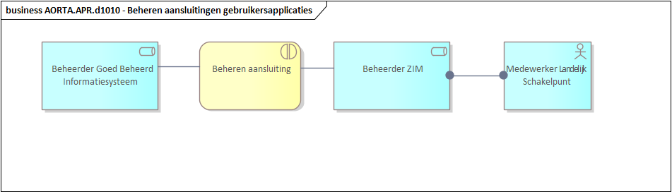
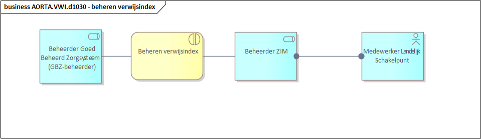
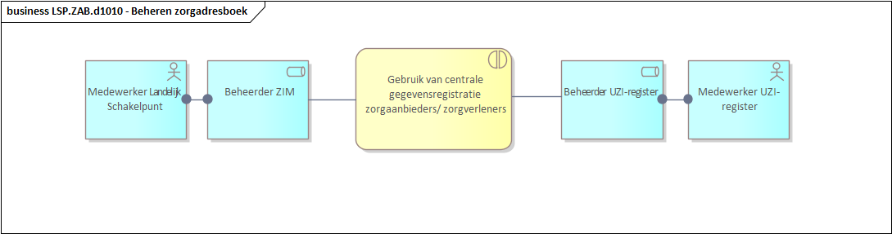

[AORTA 8.5.2](../index.md) / [Logische architectuur](../logische-architectuur.md)

# Beheerinteracties

Bij de pagina '[Ondersteunende interacties](https://vzvz.atlassian.net/wiki/x/UYKObg)' werden de ondersteunende interacties geïntroduceerd, die nodig zijn om de primaire interacties (het sturen en opvragen van patiëntgegevens) te ondersteunen. Enkele ondersteunende interacties tussen de partijen die betrokken zijn bij AORTA hebben betrekking op beheerwerkzaamheden voor informatiesystemen.

Nu de [informatiesystemen](informatiesystemen.md)zijn geïntroduceerd, kunnen ook de beheerinteracties kort worden geïntroduceerd. Deze worden echter alleen behandeld voor zover zij leiden tot eisen aan de functionaliteit van de ZIM of GBx. Een uitgebreide analyse van beheerprocessen valt buiten de reikwijdte van dit document. Hiervoor wordt verwezen naar de operationele uitwerking van beheerprocedures zoals vastgelegd in [AORTA DAP].

## Actoren en rollen

Ten behoeve van beheer worden de volgende aanvullende rollen onderscheiden.

### GBx-beheerder en GBZ-beheerder[^1]

De ‘GBx-beheerder’ draagt de verantwoordelijkheid voor het zorgvuldig beheren van een GBx dat op de ZIM wordt aangesloten en is contactpersoon voor de beheerder van de ZIM op het gebied van systeemtechnische zaken die de communicatie tussen aangesloten informatiesysteem en de ZIM beïnvloeden. In het geval van een goed beheerd zorgsysteem (GBZ) spreken we van een GBZ-beheerder. De rol van GBZ-beheerder wordt uitgevoerd onder de verantwoordelijkheid van de zorgaanbieder die eigenaar is van het GBZ en kan zo nodig worden uitbesteed aan een externe beheerpartij, mits nog steeds aan de eisen wordt voldaan die worden gesteld aan een GBZ.

Vooralsnog is voor GBZ-beheerders geen eigen identificatiemiddel ontwikkeld.

### Beheerder ZIM

De ‘beheerder ZIM’ draagt de verantwoordelijkheid voor het zorgvuldig beheren van de ZIM en de connecties met de daarop aangesloten informatiesystemen. De beheerder ZIM draagt daarmee zorg voor het dagelijks functioneren van AORTA als geheel. Aan de rol van beheerder ZIM kunnen nadere eisen worden gesteld die de rol verder onderverdelen in deelrollen. De rol van beheerder ZIM valt onder de eindverantwoordelijkheid van de LSP-organisatie (zie pagina '[Actoren en rollen - Landelijk schakelpunt](https://vzvz.atlassian.net/wiki/x/z4KObg)').

## Toegang van GBZ-beheerders tot primaire en ondersteunende interacties

De [primaire](https://vzvz.atlassian.net/wiki/x/lYGObg)- en [ondersteunende](https://vzvz.atlassian.net/wiki/x/UYKObg)interacties zijn besproken die ondersteund worden door AORTA.

Ter ondersteuning van het functioneren van AORTA moeten GBZ-beheerders ook in staat zijn om primaire en ondersteunende interacties uit te voeren die normaal gesproken door zorgverleners worden uitgevoerd, bijvoorbeeld om problemen te onderzoeken. GBZ-beheerders mogen echter geen toegang krijgen tot medische gegevens. Om deze reden is een reeks van niet werkelijk bestaande patiënten gedefinieerd met een speciale reeks burgerservicenummers, die “fictieve BSN’s” worden genoemd. Interacties met betrekking tot patiëntgegevens mogen door GBZ-beheerders alleen worden uitgevoerd in relatie tot fictieve BSN’s.

De volgende reeds behandelde interacties zijn toegankelijk voor GBZ-beheerders onder gebruik van fictieve BSN’s:

- opvragen van patiëntgegevens;

- sturen van patiëntgegevens;

- aan- en afmelden van patiëntgegevens;

- raadplegen verwijsindex;

- bijhouden van abonnementen.

NB: vanwege het feit dat vooralsnog geen identificatiemiddel voor GBZ-beheerders voorhanden is, kan de beheerder in de praktijk nog niet zelfstandig van deze functionaliteit gebruik maken; het gebruik van fictieve BSN’s is al wel toegankelijk met een UZI-zorgverlener pas, waardoor deze BSN’s wel voor testdoeleinden bruikbaar zijn.  
  
De volgende reeds behandelde interacties zijn niet gerelateerd aan patiëntgegevens en zijn toegankelijk voor GBZ-beheerders:

- selecteren van zorgaanbieders, zorgverleners en zorgaanbiederapplicaties.

## Beheer van aansluitingen

Diagram AORTA.APR.d1010 - interactie voor het beheren van aansluitingen

De ZIM bewaart informatie over aangesloten informatiesystemen in het APR. Opname in het APR is een voorwaarde voor berichtenuitwisseling met de ZIM. De beheerder van een aangesloten GBx moet gegevens uitwisselen met de beheerder van de ZIM om aansluitgegevens van het systeem actueel te houden.

Daarnaast is er een interface met het LSP waarmee een GBX een bericht kan versturen met configuratieparameters m.b.t. de functionaliteiten die de applicatie ondersteunt.

## Beheer van de verwijsindex

Diagram AORTA.VWI.d1030 – beheren van de verwijsindex

In de VWI van de ZIM staan alle aanmeldingen van alle patiënten die bevraagd kunnen worden via AORTA. Wanneer een GBZ-beheerder vermoedt dat de in de VWI opgenomen verwijzingen uit de pas lopen met het beeld dat men vanuit het eigen informatiesysteem van aanmeldingen heeft, kan de GBZ-beheerder dit controleren door de verwijzingen uit het informatiesysteem van het GBZ te vergelijken met de verwijzingen die zijn opgenomen in de VWI. Hiervoor wordt een interface op de ZIM beschikbaar gesteld. Aan de hand van het resultaat van deze vergelijking kan de GBZ-beheerder nieuwe (her)aanmeldingen en/of afmeldingen initiëren.

## Beheer van het zorgadresboek

De gegevens over zorgaanbieders en zorgverleners in het [ZORG-AB](https://vzvz.atlassian.net/wiki/x/FIOObg)worden overgenomen uit een centraal zorgaanbieder/zorgverlener register (het [UZI-register](https://vzvz.atlassian.net/wiki/x/I4KObg)) en de VZVZ-administratie.

Diagram LSP.ZAB.d1010 - interactie voor het beheer van het adresboek

Wijzigingen in het UZI-register en de VZVZ-administratie moeten regelmatig worden verwerkt in het ZORG-AB. Dit om te voorkomen dat er niet-actuele gegevens worden gebruikt.

## Beheer van zorgtoepassingen

De gegevens met betrekking tot zorgtoepassingen kunnen configureerbaar worden verwerkt door de beheerder ZIM. De configuratie-items worden aangeleverd door de LSP-opdrachtgever. De configuratie-items dienen door de beheerder ZIM ingelezen te worden.

Een configureerbare zorgtoepassing (CZT) geeft invulling aan de [primaire interacties](https://vzvz.atlassian.net/wiki/x/M4KObg): het opvragen en sturen van patiëntgegevens.

## Beheer van selectie en determinatieserver

De gegevens met betrekking tot de op te vragen bouwstenen, vraag- en filterparameters worden aangeleverd door de LSP-opdrachtgever. De betreffende gegevens worden ingelezen door de beheerder ZIM.

[^1]: In operationele zin wordt de beheerderrol per betrokken organisatie verder uitgewerkt in [AORTA DAP].
