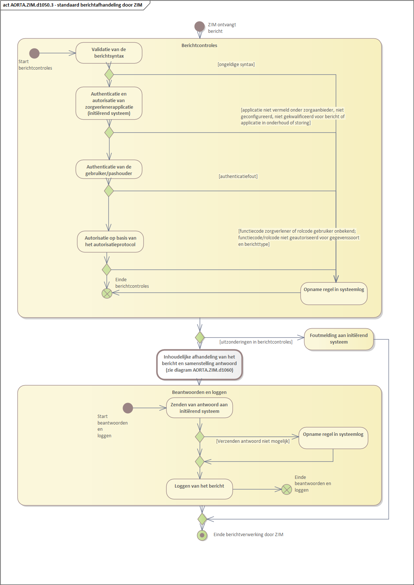
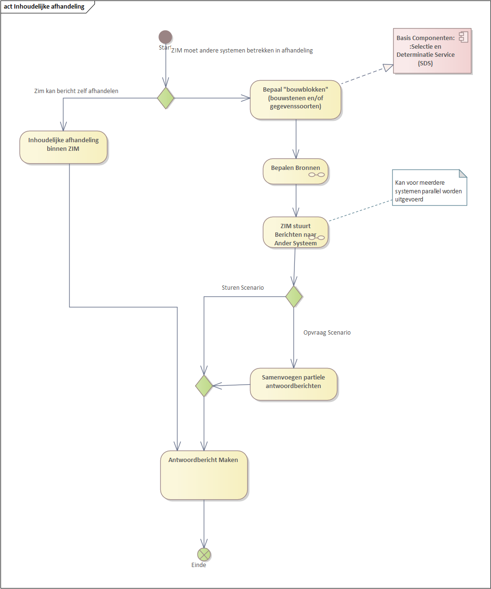
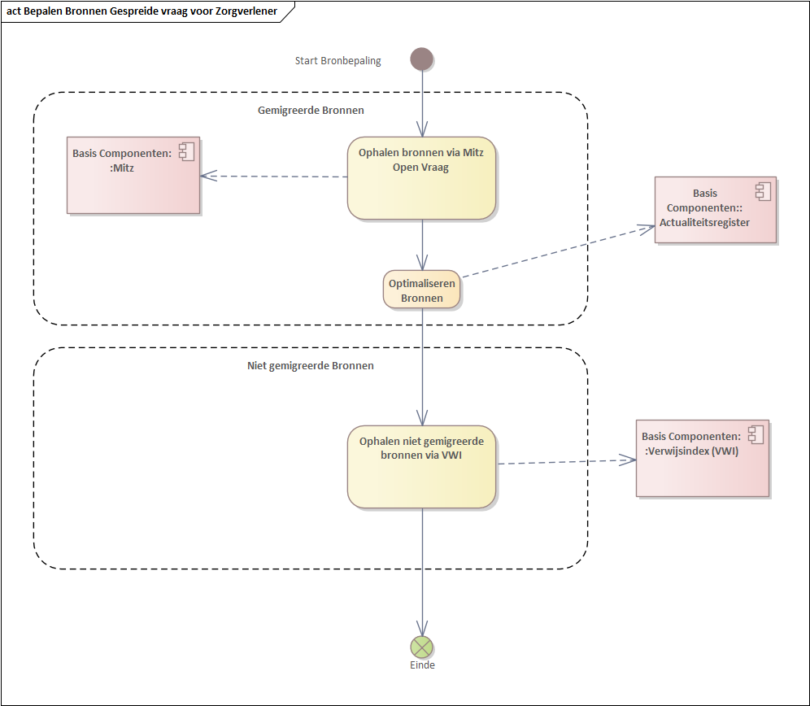
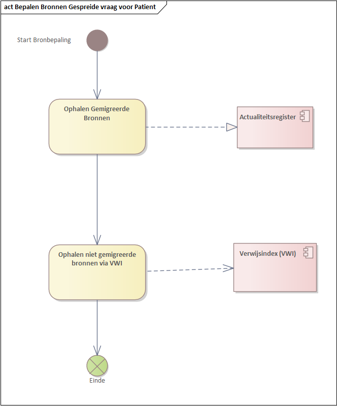
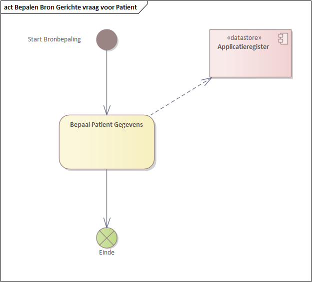
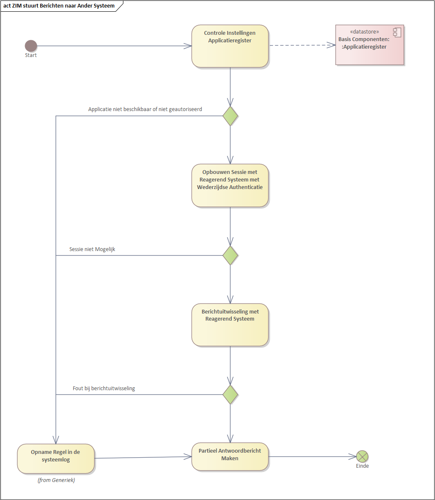
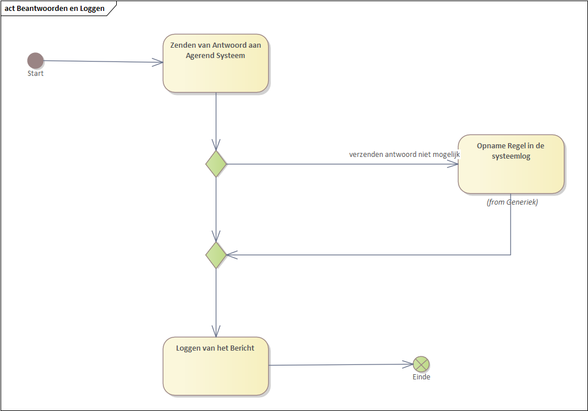

[AORTA 8.5.2](../../index.md) / [Logische architectuur](../../logische-architectuur.md) / [Berichtafhandeling](../berichtafhandeling.md)

# Berichtafhandeling door de ZIM

Bij het afhandelen van de berichten afkomstig van aangesloten GBx’en door de ZIM wordt een vast patroon gevolgd waarbij verschillende componenten binnen de ZIM betrokken zijn. Dit patroon is weergegeven in diagram AORTA.ZIM.d1050.3

Het GBx dat de berichtuitwisseling initieert met een bericht naar de ZIM wordt in deze beschrijving aangemerkt als ‘initiërend systeem’.

Een (eventueel) systeem dat tijdens de berichtafhandeling door de ZIM wordt geraadpleegd, wordt in deze beschrijving aangemerkt als ‘reagerend systeem’.

### Validatie van de berichtsyntax

De ZIM controleert (een gedeelte van) het bericht op geldigheid ten opzichte van XML schema’s[^1]. Indien het ontvangen bericht syntactisch ongeldig is, retourneert de ZIM een foutmelding en breekt de afhandeling af. Berichten bestemd voor volledige afhandeling binnen de ZIM, worden geheel gevalideerd. Berichten die door de ZIM worden doorgestuurd naar een reagerend GBZ worden alleen gevalideerd voor zover nodig voor de verdere berichtverwerking; deze validatie strekt zich niet uit tot de HL7-payload (zie '[Protocollen](https://vzvz.atlassian.net/wiki/x/JIaObg)' ) van het bericht.

### Authenticatie en autorisatie van de zorgverlener applicatie

De ZIM controleert dat het applicatie-id, genoemd als afzender van het bericht, in het applicatieregister is geregistreerd onder de organisatie die opgenomen is in servercertificaat[^2]. Indien dit niet het geval is of indien de applicatie volgens het applicatieregister niet gekwalificeerd of geconfigureerd is voor het interactie-id, retourneert de ZIM een foutmelding en breekt de afhandeling af.

Indien de applicatie een status ‘onderhoud’ of ‘storing’ heeft in het applicatieregister, retourneert de ZIM een foutmelding, breekt de afhandeling af en neemt een gebeurtenis op in het systeemlog.[^3]

[[1]](berichtafhandeling-door-de-zim.md#_ftnref1) Deze schema’s zijn gebaseerd op normatieve beschrijvingen in implementatiehandleidingen.

[[2]](berichtafhandeling-door-de-zim.md#_ftnref2) Voor een GBZ wordt deze organisatie afgeleid uit het UZI-abonneenummer op het servercertificaat van het GBZ waarmee de TLS-verbinding tot stand kwam, voor een GBP, GBK of een niet UZI-abonnee (GBO) de organisatie genoemd op het PKIO-servercertificaat.

[[3]](berichtafhandeling-door-de-zim.md#_ftnref3) Berichten met betrekking tot het applicatieregister en de VWI-synchronisatiefunctionaliteit zijn hierop een uitzondering.

### Authenticatie van de gebruiker / pashouder

Bij uitwisseling van gegevens met of via de ZIM moet de authenticiteit van de gebruiker of de verantwoordelijke voor de gegevensuitwisseling met voldoende waarborg worden vastgesteld. Hiertoe heeft de gebruiker een vertrouwensmiddel aan de hand waarvan de gebruiker kan worden geauthentiseerd (zie '[Basisregistraties en vertrouwensmiddelen](https://vzvz.atlassian.net/wiki/x/MoWObg)'). Een zorgverlener maakt hiertoe gebruik van een UZI-pas, ZORG-ID Smartcard of ZORG-ID Mobile App. Een klantenloketmedewerker maakt gebruik van een PKIoverheidpas. De patiënt kan zich authentiseren door middel van DigiD.

Diagram AORTA.ZIM.d1050.2 - standaard berichtafhandeling door de ZIM

Bij tokenauthenticatie komt een TLS-verbinding tot stand tussen GBx en ZIM op basis van het servercertificaat van het GBx en het servercertificaat van de ZIM. Op basis van het servercertificaat van het GBx wordt vastgesteld vanuit welke organisatie de berichtuitwisseling is geïnitieerd.

Daarnaast kunnen ten behoeve van de authenticatie en autorisatie van de gebruiker in het bericht meerdere tokens worden opgenomen:

- **Transactietoken (T):**  
Dit token is gekoppeld aan een uniek bericht en bevat informatie zoals de *interactionId* en *messageId*, waardoor het bericht onlosmakelijk verbonden is met het token. Het transactietoken wordt ondertekend door een servercertificaat van het versturende systeem of, indien van toepassing, door het persoonlijke UZI-certificaat van de gebruiker of het authenticiteitscertificaat op de ZORG-ID Smartcard of ZORG-ID Mobile App. Dit token waarborgt de integriteit van het bericht en biedt een beveiligingslaag tegen hergebruik. Zie [IH TRANS] voor een volledige beschrijving en afhandeling van het transactietoken.

- **PKIO-token (P):**  
Dit token dient voor de authenticatie van een specifieke gebruiker in het kader van een unieke interactie. Het wordt ondertekend met het persoonlijke PKIO-certificaat van de gebruiker, wat de betrouwbaarheid en traceerbaarheid van de handeling garandeert. Zie [IH PKIO] voor een volledige beschrijving en afhandeling van het PKIO-token.

- **Mandaattoken (M):**  
Dit token draagt autorisaties over van een mandaterende partij naar een gemandateerde partij. Het mandaattoken bevat specifieke afspraken over de acties die de gemandateerde partij mag uitvoeren, zoals toegang tot patiëntgegevens of andere zorggerelateerde taken. Het token is essentieel voor het aantonen van de gedelegeerde autorisatie en wordt gegenereerd door het systeem van de mandaterende partij. Zie [IH MAN] voor een volledige beschrijving en afhandeling van het mandaattoken.

- **Inschrijftoken (I):**  
Dit token wordt gebruikt om een patiënt te koppelen aan een behandelende organisatie. Het inschrijftoken fungeert als een bewijs dat de patiënt is geïdentificeerd en de inschrijving is uitgevoerd door een geauthentiseerde zorgverlener. Dit token is een essentieel onderdeel van de registratie van patiënten binnen zorgprocessen. Zie [IH INSCHRIJF] voor een volledige beschrijving en afhandeling van het inschrijftoken.

Het gebruik en voorkomen van een token is afhankelijk van meerdere factoren, waaronder het vertrouwensniveau dat vereist is voor een berichtuitwisseling, de aanwezigheid van een mandaat, en het specifieke uitwisselingsmechanisme dat wordt toegepast. In **Tabel 1** worden de verschillende combinaties van tokens en uitwisselingsmechanismen gedetailleerd beschreven.

Bij het uitwisselen van berichten met de ZIM zijn twee vertrouwensniveaus gedefinieerd: **‘laag’** en **‘midden’**. Het vereiste vertrouwensniveau wordt bepaald op basis van het type bericht en de gevoeligheid van de gegevens die worden uitgewisseld.

- **Niveau ‘laag’:**  
Dit niveau richt zich uitsluitend op het vaststellen van de herkomstorganisatie van de afzender, zonder authenticatie van een specifieke gebruiker. De identiteit van de gebruiker is in dit geval niet relevant. De afzenderorganisatie wordt vastgesteld op basis van het servercertificaat (bijvoorbeeld GBx-certificaat). Er is geen vereiste voor een persoonlijke pas of aanvullende tokens. Dit niveau is geschikt voor berichten waarbij geen persoonlijke of medisch inhoudelijke gegevens worden verwerkt.

- **Niveau ‘midden’:**  
Dit niveau vereist een hogere mate van zekerheid door de authenticatie van de individuele afzender (zorgmedewerker of zorgverlener). Voor dit vertrouwensniveau is een persoonlijke token(s) verplicht in het bericht, afhankelijk van de situatie zoals beschreven in **Tabel 1**. Dit niveau is minimaal vereist voor berichten die medisch inhoudelijke gegevens bevatten of waarbij de afzender direct verantwoordelijk is voor de inhoud en de actie. Het gebruik van een persoonlijke UZI-pas is noodzakelijk om de identiteit van de gebruiker te waarborgen.

Zie voor een verdere discussie van dit aspect het [Ontw Authenticatie].

Tabel 1: Gebruik van de diverse tokens

| Uitwisseling ; | Vertrouwensniveau ; | Uitwisseling onder mandaat ; | Tokens (T, P, M, I) ; |
| --- | --- | --- | --- |
| Generieke opvraag/ ;  Versturen berichten/ ;  Infrastructurele berichten ; | Laag ; |  |  |
| Generieke opvraag/ ;  Versturen berichten/ ;  Infrastructurele berichten ; | Midden (of hoger) ; |  | T of P ; |
| Generieke opvraag/ ;  Versturen berichten/ ;  Infrastructurele berichten ; | Midden (of hoger) ; | X ; | T ; |
| Conditionele opvraag/ ;  Conditioneel versturen/ ;  Conditionele infrastructurele berichten ; | Midden[^1] ; | X ; | T en I ; |

Het vereiste vertrouwensniveau bepaalt de mate van authenticatie en de noodzaak voor specifieke tokens. Niveau ‘laag’ vereist geen persoonlijke authenticatie en kan volstaan met organisatievalidatie via servercertificaten. Niveau ‘midden’ vereist daarentegen de authenticatie van individuele gebruikers en stelt specifieke eisen aan de aanwezigheid van tokens zoals het PKIO-token en, indien relevant, het mandaattoken.

Voor tokens die zijn getekend met een persoonlijke UZI-pas, PKIO-pas of ZORG-ID Smartcard van de gebruiker geldt dat de authenticatie van de gebruiker geheel los staat van het certificaat dat is gebruikt voor de opbouw van de sessie tussen GBx en ZIM.[^2]

Sessie-authenticatie (het tot stand brengen van een TLS-verbinding tussen GBx en ZIM op basis van het certificaat van een persoonlijke UZI- of PKIO- pas of ZORG-ID Smartcard [^3] en het servercertificaat van de ZIM) wordt niet ondersteund.

### Autorisatie op basis van het autorisatieprotocol

Het autorisatieprotocol controleert of de zorgverlenerfunctie (op basis van rolcode) is geautoriseerd voor de combinatie van de gegevenssoort of context en de specifieke interactie tussen GBx en ZIM. In het geval er geen sprake is van een gegevenssoort of context in het bericht, wordt alleen gekeken of de zorgverlener functie geautoriseerd is voor het verzenden van een specifieke interactie.

In het geval van patiënttoegang of toegang van een klantenloketmedewerker wordt de combinatie van interactie en rolcodes gecontroleerd.

Zie voor een verdere discussie van autorisatie op basis van het autorisatieprotocol het [Ontw APT].

### Inhoudelijke verwerking van het bericht

De acties die nodig zijn voor de inhoudelijke verwerking van het bericht door de ZIM zijn afhankelijk van het type bericht. Enkele aspecten hiervan zijn echter generiek; deze zijn weergegeven in diagram AORTA.ZIM.d1060.

**Inhoudelijke afhandeling binnen de ZIM**

Een deel van de berichttypen kan door de ZIM zelf inhoudelijk worden afgehandeld (bijvoorbeeld het aanmaken van een nieuwe verwijzing in de verwijsindex). De ZIM kan dan direct het antwoordbericht opstellen (waarin eventuele foutmeldingen kunnen worden opgenomen).

**ZIM stuurt berichten naar ander systeem**

Voor de overige berichten zijn interacties nodig met één of meer reagerende systemen (meestal GBZ’en). De manier waarop wordt bepaald welke reagerende systemen dit zijn is afhankelijk van het scenario (bijvoorbeeld gegevens opvragen versus gegevens sturen).

In verband met het minimaliseren van de tijd nodig voor beantwoording moeten meerdere reagerende systemen parallel kunnen worden benaderd. Voor elk reagerend systeem worden globaal dezelfde stappen doorlopen:

- De ZIM raadpleegt het applicatieregister om te controleren of het reagerende systeem is gekwalificeerd voor het onderhanden berichttype en om te controleren of het systeem actief is (en niet in onderhoud of storing).

- De ZIM bouwt een TLS-sessie op met het reagerende systeem op basis van wederzijdse authenticatie met behulp van servercertificaten.

- De ZIM gaat een berichtuitwisseling aan met het reagerend systeem. Zie voor details de deelontwerpen [Ontw OPV] en [Ontw STU]).

- De ZIM verwerkt het resultaat van de berichtuitwisseling tot een partieel antwoordbericht.

Bij het raadplegen van elk reagerend systeem kunnen zich problemen voordoen: indien de uitslag van de controle van het applicatieregister negatief is, geen sessie kan worden opgebouwd of zich een fout voordoet bij de berichtuitwisseling met het reagerend systeem, neemt de ZIM een regel op in het systeemlog en stelt een partieel antwoord samen waarin een foutmelding wordt opgenomen.

Diagram AORTA.ZIM.d1060 - generieke aspecten van inhoudelijke afhandeling bericht door ZIM

In het geval dat sprake is van ‘opvragen van patiëntgegevens’ moeten de antwoorden van de verschillende reagerende systemen worden gecombineerd tot één samengesteld (‘batch’-)antwoord aan het initiërende systeem (ook indien in werkelijkheid slechts één systeem is benaderd wordt de berichtstructuur van een samengesteld antwoord gebruikt). In het geval van ‘sturen van patiëntgegevens’, waarbij nooit meer dan één reagerend systeem betrokken is, hoeft geen samengesteld antwoord gemaakt te worden.

Na de inhoudelijke afhandeling (hetzij volledig door de ZIM of in samenwerking met reagerende systemen) wordt het uiteindelijke antwoord aan het initiërend systeem gestuurd (zie diagram AORTA.ZIM.d1050.2).

### Bepaal bronnen

Voor het LSP iets kan opvragen, moet het eerste weten wat en waar het opgehaald moet worden. Het opvragingstype bepaalt hoe dat gebeurd.

Figuur 1 Diagram AORTA.ZIM.d1063a Bepalen Bronnen Gespreide vraag voor Zorgverlener

#### Bepalen Bronnen Gespreide vraag voor Zorgverlener

Zolang nog niet alle systemen gemigreerd zijn naar Mitz, zullen er twee sporen zijn waarop de bronnen bepaald moeten worden. Deze sporen zijn onafhankelijk van elkaar, maar zijn in het figuur na elkaar getekend.

*Gemigreerde bronnen*

In het eerste spoor worden bij Mitz via een **open vraag** de bronnen bepaald waar de opvragende zorgverlener de gegevens van de patiënt kan ophalen.

Omdat de rubrieken bij Mitz breder zijn dan bij het LSP, worden in de volgende actie de bronnen geoptimaliseerd. Optimalisatie vindt plaats door in de AR te kijken welke bronnen de bouwstenen/gegevenssoorten hebben zoals bepaald door de SDS.

*Niet Gemigreerde bronnen*

In de andere tak wordt de VWI bevraagd om alle **niet gemigreerde** bronnen op te leveren waar er gegevens staan voor deze patiënt (alleen de bouwstenen en gegevenssoort zoals bepaald door de SDS).

Deze twee stromen kunnen nu samenkomen om de bronnen te bevragen en de afhandeling op een eenduidige manier verder af te werken.

#### Bepalen Bron Gerichte vraag voor Zorgverlener

In dit opvragingstype is de bron al bekend, en moet er alleen gekeken worden of er toestemming is voor het ophalen.

Ook hier moet weer onderscheid worden gemaakt tussen gemigreerde bronnen en niet gemigreerde bronnen.

Als eerste wordt er bepaald of de bron al gemigreerd is.

*Gemigreerde bron*

Bij een gemigreerde bron, wordt er via een **gesloten vraag** bij Mitz gekeken of er wel toestemming is om de gegevens op te halen.

Daarna wordt er in het AR gekeken of er wel gegeven zijn om op te halen.

*Niet Gemigreerde bron*

Bij een niet gemigreerde bron, moet er worden gekeken in de VWI of er wel toestemming is gegeven voor uitwisseling en voor welke bouwstenen/gegevenssoorten.

#### Bepalen Bronnen Gespreide vraag voor Patiënt

Figuur 3 Diagram AORTA.ZIM.d1063c Bepalen Bronnen Gespreide vraag voor Patiënt

*Gemigreerde en niet gemigreerde bron*

In het VWI wordt er gekeken welke bronnen er gegevens hebben voor deze patiënt. Al deze bronnen mogen bevraagd worden.

#### Bepalen Bron Gerichte vraag voor Patiënt

Figuur 4 Diagram AORTA.ZIM.d1063d Bepalen Bron Gerichte vraag voor Patiënt

Bij een gerichte vraag door patiënten moet alleen de vraag worden geoptimaliseerd (eigenlijk alleen kijken of de zorgaanbieder de opgevraagde data wel kan opleveren). Deze optimalisatie gebeurt door het checken van de systeemrol van de bronapplicatie.

### ZIM stuurt berichten naar ander systeem

Figuur 5 Diagram AORTA.ZIM.d1066 ZIM stuurt berichten naar ander systeem

Voor de overige berichten zijn interacties nodig met één of meer reagerende systemen (meestal GBZ’en). De manier waarop wordt bepaald welke reagerende systemen dit zijn is afhankelijk van het scenario (bijvoorbeeld gegevens opvragen versus gegevens sturen (dat kan **niet** naar meerdere systemen)).

In verband met het minimaliseren van de tijd nodig voor beantwoording moeten meerdere reagerende systemen parallel kunnen worden benaderd. Voor elk reagerend systeem worden globaal dezelfde stappen doorlopen:

- De ZIM raadpleegt het applicatieregister om te controleren of het reagerende systeem is gekwalificeerd voor het onderhanden berichttype en om te controleren of het systeem actief is (en niet in onderhoud of storing).

- De ZIM bouwt een TLS-sessie op met het reagerende systeem op basis van wederzijdse authenticatie met behulp van servercertificaten.

- De ZIM gaat een berichtuitwisseling aan met het reagerend systeem).

- De ZIM verwerkt het resultaat van de berichtuitwisseling tot een partieel antwoordbericht.

Bij het raadplegen van elk reagerend systeem kunnen zich problemen voordoen: indien de uitslag van de controle van het applicatieregister negatief is, geen sessie kan worden opgebouwd of zich een fout voordoet bij de berichtuitwisseling met het reagerend systeem, neemt de ZIM een regel op in het systeemlog en stelt een partieel antwoord samen waarin een foutmelding wordt opgenomen.

In het geval dat sprake is van ‘opvragen van patiëntgegevens’ moeten de antwoorden van de verschillende reagerende systemen worden gecombineerd tot één samengesteld (‘batch’-)antwoord aan het initiërende systeem (ook indien in werkelijkheid slechts één systeem is benaderd wordt de berichtstructuur van een samengesteld antwoord gebruikt). In het geval van ‘sturen van patiëntgegevens’, waarbij nooit meer dan één reagerend systeem betrokken is, hoeft geen samengesteld antwoord gemaakt te worden.

Na de inhoudelijke afhandeling (hetzij volledig door de ZIM of in samenwerking met reagerende systemen) wordt het uiteindelijke antwoord aan het initiërend systeem gestuurd (zie diagram AORTA.ZIM.d1070).

### Loggen van het bericht

Figuur 6 AORTA.ZIM.d1070 Antwoord bericht versturen en bericht loggen

Indien een inhoudelijke berichtverwerking heeft plaatsgevonden wordt een regel opgenomen in de toegangslog zodat alle toegang tot inhoudelijke gegevens traceerbaar is.

Er wordt een regel weggeschreven in de toegangslog indien de afhandeling niet in een eerder stadium is *afgebroken* met opname van een regel in het systeemlog.

[[1]](berichtafhandeling-door-de-zim.md#_ftnref1) De conditionele query kent m.b.t. het gebruik van tokens geen onderscheid in vertrouwensniveau. Het is alleen maar mogelijk om de conditionele query te gebruiken i.c.m. het mandaat-, transactie- en inschrijftoken. Hiermee wordt een vergelijkbaar vertrouwensniveau bereikt als AORTA vertrouwensniveau ‘midden’.

[[2]](berichtafhandeling-door-de-zim.md#_ftnref2) Een voordeel hiervan is dat het hierdoor mogelijk wordt dat de organisatie vermeld op het servercertificaat van het GBx afwijkt van de naam van de organisatie op het certificaat van de persoonlijke gebruikerspas, hetgeen ‘gastgebruik’ van passen mogelijk maakt; een zorgverlener die werkzaam is bij meer dan één zorgaanbieder heeft dan maar één persoonlijke UZI-pas nodig.

[^3]: Vanuit infrastructureel oogpunt is dit complex omdat dit betekent dat de TLS-verbinding niet kan starten vanaf de server van het GBx, maar moet starten bij het werkstation van de gebruiker.

[^1]: Het ontwerp elektronische handtekening voegt hier nog een niveau ‘hoog’ aan toe, waarbij (een deel van) de inhoud wordt ondertekend. Het is echter niet gebruikelijk om andere aspecten dan authenticatie te betrekken in het definiëren van vertrouwensniveaus. Zie ook volgende voetnoot.

[^2]: De hier gehanteerde definities van ‘laag’ en ‘midden’ zijn niet geheel in lijn met de niveaus van vergelijkbare indelingen zoals die van STORK en zullen naar verwachting op termijn worden herzien. Gezien de waarborgen die gelden bij de uitgifte van de UZI-pas of ZORG-ID Smartcard en het gebruik van twee-factor authenticatie geldt in feite dat bij authenticatie op basis van een UZI-pas of ZORG-ID Smartcard de identiteit van de eindgebruiker met hoge betrouwbaarheid wordt vastgesteld.
