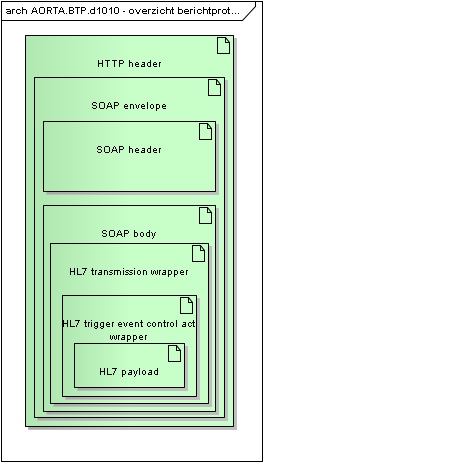

[AORTA 8.5.2](../../index.md) / [Logische architectuur](../../logische-architectuur.md) / [Berichtafhandeling](../berichtafhandeling.md)

# Protocollen

De applicatie-interacties worden gerealiseerd door uitwisseling van berichten tussen de applicaties. Voor uitwisseling van (medische) gegevens wordt binnen AORTA gebruik gemaakt van de internationale HL7v3 en/of HL7 FHIR standaard. Voor het transport van HL7v3 en HL7 FHIR interacties/berichten/documenten over internetprotocollen zijn aanvullende keuzen nodig ten aanzien van transport- en beveiligingsprotocollen.

Voor HL7v3 worden de aanbevelingen gevolgd uit het [WS-I basic profile] en [WS-I basic security profile]. WS-I(nteroperability) basic profile is een richtlijn voor de toepassing van SOAP 1.1 en WSDL 1.1. WS-I basic security profile is een richtlijn voor het toepassen van onder meer de standaarden WS-security, XML-signature en XML-encryption.

Diagram AORTA.BTP.d1010

**Diagram AORTA.BTP.d1010** **- overzicht berichtprotocol-‘stack’**

Bovenstaand diagram AORTA.BTP.d1010 geeft een overzicht van de protocollen die gebruikt worden voor berichtuitwisseling op de applicatie laag.

Tussen applicatie laag en transport laag (van het TCP/IP model) wordt gebruik gemaakt van Transport Layer Security (TLS).

De HL7 payload is de eigenlijke berichtinhoud en bevat de medische gegevens die tussen de betrokkenen wordt uitgewisseld. De structuur van de medische gegevens is sterk afhankelijk van het soort gegevens dat wordt uitgewisseld. Hiertoe worden binnen HL7v3 verschillende informatiemodellen gebruikt, aangeduid met de term RMIM (Refined Message Information Model) die zijn toegespitst op de medische context van de gegevensuitwisseling. Daarnaast is het ook mogelijk om in de HL7 payload een CDA-document op te nemen.

De HL7v3 Trigger Event Control Act (TECA) wrapper bevat gegevens over de gebeurtenis die aanleiding was het bericht te versturen. Een belangrijk aspect van deze wrapper in het geval van verzoeken is dat deze wrapper aangeeft wie het verzoek heeft verzonden (de ‘auteur’) en wie verantwoordelijk is voor het zenden van het verzoek (de ‘eindverantwoordelijke’)[^1]; dit legt de basis voor autorisatie, inclusief mandateringsaspecten. Zie het ontwerp autorisatie [Ontw APT] voor details.

De HL7v3 TECA wrapper en payload worden opgenomen in een HL7v3 transmission wrapper, die gegevens bevat over het berichttransport. Overigens kunnen meerdere HL7v3 transmission wrappers worden gecombineerd in een HL7v3 batch wrapper (niet getoond in het diagram).

Het HL7v3 bericht als geheel bevindt zich in de SOAP-body. Deze bevindt zich samen met de SOAP-header in de SOAP envelope. De SOAP-header bevat instructies over de wijze waarop het bericht moet worden afgehandeld, onder meer op het gebied van beveiliging. De SOAP-envelope als geheel is opgenomen in een HTTP-header.

Bovenstaand diagram AORTA.BTP.d1010 gaat niet in op de gebruikte SOAP-headerprotocollen. Hiervoor wordt verwezen naar de implementatiehandleiding [IH Transport].

Meer gedetailleerde informatie over de protocollen en de samenstelling van HL7-berichten is opgenomen in de implementatiehandleidingen [IH Transport] en [Decor].

[^1]: Auteur en eindverantwoordelijke kunnen dezelfde personen zijn.

Voor HL7 FHIR worden de security en privacy aanbevelingen gevolgd uit [HL7 FHIR Security and Privacy] en voor de uitwisseling van informatie de [HL7 FHIR Exchange] richtlijnen bij gebruik van HTTP 1.1 en FHIR Profiles (zie Simplifier.NET). Verder:

- Leveranciers en uitvoerders moeten ervoor zorgen dat ze bekend zijn met OAuth 2.0 threat model en alle beveiligingsoverwegingen, die in [[**RFC-6819**](https://datatracker.ietf.org/doc/html/rfc6819)] worden behandeld.

- Leveranciers en uitvoerders worden aanbevolen op de hoogte te zijn van de laatste OAuth 2.0 best practices die in [[**OAuth2-SBP**](https://datatracker.ietf.org/doc/rfc6749/)] worden behandeld.

- Leveranciers en uitvoerders worden aanbevolen op de hoogte te zijn van de laatste JWT best practices die in [[**RFC-8725**](https://datatracker.ietf.org/doc/html/rfc8725)] worden behandeld.

- OpenID Connect 1.0 is een eenvoudige identiteit laag bovenop het OAuth 2.0-protocol. Het stelt klanten in staat om de identiteit van de eindgebruiker te verifiëren op basis van de authenticatie uitgevoerd door een Identity Provider , en om basisprofielinformatie over de eindgebruiker te verkrijgen op een interoperabele en REST-achtige manier. Deze specificatie definieert de kernfunctionaliteit van OpenID Connect: authenticatie bovenop OAuth 2.0 en het gebruik van claims om informatie over de eindgebruiker te communiceren. Het beschrijft ook de veiligheids- en privacyoverwegingen voor het gebruik van [[**OpenID Connect**](http://openid.net/specs/openid-connect-core-1_0.html)].

- ICT-beveiligingsrichtlijnen voor webapplicaties (zie Nationaal Cyber Security Centrum)
