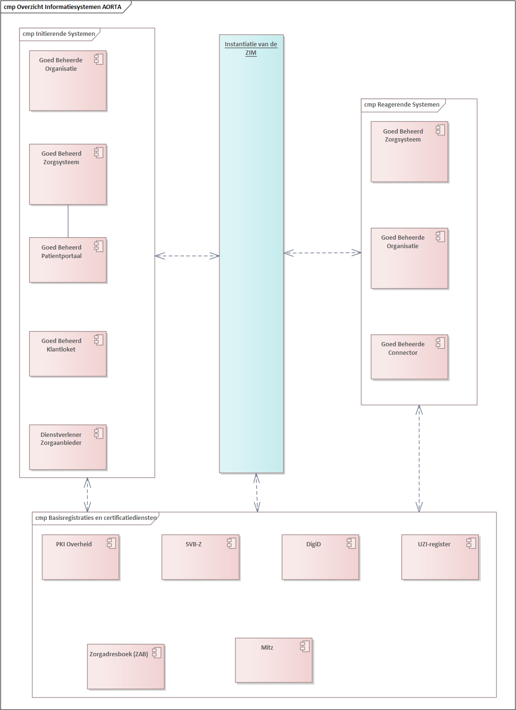
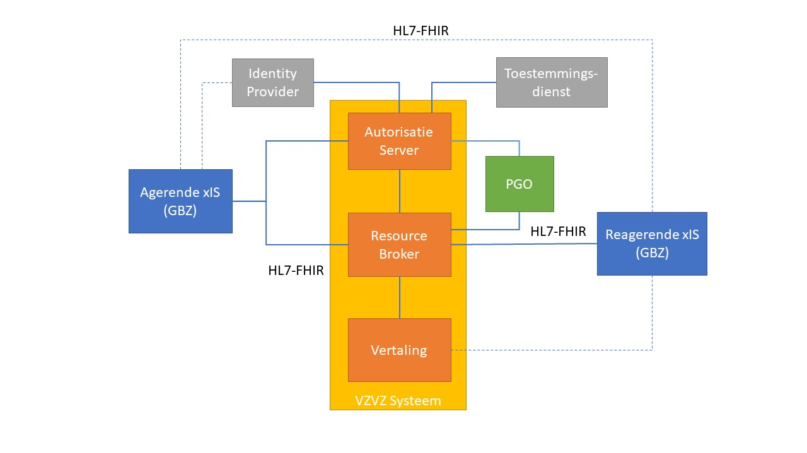

[AORTA 8.5.2](../index.md) / [Logische architectuur](../logische-architectuur.md)

# Informatiesystemen

De standaard voor informatie-uitwisseling verschuift bij AORTA richting HL7 FHIR.

AORTA zal zowel HL7v3 als FHIR gaan ondersteunen als platform/stelsel voor uitwisseling. Een belangrijke innovatie bij AORTA richting HL7 FHIR, is de ontwikkeling van API-gebaseerde interacties, en met name het samenspel tussen de Resource Broker ([HL7-FHIR standaard](https://www.hl7.org/fhir/index.html)) en de Autorisatie Server ([OAuth-protocol](https://tools.ietf.org/html/rfc6749)) die in deze informatie-uitwisseling van belang zijn.

Vooralsnog worden hieronder de ontwikkelingen met betrekking tot FHIR en de architectuurlijke en infrastructurele wijzigingen nog niet beschreven.

AORTA.INF.d1020 geeft in een vereenvoudigd infrastructuurdiagram[^1] een overzicht van de (HL7v3) informatiesystemen die elk afzonderlijk in dit hoofdstuk worden besproken.

Diagram AORTA.INF.d1020 – overzicht informatiesystemen (HL7v3) AORTA

Centraal in AORTA staat de Zorginformatiemakelaar (ZIM) (zie pagina '[Zorginformatiemakelaar (ZIM)](https://vzvz.atlassian.net/wiki/x/9oOObg)' ), die verantwoordelijk is voor de berichtuitwisseling tussen opvragende systemen en bronsystemen (en tussen sturende en ontvangende systemen).

Alle informatiesystemen die op de ZIM worden aangesloten moeten aan een set implementatie- en exploitatie-eisen voldoen, waarna ze worden aangeduid als ‘goed beheerd’ informatiesysteem, aangeduid met de afkorting GBx (zie pagina '[Goed beheerd informatiesysteem (GBx)](https://vzvz.atlassian.net/wiki/x/yoSObg)').

Tot de groep van GBx’en behoren:

- een goed beheerd zorgsysteem (zie pagina '[Zorginformatiesystemen (XIS) en het Goed beheerd zorgsysteem (GBZ)](https://vzvz.atlassian.net/wiki/x/2ISObg)'), een informatiesysteem dat door een zorgverlener of een medewerker wordt gebruikt om patiëntdossiers in te richten en te onderhouden;

- een goed beheerd patiëntportaal (zie pagina '[Goed beheerd patiëntportaal (GBP)](https://vzvz.atlassian.net/wiki/x/5oSObg)'), een portaal dat patiënten toegang geeft tot hun eigen gegevens;

- het goed beheerd klantenloketsysteem (zie pagina '[Goed beheerd klantenloketsysteem (GBK)](https://vzvz.atlassian.net/wiki/x/_ISObg)'), het toegangssysteem van de klantenloketorganisatie.

- een goed beheerde organisatie (zie pagina '[Goed beheerde organisatie (GBO)](https://vzvz.atlassian.net/wiki/x/CIWObg)'), een informatiesysteem (zoals een goed beheerd zorgsysteem) dat door zorgverleners wordt gebruikt, maar dat geen UZI-abonnee kan worden.

Naast informatiesystemen zijn er connectoren die patiëntgegevens uit of aan informatiesystemen in de AORTA-infrastructuur ontsluiten:

- de Dienstverlener Zorgaanbieder (zie pagina '[Dienstverlener Zorgaanbieder (DVZA)](https://vzvz.atlassian.net/wiki/x/FoWObg)'), connector die patiëntgegevens uit de AORTA-infrastructuur ontsluit aan informatiesystemen in het MedMij-netwerk.

- de goed beheerde connector (zie pagina '[Goed beheerd connector (GBC)](https://vzvz.atlassian.net/wiki/x/JIWObg)'), connector die patiëntgegevens ontsluit van externe infrastructuren aan informatiesystemen binnen de AORTA-infrastructuur.

Daarnaast hebben zowel de GBx’en als de ZIM toegang tot de services van een aantal basisregistraties en certificatiediensten, namelijk:

- het [UZI-register](informatiesystemen/basisregistraties-en-vertrouwensmiddelen.md#uzi-register), dat unieke zorgverlener identificaties van zorgverleners en zorgaanbieders bevat;

- [PKIoverheid](informatiesystemen/basisregistraties-en-vertrouwensmiddelen.md#PKIoverheid), een infrastructuur voor het uitgeven en beheren van digitale certificaten;

- [DigiD](informatiesystemen/basisregistraties-en-vertrouwensmiddelen.md#digid), een register van persoonsidentiteiten voor burgers.

- [Mitz](informatiesystemen/basisregistraties-en-vertrouwensmiddelen.md#mitz), een register van patiënttoestemmingen.

- ZORG-AB, een gemeenschappelijke adresinformatievoorziening

- Sectorale Berichten Voorziening in de Zorg (SBV-Z, reeds geïntroduceerd, zie pagina '[SBV-Z](https://vzvz.atlassian.net/wiki/spaces/ACM/pages/1797390478/8.5.0+Actoren+en+rollen#id-8.5.0Actorenenrollen-SBV-Z)' ; en pagina '[Basisregistraties en vertrouwensmiddelen SBV-Z](informatiesystemen/basisregistraties-en-vertrouwensmiddelen.md#sbv-z)' voor de systeemdiensten van SBV-Z).

[^1]: Zie voor een meer uitgebreide bespreking van de infrastructuur de pagina '[Infrastructurele aspecten](https://vzvz.atlassian.net/wiki/x/3oaObg)'.

## AORTA on FHIR

Met AORTA-on-FHIR worden enkele nieuwe informatiesystemen geïntroduceerd.

- Het AORTA-netwerk wordt niet langer slechts o.b.v. HL7-v3 aan het MedMij-netwerk gekoppeld, maar nu ook o.b.v. HL7-FHIR, waardoor alle (op FHIR-gebaseerde) MedMij-gegevensdiensten via LSP+ aangeboden kunnen worden;

- HL7-FHIR koppelvlakken die t.b.v. MedMij zijn ontwikkeld kunnen ook worden toegepast voor uitwisseling tussen zorgaanbieders.

- LSP+ en LSP versmelten (functioneel) tot één Resource Broker die (in de toekomst ook) kan gaan fungeren als een Koppelpunt binnen TWIIN en ook kan worden gekoppeld aan een Europees netwerk;

- De Resource Broker maakt gebruik van één Autorisatie Server, die op termijn kan worden opgeschaald naar een gemeenschappelijke dienst en ook zal worden aangesloten op Mitz;

- Om systemen van zorgaanbieders te kunnen vinden en adresseren, wordt gebruik gemaakt van de gemeenschappelijke dienst Adresseringservice in combinatie met ZORG-AB.

Tevens worden door deze AORTA-on-FHIR uitbreiding, de positie en de mogelijkheden van AORTA significant versterkt, en wordt voorkomen dat AORTA verwordt tot een "legacy" infrastructuur. Zo wordt het mogelijk om:

- Bouwstenen (ZIB's) zowel tussen zorgaanbieders onderling uit te wisselen, als ook tussen zorgaanbieders en burgers;

- Uitwisseling niet slechts te laten plaatsvinden via de VZVZ Resource Broker, maar ook (meer decentraal ingestoken) direct tussen systemen onderling, zodat voor iedere use case, de optimale informatiestroom kan worden ingeregeld;

- Dankzij vertaalservices van de VZVZ Resource Broker ook uitwisseling mogelijk te maken tussen HL7-v3 systemen en HL7-FHIR systemen.

Onderstaande figuur toont een overzicht van het beoogde systeemlandschap.

In bovenstaande opzet kunnen gegevens worden uitgewisseld tussen:

- PGO's (Persoons Gebonden Omgeving) en XIS'en (reagerend)

- XIS'en onderling;

Er wordt hierbij een architectuurscheiding aangebracht tussen autorisatie en uitwisseling. Autorisatie wordt afgehandeld in de Autorisatie Server. Uitwisseling verloopt (o.b.v. verkregen autorisatie- of toegangstokens) ofwel via de Resource Broker, ofwel direct tussen XIS'en onderling. Autorisatie omvat hierbij niet alleen de toepassing van autorisatieregels, zoals het MAP, maar ook de toestemming van de burger (zie Toestemmingsdienst). Om een geleidelijke overgang van bestaande HL7v3 naar HL7 FHIR mogelijk te maken, zal AORTA beide standaarden gelijktijdig ondersteunen. Via een vertaalservice wordt het mogelijk gemaakt om agerende XIS'en die nog op de HL7v3-standaard zitten, te laten communiceren met reagerende XIS'en die op HL7 FHIR standaard zitten. Dit zorgt voor een hybride ontwikkellijn voor leveranciers en creëert een geleidelijke migratiestrategie.

Voor authenticatie van gebruikers wordt gebruik gemaakt van bestaande Identity Providers, zoals het UZI-register, DigiD, ZorgID, etc. Dit kan worden uitgebreid naar andere Identity Providers. Agerende XIS'en van zorgaanbieders kunnen een eigen aansluiting hebben op deze Identity Providers (IdP), maar indien gewenst kan deze aansluiting ook verlopen via de autorisatieserver.
