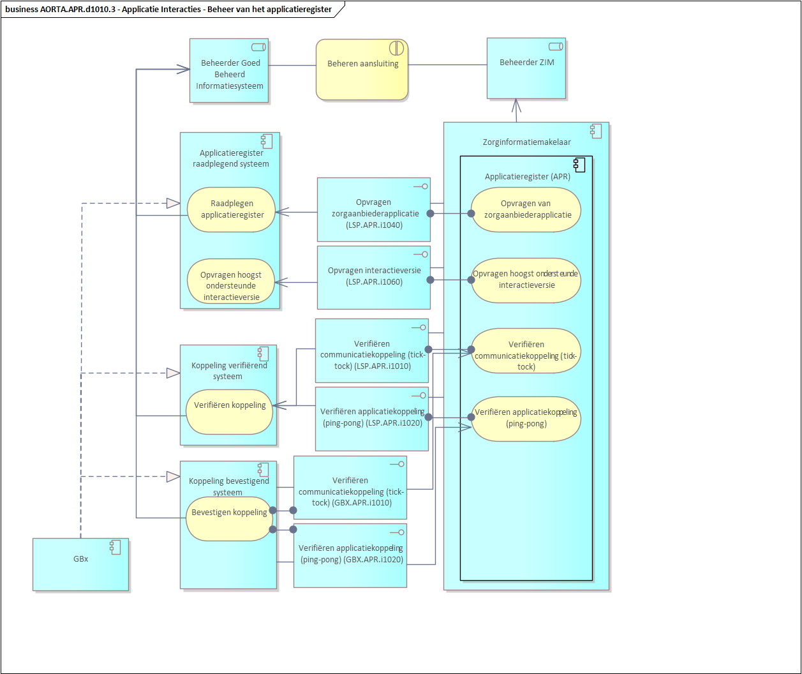
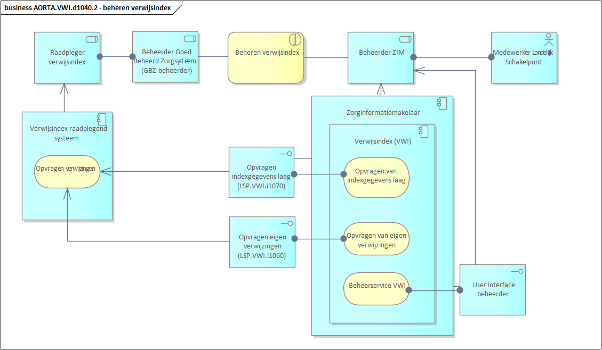
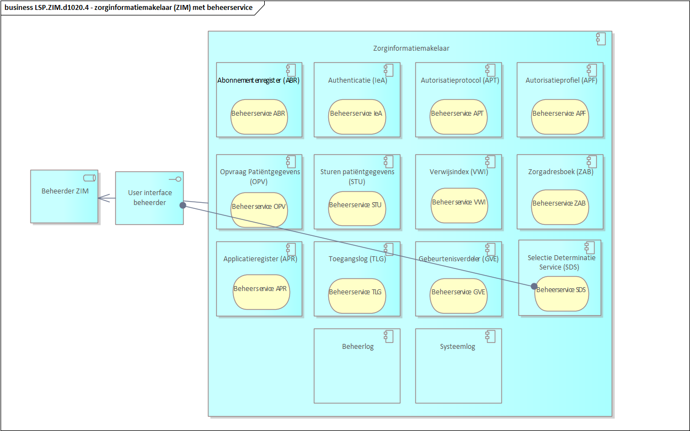

[AORTA 8.5.2](../../index.md) / [Logische architectuur](../../logische-architectuur.md) / [Informatiesystemen](../informatiesystemen.md)

# Applicatie-interacties voor beheer

Op deze pagina wordt uitgewerkt hoe de beheersmatige interacties, zoals besproken bij '[Beheerinteracties](https://vzvz.atlassian.net/wiki/x/z4WObg)', worden uitgewerkt op informatiesysteemniveau.

## Raadplegen en bewerken van het applicatieregister

De ZIM bewaart de informatie over aangesloten informatiesystemen (‘applicaties’) in een applicatieregister. Opname in het applicatieregister is een voorwaarde voor berichtenuitwisseling met de ZIM. Hiertoe bevat het applicatieregister kerngegevens van het GBx, waaronder één zorgaanbiederidentificatie, één of meer unieke applicatie-identificatienummers en - per applicatie - een URI[^1] waarop de applicatie bereikbaar is.

De ZIM biedt, om het APR te raadplegen en te bewerken, de volgende interfaces, die worden afgehandeld door het APR:

- Interface LSP.APR.i1010: verifiëren communicatiekoppeling (tick-tock)[^2]

- Interface LSP.APR.i1020: verifiëren applicatiekoppeling (ping-pong)

- Interface LSP.APR.i1075: Beheren TKID

Voor het gebruik van deze interfaces moeten binnen een op de ZIM aangesloten informatiesysteem modules aanwezig zijn die het gebruik van deze interfaces ondersteunen. Deze modules zijn hier aangeduid als:

- applicatieregister bewerkend systeem; dit gebruikt interface LSP.APR.i1075

- koppeling verifiërend systeem; dit gebruikt interfaces APR.i1010 en LSP.APR.i1020.

Omdat de ZIM op kan treden als intermediair voor koppeling verificatie tussen een koppeling verifiërend systeem en een koppeling bevestigend systeem, moet een GBx om te kunnen optreden als koppeling bevestigend systeem de volgende interfaces implementeren. Deze zijn functioneel gelijk aan LSP.APR.i1010 en LSP.APR.i1020 maar hebben de ZIM als afzender:

- Interface GBX.APR.i1010: verifiëren communicatiekoppeling (tick-tock)

- Interface GBX.APR.i1020: verifiëren applicatiekoppeling (ping-pong)

Deze situatie is weergegeven in diagram AORTA.APR.d1010.

Diagram AORTA.APR.d1010.3 - applicatie-interacties voor het beheer van het applicatieregister

### Interface LSP.APR.i1010: verifiëren communicatiekoppeling (tick-tock)

De interface ‘verifiëren communicatiekoppeling’ wordt aangeroepen vanuit de module ‘koppeling verifiërend systeem’ van een GBx en dient om het bestaan van een communicatiekoppeling met de ZIM of een reagerend GBx te controleren. Een ‘tick’-bericht test of het ‘koppeling bevestigend systeem’ in staat is om HL7-berichten te ontvangen.

### Interface LSP.APR.i1020: verifiëren applicatiekoppeling (ping-pong)

De interface ‘verifiëren applicatiekoppeling’ wordt aangeroepen vanuit de module ‘koppeling verifiërend systeem’ van een GBx en dient om het bestaan van een applicatiekoppeling met de ZIM of een reagerend GBx te controleren. Een ‘ping’-bericht test of het ‘koppeling bevestigend systeem’ in staat is om HL7-berichten inhoudelijk te verwerken.

### Interface LSP.APR.i1075: Beheren TKID

De interface ‘Beheren TKID’ wordt aangeroepen vanuit de module ‘koppeling bewerkend systeem’ van een GBx. Deze interface biedt de mogelijkheid om vanuit een GBx een bericht te versturen met de te gebruiken TKID’s.

### Rol van het APR bij beperking van het opleveren van gegevens tot een beperkte groep van zorgverleners (regionale beperking)

Het APR biedt een faciliteit om per organisatie een expliciete lijst bij te houden van zorgaanbieders die gegevens kunnen opvragen bij de desbetreffende organisatie. Een lijst voor een samenwerkingsverband bestaat uit een naam van het samenwerkingsverband, de gegevenssoort(en)/context die betrekking hebben op het samenwerkingsverband en een lijst met zorgaanbieders die het samenwerkingsverband vormen. Op deze lijst worden zorgaanbieders geplaatst, geïdentificeerd met hun UZI-registerabonneenummer (URA). Indien een dergelijke lijst is opgenomen worden opvraagberichten alleen gehonoreerd indien ze afkomstig zijn van de zorgaanbieders op de lijst en als het de gegevenssoort/context betreft die bij het samenwerkingsverband is opgenomen. Dit is een mechanisme dat bijvoorbeeld kan worden toegepast om uitwisseling regionaal te beperken. Een organisatie kan een uitzondering maken op regionale beperking door kenbaar te maken dat landelijke bevraging mogelijk is. Hiervoor dient wel in het APR ingesteld te worden dat het landelijke uitwisselingsvinkje op actief staat en dus wordt meegenomen bij de autorisatie van een opvraagbericht.

Voor het beheren van de samenwerkingsverbandlijsten worden geen speciale (bericht-) interfaces voor beheerders of andere gebruikers beschikbaar gesteld, maar zijn wel beheerfaciliteiten vereist op het niveau van de ZIM. Zie voor verdere uitwerking van dit aspect het [Ontw APR].

## Beheer van de verwijsindex

In de VWI van de ZIM staan alle aanmeldingen afkomstig uit GBZ-applicaties. Om te controleren of het beeld van de aangemelde gegevens dat bij de GBZ-beheerder bestaat overeenkomt met de werkelijke situatie in de VWI, kan de GBZ-beheerder gebruik maken van de VWI synchronisatiefunctie (Interface LSP.VWI.i1090: Synchroniseren indexgegevens met vergelijking). Het is verplicht om de verwijsindex synchroon te houden met de lokale administratie.

Daarnaast kent de VWI, evenals andere componenten van de ZIM (zie '[Beheer van overige aspecten van de ZIM](../beheerinteracties.md#Beheerder-ZIM)'), een beheerservice die toegankelijk is voor een beheerder van de ZIM via een beheerder user interface. Deze geeft de beheerder de mogelijkheid om onderhoud te plegen op de verwijsindex (zie [Ontw VWI]).

Deze situatie is weergegeven in diagram AORTA.VWI.d1040.2.

Diagram AORTA.VWI.d1040.2 – beheren verwijsindex

### Beheer van het zorgadresboek

De gegevens over zorgaanbieders en zorgverleners in het zorgadresboek (ZORG-AB) worden deels overgenomen uit een centraal zorgaanbieder/zorgverlener register (het UZI-register) en de VZVZ-administratie. Wijzigingen in het UZI-register en in de VZVZ-administratie moeten periodiek worden verwerkt in het ZORG-AB. Hiermee wordt voorkomen dat er gewerkt wordt met obsolete gegevens.

Daarnaast moet er een beheerderinterface zijn om ZORG-AB-gegevens te kunnen verwijderen voor een zorgaanbieder die niet meer de mogelijkheid (bijvoorbeeld geen geldig servercertificaat) heeft om zelf wijzigingen aan het ZORG-AB toe te brengen.

ZORG-AB is een component die los staat van het LSP en wordt aangeboden als een generieke voorziening. Zie voor de betreffende documentatie de VZVZ internetpagina met betrekking tot ZORG-AB.

### Beheer van overige aspecten van de ZIM

Diagram LSP.ZIM.d1020. toont op conceptueel niveau de beheerfaciliteiten van de ZIM. De ZIM beschikt over een gebruikersinterface die toegang geeft aan een beheerder voor het uitvoeren van beheeracties op elk van de componenten binnen de ZIM. Deze gebruikersinterface geeft de mogelijkheid om de toegang tot specifieke beheeracties te beperken tot beheerders in een meer specifieke rol. Weliswaar is op logisch niveau sprake van één beheerderinterface, op fysiek niveau kan sprake zijn van afzonderlijke interfaces voor deelcomponenten van de ZIM.

Elke component binnen de ZIM biedt een beheerservice die het voor een beheerder mogelijk maakt om configuratieparameters van de component in te stellen en eventuele storingen op te sporen en op te lossen. Per component kunnen in ontwerpdocumenten configuratieparameters en beheeracties worden geïdentificeerd.

Beheeracties worden gelogd in een beheerlog, met vastlegging van beheerderidentificatie, tijdstip en aanduiding van de beheergebeurtenis. Per component kunnen in ontwerpdocumenten beheergebeurtenissen worden geïdentificeerd die in de beheerlog moeten worden vastgelegd. Op basis van de beheerlog kan inzicht worden verkregen in de beheergebeurtenissen die hebben plaatsgevonden. De beheerlog dient als basis voor rapportages over beheergebeurtenissen, waarbij selecties mogelijk zijn per periode, gebeurtenistype of beheerder. In logische zin is sprake van één log, in technische zin kan sprake zijn van diverse aparte logs, die echter wel als één (eventueel virtueel) log benaderbaar zijn.

Analoog aan de beheerlog kent de ZIM een systeemlog, waarin alle foutsituaties worden gelogd die binnen de ZIM worden gedetecteerd. zie de pagina '[Foutafhandeling](https://vzvz.atlassian.net/wiki/x/QYaObg)'. Ook overschrijdingen van ingestelde grenswaarden van kritische systeemvariabelen worden in de systeemlog opgeslagen.

Op basis van het systeemlog kan inzicht worden verkregen in de foutgebeurtenissen die hebben plaatsgevonden. Het systeemlog dient als basis voor rapportages over foutgebeurtenissen, waarbij selecties mogelijk zijn tenminste per periode en gebeurtenistype.

Diagram LSP.ZIM.d1020.4– beheer services, beheerlog en systeemlog

[^1]: Uniform Resource Identifier, in dit geval het webadres waaronder de applicatie bereikbaar is

[^2]: Deze interface zal langzaam uitgefaseerd worden. Voor XIS-leveranciers is deze interface geen verplichting meer zijn.
