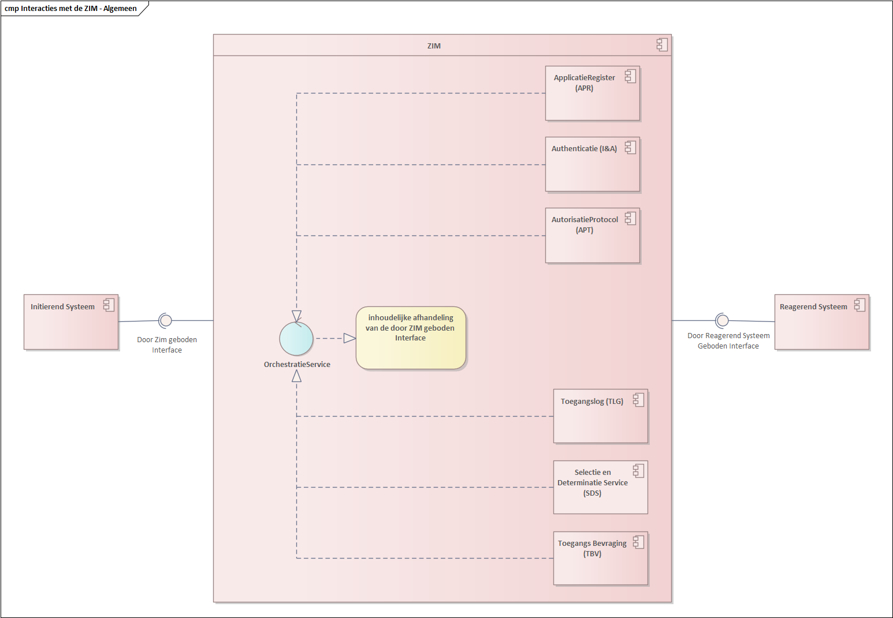
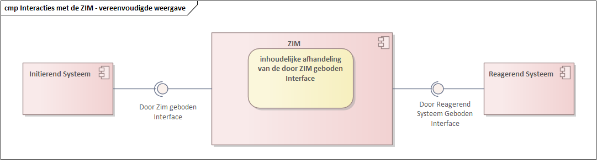

[AORTA 8.5.2](../../index.md) / [Logische architectuur](../../logische-architectuur.md) / [Informatiesystemen](../informatiesystemen.md)

# Interacties tussen informatiesystemen

De volgende pagina's '[Primaire informatiesysteem interacties](https://vzvz.atlassian.net/wiki/x/uYGObg)', '[Ondersteunende informatiesysteem interacties](https://vzvz.atlassian.net/wiki/x/goKObg)' en '[Applicatie-interacties voor beheer](https://vzvz.atlassian.net/wiki/x/0oOObg)' beschrijven hoe binnen AORTA de interacties uit de pagina's '[Primaire Interacties](https://vzvz.atlassian.net/wiki/x/lYGObg)', '[Ondersteunende Interacties](https://vzvz.atlassian.net/wiki/x/UYKObg)' en '[Beheer interacties](https://vzvz.atlassian.net/wiki/x/z4WObg)' worden gerealiseerd door de informatiesystemen van de pagina [Informatiesystemen](https://vzvz.atlassian.net/wiki/x/Y4OObg). Hierbij ligt de nadruk op de generieke interfaces die de ZIM aanbiedt aan aangesloten informatiesystemen.

## Algemene beschrijving van interacties

Diagram AORTA.ALG.d1060.1 is een algemene weergave van een berichtinteractie tussen een “initiërend systeem” (bijvoorbeeld een GBZ) en de ZIM, waarbij het initiërend systeem via de ZIM communiceert met een reagerend systeem (bijvoorbeeld een ander GBZ). Het diagram illustreert tevens de in de volgende hoofdstukken gebruikte notatie.

De ZIM biedt een interface (“door ZIM aangeboden interface”) aan het initiërend systeem. Dit systeem heeft een service om deze interface te gebruiken (“gebruiken van door ZIM geboden interface”).

De verantwoordelijkheid voor de afhandeling van de interface door de ZIM is toegekend aan de orkestratie service van de ZIM. De orkestratie service volgt hierbij ten dele een vast patroon, omdat een aantal taken bij elke berichtuitwisseling moet plaatsvinden. Hierbij maakt de orchestratieservice gebruik van de componenten Applicatieregister, Authenticatie, Autorisatieprotocol, Toegangslog en de Selectie Determinatie Service. Dit vaste verwerkingspatroon wordt verder uitgewerkt op pagina '[Berichtafhandeling door de ZIM](https://vzvz.atlassian.net/wiki/x/b4aObg)'

Diagram AORTA.ALG.d1060.1 – algemene beschrijving van interacties met de ZIM

Een deel van de berichtafhandeling is echter per interactietype verschillend en is in het diagram aangegeven met de service “inhoudelijk afhandelen van door ZIM geboden interface”. Deze inhoudelijke afhandeling wordt uitgevoerd door wisselende componenten van de ZIM, afhankelijk van het type bericht. In de volgende hoofdstukken zal per type interactie worden aangegeven welke component van de ZIM verantwoordelijk is voor de inhoudelijke afhandeling. Tijdens deze inhoudelijke verwerking kunnen ook reagerende systemen buiten de ZIM (bijvoorbeeld andere aangesloten GBZ’en) worden aangeroepen, die hiertoe dan ook een interface moeten implementeren (in het diagram aangegeven met “door reagerend systeem geboden interface”).

De volgende hoofdstukken concentreren zich op de door de ZIM aangeboden interfaces en de componenten die binnen de ZIM verantwoordelijk zijn voor de inhoudelijke afhandeling. Daarom worden de orchestratieservice en het vaste patroon van aanroepen van componenten niet steeds opnieuw getoond. Het diagram AORTA.ALG.d1060.1 kan versimpeld worden weergegeven zoals getoond in diagram AORTA.ALG.d1070. Hierbij zijn de orchestratieservice en overige componenten weggelaten en wordt de service van de component die verantwoordelijk is voor de *inhoudelijke* afhandeling van de door de ZIM geboden interface direct toegekend aan de door de ZIM geboden interface. Dit is de notatieconventie die verder in de tekst wordt gevolgd.

Diagram AORTA.ALG.d1070 – vereenvoudigde weergave van AORTA.ALG.d1060.1

## Systeemrollen

De ZIM ondersteunt diverse soorten berichten, onder meer voor het opvragen en sturen van patiëntgegevens. Niet voor elk op de ZIM aangesloten GBx zijn alle berichten relevant, zo kunnen niet bij ieder GBx patiëntgegevens worden opgevraagd.

Een “systeemrol” binnen AORTA is een deelverzameling van berichtuitwisselingen die functioneel verwant zijn. Een voorbeeld van een dergelijke systeemrol is ‘verwijsindex raadplegend systeem’; hieronder vallen uitsluitend berichtuitwisselingen die te maken hebben met het raadplegen van de verwijsindex. Voor softwareleveranciers (bv. XIS-leveranciers) is het mogelijk om voor hun software product (bv. een XIS) een acceptatie te behalen voor specifieke combinaties van systeemrollen.

In hoofdstukken Primaire informatiesysteem interacties, Ondersteunende Informatiesysteem interacties en Beheer interacties worden de verschillende berichtuitwisselingen besproken die behoren bij de AORTA-basisinfrastructuur. Hierbij worden ook de bijbehorende systeemrollen benoemd. Een totaaloverzicht van systeemrollen wordt tenslotte gegeven in hoofdstuk Overzicht van systeemrollen.

## Zorgtoepassingen

De ZIM biedt een basisinfrastructuur voor berichtuitwisseling in de zorg. Over deze basisinfrastructuur kunnen berichten worden uitgewisseld die relevant zijn binnen bepaalde ketenprocessen in de zorg, bijvoorbeeld het medicatieproces, waarbij o.a. huisartsen en apotheken zijn betrokken. De groep van berichten die relevant is voor een bepaald ketenproces in de zorg, wordt samen een *zorgtoepassing* genoemd; een voorbeeld is de groep van berichten die bedoeld is voor communicatie tussen huisartsen en apotheken voor de uitwisseling van medicatiegegevens.

Bij deze zorgtoepassingen horen specifieke systeemrollen. Een voorbeeld van een dergelijke systeemrol is ‘medicatie-voorschrijvend-systeem’; hieronder vallen uitsluitend berichtuitwisselingen die behoren bij de zorgtoepassing medicatiegegevens en die relevant zijn voor de informatiesystemen van medicatievoorschrijvers (bijvoorbeeld huisartsen). Aan een XIS kan een kwalificatie worden toegekend voor één of meer van dergelijke systeemrollen. Specifieke zorgtoepassingen worden behandeld in aparte ontwerpdocumenten; aan zorgtoepassingen gerelateerde systeemrollen worden daarom niet in dit document behandeld.

Voor verdere uitwerking wordt verwezen naar de pagina [Zorgtoepassingen](../../zorgtoepassingen.md).
