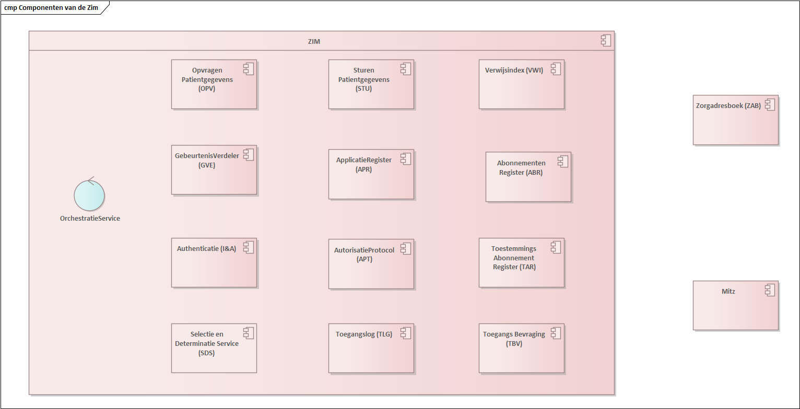

[AORTA 8.5.2](../../index.md) / [Logische architectuur](../../logische-architectuur.md) / [Informatiesystemen](../informatiesystemen.md)

# Zorginformatiemakelaar (ZIM)

De ‘Zorginformatiemakelaar’ (ZIM), volledig op HL7v3 (SOAP services) gebaseerd, is een centraal bericht uitwisselingsplatform, waarop de informatiesystemen van zorgaanbieders kunnen worden aangesloten. De ZIM wordt gebruikt door het LSP om invulling te geven aan de functie van intermediair tussen gegevenshouders en gegevensraadplegers die op HL7v3 gebaseerd zijn. De term ‘informatiemakelaar’ is van toepassing omdat het platform in feite optreedt als een ‘makelaar’[^1] van informatie.

Notitie: Naast de ZIM (Message Broker) is er ook een Resource Broker, deze wordt echter ingezet voor FHIR RESTful berichten, die op [FHIR Resources](https://www.hl7.org/fhir/resourcelist.html) en [REST APIs](https://www.hl7.org/fhir/http.html) zijn gebaseerd.

De ZIM heeft binnen AORTA de volgende taken:

- het bijhouden per patiënt in welke informatiesystemen van zorgaanbieders gegevens over de patiënt aanwezig zijn;

- het bijhouden van relevante gegevens over op de ZIM aangesloten informatiesystemen, waaronder bereikbaarheidsinformatie;

- het aannemen van verzoeken om patiëntinformatie van raadplegende informatiesystemen en het afhandelen hiervan door het opvragen van de gewenste informatie uit de systemen die volgens de verwijsindex over deze informatie beschikken;

- het bepalen van bouwsteentypen met de daarbij behorende selectieparameters op basis van context en rolcode;

- het bieden van een abonnementsfunctie aan raadplegende informatiesystemen zodat deze systemen een abonnement signaal kunnen krijgen indien bepaalde gebeurtenissen optreden;

- het zorgdragen voor beveiliging, door het authentiseren van de indiener van informatie-uitwisselingsverzoeken en het controleren van diens autorisatie om de gevraagde gegevens te raadplegen;

- het traceerbaar maken van informatie-uitwisseling door het registreren van alle berichtuitwisselingen tussen de ZIM en op de ZIM aangesloten informatiesystemen.

Naast de hierboven genoemde taken is er ook een taak die wordt aanboden door het ZORG-AB:

- het faciliteren van het verzenden van patiëntinformatie door het bieden van de mogelijkheid om de informatiesystemen van aangesloten zorgaanbieders op te zoeken en te adresseren.

Het ZORG-AB is naast de ZIM gepositioneerd, maar voor het overzicht wordt de ZORG-AB-functionaliteit ook meegenomen in de beschrijving binnen dit hoofdstuk (zie pagina '[Zorgadresboek](https://vzvz.atlassian.net/wiki/x/RISObg)' ).

De ZIM is hiertoe samengesteld uit een aantal logische componenten waaraan deelverantwoordelijkheden zijn toegekend. Diagram LSP.ZIM.d1010.5 geeft hiervan een overzicht. Deze componenten worden hier kort behandeld. Meer informatie wordt gegeven op pagina '[Beheerinteracties](https://vzvz.atlassian.net/wiki/x/z4WObg)' en in de ontwerpdocumenten van de individuele componenten.

De ZIM beschikt naast de logische componenten over een orkestratieservice[^1]. Deze zorgt ervoor dat een bericht dat binnenkomt bij de ZIM in een aantal logische stappen wordt afgehandeld, waarbij de verschillende deelcomponenten in de juiste volgorde een bijdrage leveren aan de afhandeling van het bericht. Deze orkestratie wordt in detail behandeld op de pagina '[Berichtafhandeling door de ZIM](https://vzvz.atlassian.net/wiki/x/b4aObg)'.

Diagram LSP.ZIM.d1010.5 - systeemcomponenten binnen de Zorginformatiemakelaar

Zowel de componenten en orkestratiedienst worden op logisch niveau beschreven. Over de fysieke implementatievorm van componenten en orkestratiedienst worden geen uitspraken gedaan.

[^1]: Parallel aan de Engelse term ‘Message B*roker*’.
