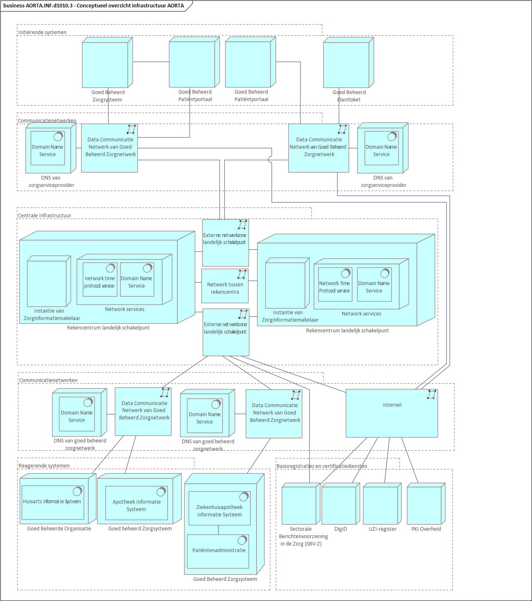

[AORTA 8.5.2](../../index.md) / [Logische architectuur](../../logische-architectuur.md) / [Infrastructurele aspecten](../infrastructurele-aspecten.md)

# Conceptueel overzicht infrastructuur

{}

Diagram AORTA.INF.d1010.4 geeft een conceptueel overzicht van de infrastructuur van AORTA. Hierin wordt weergegeven op welke wijze de informatiesystemen die zijn beschreven in het hoofdstuk '[Informatiesystemen](https://vzvz.atlassian.net/wiki/x/Y4OObg)' logisch worden gekoppeld om berichtenuitwisseling tussen deze systemen te faciliteren.

Voor de duidelijkheid is de figuur opgedeeld in lagen.

### Initiërende systemen

De bovenste laag toont de informatiesystemen die een interactie via AORTA kunnen initiëren. Zoals besproken in de systeeminteracties zijn dit GBZ’en, GBP’en het GBK en de DVZA samen aangeduid als GBx.

### Communicatienetwerken

Opvragende systemen en bronsystemen worden gekoppeld aan de centrale infrastructuur via een datacommunicatienetwerk (DCN). Onder een DCN wordt hier verstaan: een netwerk van datacommunicatieverbindingen, inclusief de daarvoor benodigde voorzieningen op de locatie van de aangesloten partijen, dat door één datacommunicatiedienstverlener wordt geëxploiteerd en beheerd. In technisch opzicht is een DCN een privaat of virtueel privaat TCP/IP-netwerk.

Indien dit voor het bereiken van het juiste beschikbaarheidsniveau noodzakelijk is, kan een GBx door middel van redundante verbindingen aan een DCN gekoppeld worden. DCN’s worden door middel van redundante verbindingen gekoppeld aan de centrale infrastructuur.

#### Goedbeheerd ZorgNetwerk (GZN)

Binnen AORTA worden aan het DCN eisen gesteld voor onder meer functionaliteit, beschikbaarheid en beveiliging; daarnaast worden eisen gesteld aan de dienstverlening van de datacommunicatiedienstverlener die optreedt als leverancier van het DCN. Een datacommunicatiedienstverlener die voldoet aan dit programma van eisen en hiervoor een kwalificatie behaalt wordt binnen AORTA aangeduid als een Goed Beheerd Zorgnetwerk (GZN) (voorheen was dit Zorg Service Provider, ZSP). Een GBx kan uitsluitend gekoppeld worden aan de ZIM via het DCN van een GZN.[^1]

#### Domain Name Service

Elke GZN beheert een eigen Domain Name Service (DNS) die de hostnaam van elk aangesloten GBx vertaalt naar het IP-adres waarop het GBx bereikbaar is. Uit het oogpunt van beschikbaarheid biedt het LSP een gemeenschappelijke secundaire DNS voor alle aangesloten GZN’s. Systemen binnen AORTA dienen elkaar te benaderen via de DNS en niet rechtstreeks op IP-adres.

#### Domein [aorta-zorg.nl](http://aorta-zorg.nl)

Het GZN kent aan een GBx een hostnaam toe, zodat de GZN het IP-adres kan wijzigen zonder dat dit effect heeft op de bereikbaarheid van de GBx voor de buitenwereld (waaronder de ZIM). Deze hostnaam wordt ook vastgelegd in servercertificaten van het UZI-register als ‘Fully Qualified Domain Name’ (FQDN). Wijzigingen van het IP-adres zijn overigens beperkt tot de door het LSP toegekende reeks, zie hieronder bij ‘IP-adresreeksen’.

Diagram AORTA.INF.d1010.4: conceptueel overzicht van de AORTA infrastructuur

Het UZI-register eist dat de relatie tussen FQDN en zorgaanbieder kan worden getoetst bij de Stichting Internet Domeinregistratie Nederland (SIDN) of bij het LSP. Daarom krijgt elk op de ZIM aangesloten informatiesysteem een hostnaam onder het geregistreerde domein ‘[aorta-zorg.nl](http://aorta-zorg.nl)’. De FQDN wordt tevens vastgelegd als URI van het GBx in het applicatieregister van de ZIM.

#### IP-adresreeksen

Een GBx dat via een GZN wordt aangesloten op de centrale infrastructuur krijgt een IP-adres toegekend door de GZN. Aan een GZN wordt hiertoe een reeks van IP-adressen toegekend door het Landelijk Schakelpunt (LSP), die vervolgens aan specifieke GBx’en kunnen worden toegekend. Elk GBx moet binnen het DCN bereikbaar zijn op het toegekende IP-adres (maar moet via de DNS benaderd worden).

Het kan voorkomen dat het door het GZN toegekende IP-adres botst met adressen binnen het locale netwerk van het GBx of dat de door het LSP toegekende reeks van IP-adressen botst met adressen binnen het DCN van de GZN. In deze gevallen moet op het koppelvlak van het LAN waartoe het GBZ behoort en het DCN en/of op de grens van DCN en het externe netwerk van het LSP een vorm van adresconversie worden toegepast, zoals NAT (Network Address Translation).

#### Internet-koppeling

GBx’en hebben toegang nodig tot het internet om een aantal redenen:

- de services van de SBV-Z voor verificatie van het burgerservicenummer en wettelijk identificatiedocument (zie [subparagraaf 10.4](../informatiesystemen/basisregistraties-en-vertrouwensmiddelen.md#sbv-z)) worden via het internet geleverd.

- GBZ’en moeten in staat zijn om de digitale certificaten op de UZI-passen of ZORG-ID Smartcards van hun gebruikers op geldigheid te controleren; daartoe moeten zij controleren of deze certificaten zijn ingetrokken.Om dit te kunnen controleren moeten zij toegang hebben tot de ‘certificate revocation lists’ (CRL) die op het internet worden gepubliceerd door de ‘certificate authority’ (CA), in dit geval het UZI-register.

- Volgens de regels van PKIO moet ook de geldigheid van het certificaat van de CA zelf worden gecontroleerd en deze keten van CA’s moet worden gevolgd tot aan de ‘Root CA van de Staat der Nederlanden’. Hiertoe moeten ook de CRL’s van deze CA’s worden gecontroleerd, die op het internet worden gepubliceerd.

- GBZ, GBP en GBK moeten in staat zijn om het PKIO-certificaat van de ZIM op geldigheid te controleren en moeten daartoe controleren of dit certificaat is ingetrokken. Om dit te kunnen controleren moeten zij toegang hebben tot de CRL van de CA die het ZIM-certificaat uitgeeft.

De GZN *kan* een ontsluiting bieden naar het internet via een beveiligde netwerkpoort in het DCN. Overigens kan deze ontsluiting naar het internet ook via een andere service provider worden geleverd.[^1]

#### Protocollen

Voor de datacommunicatie tussen GBx en ZIM wordt, ter bevordering van interoperabiliteit, gebruik gemaakt van gangbare internetprotocollen, namelijk HTTP met TLS (HTTPS) over TCP/IP (de applicatie-protocollen boven de HTTP-laag zijn reeds besproken in '[Protocollen](../berichtafhandeling/protocollen.md)'). Voor het opzetten van een beveiligde verbinding tussen GBZ en ZIM volgens het TLS protocol met wederzijdse authenticatie moet het GBZ over een UZI-servercertificaat of een PKIO-servercertificaat beschikken en de ZIM over een PKIO-servercertificaat. Een GBP moet beschikken over een PKIO-servercertificaat. Het GBK heeft evenals de ZIM een PKIO-servercertificaat.

### Centrale infrastructuur

De ZIM is de belangrijkste component in de centrale infrastructuur. Vanuit het oogpunt van continuïteit en beschikbaarheid voorziet de architectuur in twee instanties van de ZIM, verspreid over rekencentra op afzonderlijke locaties, gekoppeld door een netwerk. Het bestaan van meerdere instanties van de ZIM dient functioneel transparant te zijn voor informatiesystemen die communiceren met de ZIM, dat wil zeggen dat de instanties van de ZIM zich dienen te gedragen als ware er één ZIM.

In de rekencentra van het LSP zijn tevens netwerkdiensten aanwezig die zorgdragen voor het functioneren van de AORTA-infrastructuur als geheel:

- De centrale infrastructuur biedt een routeerfunctie, waardoor netwerkverkeer dat afkomstig is van een systeem binnen een aangesloten DCN en is gericht aan een systeem in een ander aangesloten DCN, correct kan worden afgeleverd. Hiertoe wordt dynamische routering toegepast.[^1]

- Een Domain Name Service binnen de centrale infrastructuur dient als secundaire DNS voor de primaire DNS-services van de aangesloten DCN’en.

- Voor tijdsynchronisatie tussen de op de centrale infrastructuur aangesloten systemen biedt de centrale infrastructuur een Network Time Protocol service.

### Externe systemen/infrastructuren

Er kunnen externe systemen of infrastructuren aangesloten worden op AORTA. Vanuit AORTA zullen er eisen gesteld worden aan het koppelvlak met deze externe systemen/infrastructuren. De AORTA infrastructuur mag geen nadelige gevolgen ondervinden van een extern aangesloten systeem of infrastructuur. Nadelige gevolgen kunnen bestaan uit bijvoorbeeld een degeneratie van het beveiligingsniveau of de prestaties van AORTA.

### Reagerende systemen

Diverse XIS-systemen (huisartsinformatiesystemen, apotheekinformatiesystemen, ziekenhuisapotheekinformatiesystemen, etc.) waarvoor een XIS-typekwalificatie is verkregen en waarvan de implementatie voldoet aan de eisen voor een GBZ, kunnen fungeren als reagerende systemen in interacties die via AORTA verlopen.

Een GBZ kan meerdere XIS-applicaties omvatten, zoals aangegeven in het diagram met het voorbeeld van een GBZ dat bestaat uit een ziekenhuisapotheekinformatiesysteem en patiëntadministratiesysteem.

Een GBZ kan overigens in de ene interactie het initiërend systeem zijn en in een andere interactie het reagerend systeem.

### Basisregistraties en certificatiediensten

Onder basisregistraties en certificatiediensten vallen de infrastructuren van UZI-register, PKIoverheid, DigiD en SBV-Z . Deze zijn beschikbaar via het internet voor zowel de ZIM (met uitzondering van het SBV-Z) als voor GBx’en. UZI-register en PKIoverheid zijn voor GBx’en adresseerbaar via het internet óf via de netwerkinfrastructuur van de ZIM.

[[1]](conceptueel-overzicht-infrastructuur.md#_ftnref1) Dit is een voorbereiding op eventuele rechtstreekse gegevensuitwisseling tussen aangesloten GBZ’en zonder tussenkomst van de ZIM, bijvoorbeeld van multimediale bestanden op basis van het DICOM-protocol.

[[1]](conceptueel-overzicht-infrastructuur.md#_ftnref1) In theorie kunnen de UZI- en PKIO-services ook benaderd worden via de centrale infrastructuur omdat ook daar een internetkoppeling aanwezig is om deze zelfde services te bereiken. Hiervoor zijn binnen het lokale netwerk van het GBZ in het algemeen configuratiehandelingen nodig om internetverkeer met UZI- en PKIO-register om te leiden ten opzichte van overig internetverkeer. In het algemeen loopt de toegang van het GBZ tot deze services niet via de centrale infrastructuur.

[^1]: Strikt genomen geldt deze eis niet voor het GBK, maar het datacommunicatienetwerk waarmee het GBK wordt gekoppeld aan de ZIM, evenals het beheer van dit netwerk worden wel gehouden aan dezelfde eisen als die gelden voor een GZN, waardoor ook deze netwerkdienst als een GZN kan worden beschouwd.
