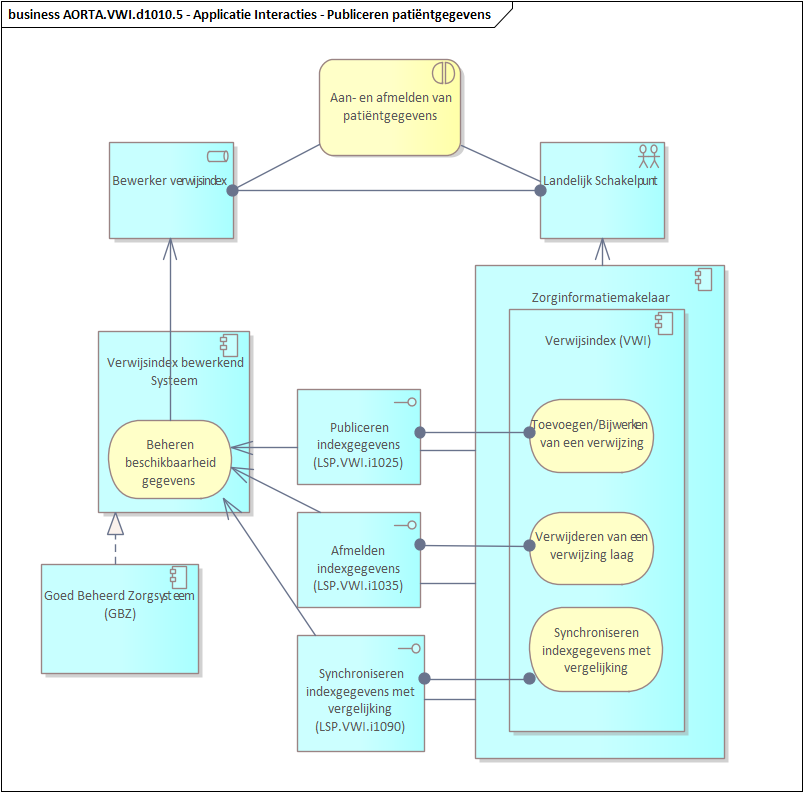
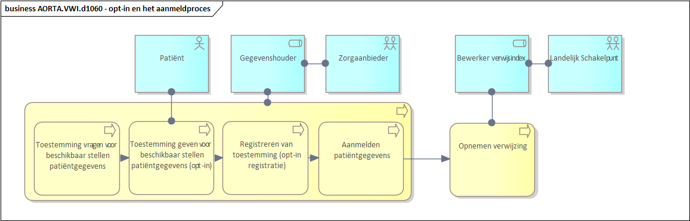
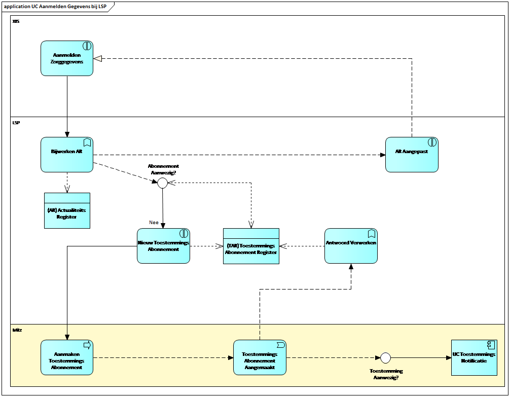
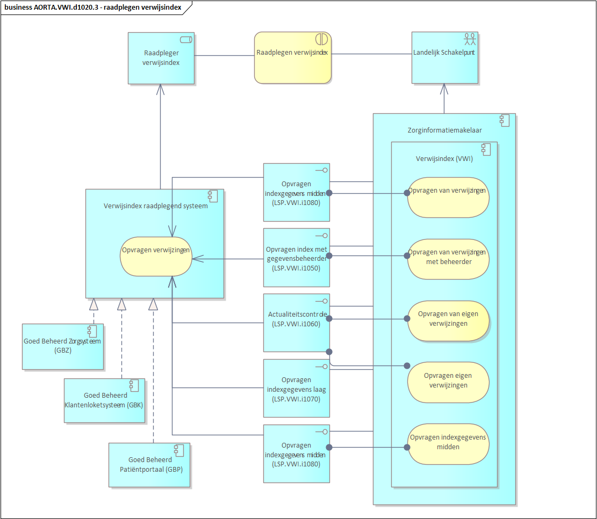
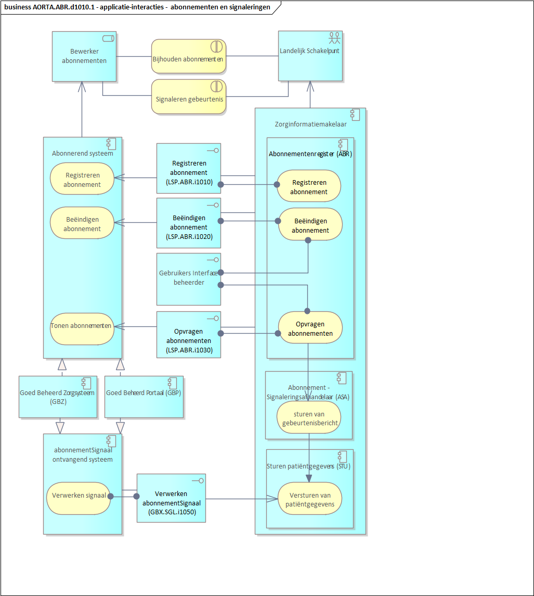
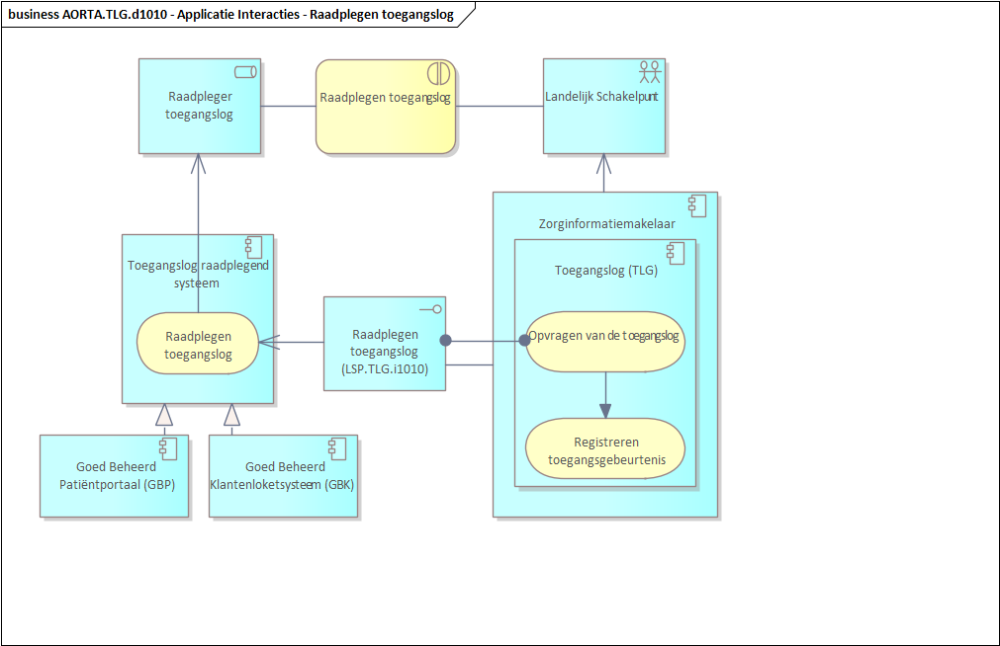
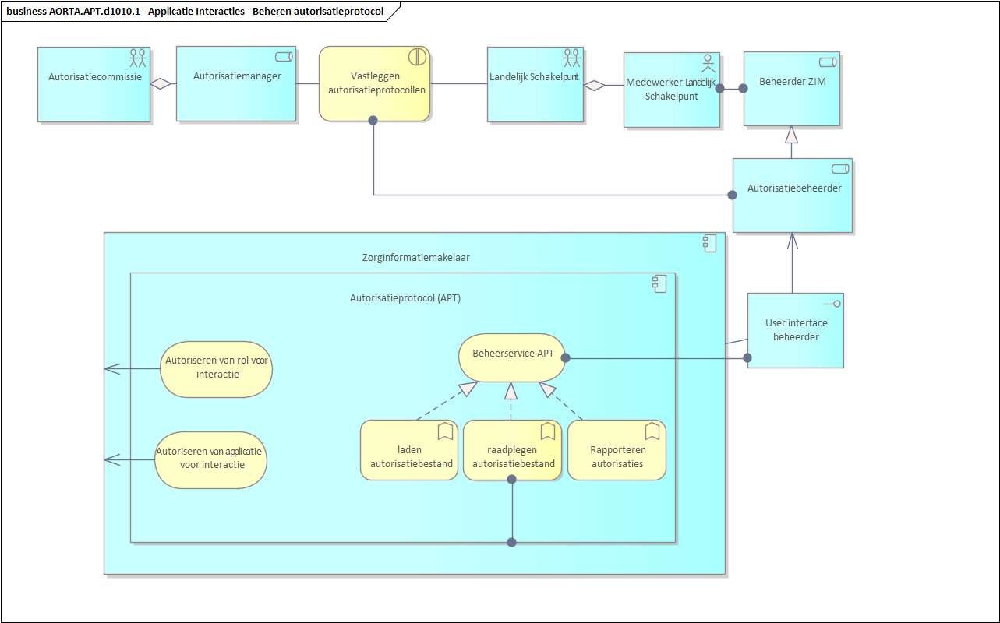
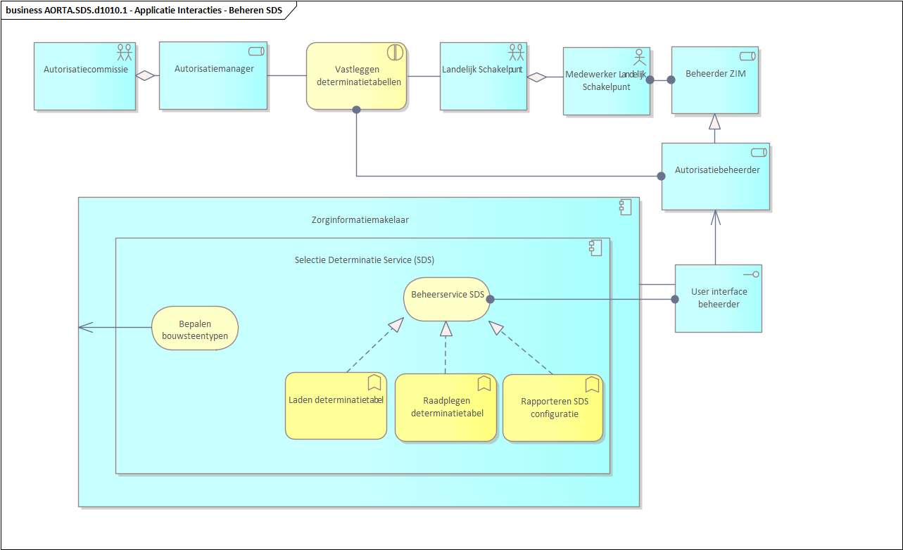

[AORTA 8.5.2](../../index.md) / [Logische architectuur](../../logische-architectuur.md) / [Ondersteunende interacties](../ondersteunende-interacties.md)

# Ondersteunende informatiesysteeminteracties

Op deze pagina worden de ondersteunende interacties op informatiesysteemniveau uitgewerkt.

## Opvragen/verifiëren BSN en controleren omloopstatus WID

De [SBV-Z](../informatiesystemen/basisregistraties-en-vertrouwensmiddelen.md#sbv-z) biedt interfaces voor:

- Opvragen/verifiëren BSN – deze interface maakt het mogelijk om op basis van een aantal persoonsgegevens het Burgerservicenummer van een persoon op te vragen, of te controleren of bepaalde persoonsgegevens en een bekend BSN daadwerkelijk bij elkaar horen;

- Opvragen persoonsgegevens – deze interface maakt het mogelijk om persoonsgegevens te verkrijgen op basis van het BSN;

- WID-controle – deze interface maakt het mogelijk om de omloopstatus van een Nederlands identiteitsdocument te controleren.

De systeemrol die deze interfaces gebruikt wordt aangeduid als ‘patiënt administrerend systeem’. Omdat binnen AORTA bij communicatie over patiënten een correct BSN nodig is, moet een GBZ geaccepteerd zijn voor een ‘patiënt administrerend systeem’.

Deze interfaces vallen buiten de specificaties van AORTA, aangezien de specificaties worden beheerd door de SBV-Z (zie [SBV-Z]). Voor AORTA is nog relevant dat van deze interfaces twee implementatievarianten bestaan, waarvan één gebaseerd op HL7v3-berichten. Het GBZ zou de interface gebaseerd op HL7v3 niet moeten gebruiken. Deze is niet meer actueel.

## Aan- en afmelden van patiëntgegevens

Om een ongerichte opvraag van patiëntgegevens via AORTA door andere zorgverleners mogelijk te maken, moet een zorgaanbieder het bestaan van patiëntgegevens in zijn eigen informatiesysteem aanmelden bij het Landelijk Schakelpunt. In het geval er geen gebruik wordt gemaakt van Mitz, zullen er alleen patiëntgegevens worden aangemeld van die patiënten die ook daadwerkelijk toestemming hebben gegeven.

Deze aanmelding leidt tot het opnemen van een nieuwe verwijzing in de Verwijsindex (VWI) of het Actualiteitenregister (AR) die onderdeel zijn van de ZIM. Deze verwijzing bevat geen medisch inhoudelijke informatie, maar bevat metagegevens over de informatie die in het systeem van de aanmeldende zorgverlener aanwezig is, waaronder het patiëntnummer (BSN) en bouwsteentype. Het (mogelijke) onderscheid in bouwsteentypen wordt onder meer gebruikt om toegang van zorgverleners te kunnen beperken tot specifieke delen van het medische dossier van een patiënt.

De aanmelding bij de VWI gebeurt per bouwsteentype. Er komt per bouwsteentype per bronsysteem per patiënt één verwijzing in de VWI.

De ZIM biedt voor de aanmelding een aantal interfaces die zijn toegekend aan services van de Verwijsindex:

- LSP.VWI.i1025: Publiceren gegevens;

- LSP.VWI.i1035: Afmelden verwijzing.

- LSP.VWI.i1090: Synchroniseren indexgegevens met vergelijking.

Deze situatie is weergegeven in diagram AORTA.VWI.d1010. De interfaces worden hier kort behandeld, zie [Ontw VWI] voor details.

Indien het aanmeldende systeem is gemigreerd naar Mitz, word er gekeken of er voor deze BSN/applicatie-ID combinatie al een toestemming abonnement genomen is. Indien dit niet het geval is, wordt het proces Toestemming Abonnement opgestart.

Diagram AORTA.VWI.d1010 - informatiesysteeminteracties voor het beschikbaar maken van patiëntgegevens

### Interface LSP.VWI.i1025: Publiceren gegevens

Een (her)aanmelding wordt geïnitieerd vanuit het informatiesysteem van de zorgverlener. De (her)aanmelding leidt tot toevoegen of bijwerken van een verwijzing in de Verwijsindex (VWI). Een van de voorwaarden voor aanmelden is dat de zorgverlener de identiteit en Burgerservicenummer van de patiënt heeft geverifieerd. Deze interface wordt aangesproken op vertrouwensniveau laag.

### Interface LSP.VWI.i2035: Afmelden verwijzing

Een zorgverlener of het systeem heeft de mogelijkheid om eerder aangemelde gegevens weer af te melden. Hierbij wordt de desbetreffende verwijzing uit de VWI verwijderd. Deze interface wordt aangesproken op vertrouwensniveau laag.

### Interface LSP.VWI.i1090: Synchroniseren indexgegevens met vergelijking

Het synchronisatieproces wordt gestart door een GBZ-beheerder. Door gebruik te maken van deze interface worden de geregistreerde verwijzingen in de VWI gesynchroniseerd met de lokale administratie van verwijzingen in het GBZ. De ‘synchroniseren indexgegevens met vergelijking’-interface levert slechts een vergelijkingsresultaat op. In combinatie met de interfaces LSP.VWI.i1025 Publiceren gegevens en LSP.VWI.i1035 Afmelden indexgegevens laag kunnen de verwijzingen in de VWI worden aangepast.

### Controle op opt-in bij het aanmelden van patiëntgegevens

Bij het aanmelden/publiceren van patiëntgegevens voor uitwisseling via AORTA is het van belang dat vooraf door de gegevenshouder toestemming (‘opt-in’) is verkregen van de patiënt voor het beschikbaar maken van zijn gegevens. Daarom wordt bij het (her)aanmelden door de gegevenshouder gecontroleerd of de vereiste opt-in van de patiënt is verkregen. Dit moet gebeuren in het GBx dat een (her)aanmelding verricht.

Diagram AORTA.VWI.d1060 beschrijft globaal het proces en de controles die van toepassing zijn bij het aanmelden van patiëntgegevens. Een nadere uitwerking hiervan op systeemniveau is opgenomen in het [Ontw VWI].

Diagram AORTA.VWI.d1060 - Opt-in en het aanmeldproces

- Elke zorgverlener die als gegevenshouder verantwoordelijk is voor het beschikbaar stellen van gegevens via het Landelijk Schakelpunt vraagt (eenmalig voor een bepaalde toepassing) toestemming aan de patiënt voor het beschikbaar stellen van diens patiëntgegevens.

- De patiënt geeft (eenmalig per zorgverlener) toestemming voor het beschikbaar stellen van patiëntgegevens. Uiteraard kan de patiënt ook besluiten hiervoor geen toestemming te geven of deze later in te trekken.

- De gegevenshouder registreert het geven van toestemming (of het niet geven van toestemming) door de patiënt.

- De gegevenshouder meldt de gegevens van de patiënt aan bij het Landelijk Schakelpunt, dat optreedt als bewerker van de verwijsindex.[^1] Aanmelden mag alleen indien toestemming verkregen is en dit uit de eigen registratie blijkt. De verantwoordelijkheid voor het correct aanmelden ligt bij de gegevenshouder. De gegevenshouder kan ervoor kiezen om aanmeldingen automatisch te laten uitvoeren door het eigen informatiesysteem (XIS), mits dit alleen aanmeldingen uitvoert voor patiënten waarvoor een opt-in in de registratie is opgenomen.

- De bewerker van de verwijsindex neemt de verwijzing op.

## Toestemming abonnement

**Processtappen**

Binnen deze processtappen wordt er vanuit gegaan dat de XIS geëmigreerd is naar Mitz. Indien dit niet het geval is blijft de oude situatie van kracht.

*Aanmelden patiëntgegevens (XIS)*

Het proces begint op de XIS, waar patiënt gegevens zijn veranderd. Zonder te hoeven kijken naar toestemmingen, worden deze gegevens aangemeld bij het LSP. Hierbij kunnen de gegevens zowel in bouwstenen als in gegevens soorten verdeeld zijn. Alles wordt aangemeld. (Zie [Aan- en afmelden van patiëntgegevens](ondersteunende-informatiesysteeminteracties.md#aan-en-afmelden-van-patientgegevens))

*Abonnement aanwezig? (LSP)*

Na dit aanmelden gaat het LSP kijken of er wel een toestemming abonnement is afgenomen voor deze zorgapplicatie voor deze BSN. Deze abonnementen worden voor het LSP door Mitz bijgehouden in het toestemming abonnement register.

Als een toestemmingsabonnement geregistreerd is, wordt er aan het XIS gemeld dat het Actualiteitsregister (ACT) is aangepast en zijn er verder geen acties nodig.

*Nieuw Toestemming Abonnement (LSP)*

Indien er nog geen toestemming abonnement is genomen, dan neemt het LSP deze automatisch, hiervoor hoeft de XIS niets te doen of bij te houden.

In het Toestemming Abonnement Register wordt nu de Applicatie Id, huidige datum/tijd en BSN genoteerd. Dit wordt op deze plaats gedaan, zodat je bij meerdere aanmeldingen geen meerdere aanvragen krijgt. Meerdere aanvragen zou later tot een probleem kunnen leiden.

Voor de interface naar Mitz voor het aanmaken van een nieuw toestemming abonnement zie [[MitzToe](../../processen/aansluiten-mitz.md)]

*Aanmaken Toestemming Abonnement (Mitz)*

Deze en de volgende stap wordt uitgevoerd door Mitz. Hier heeft het LSP verder geen invloed op. Ze zijn hier opgenomen om het proces duidelijker te maken.

In deze stap maakt Mitz een toestemming abonnement.

*Toestemming Aanmaken (Mitz)*

De volgende stap is dat Mitz kijkt of er al toestemming staan voor de combinatie van applicatie_id en BSN. Indien dit het geval is, wordt er een notificatie verstuurd naar het LSP.

*Antwoord Verwerkt (LSP)*

Aan het LSP wordt gemeld dat er een abonnement is aangemaakt en met welk ID dat het is opgeslagen. Deze wordt door het LSP in het toestemming abonnement register bijgewerkt, door deze gegevens in het record erbij te zetten, dat eerder in de stap "Nieuw Toestemming Abonnement" is aangemaakt.

Indien het niet mogelijk was om dit abonnement te maken, wordt het in de stap "Nieuw Toestemming Abonnement" aangemaakte record gemarkeerd als “incomplete”.

## Raadplegen van de verwijsindex

De Verwijsindex (VWI), die onderdeel is van de ZIM, houdt bij in welke informatiesystemen gegevens over patiënten zijn opgeslagen.

De ZIM biedt de volgende interface voor de bevraging van de verwijsindex:

- LSP.VWI.i1060: Actualiteit controle;

- LSP.VWI.i1080: Opvragen indexgegevens midden.

Deze situatie is weergegeven in diagram AORTA.VWI.d1020.3 .

Diagram AORTA.VWI.d1020.3 - informatiesysteeminteracties voor het raadplegen van de verwijsindex

### Interface LSP.VWI.i1060: Actualiteit controle

Om te bepalen of er nieuwe gegevens beschikbaar zijn gekomen sinds een bepaalde datum kan een GBZ via de service ‘Opvragen actualiteit’ een actualiteit controle verzoek doen aan de ZIM. De ZIM kijkt of er na de opgenomen tijd een VWI bijwerking is geweest voor de in het bericht opgenomen queryparameters. Als antwoord op het verzoek komt er een bevestiging of ontkenning terug. Voor het opvragen van de actualiteit wordt het opvragen Actualiteit-bericht verstuurd op autorisatie-niveau laag door het Verwijsindex Raadplegend Systeem.

### Interface LSP.VWI.i1080: opvragen index midden

De ‘opvragen index’ interface biedt de mogelijkheid om een overzicht op te vragen van de verwijzingen zoals die aanwezig zijn in de VWI van de ZIM voor een specifieke patiënt. Het opvragen van de index kan vanuit een op de ZIM aangesloten informatiesysteem (GBZ, GBK, GBO) plaatsvinden. Een verwijzing bevat onder meer de gegevenssoort of het bouwsteentype, de zorgaanbieder die de gegevens heeft aangemeld en een tijdsinterval waarover gegevens beschikbaar zijn (zie [Ontw VWI] voor details).

Nadat het GBx heeft vastgesteld welke verwijzingen in de VWI aanwezig zijn, kan het GBx meer gericht naar inhoudelijke gegevens vragen. Deze interface wordt aangesproken op vertrouwensniveau midden.

## Toestemming Abonnement Register

In het toestemming Abonnement register wordt bijgehouden of een applicatie voor een BSN een abonnement heeft genomen.  
  
Dit is van belang om binnen het LSP bij te houden, omdat bij het **afmelden** van een abonnement een ID moet worden meegegeven. Dit ID wordt bepaald door Mitz en wordt na het aanmaken van het abonnement teruggegeven.

Het register bevat de volgende velden:

| Veld ; | Omschrijving ; |
| --- | --- |
| Applicatie ID ; |  |
| BSN ; |  |
| Aanmaak Datum/Tijd ; |  |
| Abonnement ID ; | Komt van Mitz ; |
| Error Indicatie ; | Geeft aan dat er wel wat is aangevraagd, maar dat er een fout antwoord is terug gekomen. Staat initieel op **false** ; |

## Verwijderen Toestemming Abonnement

<Dit wordt pas in de volgende versie ondersteund>

## Bijhouden van abonnementen en signaleren van gebeurtenissen

Zorgverleners kunnen zich abonneren op het optreden van specifieke gebeurtenissen in de ZIM, zoals bijvoorbeeld het optreden van wijzigingen in de verwijsindex voor een bepaalde patiënt. Daarnaast is het voor de patiënt mogelijk om zich te abonneren op verzonden berichten over het LSP met zijn persoon als onderwerp en op mogelijke aanmeldingen in de verwijsindex. De ZIM stuurt dan automatisch een abonnement signaal indien de gebeurtenis optreedt. Bij het aangaan van het abonnement kan het abonnerend systeem het informatiesysteem opgeven (binnen dezelfde zorgaanbieder) waarvoor het signaal bedoeld is. Het informatiesysteem dat het signaal ontvangt moet hiertoe beschikken over een module die wordt aangeduid als ‘abonnement signaal ontvangend systeem’.

De systeemrollen ‘abonnerend systeem’ en ‘abonnement signaal ontvangend systeem’ kunnen door hetzelfde informatiesysteem worden gerealiseerd, maar dit hoeft niet, zolang de informatiesystemen maar onder dezelfde zorgaanbieder vallen.

De ZIM biedt de volgende interfaces voor het bijhouden van abonnementen:

- LSP.ABR.i1010: Registreren abonnement

- LSP.ABR.i1020: Beëindigen abonnement

- LSP.ABR.i1030: Opvragen abonnementen

De ZIM beschikt over een abonnement signaleringsafhandelaar die zorgt voor het sturen van berichten in het geval een gebeurtenis zich voordoet (zie voor details het [Ontw Sgl GBV]).

Om signaleringen van opgetreden gebeurtenissen te kunnen ontvangen moet het abonnement signaal ontvangend systeem in staat zijn om abonnement signaal-berichten te verwerken. Hiervoor moet het de volgende interface aanbieden:

- GBX.SGL.i1050: Verwerken abonnement signaal

Deze situatie is weergegeven in diagram AORTA.ABR.d1010.

### Interface LSP.ABR.i1010: Registreren abonnement

De ‘registreren abonnement’ interface biedt de mogelijkheid om een abonnement te registreren voor een specifieke gebeurtenis in de ZIM, zoals het optreden van een nieuwe aanmelding van gegevens van een patiënt. Het registreren van een abonnement vindt plaats vanuit een abonnerend systeem.

### Interface LSP.ABR.i1020: Beëindigen abonnement

De ‘beëindigen abonnement’ interface biedt de mogelijkheid om een eerder geregistreerd abonnement te beëindigen. Eventueel kan het abonnerend systeem vooraf de geregistreerde abonnementen opvragen via LSP.ABR.i1030.

### Interface LSP.ABR.i1030: Opvragen abonnementen

De ‘opvragen abonnementen’ interface biedt de mogelijkheid om een lijst op te vragen van de gebeurtenissen per patiënt waarop het abonnerend systeem een abonnement heeft genomen. Een abonnerend systeem kan via deze interface de eigen abonnementen van een zorgverlener opvragen.

### Interface GBX.SGL.i1050: Verwerken abonnement signaal

De interface ‘verwerken abonnement signaal’ moet door een abonnement signaal-ontvangend systeem geïmplementeerd worden zodat het signalen kan ontvangen indien één van de gebeurtenissen optreedt waarop via het abonnerend systeem een abonnement is genomen. Een abonnement signaal-bericht bevat geen medisch inhoudelijke informatie. Het ontvangen van een abonnement signaal-bericht kan eventueel aanleiding zijn om vervolgens medisch inhoudelijke informatie via de ZIM op te vragen.

Diagram AORTA.ABR.d1010 – informatiesysteeminteracties – abonnementen en signaleringen

Zie voor een verdere behandeling van het abonnementenregister en de signaleringsafhandelaar de ontwerpen [Ontw Sgl ABR] en [Ontw Sgl GBV].

## Selecteren van zorgaanbieders, zorgverleners en zorgaanbiederapplicaties

De ZAB stelt aangesloten informatiesystemen in staat om beschrijvende gegevens te achterhalen over de zorgaanbieder of zorgverlener, bijvoorbeeld de naam van een zorgaanbieder voor presentatie aan de eindgebruiker. Ook kunnen gegevens van aangesloten GBZ’en worden opgevraagd.

Deze functionaliteit is onder meer nodig bij het versturen van informatie via de ZIM naar het informatiesysteem van een andere zorgaanbieder. Hiervoor heeft de zendende partij het unieke applicatieID nodig van het informatiesysteem van de ontvanger.

De ZAB stelt hiertoe interfaces beschikbaar die toegang geven tot informatie uit twee ondersteunende componenten van het LSP, het ZAB en het Applicatieregister (APR). De ZAB heeft een koppeling met het APR om daar de benodigde informatie op te halen.

De ZAB biedt interfaces om gegevens op te vragen, aan te vullen, bij te werken en te verwijderen. De diverse interfaces zijn beschreven in het [Ontwerp ZAB].

Binnen het goed beheerd zorgsysteem van de opvragende zorgverlener moeten hiertoe modules aanwezig zijn die het gebruik van deze interface ondersteunen. Deze modules zijn hier aangeduid als ‘zorgadresboek raadplegend systeem’ en ‘zorgadresboek bewerkend systeem’.

## Raadplegen van de toegangslog

De toegangslog (TLG), die onderdeel is van de ZIM, houdt bij welke toegangsgebeurtenissen hebben plaatsgevonden waarbij berichten met de ZIM zijn uitgewisseld door op de ZIM aangesloten informatiesystemen.

De ZIM biedt één interface voor het *raadplegen* van de toegangslog:

- LSP.TLG.i1010: Raadplegen toegangslog.

Deze interface is toegankelijk voor de patiënt via een GBP[^2] en voor medewerkers van het Klantenloket via het GBK. Deze informatiesystemen moeten hiertoe een module implementeren die aangemerkt wordt als ‘toegangslog raadplegend systeem’.

De ZIM stelt aan informatiesystemen die op de ZIM zijn aangesloten geen externe interface beschikbaar om rechtstreeks te communiceren met de daadwerkelijke logging service van de toegangslog. In plaats daarvan wordt de logging service aangeroepen als onderdeel van het afhandelen van andere berichtuitwisselingen tussen ZIM en aangesloten informatiesystemen, zoals het opvragen van patiëntgegevens. Hiertoe biedt de logging component één service aan andere componenten binnen de ZIM aan:

- Registreren toegangsgebeurtenis.

Deze situatie is weergegeven in een diagram AORTA.TLG.d1010. De interfaces worden hier kort behandeld. Zie voor meer detail het [Ontw TLG].

### Interface LSP.TLG.i1010: raadplegen toegangslog

De interface ‘raadplegen toegangslog’ biedt de mogelijkheid om op te vragen welke berichten met de ZIM zijn uitgewisseld door aangesloten informatiesystemen over een specifieke patiënt. Het opvragen van het toegangslog kan vanuit een op de ZIM aangesloten GBP of GBK plaatsvinden.

### ZIM-interne service: registreren toegangsgebeurtenis

De toegangslog biedt deze service aan andere componenten binnen de ZIM om gegevens over het uitwisselen van berichten met informatiesystemen te registreren. De ZIM gebruikt deze service tijdens elke berichtafhandeling waarbij een informatiesysteem betrokken is. Dit legt de basis voor inzicht in de traceerbaarheid van gegevensuitwisseling via AORTA.

Diagram AORTA.TLG.d1010 - informatiesysteeminteracties voor raadplegen van de toegangslog

## Vastleggen autorisatieprotocollen

Het autorisatieprotocol (APT) is een component van de ZIM die:

- voor alle beroepen en specialisaties van zorgverleners vastlegt per gegevenssoort of per context welke berichtuitwisselingen via AORTA zijn toegestaan; voor de combinatie van beroep en specialisatie wordt hierbij een rolcode gebruikt;

- voor rolcodes van niet-zorgverleners (bijvoorbeeld patiënt, ouder, voogd) vastlegt per gegevenssoort of per context welke berichtuitwisselingen via AORTA zijn toegestaan.

Daarnaast legt de ZIM in het Applicatieregister (APR) vast voor welke interacties de op de ZIM aangesloten informatiesystemen zijn geautoriseerd, door een aangesloten informatiesysteem te koppelen aan een zogenaamde ‘HL7v3 conformancetabel’. Deze tabel wordt bij autorisatie gebruikt om te controleren of een applicatie een bepaald bericht mag verzenden en/of mag ontvangen.

De gewenste instellingen voor het autorisatieprotocol worden vastgesteld door een autorisatiecommissie waarin medische beroepsverenigingen en patiëntenverenigingen vertegenwoordigd zijn. Deze instellingen worden op last van de autorisatiemanager in het systeem aangebracht door een medewerker van het landelijk schakelpunt in de rol van autorisatiebeheerder van de ZIM.

Hiertoe is een beheerderinterface op de ZIM beschikbaar die toegang geeft tot een beheerservice voor autorisatieprotocol. Deze beheerservice ondersteunt twee functies, namelijk:

- raadplegen autorisatieprotocol;

- aanpassen autorisatieprotocol.

De ZIM stelt vooralsnog geen externe interface beschikbaar aan op de ZIM aangesloten informatiesystemen om direct te communiceren met de services van het autorisatieprotocol. In plaats daarvan wordt het autorisatieprotocol gecontroleerd als onderdeel van het afhandelen van berichtuitwisselingen tussen ZIM en aangesloten informatiesystemen, zoals het opvragen van patiëntgegevens. Hiertoe biedt het autorisatieprotocol twee services aan andere componenten binnen de ZIM aan:

- autoriseren van rol voor interactie;

- autoriseren van applicatie voor interactie.

Deze situatie is weergegeven in diagram AORTA.APT.d1010.1.

Diagram AORTA.APT.d1010.1 - informatiesysteeminteracties voor het beheer van het autorisatieprotocol

### ZIM-interne service: autoriseren van rol voor interactie

De autorisatieprotocolcomponent biedt aan andere componenten binnen de ZIM een service ‘autoriseren van rol voor interactie’ om te bepalen of een inkomend bericht is toegestaan voor de rolcode van de afzender van het bericht. De ZIM gebruikt deze service tijdens elke berichtafhandeling (behoudens enkele uitzonderingssituaties, zie [Ontw APT]). Deze controle veroorzaakt een foutbericht indien het te controleren bericht een onbekende zorgverlenerfunctie of rolcode bevat of indien de rolcode niet is geautoriseerd voor het berichttype.

### ZIM-interne service: autoriseren van applicatie voor interactie

De autorisatieprotocolcomponent biedt aan andere componenten binnen de ZIM een service ‘autoriseren van applicatie voor interactie’ om te bepalen of een inkomend bericht is toegestaan voor de applicatie die het bericht heeft ingestuurd. De ZIM gebruikt deze service tijdens elke berichtafhandeling (behoudens enkele uitzonderingssituaties, zie [Ontw APT]). Deze controle veroorzaakt een foutbericht indien de verzendende applicatie niet is geautoriseerd voor het desbetreffende berichttype.

### Beheerfunctie ‘raadplegen autorisatiebestand’

Met de functie ‘raadplegen autorisatiebestand’ kan de autorisatiebeheerder de instellingen van het autorisatieprotocol raadplegen. Hierbij is de ingangsdatum vast te stellen van elke autorisatie van een specifieke rolcode voor een specifiek berichttype.

### Beheerfunctie ‘laden autorisatiebestand’

Met de functie ‘laden autorisatiebestand’ kan de autorisatiebeheerder (op last van de autorisatiemanager namens de autorisatiecommissie) de instellingen van het autorisatieprotocol wijzigen. Hiermee kunnen specifieke rolcodes geautoriseerd worden voor specifieke berichttypes, of kan deze autorisatie juist worden ingetrokken.

### Beheerfunctie ‘rapporteren autorisaties’

Met de functie ‘rapporteren autorisaties’ kan de autorisatiebeheerder de instellingen van het actuele autorisatiebestand rapporteren.

N.B. De geautoriseerde interactiesoorten kunnen per informatiesysteem worden aangepast via een interface van de ZIM die toegang geeft tot de instellingen van het applicatieregister (zie '[Applicatieregister](https://vzvz.atlassian.net/wiki/display/A8/Applicatieregister)' ).

De functionaliteit van het autorisatieprotocol wordt verder uitgewerkt in [Ontw APT].

## Vastleggen determinatietabellen

De Selectie en Determinatie Service (SDS) is een component van de ZIM die:

- voor alle beroepen en specialisaties van zorgverleners vastlegt per context welke bouwsteentypen via AORTA opvraagbaar zijn en welke beperkingen daarop gelden. Voor de combinatie van beroep en specialisatie wordt hierbij een rolcode gebruikt;

- vastlegt uit welke bouwstenen een gegevenssoort bestaat.

De gewenste instellingen voor de SDS worden vastgesteld door een autorisatiecommissie waarin medische beroepsverenigingen en patiëntenverenigingen vertegenwoordigd zijn. Deze instellingen worden op last van de autorisatiemanager in het systeem aangebracht door een medewerker van het landelijk schakelpunt in de rol van autorisatiebeheerder van de ZIM.

Hiertoe is een beheerderinterface op de ZIM beschikbaar die toegang geeft tot een beheerservice voor de SDS. Deze beheerservice ondersteunt drie functies, namelijk:

- Raadplegen SDS;

- Aanpassen SDS;

- Rapporteren SDS configuratie.

De ZIM stelt vooralsnog geen externe interface beschikbaar aan op de ZIM aangesloten informatiesystemen om direct te communiceren met de services van de SDS. In plaats daarvan wordt de SDS door de ZIM gebruikt als onderdeel van het afhandelen van opvragingen binnen een context. Hiertoe biedt de SDS twee services aan andere componenten binnen de ZIM aan:

- Bepalen bouwsteentypen;

- Bepalen gegevenssoorten.

Deze situatie is weergegeven in diagram AORTA.SDS.d1010.

**Diagram AORTA.SDS.d1010 - informatiesysteeminteracties voor het beheer van de Selectie en Determinatie Service**

### ZIM-interne service: Bepalen bouwsteentypen en selectieparameters

De SDS component biedt aan de OPV component binnen de ZIM een service ‘Bepalen bouwsteentypen en selectieparameters’. Deze service bepaalt welke bouwsteentypen er opgevraagd dienen te worden binnen de context van een bepaalde opvraag, en welke selectieparameters daarbij gehanteerd moeten worden. Hierbij wordt rekening gehouden met de rolcode van de opvrager. De rolcode kan bepaalde beperkingen met zich mee brengen met betrekking tot de op te leveren bouwsteen instantiaties.

De service Bepalen Bouwsteentypen gebruikt intern in het SDS component twee andere services:

- Bepalen interactieIDs;

- Bepalen selectieparameters.

De service Bepalen van interactieIDs bepaalt welke interactieIDs zijn gekoppeld aan de bouwsteentypen behorende bij de context en rolcode zoals bepaald door de service Bepalen Bouwsteentypen. Het kan hier maximaal gaan om twee verschillende versies van een bouwsteeninteractie.

De service Bepalen selectieparameters bepaalt de beperkingen die gesteld worden aan de inhoud van een bepaalde bouwsteen. Deze beperkingen worden bepaald door de context in combinatie met de rolcode van de opvrager.

De OPV component gebruikt deze service tijdens elke generieke opvraag van patiëntgegevens binnen een specifieke context.

### ZIM-interne service: Bepalen gegevenssoorten

De service Bepalen gegevenssoorten bepaalt aan de hand van een bouwsteentype in welke gegevenssoort(en) dit bouwsteentype voorkomt. Op basis van de gevonden gegevenssoort(en) en de al eerder bepaalde bouwsteentypen kan worden bepaald welke bronnen bevraagd dienen te worden aan de hand van de verwijzingen in de verwijsindex.

### Beheerfunctie ‘raadplegen determinatietabel’

Met de functie ‘raadplegen determinatietabel’ kan de autorisatiebeheerder de instellingen van de SDS raadplegen. Daarnaast is het ook mogelijk om eerdere versies van de SDS te raadplegen.

Elke wijziging in een determinatietabel heeft een nieuwe versie van de tabel als gevolg. Iedere vorige versie zal worden gelogd voor mogelijke reconstrueren van door de ZIM verstuurde opvraagberichten.

### Beheerfunctie ‘laden determinatietabel’

Met de functie ‘laden determinatietabel’ kan de autorisatiebeheerder (op last van de autorisatiemanager namens de autorisatiecommissie) de instellingen van de determinatietabel wijzigen.

### Beheerfunctie ‘rapporteren SDS configuratie’

Met de functie ‘rapporteren SDS configuratie’ kan de autorisatiebeheerder de instellingen van de actuele SDS rapporteren. Deze rapportage kan ter verificatie dienen van de ingeladen determinatietabel.

[^1]: Ook indien een eenmalige ‘opt-in’ is verkregen, geeft de gegevenshouder de patiënt nog steeds bij elk contact de mogelijkheid om specifieke gegevens niet beschikbaar te maken (dus niet aan te melden).

[^2]: Hier wordt bedoeld dat een GBP de systeemrol van toegangslog-raadplegend systeem kan implementeren. Op het moment van publicatie zijn nog geen GBP’s gerealiseerd die deze functionaliteit bieden.
