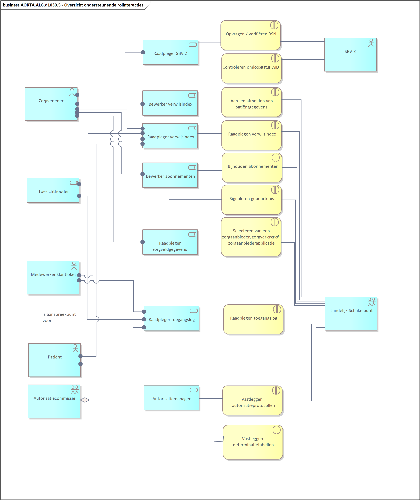

[AORTA 8.5.2](../../index.md) / [Logische architectuur](../../logische-architectuur.md) / [Ondersteunende interacties](../ondersteunende-interacties.md)

# Ondersteunende interacties.

Naast de primaire interacties van opvragen en sturen van patiëntgegevens, biedt AORTA een aantal ondersteunende (‘secundaire’) interacties. Een overzicht van de ondersteunende interacties wordt gegeven in diagram AORTA.ALG.d1030.5.

Diagram AORTA.ALG.d1030.5 - overzicht van ondersteunende interacties

Bij de volgende ondersteunende interactie wisselen eindgebruikers gegevens uit met de Sectorale Berichten Voorziening in de Zorg (SBV-Z) (zie pagina [Actoren en rollen](https://vzvz.atlassian.net/wiki/x/z4KObg)):

- Opvragen/verifiëren BSN;

- Controleren omloopstatus WID.

Bij de volgende ondersteunende interacties wisselen eindgebruikers gegevens uit met het LSP, in plaats van met een andere eindgebruiker:

- aan- en afmelden van patiëntgegevens;

- raadplegen van de verwijsindex;

- bijhouden van abonnementen op specifieke gebeurtenissen, zoals wijzigingen in patiëntgegevens;

- selecteren van zorgaanbieders, zorgverleners en zorgaanbiederapplicaties;

- raadplegen van een toegangslog;

- vastleggen van autorisatieprotocollen;

- vastleggen van determinatietabellen.

De bovenstaande interacties worden vanaf [zie pagina [Opvragen/verifiëren BSN en controleren omloopstatus WID](https://vzvz.atlassian.net/wiki/x/6oKObg)] besproken.
