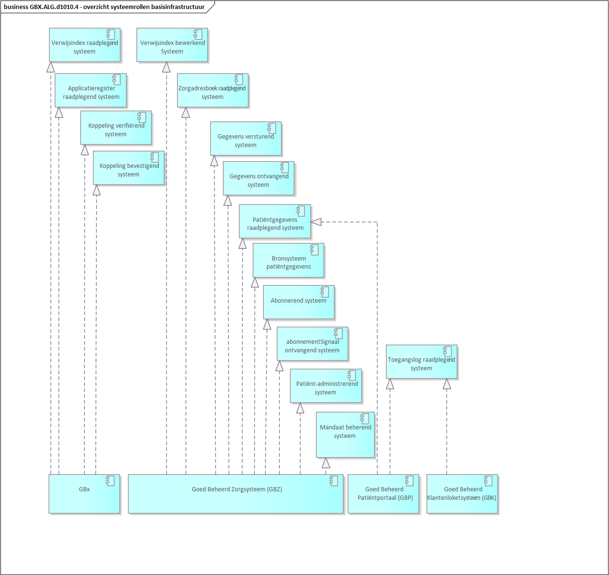

[AORTA 8.5.2](../index.md) / [Logische architectuur](../logische-architectuur.md)

# Overzicht van systeemrollen

Diagram GBX.ALG.d1010.4 geeft een samenvattend overzicht van de systeemrollen die zijn geïntroduceerd in de hoofdstukken “primaire informatiesysteeminteracties”, “ondersteunende informatiesysteeminteracties” en “beheerinteracties”. Samen representeren deze systeemrollen de set van mogelijke interacties tussen GBx’en en de ZIM die vallen binnen de basisinfrastructuur van AORTA. Het diagram geeft tevens aan welke systeemrollen kunnen worden gerealiseerd door alle GBx’en en welke zijn voorbehouden aan GBZ’en, GBP en GBK.

Diagram GBX.ALG.d1010.4 – overzicht systeemrollen basisinfrastructuur AORTA
