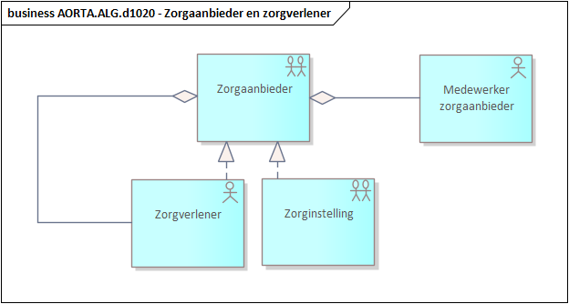

[AORTA 8.5.2](../../index.md) / [Logische architectuur](../../logische-architectuur.md) / [Primaire interacties](../primaire-interacties.md)

# Actoren

Binnen de context van AORTA zijn de volgende actoren van belang, namelijk:

- zorgverlener;

- zorgaanbieder;

- medewerker van een zorgaanbieder;

- patient;

- goed beheerde organisatie.

### Zorgverlener

In AORTA een ‘zorgverlener’ gedefinieerd als een individuele uitoefenaar van een medisch beroep zoals bedoeld in artikel 3 of 34 van de Wet op de beroepen in de individuele gezondheidszorg. Een zorgverlener kan uniek worden geïdentificeerd en beschikt over één of meer wettelijk beschermde beroepstitels.

### Zorgaanbieder

In AORTA wordt verstaan onder een ‘zorgaanbieder’:

- een zorginstelling zoals bedoeld in de Kwaliteitswet zorginstellingen, of;

- een individuele zorgverlener, die niet werkt binnen een zorginstelling, of;

- een instelling die een belangrijke rol speelt in een specifiek zorgproces.

Een individuele zorgverlener kan dus ook een zorgaanbieder zijn, bijvoorbeeld in het geval van een huisarts met een eigen praktijk. Zorgaanbieder en zorgverlener kunnen dan dezelfde persoon zijn.

Een zorgaanbieder kan zorgverleners in dienst hebben en medewerkers die geen zorgverlener zijn. Dit geldt ook als de zorgaanbieder een individuele zorgverlener is: een huisarts kan bijvoorbeeld een verpleegkundige in dienst hebben en een huisartsassistente.

Deze relaties worden geïllustreerd in diagram AORTA.ALG.d1020. Dit toont dat een zorgaanbieder ‘gerealiseerd’ kan worden door een zorgverlener of een zorginstelling en dat zorgaanbieders (zowel zorginstellingen als zorgverleners) zorgverleners en medewerkers in dienst kunnen hebben.

Diagram AORTA.ALG.d1020 - illustratie van het begrip zorgaanbieder

### Medewerker van een zorgaanbieder

In AORTA wordt bedoeld met een ‘medewerker van een zorgaanbieder’ een persoon die werkt voor een zorgaanbieder en zelf geen zorgverlener is. Een medewerker is uniek identificeerbaar en er kan worden vastgesteld voor welke zorgaanbieder de medewerker werkt.

### Patiënt

Het begrip ‘patiënt’ wordt in AORTA niet beperkt tot personen die behandeld worden voor een aandoening, maar wordt meer algemeen opgevat. De patiënt is een uniek-identificeerbare natuurlijke persoon over wie informatie kan worden uitgewisseld. Omdat in de Wbsn-z is vastgelegd dat bij alle berichtgevingen tussen zorgaanbieders onderling het burger servicenummer aanwezig moet zijn, kan de patiënt in de praktijk elke persoon zijn aan wie een burger servicenummer is toegekend. Dat desondanks gesproken wordt over de patiënt en niet over ‘de burger’ heeft te maken met het feit dat in het kader van zorgprocessen de term ‘patiënt’ meer herkenning oproept.

### Goed Beheerde Organisatie

Goed beheerde organisaties (GBO) zijn instellingen die niet beschreven staan in de Kwaliteitswet zorginstellingen. Deze instellingen kunnen als gevolg niet beschikken over UZI authenticatiemiddelen. Om toch gebruik te kunnen maken van de AORTA infrastructuur dient de instelling voorzien te worden van een PKIoverheid servercertificaat. In geval een instelling is voorzien van een PKIoverheid servercertificaat gelden dezelfde uitgangspunten als voor een zorgaanbieder.

Alleen zorgverleners kunnen gegevens uitwisselen via de AORTA infrastructuur. Binnen een GBO dienen dus wel zorgverleners werkzaam te zijn om patiëntgegevens op te kunnen vragen.
