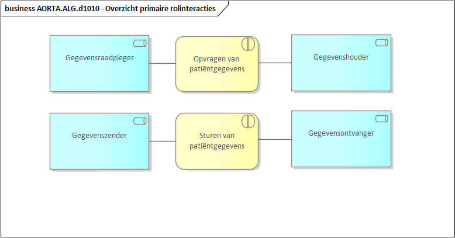

[AORTA 8.5.2](../../index.md) / [Logische architectuur](../../logische-architectuur.md) / [Primaire interacties](../primaire-interacties.md)

# Interacties

Het primaire doel van AORTA is het ondersteunen van informatie-uitwisseling tussen zorgverleners. Hiertoe ondersteunt AORTA een tweetal primaire interacties([^1]), zoals weergegeven in diagram AORTA.ALG.d1010:

- Het opvragen van patiëntgegevens. Hierbij vraagt een gegevensraadpleger patiëntgegevens op bij de gegevenshouder(s).

- Het sturen van patiëntgegevens. Hierbij stuurt een gegevenszender patiëntgegevens naar een gegevensontvanger.

In dit hoofdstuk wordt een aantal algemene aspecten van deze primaire interacties besproken, los van de implicaties op informatiesysteemniveau.

Diagram AORTA.ALG.d1010 - primaire interacties van AORTA

Gegevenshouder, gegevensraadpleger, gegevenszender en gegevensontvanger zijn algemene rollen en worden geconcretiseerd door aan te geven welke actoren deze rollen kunnen vervullen. Hiertoe is het noodzakelijk eerst een aantal actoren te introduceren die binnen de context van AORTA van belang zijn.

[^1]: Een ‘interactie’ is een wisselwerking tussen organisaties, personen en/of systemen, waarbij gegevens kunnen worden uitgewisseld.
