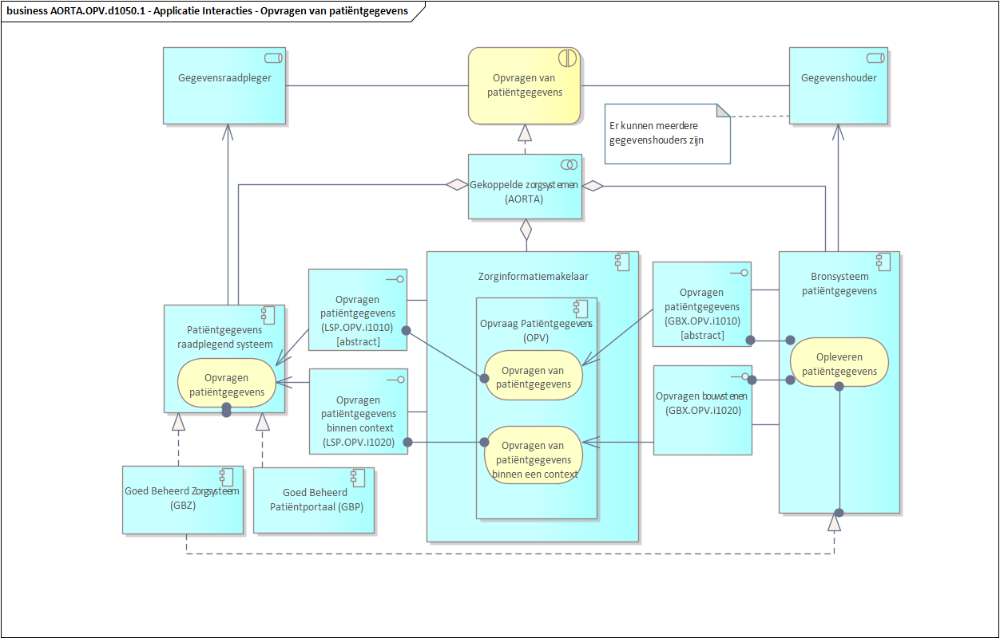
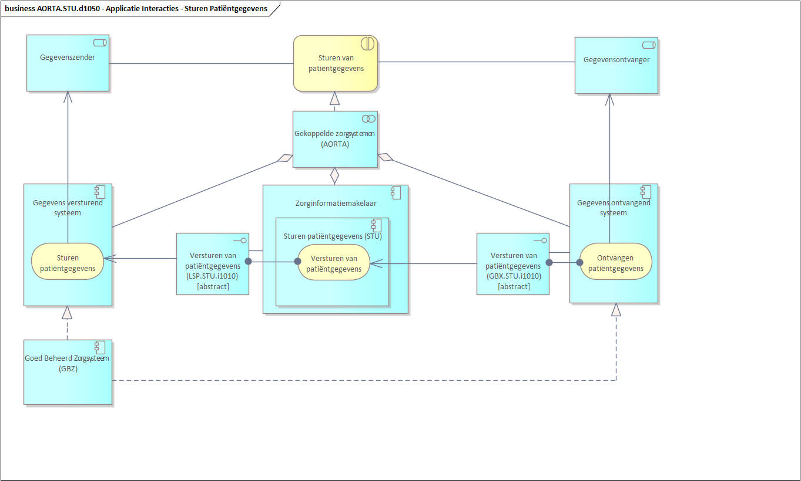

[AORTA 8.5.2](../../index.md) / [Logische architectuur](../../logische-architectuur.md) / [Primaire interacties](../primaire-interacties.md)

# Primaire informatiesysteeminteracties – opvragen en sturen van gegevens

Op deze pagina wordt uitgewerkt hoe de primaire interacties worden uitgewerkt op informatiesysteemniveau.

## Opvragen van patiëntgegevens

AORTA koppelt patiëntgegevens raadplegende systemen via de ZIM aan bronsystemen voor patiëntgegevens. Zorgverleners zijn zo in staat om via hun eigen GBZ gegevens over hun patiënten uit de GBZ’en van andere zorgverleners op te vragen. Hiertoe moet hun informatiesysteem gekoppeld zijn aan de ZIM. De zorgverlener hoeft niet zelf te weten in welke andere informatiesystemen gegevens over zijn patiënten zijn opgeslagen. Dit wordt voor niet naar Mitz gemigreerde systemen bijgehouden in de Verwijsindex (VWI), die onderdeel is van de ZIM. Bij naar Mitz gemigreerde systemen kan dit via Mitz worden opgevraagd.

In het geval een raadplegend systeem een specifieke bron wil bevragen, is het ook mogelijk om een gerichte bevraging te doen. De VWI zal in dat geval niet geraadpleegd worden.[^1] Indien het bevraagde systeem gemigreerd is naar Mitz, wordt wel Mitz bevraagd om te kijken of er toestemming is om de bron te bevragen.

De ZIM biedt voor het opvragen twee interfaces aan patiëntgegevens raadplegende systemen:

- LSP.OPV.i1010: Opvragen van patiëntgegevens;

- LSP.OPV.i1020: Opvragen van patiëntgegevens binnen context.

Patiënten kunnen hun eigen patiëntgegevens opvragen, voor zover deze bij de VWI zijn aangemeld. Dit kan via een GBP, met gebruikmaking van de interface LSP.OPV.i1010[[2]](http://vzvz.atlassian.net#_ftn2). Deze functionaliteit is niet actief. Een patiënt kan zijn eigen patiëntgegevens opvragen via een zogenaamde Persoonlijke Gezondheidsomgeving (PGO). Voor meer informatie hierover wordt verwezen naar het afsprakenstelsel van MedMij.

Deze situatie is weergegeven in diagram AORTA.OPV.d1050.

Diagram AORTA.OPV.d1050.1 - informatiesysteeminteracties voor het opvragen van patiëntgegevens

De interfaces ‘opvragen van patiëntgegevens’ en ‘opvragen bouwstenen’ zijn abstracte interfaces; er bestaat dus geen concreet geïmplementeerde interface met deze naam. De abstracte interface bestaat enkel op ontwerpniveau om het beschrijven van een aantal generieke aspecten van deze interface mogelijk te maken, zodat de ZIM verschillende concrete opvraagberichten op een generieke wijze behandelt. In de uitwerking van concrete zorgtoepassingen (bijvoorbeeld medicatieproces, huisartswaarneemgegevens) worden concrete implementaties ontworpen van de interface ‘opvragen patiëntgegevens’ (bijvoorbeeld ‘opvragen medicatievoorschriften’). De interface ‘opvragen bouwstenen’ wordt ingevuld door specifieke bouwsteen bevragingen (bijvoorbeeld ‘opvragen medicatieverstrekkingen’). Waar sprake is van abstracte interfaces wordt dit expliciet benoemd.

### Interface LSP.OPV.i1010: opvragen van patiëntgegevens

Het opvragen van patiëntgegevens kan vanuit een op de ZIM aangesloten patiëntgegevens raadplegend systeem worden geïnitieerd. Deze interface wordt gebruikt om de inhoudelijke gegevens van een patiënt op te vragen zoals die in andere op de ZIM aangesloten informatiesystemen aanwezig zijn. Wanneer patiëntgegevens via de ZIM worden opgevraagd, stuurt de ZIM-component ‘Opvraag patiëntgegevens’ (OPV) de opvraag door naar alleen die GBZ’en die volgens de Verwijsindex over de gevraagde gegevens beschikken.[^1] De OPV component verzamelt vervolgens de resultaten en beantwoordt het oorspronkelijke verzoek.[^2]

Om het doorsturen van opvraagverzoeken mogelijk te maken moet een op de ZIM aangesloten informatiesysteem de benodigde interface implementeren, GBX.OPV.i1010; deze is structureel gelijk aan LSP.OPV.i1010, maar het doorgestuurde opvraagverzoek bevat nu de ZIM als afzender.

Zie voor een verdere uitwerking van de aspecten van deze interface het ontwerp van de component ‘Opvraag patiëntgegevens’ (OPV) (zie [Ontw OPV]).

### Interface LSP.OPV.i1020: opvragen van patiëntgegevens binnen context

Het opvragen van patiëntgegevens binnen een context kan vanuit een op de ZIM aangesloten patiëntgegevens raadplegend systeem worden geïnitieerd. Deze interface wordt gebruikt om de inhoudelijke gegevens van een patiënt op te vragen zoals die in andere op de ZIM aangesloten informatiesystemen aanwezig zijn. Wanneer patiëntgegevens via de ZIM worden opgevraagd, zal door de SDS component worden bepaald welke specifieke bouwstenen moeten worden opgevraagd en met welke eventuele beperkingen.

Er wordt binnen deze interface onderscheid gemaakt tussen een gerichte en een ongerichte bevraging. Bij een gerichte opvraag heeft het patiëntraadplegend systeem de te bevragen GBZ(en) opgenomen in de bevraging en zal de Verwijsindex niet geraadpleegd worden. In het geval van een ongerichte bevraging zal de OPV component per bouwsteen de specifieke bouwsteenvraag versturen naar de bronsystemen die volgens de VWI over de bouwsteen zouden kunnen beschikken.[^3]

Zie voor een precieze uitwerking van de aspecten van deze interface het ontwerp van de component ‘Opvraag patiëntgegevens’ (OPV) (zie [Ontw OPV]).

## Versturen van patiëntgegevens

AORTA stelt zorgverleners in staat om via hun eigen informatiesysteem gegevens over de door hen behandelde patiënten op te sturen naar de informatiesystemen van andere zorgverleners.

Hiertoe moeten de informatiesystemen van zender en ontvanger gekoppeld zijn aan de ZIM. Voorafgaand aan het verzenden heeft de zender de mogelijkheid om via de ZIM de voor het adresseren benodigde informatie op te zoeken over de ontvanger (zie hiervoor pagina '[Raadplegen van de verwijsindex](../ondersteunende-interacties-1/ondersteunende-informatiesysteeminteracties.md#raadplegen-van-de-verwijsindex)').

De ZIM biedt voor het sturen één interface:

- LSP.STU.i1010: Versturen van patiëntgegevens

Een systeem dat deze interface implementeert heeft de systeemrol ‘gegevens versturend systeem’. Deze situatie is weergegeven in diagram AORTA.STU.d1050.

### Interface LSP.STU.i1010: sturen van patiëntgegevens

Het sturen van patiëntgegevens kan vanuit een op de ZIM aangesloten informatiesysteem worden geïnitieerd. Deze interface biedt de mogelijkheid om de inhoudelijke gegevens van een patiënt te versturen naar een op de ZIM aangesloten informatiesysteem dat toebehoort aan een andere zorgaanbieder. Wanneer patiëntgegevens via de ZIM worden verstuurd, stuurt de ZIM-component ‘Sturen patiëntgegevens’ (STU) de verzonden gegevens door naar het informatiesysteem dat in de adressering van het bericht is gespecificeerd. Om dit doorsturen mogelijk te maken moeten de aangesloten informatiesystemen de benodigde interface implementeren, GBX.STU.i1010; deze is structureel gelijk aan LSP.STU.i1010; ook inhoudelijk wordt de boodschap niet aangepast. De ZIM acteert dus alleen als intermediair.

Zie voor een verdere uitwerking van de aspecten van deze interface het ontwerp van de component ‘Sturen patiëntgegevens’ (STU) (zie [Ontw STU]).

*N.B. De ‘sturen van patiëntgegevens’ interface is een abstracte interface; er bestaat dus geen concreet geïmplementeerde interface met deze naam. De abstracte interface bestaat enkel op ontwerpniveau om het beschrijven van een aantal generieke aspecten van deze interface mogelijk te maken, zodat de ZIM verschillende concrete opvraagberichten op een generieke wijze behandelt. In de uitwerking van concrete zorgtoepassingen (bijvoorbeeld medicatieproces, huisartswaarneemgegevens) worden concrete implementaties ontworpen van deze interface (bijvoorbeeld ‘versturen medicatievoorschrift’).*

Diagram AORTA.STU.d1050 - informatiesysteeminteracties voor het sturen van patiëntgegevens

[^1]: Omdat de ZIM hierbij de vraag afkomstig van één applicatie uitzet naar meerdere applicaties wordt gesproken van ‘divergeren’ van een verzoek.

[[2]](primaire-informatiesysteeminteracties-opvragen-en-.md#_ftnref2) Omdat hierbij de antwoorden afkomstig van meerdere applicaties weer worden gebundeld, wordt gesproken van ‘convergeren’ van antwoorden.

[^3]: De VWI bepaalt de juiste verwijzingen door te bepalen welke gegevenssoorten specifieke bouwsteentypen bevatten. Bronnen die een verwijzing van een relevant bouwsteentype of gegevenssoort hebben aangemeld zullen worden bevraagd.

[^2]: 

Deze functionaliteit wordt alleen geboden via de interface LSP.OPV.i1020. Hier wordt bedoeld dat in principe zowel een GBZ als een GBP kan optreden als patiëntgegevens-raadplegend systeem. Op het moment van publicatie zijn nog geen GBP’s gerealiseerd die deze functionaliteit bieden.
