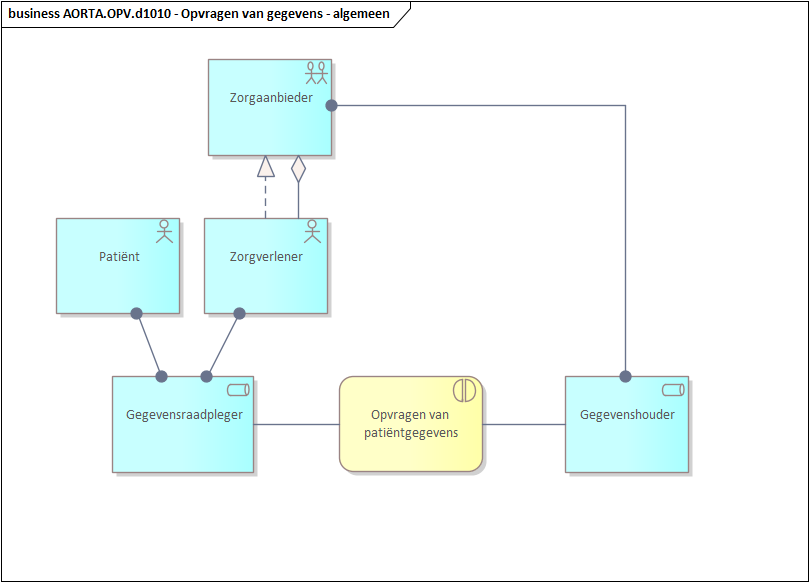
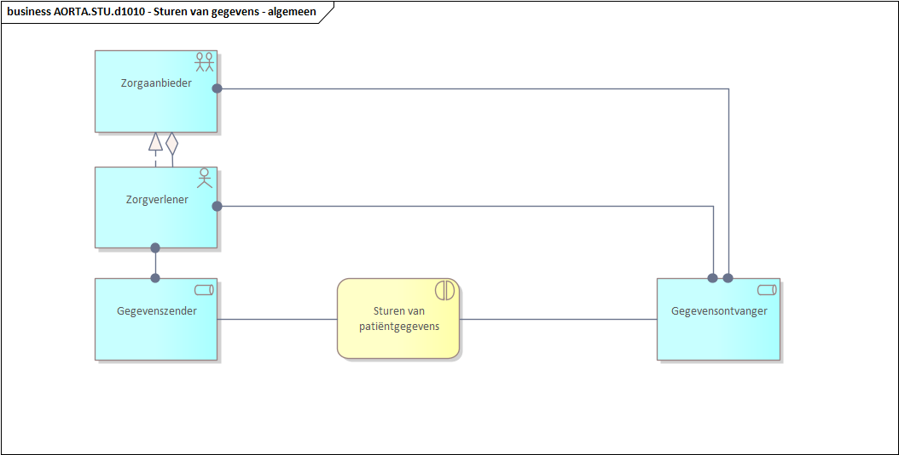

[AORTA 8.5.2](../../index.md) / [Logische architectuur](../../logische-architectuur.md) / [Primaire interacties](../primaire-interacties.md)

# Rollen toekennen aan actoren

Nu de actoren ‘zorgaanbieder’, ‘zorgverlener’ en ‘patiënt’ zijn geïntroduceerd, kunnen de rollen behorend bij de primaire interacties worden geconcretiseerd. Hierbij geldt voor de actor GBO hetzelfde als voor de actor ‘zorgaanbieder’.

### Opvragen van patiëntgegevens

De rollen behorend bij de interactie ‘opvragen van patiëntgegevens’ worden getoond in diagram AORTA.OPV.d1010.

Diagram AORTA.OPV.d1010 - opvragen van patiëntgegevens

**Gegevenshouder**

Bij het opvragen van patiëntgegevens heeft een *zorgaanbieder* de rol van gegevenshouder. De opslag van dossiergegevens is namelijk in het algemeen gemeenschappelijk georganiseerd door de zorgaanbieder voor (groepen van) zorgverleners die bij de zorgaanbieder werkzaam zijn; toegang tot de dossiergegevens moet daarom op het niveau van de zorgaanbieder worden geregeld. Meerdere zorgaanbieders kunnen gegevenshouder zijn van gegevens van een bepaalde patiënt.

**Gegevensraadpleger**

Een individuele zorgverlener behorend bij een zorgaanbieder (in het algemeen een andere zorgaanbieder dan de gegevenshouder) heeft de rol van gegevensraadpleger. Het is mogelijk dat een zorgverlener een systeem mandateert om voor hem gegevens op te vragen. Er zal echter altijd een zorgverlener zijn, die verantwoordelijk is voor een opvraag. Ook de patiënt kan optreden als gegevensraadpleger van zijn eigen gegevens.

### Sturen van patiëntgegevens

De rollen behorend bij de interactie ‘sturen van patiëntgegevens’ worden getoond in diagram AORTA.STU.d1010.

Diagram AORTA.STU.d1010 - Sturen van patiëntgegevens

**Gegevenszender**

Bij het sturen van patiëntgegevens heeft een zorgverlener die hoort bij een zorgaanbieder de rol van gegevenszender.

**Gegevensontvanger**

De gegevensontvanger kan een individuele zorgverlener zijn die hoort bij een zorgaanbieder (in het algemeen een andere zorgaanbieder dan de zorgaanbieder waartoe de gegevenszender behoort). Het is echter ook mogelijk dat de gegevenszender op het moment van verzenden nog niet kan vaststellen welke zorgverlener bij de ontvangende zorgaanbieder de behandeling van de patiënt zal uitvoeren en daartoe de gegevens zal raadplegen. In dit geval is de gegevensontvanger de zorgaanbieder, waarbij het aan de zorgaanbieder is om de gegevens beschikbaar te maken aan de individuele zorgverlener die de patiënt zal behandelen.

### Toegangsbeperkingen

De modellen die op deze pagina beschreven staan houden niet in dat een zorgverlener die optreedt als gegevensraadpleger automatisch toegang kan hebben tot alle patiëntgegevens van alle patiënten waarover de gegevenshouder beschikt, of dat iedere zorgverlener die optreedt als gegevenszender de gegevens van elke willekeurige patiënt kan versturen. Een nadere inperking door een model van toegangsregels is vereist in de vorm van een toegangsmodel.
