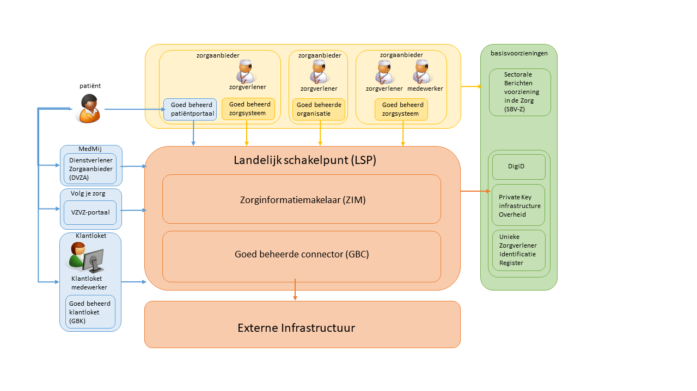

[AORTA 8.5.2](../index.md) / [Logische architectuur](../logische-architectuur.md)

# Samenvatting

AORTA is **de landelijk beschikbare infrastructuur voor gegevensuitwisseling in de zorg in Nederland**, met behulp waarvan zorgverleners onderling patiëntgegevens kunnen uitwisselen en patiënten hun eigen gegevens kunnen raadplegen.

## Primaire interacties

AORTA ondersteunt als primaire interacties (1) het opvragen van patiëntgegevens en het versturen van patiëntgegevens. Hierbij maakt AORTA gebruik van een intermediair, het Landelijk Schakelpunt (LSP); het LSP houdt een verwijsindex bij, waarbij de gegevenshouders kunnen aanmelden dat zij over patiëntgegevens beschikken. Vervolgens kunnen zorgverleners en patiënten via het LSP gegevens opvragen zonder dat zij elke afzonderlijke gegevenshouder apart hoeven te benaderen. Ook bij het versturen van gegevens treedt het LSP op als intermediair en ondersteunt hierbij de adressering van gegevens.

(1) Een interactie is een wisselwerking tussen organisaties, personen en/of systemen, waarbij gegevens kunnen worden uitgewisseld.

## Ondersteunende interacties

AORTA ondersteunt het opvragen en versturen van gegevens met de volgende interacties:

- het aan- en afmelden van gegevens bij de verwijsindex;

- het nemen van een abonnement op wijzigingen in patiëntgegevens of op verzonden berichten omtrent een specifieke patiënt;

- het raadplegen van een toegangslog waarin alle gegevensuitwisselingen zijn vastgelegd voor controle achteraf op de toegangsregels, in aanvulling op de beveiligingsmaatregelen vooraf.

Daarnaast worden er externe services aangeboden voor op de AORTA aangesloten systemen. Het gaat hier specifiek over:

- het opzoeken van gegevens over zorgaanbieders, zorgverleners en het opzoeken van adresseringsinformatie van een op AORTA aangesloten zorginformatiesysteem

## Authenticatie en autorisatie

AORTA authenticeert zorgverleners en patiënten die via AORTA gegevens uitwisselen. Zorgverleners moeten hiertoe beschikken over een UZI-pas, die hun unieke zorgverlener identificatie bevat. Patiënten moeten beschikken over een DigiD met sms verificatie.

AORTA regelt ook de autorisatie van betrokken zorgverleners en patiënten. De autorisatie houdt rekening met diverse aspecten, namelijk actieve instemming door de patiënt met het ter beschikking stellen van gegevens door de zorgaanbieder (voor niet gemigreerde systemen door middel van een lokaal geregistreerde opt-in, via gemigreerde systemen wordt de opt-in via Mitz geregeld), het bestaan van een behandelrelatie tussen zorgverlener en patiënt, het beroep van de zorgverlener en eventueel bezwaar van de patiënt tegen uitwisseling van gegevens. Ook is er de mogelijkheid voor de zorgverlener om andere medewerkers direct of indirect (op basis van een set aan autorisatieregels) te mandateren, waarbij de medewerker gegevens kan uitwisselen onder verantwoordelijkheid van de zorgverlener.

Patiënten die niet zelf over de mogelijkheden beschikken om toegang tot AORTA te verkrijgen, kunnen zich wenden tot een Klantenloketorganisatie. Klantenloketmedewerkers kunnen hierbij enkele gegevens namens de patiënt opvragen. Klantenloketmedewerkers identificeren zich met een PKIO-pas.

## Informatiesystemen

De standaard voor informatie-uitwisseling verschuift bij AORTA van HL7v3 richting HL7 FHIR, waar het communicatie met de patiënt betreft, maar ook waar met apps gewerkt wordt en de behoefte aan FHIR voor uitwisseling tussen zorgaanbieders is.

Aorta zal zowel HL7v3 als FHIR gaan ondersteunen als platform/stelsel voor uitwisseling. Een belangrijke innovatie bij AORTA richting HL7 FHIR, is de ontwikkeling van API-gebaseerde interacties, en met name het samenspel tussen de Resource Broker ([HL7-FHIR standaard](https://www.hl7.org/fhir/index.html)) en de Autorisatie Server ([OAuth-protocol](https://tools.ietf.org/html/rfc6749)) die in deze informatie-uitwisseling van belang zijn.

Het LSP maakt gebruik van een centraal bericht uitwisselingsplatform, de Zorginformatiemakelaar (ZIM). De ZIM is verantwoordelijk voor de HL7v3 berichtuitwisseling tussen initiërende systemen en reagerende systemen.

LSP+ is een uitbreiding of extensie voor HL7 FHIR, omdat het AORTA-netwerk niet alleen o.b.v. HL7v3 aan het MedMij-netwerk wordt gekoppeld, maar ook o.b.v. HL7-FHIR, waardoor alle (op FHIR-gebaseerde) MedMij-gegevensdiensten via LSP+ geboden kunnen worden.

Alle informatiesystemen die op de ZIM worden aangesloten moeten aan een stelsel van implementatie- en exploitatie-eisen voldoen, waarna ze worden aangeduid als ‘goed beheerd’ informatiesysteem, aangeduid met de afkorting GBx.

Tot de groep van GBx’en behoren:

- goed beheerde zorgsystemen (GBZ), informatiesystemen die door zorgverleners worden gebruikt om een patiëntdossier in te richten;

- goed beheerde patiëntportalen (GBP), portalen die patiënten toegang geven tot hun eigen gegevens(1);VZVZ-portaal, specialisatie van een GBP onder beheer van VZVZ.

- een goed beheerd klantenloketsysteem (GBK), het toegangssysteem van de klantenloketorganisatie;

- goed beheerde organisaties (GBO), informatiesystemen die door zorgverleners worden gebruikt, maar die geen uzi abonnee kunnen worden;

- goed beheerde connector (GBC), connector die patiëntgegevens ontsluit van externe infrastructuren aan de AORTA-infrastructuur;

- dienstverlener zorgaanbieder (DVZA), connector die patiëntgegevens uit de AORTA-infrastructuur ontsluit aan het MedMij-netwerk.

Het LSP en LSP+ zullen samen de Resource Broker gaan vormen voor het  HL7 FHIR verkeer, waarbij er tevens van één Autorisatie Server gebruik gemaakt gaat worden, die op termijn opgeschaald wordt naar een gemeenschappelijke dienst en op Mitz aangesloten wordt. Om systemen van zorgaanbieders te kunnen vinden en adresseren, wordt gebruik gemaakt van de gemeenschappelijke dienst ZORG-AB. Om de interoperabiliteit te bevorderen, zal gebruik gemaakt worden van Zorg Informatie Bouwstenen (ZIB's) die tussen zorgaanbieders onderling, als ook tussen zorgaanbieders en burgers worden uitgewisseld.

Informatie uitwisseling tussen zorgaanbieders mag ook direct plaatsvinden, zonder tussenkomst van de Resource Broker, zodat voor iedere use case, de optimale informatiestroom kan worden ingeregeld. Met behulp van een vertaal (of translatie) services van de Resource Broker wordt het zorgaanbieders mogelijk gemaakt tussen HL7v3- en HL7 FHIR systemen te communiceren.

Voor systeemauthenticatie moeten systemen beschikken over een UZI-servercertificaat (GBZ) of een servercertificaat van PKIoverheid (partijen die geen UZI abonnee kunnen worden, zoals ZIM, GBP, GBK, GBO).

Zowel de GBx’en als de ZIM hebben toegang tot de services van een aantal basisregistraties.

(1) Hoewel de ZIM is voorbereid op berichten vanuit een GBP, is op het moment van publicatie nog geen concreet GBP gerealiseerd, waardoor daadwerkelijke patiënttoegang tot AORTA via een GBP nog niet mogelijk is.

## Berichtafhandeling

Om de interacties tussen zorgverleners onderling en tussen patiënt en zorgverlener te ondersteunen, is een reeks van interfaces gedefinieerd op de ZIM. Er wordt onderscheid gemaakt tussen de interfaces voor GBZ’en, GBO’s, GBP’en en GBK’en en de DVZA. Via de GBC kan een externe infrastructuur bevraagt worden. Er worden (nog) geen interfaces aangeboden specifiek voor externe infrastructuren.

Voor berichtuitwisseling tussen GBx en ZIM wordt gebruik gemaakt van berichten die gebaseerd zijn op de internationale medische berichtenstandaard HL7v3. HL7-berichten worden verstuurd over SOAP over HTTPS. GBx en ZIM worden gekoppeld via datacommunicatienetwerken (DCN’s) op basis van TCP/IP. De leveranciers van deze DCN’s moeten aan speciale eisen voldoen om zich te kwalificeren als Goedbeheerd ZorgNetwerk (GZN, voorheen Zorg Service Provider).

Voor berichtuitwisseling tussen GBx onderling of tussen PGO en LSP+ kan van FHIR REST API's gebruik gemaakt worden, die gebaseerd zijn op FHIR profielen. FHIR profielen zijn specifieke en uitgebreide FHIR resources die voor specifieke toepassingen gemaakt zijn. Door de manier waarop profielen worden toegepast binnen FHIR kunnen er voor een bepaalde (FHIR) basis resource verschillende profielen bestaan, bijvoorbeeld afhankelijk van zorgdomein, land, instelling of leverancier. Om interoperabiliteit te borgen is het van belang dat binnen een bepaalde use case dezelfde profielen gebruikt worden. Een register met FHIR profielen is te vinden op [www.simplifier.net](http://www.simplifier.net) (in samenwerking met HL7 Nederland).

De kern van de relatie tussen bouwstenen op basis van ZIB’s (Zorg Informatie Bouwstenen) en FHIR is dat de bouwstenen op modelniveau via mapping “omgezet” moeten worden in FHIR resources en vice versa. Daarvoor zijn er specifieke profielen door Nictiz en andere partijen ontwikkeld en in beheer gegeven bij HL7 Nederland. De gepubliceerde ZIB profielen zijn terug te vinden op [Nictiz STU3 Zib 2017](https://simplifier.net/nictizstu3-zib2017) (zie ook [ZIB Publicatie 2017 NL](https://zibs.nl/wiki/ZIB_Publicatie_2017\(NL\))). Het onderhanden werk bij Nictiz is terug te vinden op [https://simplifier.net/organization/nictiz/~projects](https://simplifier.net/organization/nictiz/~projects).

## Non-functionele aspecten en beveiliging

De ZIM is ten behoeve van beschikbaarheid en continuïteit redundant en op gescheiden locaties geïmplementeerd. Voor beschikbaarheid, responstijden, capaciteit en schaalbaarheid zijn richtlijnen opgesteld die zijn vastgelegd in een programma van eisen (zie [PvE ZIM]) en in beheerafspraken.

Beveiliging van AORTA is een centraal aspect van de architectuur en is gebaseerd op een [vertrouwensmodel](../referenties.md#Vertrouwensmodel), dat een geheel vormt van technische, organisatorische en juridische waarborgen. In de architectuur komen vooral de technische waarborgen aan de orde.
