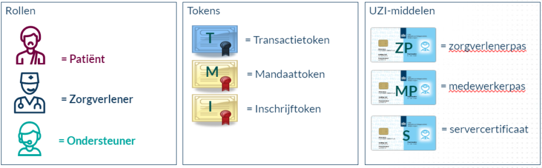
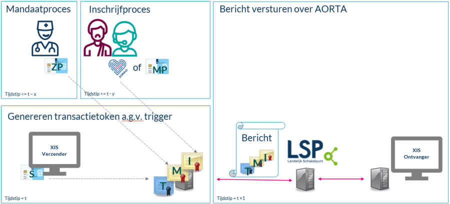

[AORTA 8.5.2](../../index.md) / [Processen](../../processen.md) / [Vereenvoudigd gebruik UZI-pas (VGU)](../vereenvoudigd-gebruik-uzi-pas-vgu.md)

# Generieke uitwerking vereenvoudigd gebruik van de UZI-pas (VGU)

Hieronder staat uitgewerkt hoe het **v**ereenvoudigd **g**ebruik van de **U**ZI-pas (VGU) toegepast kan worden. Het betreft een generieke uitwerking die toegepast kan worden op elke interactie die over de AORTA infrastructuur wordt verstuurd. Het gaat daarbij zowel om infrastructurele berichten gericht aan het LSP als om zorginhoudelijke berichten gericht aan een ontvangende XIS.

## Legenda

Onderstaande legenda toont de symbolen zoals gebruikt in onderstaande diagram

## 

## Generiek proces

Het generieke proces dat gevolgd dient te worden om gebruik te maken van het vereenvoudigde gebruik van de UZI-pas staat hieronder uitgewerkt.   

## Samenvatting

Onderstaande tabel beschrijft de actoren, UZI-middelen en resultaat van de tokens in de tijd.

| **Tijdstip** ; | **Proces** ; | **Actoren** ; | **Token** ; | **Duur token** ; | **Middel** ; |
| --- | --- | --- | --- | --- | --- |
| **T-x (x>0)** Het tijdstip ligt in ieder geval voor het moment dat een transactietoken aangemaakt wordt. Op welk moment het mandaattoken precies aangemaakt wordt, is afhankelijk van het zorgproces. ; | Mandaatproces ; | Verantwoordelijke zorgverlener ; XIS ; | Mandaattoken ; | Richtlijn 5 minuten, maximaal 90 minuten. ; | UZI-zorgverlenerpas, handtekeningcertificaat ; |
| **T-y (y>0)** Het tijdstip ligt in ieder geval voor het moment dat een transactietoken aangemaakt wordt. Op welk moment het mandaattoken precies aangemaakt wordt, is afhankelijk van het zorgproces. Hierbij geldt dat er geen verband is tussen x en y. ; | Inschrijfproces ; | Medewerker ; Patiënt ; XIS ; | Inschrijftoken ; | Maximaal de geldigheidsduur van het handtekeningcertificaat waarmee is ondertekend . ; | UZI-medewerkerpas-op-naam, authenticatiecertificaat, of ; ZORG-ID ; |
| **T** ; | Genereren transactietoken a.g.v. trigger ; | XIS ; | Transactietoken ; | Maximaal 1,5 jaar ; | UZI-servercertificaat ; |
| **T+1** ; | Bericht versturen over AORTA ; | XIS ; LSP ; | Mandaattoken ; Transactietoken ; Inschrijftoken ; |  | UZI-servercertificaat ; |
