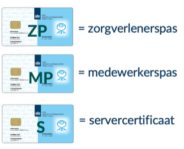

[AORTA 8.5.2](../../index.md) / [Processen](../../processen.md) / [Vereenvoudigd gebruik UZI-pas (VGU)](../vereenvoudigd-gebruik-uzi-pas-vgu.md)

# UZI-middel gebruik

## Processen met betrekking tot UZI-middelen

Het vereenvoudigd gebruik met de UZI-pas sluit het gebruik van de UZI-pas niet helemaal uit. De UZI-pas blijft nodig binnen twee deelprocessen:

- Bij de bevestiging van inschrijving van een patiënt;

- Bij het afgeven van een mandaat door een verantwoordelijke zorgverlener.

Deze twee deelprocessen kunnen op afzonderlijke momenten in de tijd plaatsvinden. Het is aan een zorgaanbieder in overleg met zijn XIS-leverancier zaak om een goede invulling te vinden, die aansluit bij het werkproces zoals geïmplementeerd binnen de zorgaanbieder.   
Naast de UZI-passen dient er gebruik te worden gemaakt van servercertificaten. Deze zijn nodig voor het proces om een specifieke zorgaanbieder te identificeren en te authenticeren Hieronder wordt gesproken over een UZI-servercertificaat. Het is mogelijk dat in sommige gevallen gebruik wordt gemaakt van een PKIo-servercertificaat.

### UZI-middelen

Er zijn verschillende soorten UZI-middelen te onderscheiden. Het gaat hierbij om persoonlijke als organisatie UZI-middelen.

**Zorgverlenerpas**: Pas ten behoeve van zorgverlener waarvan het beroep valt onder artikel 3, 34 of 36a beroepen van de Wet BIG. De certificaten op de pas bevatten de unieke identificatie (UZI-nummer) en de functie (UZI-rolcode) van de betreffende zorgverlener.  
   
**Medewerkerpas**: Pas voor medewerkers die geen beroep uitoefenen wat valt onder artikel 3, 34 of 36a van de Wet BIG. Met de certificaten op deze pas is het niet mogelijk om je te authenticeren voor toegang tot de AORTA infrastructuur. Een alternatief voor deze pas is het gebruik van ZORG-ID.

**Medewerkerpas-op-naam**: Pas voor medewerkers die geen beroep uitoefenen wat valt onder artikel 3, 34 of 36a van de Wet BIG. De certificaten die opgenomen zijn bevatten een unieke identificatie van de medewerker (UZI-nummer). Deze medewerker vervult niet een functie die valt onder artikel 3, 34 of 36a van de Wet BIG en krijgt hiermee geen unieke rolcode toegekend. Ook een UZI-medewerkerpas op naam kan toegang krijgen tot het LSP, maar alleen als deze is gemandateerd door een BIG- geregistreerde zorgverlener met een UZI- zorgverlenerpas. Een alternatief voor de medewerkerspas-op-naam is het gebruik van ZORG-ID.  
   
**Servercertificaat**: zorgt voor identificatie en authenticatie van de zorgaanbiederapplicatie. Met een servercertificaat kunnen beveiligde verbindingen worden opgezet met het LSP. Binnen AORTA geldt dat er gebruik moet worden gemaakt van UZI-servercertificaten, tenzij het niet mogelijk is voor de betreffende zorgaanbieder om een UZI-servercertificaat aan te vragen. In dat geval zal gewerkt worden met een PKIo-servercertificaat.

### Inschrijfproces

Zodra een patiënt is ingeschreven en er een WID- en een BSN-controle heeft plaatsgevonden bij het SBV-Z, dan is het mogelijk om een inschrijftoken te ondertekenen. Het ondertekenen kan op verschillende momenten in de tijd gebeuren:

- Direct na de initiële inschrijving en de benodigde SBV-Z controles;

- Op een later moment na de initiële inschrijving en de benodigde SBV-Z controles Het is hierbij van belang dat er extra waarborgen zijn dat een patiënt daadwerkelijk door een geautoriseerd persoon is ingeschreven inclusief alle benodigde controles. Een kwaadwillende mag niet in staat gesteld worden om inschrijftokens te laten genereren. ;

- Op het moment van bevraging en er nog geen inschrijftoken beschikbaar is.

Het is aan een zorgaanbieder in overleg met zijn XIS-leverancier zaak om een goede invulling te vinden, die aansluit bij het werkproces zoals geïmplementeerd binnen de zorgaanbieder.  
Het inschrijftoken moet worden ondertekend met het authenticatiecertificaat van minimaal Dit kan ook met een zorgverlenerpas gebeuren. een medewerkpas-op-naam pas. Deze pas dient geldig te zijn op het moment van ondertekenen van een inschrijftoken. Een inschrijftoken is 1.5 jaar geldig, ongeacht de geldigheidsduur van de UZI-pas. Na 1.5 jaar dient de inschrijving opnieuw bevestigd te worden door middel van ondertekening.  
Als gevolg van deze ondertekening kan onweerlegbaar worden vastgesteld dat een geautoriseerde gebruiker binnen de organisatie heeft vastgesteld dat de inschrijving van de patiënt door deze persoon is gedaan of dat deze persoon heeft geconstateerd dat de inschrijving correct heeft plaatsgevonden.   
Registratie en ondertekening van het inschrijftoken dient te gebeuren voordat het systeem gebruik kan maken van het vereenvoudigd gebruik van de UZI-pas.

### Mandaatproces

Een zorgverlener kan door middel van een mandaat zijn autorisaties overdragen aan een andere zorgverlener. Op een soortgelijke wijze kan een zorgverlener het XIS delegeren om onder zijn verantwoordelijkheid een interactie te versturen met betrekking tot de patiënten waar de betreffende zorgverlener een behandelrelatie mee heeft.  
Het mandaat dat een verantwoordelijke zorgverlener heeft geregistreerd, wordt vastgelegd in de vorm van een mandaattoken. Voor het vereenvoudigd gebruik van de UZI-pas dient de applicatieID van het systeem van waaruit een AORTA-interactie wordt verstuurd, opgenomen te zijn in het mandaat. Na het registreren van een mandaat, dient de verantwoordelijke zorgverlener het mandaat te ondertekenen met het handtekeningcertificaat van zijn UZI-pas. Het mandaattoken is maximaal net zolang geldig als de geldigheidsduur van de zorgverlenerpas. Indien een zorgverlenerpas verlopen is, dan zal het mandaattoken niet meer gebruikt kunnen worden.   
Registratie en ondertekening van het mandaattoken dient te gebeuren voordat het systeem gebruik kan maken van het vereenvoudigd gebruik van de UZI-pas.

### Genereren transactietoken a.g.v. trigger

Om zeker te weten dat een bericht ook daadwerkelijk door een zorgaanbieder is opgesteld, dient er een transactietoken te worden ondertekend door het UZI-servercertificaat. Het transactietoken bevestigd dat een specifiek bericht is opgesteld onder verantwoordelijkheid van een specifieke zorgaanbieder die een behandelrelatie heeft met de patiënt op wie het bericht betrekking heeft.   
Het aanmaken van een transactietoken wordt geïnitieerd door een trigger zoals omschreven in de pagina Vereenvoudigd proces UZI-pas.

### Bericht versturen over AORTA

Voor het versturen van een bericht, dient het versturende XIS een verbinding op te zetten met het LSP. Een verbinding wordt opgezet op basis van het servercertificaat van de XIS. Het bericht dat verstuurd wordt, dient begeleidt te worden met:

- het inschrijftoken van de patiënt die onderwerp is van het bericht;

- het mandaattoken van de verantwoordelijke zorgverlener die een behandelrelatie heeft met deze patiënt;

- het transactietoken die is aangemaakt als gevolg van een trigger.

Het XIS moet deze tokens koppelen aan een bericht.   
Het is mogelijk dat er meerdere mandaattokens beschikbaar zijn, die gebruikt zouden kunnen worden. Afhankelijk van de trigger zou een gebruiker van het systeem het juiste mandaattoken kunnen kiezen of kan het systeem op basis van de context van het bericht zelf een mandaattoken kunnen kiezen. De wijze van implementeren kan afhankelijk zijn van het zorgproces waarin dit proces wordt toegepast. Het is dan ook aan de XIS-leverancier om hier goed mee om te gaan. VZVZ zal hier bij de implementatie in kunnen begeleiden.

## Voor wie UZI-passen?

Om patiëntgegevens op te mogen vragen, dient de verantwoordelijke zorgverlener een behandelrelatie te hebben met de patiënt wiens gegevens worden opgevraagd. Het is aan de verantwoordelijke zorgverlener en/of de organisatie om de behandelrelatie te verantwoorden aan een patiënt of inspectiedienst.   
De rol van de verantwoordelijke zorgverlener bepaalt welke inhoudelijke informatie er bij een opvraag wordt opgeleverd. Welke informatie wordt opgeleverd voor een bevraging door een specifieke rol heeft te maken met de autorisatierichtlijnen die worden opgesteld door de verschillende koepels; niet elke zorgverlener krijgt vanzelfsprekend dezelfde dataset opgeleverd.   
Met name voor organisaties waar verschillende zorgverlenerrollen actief zijn, is het van belang om een goede afweging te maken over welke zorgverlener met welke zorgverlenerrol een UZI-pas moet bezitten. Hierbij kan de autorisatierichtlijn van een zorgtoepassing meer inzicht geven. Voor alle interactietypes (opvragen, versturen, infrastructurele berichten etc.) geldt dat het Medische Autorisatie Protocol (MAP) bepaalt of een bepaalde rolcode een bericht mag versturen. Ook hiervoor geldt dat VZVZ de MAP-configuratie beschikbaar kan stellen om een goede afweging te maken voor welke rollen er UZI-passen aangeschaft dienen te worden.

## Aantal UZI-passen?

Het aantal benodigde UZI-passen is sterk afhankelijk van de organisatiestructuur en de werkprocessen binnen een organisatie. Er zijn wel een aantal zaken aan te geven, waar organisaties rekening mee kunnen houden bij het bepalen van het aantal benodigde UZI-passen:

- Verschillende soorten zorgverlenerrollen binnen de organisatie; autorisaties worden binnen AORTA toegekend per zorgverlenerrol. Niet elke zorgverlener heeft dezelfde autorisaties. Er dient dus nagedacht te worden welke zorgverlenerrollen een UZI-pas dienen aan te vragen om de juiste patiëntgegevens te kunnen opvragen.

- Onderkennen verantwoordelijke zorgverlener binnen zorgprocessen; een zorgverlener dient een behandelrelatie te hebben met een patiënt om diens gegevens op te vragen. Het is aan de zorgaanbieder om een behandelrelatie te verantwoorden aan een patiënt of inspectiedienst.

- Doorstroom van personeel; een UZI-pas is gekoppeld aan een persoon. Indien deze persoon uit dienst gaat, mag de UZI-pas en de hiermee getekende tokens niet meer gebruikt worden.

- Vervangen verlopen en/of ingetrokken UZI-pas; een UZI-pas die verlopen is, moet niet leiden tot een verstoord zorgproces. Het is dus aan te raden om altijd meerdere actieve UZI-passen in een instelling te gebruiken, zodat bij het verlopen of intrekken van een UZI-pas het zorgproces niet stil valt.

## Rol VZVZ

VZVZ kan een XIS-leverancier en/of zorgaanbieder begeleiden met het implementeren en in gebruik nemen van het proces met betrekking tot het vereenvoudigd gebruik van de UZI-pas.   
VZVZ kan advies geven over het aantal te gebruiken UZI-passen en aan wie die UZI-passen het best kunnen worden toegekend. Dit zal echter een niet bindend advies zijn. Het is aan de zorgaanbieder om hierin de juiste keuzes voor zijn organisatie te maken.   
Indien een zorgaanbieder in overleg met zijn XIS-leverancier bepaalde tekortkomingen ziet met betrekking tot het vereenvoudigd gebruik van de UZI-pas, dan gaat VZVZ graag in gesprek om een oplossing te vinden voor deze tekortkomingen. Hierbij valt bijvoorbeeld te denken aan het ontbreken van een juiste trigger voor het initiëren van het versturen van een bericht. VZVZ zal hierbij altijd de geldende normen, regels, wetten en afspraken met het veld in ogenschouw nemen.
