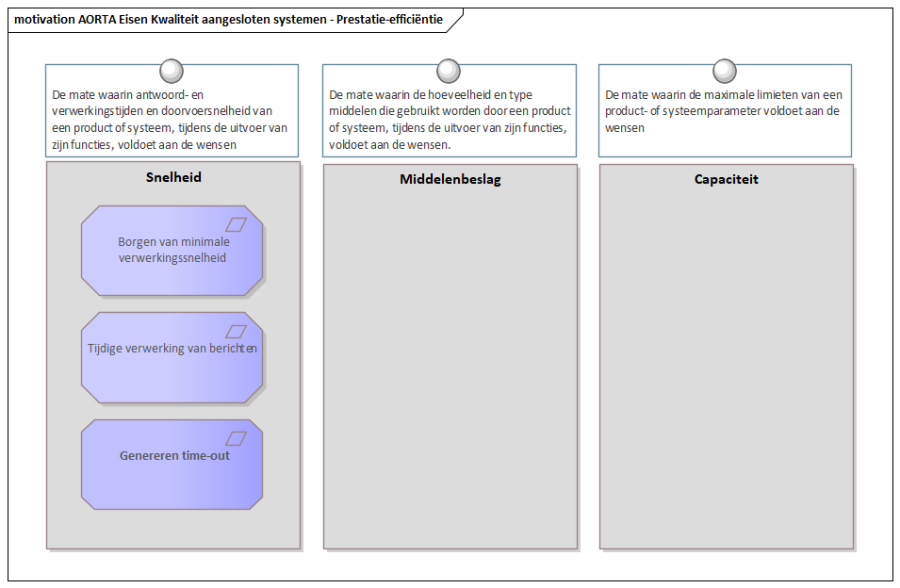
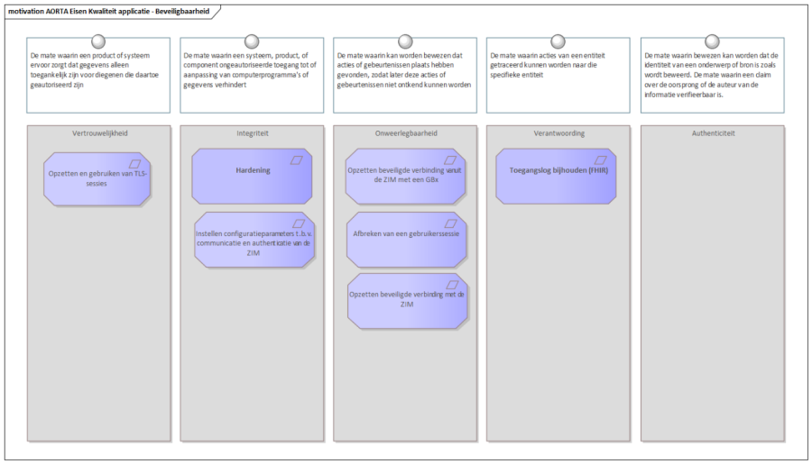
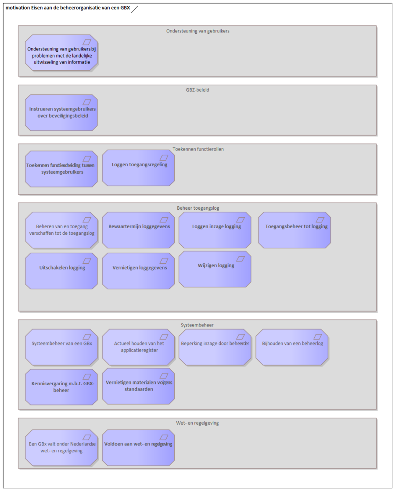
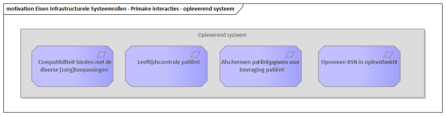
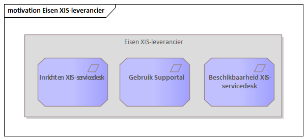
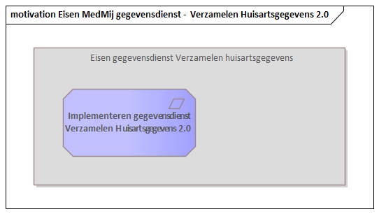

[AORTA 8.5.2](../../../index.md) / [Zorgtoepassingen](../../../zorgtoepassingen.md) / [MedMij](../../medmij.md) / [MedMij Bronsysteem](../medmij-bronsysteem.md)

# PvE Bronsysteem tbv MedMij

| Datum: 15 juni 2022 ; |
| --- |
| Status: Definitief ; |
| Versie: ; |
| Classificatie: Openbaar ; |
| Revisie: 1.0 ; |

### Documenthistorie

*Documentversies*

| **Datum** ; | **Status** ; | **Versie** ; | **Omschrijving** ; |
| --- | --- | --- | --- |
| 15 juni 2022 ; | Definitief ; |  | Eerste opzet PvE Bronsysteem tbv MedMij ; |
|  |  |  |  |

Inhoudsopgave   
[Documenthistorie](pve-bronsysteem-tbv-medmij.md#documenthistorie)  
[1 Inleiding](pve-bronsysteem-tbv-medmij.md#inleiding)  
[1.1 Doelgroep voor dit document](pve-bronsysteem-tbv-medmij.md#doelgroep-voor-dit-document)  
[**1.2** Doel en scope](pve-bronsysteem-tbv-medmij.md#doel-en-scope)  
[2 Diagrammen Kwaliteitseisen](pve-bronsysteem-tbv-medmij.md#diagrammen-kwaliteitseisen)  
[2.1 AORTA Eisen Kwaliteit aangesloten systemen](pve-bronsysteem-tbv-medmij.md#aorta-eisen-kwaliteit-aangesloten-systemen)  
[2.1.1 Tijdige verwerking van berichten](pve-bronsysteem-tbv-medmij.md#tijdige-verwerking-van-berichten)  
[2.1.2 Genereren time-out](pve-bronsysteem-tbv-medmij.md#genereren-time-out)  
[2.1.3 Borgen van minimale verwerkingssnelheid](pve-bronsysteem-tbv-medmij.md#borgen-van-minimale-verwerkingssnelheid)  
[2.1.4 Borgen van de beschikbaarheid van een GBx](pve-bronsysteem-tbv-medmij.md#borgen-van-de-beschikbaarheid-van-een-gbx)  
[2.1.5 Minimaliseren van de impact van gepland onderhoud](pve-bronsysteem-tbv-medmij.md#minimaliseren-van-de-impact-van-gepland-onderhoud)  
[2.1.6 Borgen van de betrouwbaarheid bij kleine storingen](pve-bronsysteem-tbv-medmij.md#borgen-van-de-betrouwbaarheid-bij-kleine-storingen)  
[2.1.7 Borgen van de betrouwbaarheid bij grote storingen](pve-bronsysteem-tbv-medmij.md#borgen-van-de-betrouwbaarheid-bij-grote-storingen)  
[2.1.8 Beveiliging van patiëntgegevens in het GBx](pve-bronsysteem-tbv-medmij.md#beveiliging-van-patientgegevens-in-het-gbx)  
[2.1.9 Borgen van plicht tot uitwisselen van patiëntgegevens](pve-bronsysteem-tbv-medmij.md#borgen-van-plicht-tot-uitwisselen-van-patientgegevens)  
[2.1.10 Een GBx beschikt over een geldig UZI/PKIO-servercertificaat](pve-bronsysteem-tbv-medmij.md#een-gbx-beschikt-over-een-geldig-uzipkio-servercertificaat)  
[2.1.11 Beveiligde opslag](pve-bronsysteem-tbv-medmij.md#beveiligde-opslag)  
[2.1.12 Communicatie met het LSP via een GZN](pve-bronsysteem-tbv-medmij.md#communicatie-met-het-lsp-via-een-gzn)  
[2.1.13 Gebruik van IP en DNS](pve-bronsysteem-tbv-medmij.md#gebruik-van-ip-en-dns)  
[2.1.14 Tijdsynchronisatie GBx en ZIM](pve-bronsysteem-tbv-medmij.md#tijdsynchronisatie-gbx-en-zim)  
[2.1.15 Aansluiting op productie-omgeving LSP](pve-bronsysteem-tbv-medmij.md#aansluiting-op-productie-omgeving-lsp)  
[2.2 AORTA Eisen Kwaliteit applicatie](pve-bronsysteem-tbv-medmij.md#aorta-eisen-kwaliteit-applicatie)  
[2.2.1 Afbreken van een gebruikerssessie](pve-bronsysteem-tbv-medmij.md#afbreken-van-een-gebruikerssessie)  
[2.2.2 Opzetten beveiligde verbinding met de ZIM](pve-bronsysteem-tbv-medmij.md#opzetten-beveiligde-verbinding-met-de-zim)  
[2.2.3 Instellen configuratieparameters t.b.v. communicatie en authenticatie van de ZIM](pve-bronsysteem-tbv-medmij.md#instellen-configuratieparameters-tbv-communicatie-en-authenticatie-van-de-zim)  
[2.2.4 Opzetten en gebruiken van TLS-sessies](pve-bronsysteem-tbv-medmij.md#opzetten-en-gebruiken-van-tls-sessies)  
[2.2.5 Opzetten beveiligde verbinding vanuit de ZIM met een GBx](pve-bronsysteem-tbv-medmij.md#opzetten-beveiligde-verbinding-vanuit-de-zim-met-een-gbx)  
[2.2.6 Hardening](pve-bronsysteem-tbv-medmij.md#hardening)  
[2.2.7 Toegangslog bijhouden (FHIR)](pve-bronsysteem-tbv-medmij.md#toegangslog-bijhouden-fhir)  
[2.2.8 Onderscheiden van fictieve gegevens](pve-bronsysteem-tbv-medmij.md#onderscheiden-van-fictieve-gegevens)  
[2.2.9 Ondersteunen servercertificaten en ondertekeningalgoritmen](pve-bronsysteem-tbv-medmij.md#ondersteunen-servercertificaten-en-ondertekeningalgoritmen)  
[2.2.10 Kenbaar maken Certificate Authorities](pve-bronsysteem-tbv-medmij.md#kenbaar-maken-certificate-authorities)  
[2.2.11 Afhandelen transactietoken](pve-bronsysteem-tbv-medmij.md#afhandelen-transactietoken)  
[2.2.12 Protocolstack voor gegevensuitwisseling o.b.v. FHIR](pve-bronsysteem-tbv-medmij.md#protocolstack-voor-gegevensuitwisseling-obv-fhir)  
[2.3 Eisen aan de beheerorganisatie van een GBX](pve-bronsysteem-tbv-medmij.md#eisen-aan-de-beheerorganisatie-van-een-gbx)  
[2.3.1 Ondersteuning van gebruikers bij problemen met de landelijke uitwisseling van informatie](pve-bronsysteem-tbv-medmij.md#ondersteuning-van-gebruikers-bij-problemen-met-de-landelijke-uitwisseling-van-informatie)  
[2.3.2 Instrueren systeemgebruikers over beveiligingsbeleid](pve-bronsysteem-tbv-medmij.md#instrueren-systeemgebruikers-over-beveiligingsbeleid)  
[2.3.3 Toekennen functiescheiding tussen systeemgebruikers](pve-bronsysteem-tbv-medmij.md#toekennen-functiescheiding-tussen-systeemgebruikers)  
[2.3.4 Beheren van en toegang verschaffen tot de toegangslog](pve-bronsysteem-tbv-medmij.md#beheren-van-en-toegang-verschaffen-tot-de-toegangslog)  
[2.3.5 Systeembeheer van een GBx](pve-bronsysteem-tbv-medmij.md#systeembeheer-van-een-gbx)  
[2.3.6 Actueel houden van het applicatieregister](pve-bronsysteem-tbv-medmij.md#actueel-houden-van-het-applicatieregister)  
[2.3.7 Beperking inzage door beheerder](pve-bronsysteem-tbv-medmij.md#beperking-inzage-door-beheerder)  
[2.3.8 Bijhouden van een beheerlog](pve-bronsysteem-tbv-medmij.md#bijhouden-van-een-beheerlog)  
[2.3.9 Kennisvergaring m.b.t. GBX-beheer](pve-bronsysteem-tbv-medmij.md#kennisvergaring-mbt-gbx-beheer)  
[2.3.10 Een GBx valt onder Nederlandse wet- en regelgeving](pve-bronsysteem-tbv-medmij.md#een-gbx-valt-onder-nederlandse-wet-en-regelgeving)  
[2.3.11 Vernietigen materialen volgens standaarden](pve-bronsysteem-tbv-medmij.md#vernietigen-materialen-volgens-standaarden)  
[2.3.12 Voldoen aan wet- en regelgeving](pve-bronsysteem-tbv-medmij.md#voldoen-aan-wet-en-regelgeving)  
[2.3.13 Loggen toegangsregeling](pve-bronsysteem-tbv-medmij.md#loggen-toegangsregeling)  
[2.3.14 Bewaartermijn loggegevens](pve-bronsysteem-tbv-medmij.md#bewaartermijn-loggegevens)  
[2.3.15 Loggen inzage logging](pve-bronsysteem-tbv-medmij.md#loggen-inzage-logging)  
[2.3.16 Uitschakelen logging](pve-bronsysteem-tbv-medmij.md#uitschakelen-logging)  
[2.3.17 Vernietigen loggegevens](pve-bronsysteem-tbv-medmij.md#vernietigen-loggegevens)  
[2.3.18 Wijzigen logging](pve-bronsysteem-tbv-medmij.md#wijzigen-logging)  
[2.3.19 Toegangsbeheer tot logging](pve-bronsysteem-tbv-medmij.md#toegangsbeheer-tot-logging)  
[2.4 Eisen Infrastructurele Systeemrollen](pve-bronsysteem-tbv-medmij.md#eisen-infrastructurele-systeemrollen)  
[2.4.1 Afschermen patiëntgegevens voor bevraging patiënt](pve-bronsysteem-tbv-medmij.md#afschermen-patientgegevens-voor-bevraging-patient)  
[2.4.2 Compatibiliteit bieden met de diverse (zorg)toepassingen](pve-bronsysteem-tbv-medmij.md#compatibiliteit-bieden-met-de-diverse-zorgtoepassingen)  
[2.4.3 Leeftijdscontrole patiënt](pve-bronsysteem-tbv-medmij.md#leeftijdscontrole-patient)  
[2.4.4 Opnemen BSN in opleverbericht](pve-bronsysteem-tbv-medmij.md#opnemen-bsn-in-opleverbericht)  
[2.4.5 Wijzigen TKID applicatie o.b.v. FHIR](pve-bronsysteem-tbv-medmij.md#wijzigen-tkid-applicatie-obv-fhir)  
[2.4.6 Bevestigen applicatiekoppeling o.b.v. FHIR](pve-bronsysteem-tbv-medmij.md#bevestigen-applicatiekoppeling-obv-fhir)  
[2.4.7 Verwerken geboortedatums waarin nullen zijn opgenomen](pve-bronsysteem-tbv-medmij.md#verwerken-geboortedatums-waarin-nullen-zijn-opgenomen)  
[2.4.8 Voorlopig koppelen van patiëntgegevens aan een BSN](pve-bronsysteem-tbv-medmij.md#voorlopig-koppelen-van-patientgegevens-aan-een-bsn)  
[2.4.9 Definitief koppelen van patiëntgegevens aan een BSN](pve-bronsysteem-tbv-medmij.md#definitief-koppelen-van-patientgegevens-aan-een-bsn)  
[2.4.10 Controleren geldigheid van een WID](pve-bronsysteem-tbv-medmij.md#controleren-geldigheid-van-een-wid)  
[2.4.11 Opzoeken en tonen patiëntgegevens](pve-bronsysteem-tbv-medmij.md#opzoeken-en-tonen-patientgegevens)  
[2.4.12 Gebruik van geverifieerde BSN's](pve-bronsysteem-tbv-medmij.md#gebruik-van-geverifieerde-bsns)  
[2.5 Eisen XIS-leverancier](pve-bronsysteem-tbv-medmij.md#eisen-xis-leverancier)  
[2.5.1 Beschikbaarheid XIS-servicedesk](pve-bronsysteem-tbv-medmij.md#beschikbaarheid-xis-servicedesk)  
[2.5.2 Inrichten XIS-servicedesk](pve-bronsysteem-tbv-medmij.md#inrichten-xis-servicedesk)  
[2.5.3 Gebruik Supportal](pve-bronsysteem-tbv-medmij.md#gebruik-supportal)  
[2.6 Eisen specifieke gegevensdienst](pve-bronsysteem-tbv-medmij.md#eisen-specifieke-gegevensdienst)  
[2.6.1 Implementeren gegevensdienst Verzamelen Huisartsgegevens 2.0](pve-bronsysteem-tbv-medmij.md#implementeren-gegevensdienst-verzamelen-huisartsgegevens-20)  
[2.6.2 Implementeren gegevensdienst Verzamelen Medicatiegegevens 9.0](pve-bronsysteem-tbv-medmij.md#implementeren-gegevensdienst-verzamelen-medicatiegegevens-90)  
[2.6.3 Implementeren gegevensdienst Verzamelen Medicatiegerelateerde Overgevoeligheden 2.A](pve-bronsysteem-tbv-medmij.md#implementeren-gegevensdienst-verzamelen-medicatiegerelateerde-overgevoeligheden-2a)  
[2.6.4 Implementeren gegevensdienst Verzamelen Basisgegevens GGZ 2.0](pve-bronsysteem-tbv-medmij.md#implementeren-gegevensdienst-verzamelen-basisgegevens-ggz-20)  
[2.6.5 Implementeren gegevensdienst Verzamelen Basisgegevens zorg 3.0](pve-bronsysteem-tbv-medmij.md#implementeren-gegevensdienst-verzamelen-basisgegevens-zorg-30)  
[2.6.6 Implementeren gegevensdienst Delen antwoorden op vragenlijsten 2.0](pve-bronsysteem-tbv-medmij.md#implementeren-gegevensdienst-delen-antwoorden-op-vragenlijsten-20)  
[2.6.7 Implementeren Ontvankelijkheidstoets](pve-bronsysteem-tbv-medmij.md#implementeren-ontvankelijkheidstoets)  
[2.6.8 Controleren behandelrelatie](pve-bronsysteem-tbv-medmij.md#controleren-behandelrelatie)  
[2.6.9 Bijhouden behandelrelatie](pve-bronsysteem-tbv-medmij.md#bijhouden-behandelrelatie)  
[2.6.10 Implementeren gegevensdienst Delen Meetwaarden vitale functies 2.0](pve-bronsysteem-tbv-medmij.md#implementeren-gegevensdienst-delen-meetwaarden-vitale-functies-20)  
[2.6.11 Implementeren gegevensdienst Verzamelen Afspraken 2.0](pve-bronsysteem-tbv-medmij.md#implementeren-gegevensdienst-verzamelen-afspraken-20)  
[2.6.12 Implementeren gegevensdienst Verzamelen Documenten 3.0](pve-bronsysteem-tbv-medmij.md#implementeren-gegevensdienst-verzamelen-documenten-30)  
[2.6.13 Implementeren gegevensdienst Meetwaarden vitale functies 2.0](pve-bronsysteem-tbv-medmij.md#implementeren-gegevensdienst-meetwaarden-vitale-functies-20)  
[2.6.14 Implementeren gegevensdienst Verzamelen verwijzingen naar vragenlijsten 2.0](pve-bronsysteem-tbv-medmij.md#implementeren-gegevensdienst-verzamelen-verwijzingen-naar-vragenlijsten-20)

## Inleiding

Dit programma van eisen gaat over de toepassing bronsysteem t.b.v. MedMij. Het PvE Bronsysteem t.b.v. MedMij betreft een document waarin eisen zijn opgenomen waaraan een GBZ moet voldoen om aangesloten te worden op de AORTA-infrastructuur.

### Doelgroep voor dit document

De doelgroep voor dit document bestaat uit diverse rollen aan de kant van de XIS-leverancier en de GBx beheerorganisatie. Het gaat hierbij om o.a. architecten, software ontwikkelaars, productmanagers, testers en systeembeheerders. Tevens is dit document bedoeld voor diverse rollen binnen VZVZ. Het gaat hierbij o.a. om architecten, productmanagers, testers, demandmanagers en ketenregie.

### Doel en scope

Het doel van dit document is om de eisen te beschrijven waaraan moet worden voldaan om een GBZ als bronsysteem t.b.v. MedMij aan te sluiten op de AORTA-infrastructuur. De hierin opgenomen hoofdstukken gelden voor alle bronsystemen ongeacht de gegevensdienst waarvoor zij gegevens beschikbaar stellen. Paragraaf 1.6 bevat per gegevensdienst de specifieke eisen voor die gegevensdienst. Deze zijn alleen van toepassing indien de betreffende XIS ook daadwerkelijk gegevens beschikbaar wil stellen t.b.v. die gegevensdienst.   
Section: Section1

## Diagrammen Kwaliteitseisen

### AORTA Eisen Kwaliteit aangesloten systemen

  
*Figure 1 : AORTA Eisen Kwaliteit aangesloten systemen - Prestatie-efficiëntie*

#### Tijdige verwerking van berichten

<!-- rm:requirement urn:researchmaster:aorta:requirement:GBX.PST.e4015 -->

#### Genereren time-out

<!-- rm:requirement urn:researchmaster:aorta:requirement:GBX.PST.e4020 -->

#### Borgen van minimale verwerkingssnelheid

<!-- rm:requirement urn:researchmaster:aorta:requirement:GBX.PST.e4010.1 -->

#### Borgen van de beschikbaarheid van een GBx

<!-- rm:requirement urn:researchmaster:aorta:requirement:GBX.BES.e4010 -->

#### Minimaliseren van de impact van gepland onderhoud

<!-- rm:requirement urn:researchmaster:aorta:requirement:GBX.BES.e4020 -->

#### Borgen van de betrouwbaarheid bij kleine storingen

<!-- rm:requirement urn:researchmaster:aorta:requirement:GBX.BET.e4010.1 -->

#### Borgen van de betrouwbaarheid bij grote storingen

<!-- rm:requirement urn:researchmaster:aorta:requirement:GBX.BET.e4020.1 -->

#### Beveiliging van patiëntgegevens in het GBx

<!-- rm:requirement urn:researchmaster:aorta:requirement:GBX.BVL.e4060 -->

#### Borgen van plicht tot uitwisselen van patiëntgegevens

<!-- rm:requirement urn:researchmaster:aorta:requirement:GBX.BVL.e4070 -->

#### Een GBx beschikt over een geldig UZI/PKIO-servercertificaat

<!-- rm:requirement urn:researchmaster:aorta:requirement:GBX.BVL.e4080 -->
<!-- rm:requirement urn:researchmaster:aorta:requirement:GBX.BVL.e4080.1 -->

#### Beveiligde opslag

<!-- rm:requirement urn:researchmaster:aorta:requirement:SYS.BVL.e4010 -->

#### Communicatie met het LSP via een GZN

<!-- rm:requirement urn:researchmaster:aorta:requirement:GBX.CON.e4010 -->
<!-- rm:requirement urn:researchmaster:aorta:requirement:GBX.CON.e4010.1 -->

#### Gebruik van IP en DNS

<!-- rm:requirement urn:researchmaster:aorta:requirement:GBX.CON.e4020 -->
<!-- rm:requirement urn:researchmaster:aorta:requirement:GBX.CON.e4020.1 -->
<!-- rm:requirement urn:researchmaster:aorta:requirement:GBX.CON.e4020.2 -->

#### Tijdsynchronisatie GBx en ZIM

<!-- rm:requirement urn:researchmaster:aorta:requirement:GBX.CON.e4030 -->
<!-- rm:requirement urn:researchmaster:aorta:requirement:GBX.CON.e4030.1 -->

#### Aansluiting op productie-omgeving LSP

<!-- rm:requirement urn:researchmaster:aorta:requirement:GBX.CON.e4120 -->

### AORTA Eisen Kwaliteit applicatie

  
*Figure 5 : AORTA Eisen Kwaliteit applicatie - Beveiligbaarheid*  
ISO 25010 definitieert Beveiligbaarheid als: De mate waarin een product of systeem informatie en gegevens beschermt zodat personen, andere producten of systemen de juiste mate van gegevenstoegang hebben passend bij hun soort en niveau van autorisatie.

#### Afbreken van een gebruikerssessie

<!-- rm:requirement urn:researchmaster:aorta:requirement:GBX.IDA.e4090 -->

#### Opzetten beveiligde verbinding met de ZIM

<!-- rm:requirement urn:researchmaster:aorta:requirement:GBX.CON.e4080.4 -->

#### Instellen configuratieparameters t.b.v. communicatie en authenticatie van de ZIM

<!-- rm:requirement urn:researchmaster:aorta:requirement:GBX.FBH.e4050.2 -->

#### Opzetten en gebruiken van TLS-sessies

<!-- rm:requirement urn:researchmaster:aorta:requirement:GBX.CON.e4070.2 -->

#### Opzetten beveiligde verbinding vanuit de ZIM met een GBx

<!-- rm:requirement urn:researchmaster:aorta:requirement:GBX.CON.e4090.2 -->

#### Hardening

<!-- rm:requirement urn:researchmaster:aorta:requirement:SYS.BVL.e4065 -->

#### Toegangslog bijhouden (FHIR)

<!-- rm:requirement urn:researchmaster:aorta:requirement:GBX.LOG.e4016 -->

#### Onderscheiden van fictieve gegevens

<!-- rm:requirement urn:researchmaster:aorta:requirement:GBX.BVL.e4090 -->

#### Ondersteunen servercertificaten en ondertekeningalgoritmen

<!-- rm:requirement urn:researchmaster:aorta:requirement:GBX.CON.e4110.2 -->

#### Kenbaar maken Certificate Authorities

<!-- rm:requirement urn:researchmaster:aorta:requirement:GBX.CON.e4100 -->

#### Afhandelen transactietoken

<!-- rm:requirement urn:researchmaster:aorta:requirement:GBX.CON.e4140.2 -->

#### Protocolstack voor gegevensuitwisseling o.b.v. FHIR

<!-- rm:requirement urn:researchmaster:aorta:requirement:GBX.CON.e4130.1 -->

### Eisen aan de beheerorganisatie van een GBX

  
*Figure 8 : Eisen aan de beheerorganisatie van een GBX*

#### Ondersteuning van gebruikers bij problemen met de landelijke uitwisseling van informatie

<!-- rm:requirement urn:researchmaster:aorta:requirement:GBX.FBH.e4010 -->

#### Instrueren systeemgebruikers over beveiligingsbeleid

<!-- rm:requirement urn:researchmaster:aorta:requirement:GBX.FBH.e4015 -->

#### Toekennen functiescheiding tussen systeemgebruikers

<!-- rm:requirement urn:researchmaster:aorta:requirement:GBX.FBH.e4025 -->

#### Beheren van en toegang verschaffen tot de toegangslog

<!-- rm:requirement urn:researchmaster:aorta:requirement:GBX.SBH.e4010 -->

#### Systeembeheer van een GBx

<!-- rm:requirement urn:researchmaster:aorta:requirement:GBX.SBH.e4020 -->
<!-- rm:requirement urn:researchmaster:aorta:requirement:GBX.SBH.e4020.2 -->

#### Actueel houden van het applicatieregister

<!-- rm:requirement urn:researchmaster:aorta:requirement:GBX.SBH.e4030 -->

#### Beperking inzage door beheerder

<!-- rm:requirement urn:researchmaster:aorta:requirement:GBX.SBH.e4040.3 -->

#### Bijhouden van een beheerlog

<!-- rm:requirement urn:researchmaster:aorta:requirement:GBX.SBH.e4050 -->

#### Kennisvergaring m.b.t. GBX-beheer

<!-- rm:requirement urn:researchmaster:aorta:requirement:GBX.SBH.e4060 -->

#### Een GBx valt onder Nederlandse wet- en regelgeving

<!-- rm:requirement urn:researchmaster:aorta:requirement:GBX.CON.e4050.1 -->

#### Vernietigen materialen volgens standaarden

<!-- rm:requirement urn:researchmaster:aorta:requirement:GBX.SBH.e4070 -->

#### Voldoen aan wet- en regelgeving

<!-- rm:requirement urn:researchmaster:aorta:requirement:GBX.ALG.e4010 -->

#### Loggen toegangsregeling

<!-- rm:requirement urn:researchmaster:aorta:requirement:AGE.LOG.e4070 -->

#### Bewaartermijn loggegevens

<!-- rm:requirement urn:researchmaster:aorta:requirement:AGE.LOG.e4010 -->

#### Loggen inzage logging

<!-- rm:requirement urn:researchmaster:aorta:requirement:AGE.LOG.e4020 -->

#### Uitschakelen logging

<!-- rm:requirement urn:researchmaster:aorta:requirement:AGE.LOG.e4030 -->

#### Vernietigen loggegevens

<!-- rm:requirement urn:researchmaster:aorta:requirement:AGE.LOG.e4050 -->

#### Wijzigen logging

<!-- rm:requirement urn:researchmaster:aorta:requirement:AGE.LOG.e4060 -->

#### Toegangsbeheer tot logging

<!-- rm:requirement urn:researchmaster:aorta:requirement:AGE.LOG.e4040 -->

### Eisen Infrastructurele Systeemrollen

  
*Figure 9 : Eisen Infrastructurele Systeemrollen - Primaire interacties - opleverend systeem*

#### Afschermen patiëntgegevens voor bevraging patiënt

<!-- rm:requirement urn:researchmaster:aorta:requirement:GBX.OPV.e4537 -->

#### Compatibiliteit bieden met de diverse (zorg)toepassingen

<!-- rm:requirement urn:researchmaster:aorta:requirement:GBX.OPV.e4550.1 -->

#### Leeftijdscontrole patiënt

<!-- rm:requirement urn:researchmaster:aorta:requirement:GBX.OPV.e4570 -->

#### Opnemen BSN in opleverbericht

<!-- rm:requirement urn:researchmaster:aorta:requirement:GBX.OPV.e4660 -->

#### Wijzigen TKID applicatie o.b.v. FHIR

<!-- rm:requirement urn:researchmaster:aorta:requirement:GBX.APR.e4070.1 -->

#### Bevestigen applicatiekoppeling o.b.v. FHIR

<!-- rm:requirement urn:researchmaster:aorta:requirement:GBX.APR.e4080 -->

#### Verwerken geboortedatums waarin nullen zijn opgenomen

<!-- rm:requirement urn:researchmaster:aorta:requirement:GBX.IDA.e4015 -->

#### Voorlopig koppelen van patiëntgegevens aan een BSN

<!-- rm:requirement urn:researchmaster:aorta:requirement:GBX.IDA.e4020 -->

#### Definitief koppelen van patiëntgegevens aan een BSN

<!-- rm:requirement urn:researchmaster:aorta:requirement:GBX.IDA.e4030 -->

#### Controleren geldigheid van een WID

<!-- rm:requirement urn:researchmaster:aorta:requirement:GBX.IDA.e4040 -->

#### Opzoeken en tonen patiëntgegevens

<!-- rm:requirement urn:researchmaster:aorta:requirement:GBX.IDA.e4010.1 -->

#### Gebruik van geverifieerde BSN's

<!-- rm:requirement urn:researchmaster:aorta:requirement:GBX.IDA.e4060.1 -->

### Eisen XIS-leverancier

  
*Figure 12 : Eisen XIS-leverancier*

#### Beschikbaarheid XIS-servicedesk

<!-- rm:requirement urn:researchmaster:aorta:requirement:XIS.SVD.e4010 -->

#### Inrichten XIS-servicedesk

<!-- rm:requirement urn:researchmaster:aorta:requirement:XIS.SVD.e4030 -->

#### Gebruik Supportal

<!-- rm:requirement urn:researchmaster:aorta:requirement:XIS.SVD.e4020 -->

### Eisen specifieke gegevensdienst

  
*Figure 13 : Eisen MedMij gegevensdienst - Verzamelen Huisartsgegevens 2.0*

#### Implementeren gegevensdienst Verzamelen Huisartsgegevens 2.0

<!-- rm:requirement urn:researchmaster:aorta:requirement:GBZ.VEHU.e4010 -->

#### Implementeren gegevensdienst Verzamelen Medicatiegegevens 9.0

<!-- rm:requirement urn:researchmaster:aorta:requirement:GBZ.VEME.e4010 -->

#### Implementeren gegevensdienst Verzamelen Medicatiegerelateerde Overgevoeligheden 2.A

<!-- rm:requirement urn:researchmaster:aorta:requirement:GBZ.VEMO.e4010 -->

#### Implementeren gegevensdienst Verzamelen Basisgegevens GGZ 2.0

<!-- rm:requirement urn:researchmaster:aorta:requirement:GBZ.BGGZ.e4010 -->

#### Implementeren gegevensdienst Verzamelen Basisgegevens zorg 3.0

<!-- rm:requirement urn:researchmaster:aorta:requirement:GBZ.VBGZ.e4010 -->

#### Implementeren gegevensdienst Delen antwoorden op vragenlijsten 2.0

<!-- rm:requirement urn:researchmaster:aorta:requirement:GBZ.DAOV.e4020 -->

#### Implementeren Ontvankelijkheidstoets

<!-- rm:requirement urn:researchmaster:aorta:requirement:GBZ.ONTV.e4010 -->

#### Controleren behandelrelatie

<!-- rm:requirement urn:researchmaster:aorta:requirement:GBZ.ONTV.e4020 -->

#### Bijhouden behandelrelatie

<!-- rm:requirement urn:researchmaster:aorta:requirement:GBX.IDA.e4050 -->

#### Implementeren gegevensdienst Delen Meetwaarden vitale functies 2.0

<!-- rm:requirement urn:researchmaster:aorta:requirement:GBZ.DMVF.e4010 -->

#### Implementeren gegevensdienst Verzamelen Afspraken 2.0

<!-- rm:requirement urn:researchmaster:aorta:requirement:GBZ.VAf.e4010 -->

#### Implementeren gegevensdienst Verzamelen Documenten 3.0

<!-- rm:requirement urn:researchmaster:aorta:requirement:GBZ.VDo.e4010 -->

#### Implementeren gegevensdienst Meetwaarden vitale functies 2.0

<!-- rm:requirement urn:researchmaster:aorta:requirement:GBZ.MVF.e4010 -->

#### Implementeren gegevensdienst Verzamelen verwijzingen naar vragenlijsten 2.0

<!-- rm:requirement urn:researchmaster:aorta:requirement:GBZ.VVV.e4010 -->

