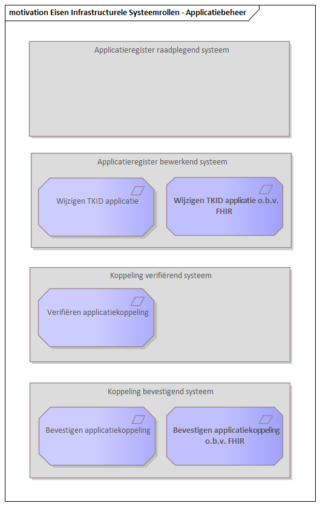
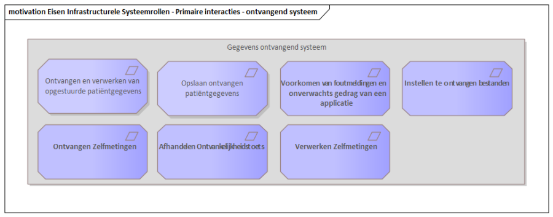
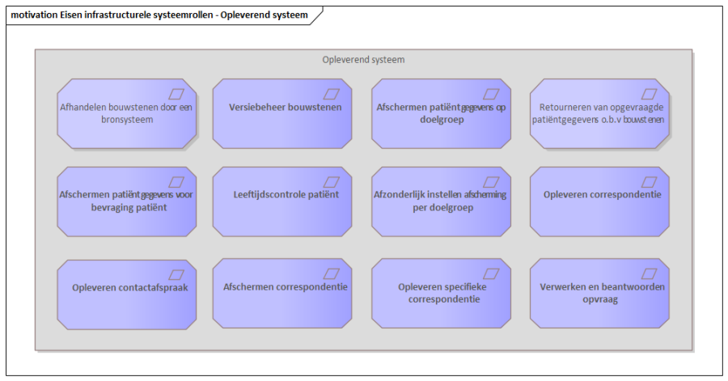
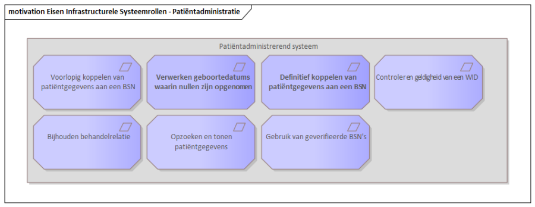
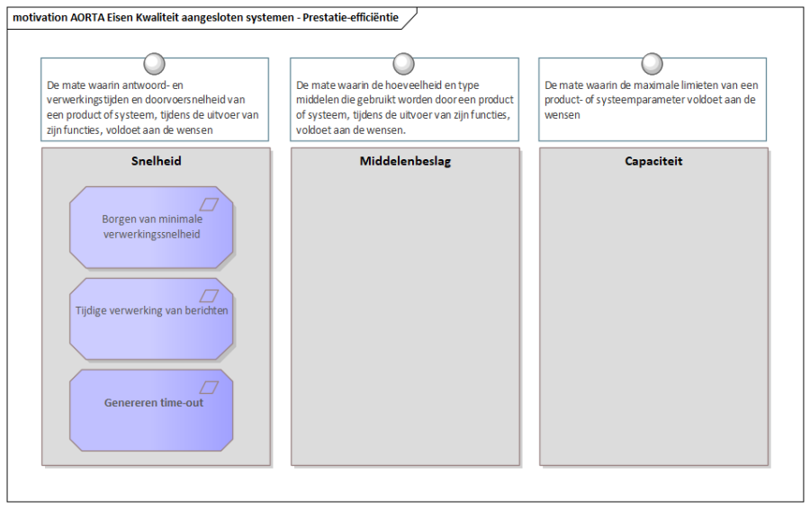
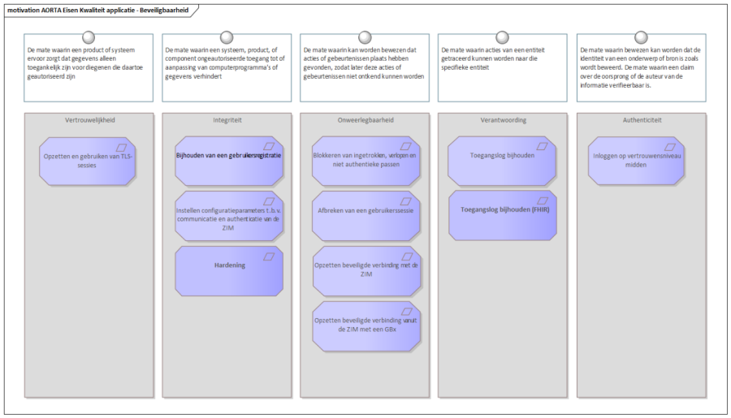
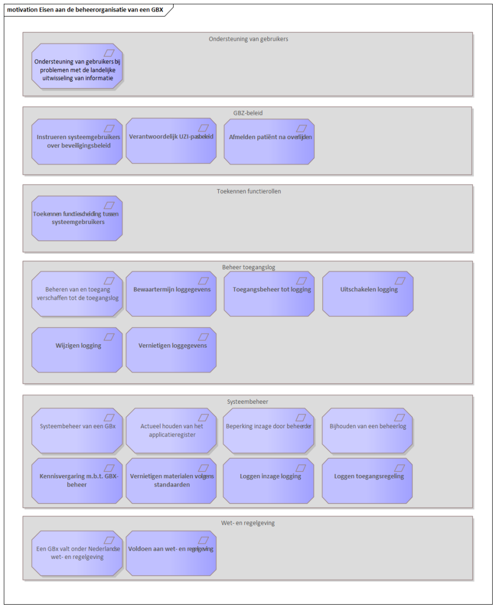

[AORTA 8.5.2](../../../index.md) / [Zorgtoepassingen](../../../zorgtoepassingen.md) / [MedMij](../../medmij.md) / [MedMij HIS t.b.v. OPEN](../medmij-his-t-b-v-open.md)

# PvE HIS tbv OPEN

| Datum: 8-10-2025 ; |
| --- |
| Status: Definitief ; |
| Versie: ; |
| Classificatie: Openbaar ; |
| Revisie: 2.0 ; |

### Documenthistorie

*Documentversies*

| **Datum** ; | **Status** ; | **Versie** ; | **Omschrijving** ; |
| --- | --- | --- | --- |
| 15 juni 2022 ; | Definitief ; | 1.0 ; | Eerste opzet PvE Huisartsinformatiesysteem tbv Open ; |
| 8-10-2025 ; | Definitief ; | 2.0 ; | TLS-versies aangepast op basis van NCSC richtlijnen (2025-05) ; |

Inhoudsopgave   
[Documenthistorie](pve-his-tbv-open.md#documenthistorie)  
[1 Inleiding](pve-his-tbv-open.md#inleiding)  
[2 Eisen HIS t.b.v. OPEN](pve-his-tbv-open.md#eisen-his-tbv-open)  
[2.1 AORTA Eisen Infrastructurele Systeemrollen](pve-his-tbv-open.md#aorta-eisen-infrastructurele-systeemrollen)  
[2.1.1 Systeemrollen - Infrastructuur - Applicatiebeheer](pve-his-tbv-open.md#systeemrollen-infrastructuur-applicatiebeheer)  
[2.1.2 Systeemrollen - Infrastructuur - Gegevens ontvangend systeem](pve-his-tbv-open.md#systeemrollen-infrastructuur-gegevens-ontvangend-systeem)  
[2.1.3 Systeemrollen - Infrastructuur - Gegevens opleverend systeem](pve-his-tbv-open.md#systeemrollen-infrastructuur-gegevens-opleverend-systeem)  
[2.1.4 Systeemrollen - Infrastructuur - Patiëntadministratie](pve-his-tbv-open.md#systeemrollen-infrastructuur-patientadministratie)  
[2.2 AORTA Eisen Kwaliteit Aangesloten Systemen](pve-his-tbv-open.md#aorta-eisen-kwaliteit-aangesloten-systemen)  
[2.2.1 Genereren time-out](pve-his-tbv-open.md#genereren-time-out)  
[2.2.2 Tijdige verwerking van berichten](pve-his-tbv-open.md#tijdige-verwerking-van-berichten)  
[2.2.3 Borgen van minimale verwerkingssnelheid](pve-his-tbv-open.md#borgen-van-minimale-verwerkingssnelheid)  
[2.2.4 Borgen van de betrouwbaarheid bij grote storingen](pve-his-tbv-open.md#borgen-van-de-betrouwbaarheid-bij-grote-storingen)  
[2.2.5 Borgen van de betrouwbaarheid bij kleine storingen](pve-his-tbv-open.md#borgen-van-de-betrouwbaarheid-bij-kleine-storingen)  
[2.2.6 Minimaliseren van de impact van gepland onderhoud](pve-his-tbv-open.md#minimaliseren-van-de-impact-van-gepland-onderhoud)  
[2.2.7 Borgen van de beschikbaarheid van een GBx](pve-his-tbv-open.md#borgen-van-de-beschikbaarheid-van-een-gbx)  
[2.2.8 Beveiligde opslag](pve-his-tbv-open.md#beveiligde-opslag)  
[2.2.9 Een GBx beschikt over een geldig UZI/PKIO-servercertificaat](pve-his-tbv-open.md#een-gbx-beschikt-over-een-geldig-uzipkio-servercertificaat)  
[2.2.10 Borgen van plicht tot uitwisselen van patiëntgegevens](pve-his-tbv-open.md#borgen-van-plicht-tot-uitwisselen-van-patientgegevens)  
[2.2.11 Beveiliging van patiëntgegevens in het GBx](pve-his-tbv-open.md#beveiliging-van-patientgegevens-in-het-gbx)  
[2.2.12 Borgen betrouwbare koppeling tussen pas en applicatie](pve-his-tbv-open.md#borgen-betrouwbare-koppeling-tussen-pas-en-applicatie)  
[2.2.13 Aansluiting op productie-omgeving LSP](pve-his-tbv-open.md#aansluiting-op-productie-omgeving-lsp)  
[2.2.14 Tijdsynchronisatie GBx en ZIM](pve-his-tbv-open.md#tijdsynchronisatie-gbx-en-zim)  
[2.2.15 Gebruik van IP en DNS](pve-his-tbv-open.md#gebruik-van-ip-en-dns)  
[2.2.16 Communicatie met het LSP via een GZN](pve-his-tbv-open.md#communicatie-met-het-lsp-via-een-gzn)  
[2.3 AORTA Eisen Kwaliteit Applicatie](pve-his-tbv-open.md#aorta-eisen-kwaliteit-applicatie)  
[2.3.1 Toegangslog bijhouden (FHIR)](pve-his-tbv-open.md#toegangslog-bijhouden-fhir)  
[2.3.2 Hardening](pve-his-tbv-open.md#hardening)  
[2.3.3 Opzetten beveiligde verbinding vanuit de ZIM met een GBx](pve-his-tbv-open.md#opzetten-beveiligde-verbinding-vanuit-de-zim-met-een-gbx)  
[2.3.4 Opzetten en gebruiken van TLS-sessies](pve-his-tbv-open.md#opzetten-en-gebruiken-van-tls-sessies)  
[2.3.5 Instellen configuratieparameters t.b.v. communicatie en authenticatie van de ZIM](pve-his-tbv-open.md#instellen-configuratieparameters-tbv-communicatie-en-authenticatie-van-de-zim)  
[2.3.6 Bijhouden van een gebruikersregistratie](pve-his-tbv-open.md#bijhouden-van-een-gebruikersregistratie)  
[2.3.7 Opzetten beveiligde verbinding met de ZIM](pve-his-tbv-open.md#opzetten-beveiligde-verbinding-met-de-zim)  
[2.3.8 Toegangslog bijhouden](pve-his-tbv-open.md#toegangslog-bijhouden)  
[2.3.9 Afbreken van een gebruikerssessie](pve-his-tbv-open.md#afbreken-van-een-gebruikerssessie)  
[2.3.10 Blokkeren van ingetrokken, verlopen en niet authentieke passen](pve-his-tbv-open.md#blokkeren-van-ingetrokken-verlopen-en-niet-authentieke-passen)  
[2.3.11 Inloggen op vertrouwensniveau midden](pve-his-tbv-open.md#inloggen-op-vertrouwensniveau-midden)  
[2.3.12 Afhandelen transactietoken](pve-his-tbv-open.md#afhandelen-transactietoken)  
[2.3.13 Protocolstack voor gegevensuitwisseling o.b.v. FHIR](pve-his-tbv-open.md#protocolstack-voor-gegevensuitwisseling-obv-fhir)  
[2.3.14 Kenbaar maken Certificate Authorities](pve-his-tbv-open.md#kenbaar-maken-certificate-authorities)  
[2.3.15 Ondersteunen servercertificaten en ondertekeningalgoritmen](pve-his-tbv-open.md#ondersteunen-servercertificaten-en-ondertekeningalgoritmen)  
[2.3.16 Bevorderen interoperabiliteit bij berichtuitwisseling](pve-his-tbv-open.md#bevorderen-interoperabiliteit-bij-berichtuitwisseling)  
[2.3.17 Juiste afhandeling van SOAP headers](pve-his-tbv-open.md#juiste-afhandeling-van-soap-headers)  
[2.3.18 Protocolstack voor berichtuitwisseling](pve-his-tbv-open.md#protocolstack-voor-berichtuitwisseling)  
[2.4 AORTA Eisen Organisatie van een GBX](pve-his-tbv-open.md#aorta-eisen-organisatie-van-een-gbx)  
[2.4.1 Afmelden patiënt na overlijden](pve-his-tbv-open.md#afmelden-patient-na-overlijden)  
[2.4.2 Wijzigen logging](pve-his-tbv-open.md#wijzigen-logging)  
[2.4.3 Vernietigen loggegevens](pve-his-tbv-open.md#vernietigen-loggegevens)  
[2.4.4 Uitschakelen logging](pve-his-tbv-open.md#uitschakelen-logging)  
[2.4.5 Toegangsbeheer tot logging](pve-his-tbv-open.md#toegangsbeheer-tot-logging)  
[2.4.6 Loggen toegangsregeling](pve-his-tbv-open.md#loggen-toegangsregeling)  
[2.4.7 Loggen inzage logging](pve-his-tbv-open.md#loggen-inzage-logging)  
[2.4.8 Bewaartermijn loggegevens](pve-his-tbv-open.md#bewaartermijn-loggegevens)  
[2.4.9 Voldoen aan wet- en regelgeving](pve-his-tbv-open.md#voldoen-aan-wet-en-regelgeving)  
[2.4.10 Vernietigen materialen volgens standaarden](pve-his-tbv-open.md#vernietigen-materialen-volgens-standaarden)  
[2.4.11 Een GBx valt onder Nederlandse wet- en regelgeving](pve-his-tbv-open.md#een-gbx-valt-onder-nederlandse-wet-en-regelgeving)  
[2.4.12 Kennisvergaring m.b.t. GBX-beheer](pve-his-tbv-open.md#kennisvergaring-mbt-gbx-beheer)  
[2.4.13 Bijhouden van een beheerlog](pve-his-tbv-open.md#bijhouden-van-een-beheerlog)  
[2.4.14 Beperking inzage door beheerder](pve-his-tbv-open.md#beperking-inzage-door-beheerder)  
[2.4.15 Actueel houden van het applicatieregister](pve-his-tbv-open.md#actueel-houden-van-het-applicatieregister)  
[2.4.16 Systeembeheer van een GBx](pve-his-tbv-open.md#systeembeheer-van-een-gbx)  
[2.4.17 Beheren van en toegang verschaffen tot de toegangslog](pve-his-tbv-open.md#beheren-van-en-toegang-verschaffen-tot-de-toegangslog)  
[2.4.18 Toekennen functiescheiding tussen systeemgebruikers](pve-his-tbv-open.md#toekennen-functiescheiding-tussen-systeemgebruikers)  
[2.4.19 Verantwoordelijk UZI-pasbeleid](pve-his-tbv-open.md#verantwoordelijk-uzi-pasbeleid)  
[2.4.20 Instrueren systeemgebruikers over beveiligingsbeleid](pve-his-tbv-open.md#instrueren-systeemgebruikers-over-beveiligingsbeleid)  
[2.4.21 Ondersteuning van gebruikers bij problemen met de landelijke uitwisseling van informatie](pve-his-tbv-open.md#ondersteuning-van-gebruikers-bij-problemen-met-de-landelijke-uitwisseling-van-informatie)  
Section: Section1

## Inleiding

End   
  
Section: Section2

## Eisen HIS t.b.v. OPEN

### AORTA Eisen Infrastructurele Systeemrollen

#### Systeemrollen - Infrastructuur - Applicatiebeheer

  
*Figure 1 : Eisen Infrastructurele Systeemrollen - Applicatiebeheer*

##### Bevestigen applicatiekoppeling o.b.v. FHIR

<!-- rm:requirement urn:researchmaster:aorta:requirement:GBX.APR.e4080 -->

##### Wijzigen TKID applicatie o.b.v. FHIR

<!-- rm:requirement urn:researchmaster:aorta:requirement:GBX.APR.e4070.1 -->

##### Bevestigen applicatiekoppeling

**Alias**: GBX.APR.e4160

| Details ; |
| --- |
| **Beginsituatie** ; Het systeem beschikt over de voor deze functie vereiste vertrouwensmiddelen. ; **Trigger** ; Het systeem ontvangt een verifiërenApplicatiekoppeling bericht conform [IH AORTA.](https://decor.nictiz.nl/pub/vzvz/aorta-vzvz-html-20200821T140325/) ; **Interacties** ; Het systeem stuurt een verifiërenApplicatiekoppelingAntwoord terug naar de verzender conform [IH AORTA.](https://decor.nictiz.nl/pub/vzvz/aorta-vzvz-html-20200821T140325/) ; **Resultaat** ; Het antwoordbericht is teruggestuurd naar de verzender. ; **Uitzonderingen** ; Uitzonderingen zijn beschreven in de [Foutentabel](https://www.aorta-lsp.nl/media/downloads/foutentabel-aorta-v8200xlsx/download). ; **Opties** ; Het bericht moet een authenticatietoken kunnen bevatten. ; **Responsetijd** ;  **Betrouwbaarheid** ;  **Toelichting** ; - ; |

**Vzvz_Moscow**: Verplicht  
**Vzvz_Req_Verificatie**: Acceptatietest  
**Vzvz_Req_Soort**: Functional  
**Vzvz_Req_Type**: Product

##### Verifiëren applicatiekoppeling

**Alias**: GBX.APR.e4140

| Details ; |
| --- |
| **Beginsituatie** ; De gebruiker is lokaal ingelogd op vertrouwensniveau laag of hoger. ; **Trigger** ; De gebruiker initieert de functie via het systeem. ; **Interacties** ;  Het systeem verzendt en verifiërenApplicatiekoppeling bericht naar de ZIM of een ander GBX conform [IH APR](https://decor.nictiz.nl/pub/vzvz/aorta-vzvz-html-20200821T140325/). ;  Het systeem ontvangt een verifiërenApplicatiekoppelingAntwoord bericht conform [IH APR](https://decor.nictiz.nl/pub/vzvz/aorta-vzvz-html-20200821T140325/). ; **Resultaat** ; De opgeleverde gegevens zijn door het systeem: ;  gepresenteerd aan de gebruiker, of ;  verwerkt tot een beslissing (die is gepresenteerd aan de gebruiker). ; **Uitzonderingen** ; Uitzonderingen zijn beschreven in de [Foutentabel](https://www.aorta-lsp.nl/media/downloads/foutentabel-aorta-v8200xlsx/download). ; **Opties** ; Het bericht moet een authenticatietoken kunnen bevatten. ; **Responsetijd** ;  **Betrouwbaarheid** ; Garantie geven dat versturen van gegevens niet zonder kennisgeving gestaakt wordt ; **Toelichting** ; - ; |

**Vzvz_Moscow**: Verplicht  
**Vzvz_Req_Verificatie**: Acceptatietest  
**Vzvz_Req_Soort**: Functional  
**Vzvz_Req_Type**: Product

##### Wijzigen TKID applicatie

**Alias**: GBX.APR.e4060, GBX.APR.e4170.1

| Details ; |
| --- |
| **Beginsituatie** ; De gebruiker is lokaal ingelogd op vertrouwensniveau laag of hoger. ; **Trigger** ; De gebruiker initieert de functie via het systeem. ; **Interacties** ;  Het systeem verzendt een *beherenTKID-*bericht naar de ZIM conform [HL7v3 IH APR](https://www.aortadocumentatie.nl/Documenten/AORTA_ApBh_IH_Applicatieregister_HL7.pdf). ;  Het systeem ontvangt een ontvangstbevestiging conform [HL7v3 IH APR](https://www.aortadocumentatie.nl/Documenten/AORTA_ApBh_IH_Applicatieregister_HL7.pdf). ; **Resultaat** ; Het LSP heeft de in het bericht opgenomen TKID's opgenomen in het applicatieregister. ; **Uitzonderingen** ; Uitzonderingen zijn beschreven in de Foutentabel. ; **Opties** ;  **Responsetijd** ;  **Betrouwbaarheid** ;  **Toelichting** ; De logische attributen van dit bericht zijn te vinden in het [Ontwerp Applicatieregister](https://www.vzvz.nl/uploaded/FILES/htmlcontent/AORTA2015/AORTA_ApBh_Ontw_Applicatieregister.pdf). ; Vanuit het XIS-acceptatieproces wordt er een typekwalificatieID (TKID) gegenereerd. In overleg tussen de XIS-leverancier en het VZVZ-acceptatieteam wordt de granulariteit van een TKID bepaald. Het is mogelijk dat er voor een XIS-applicatie één of meerdere TKID's worden uitgegeven. ; Aan elk TKID zijn één of meerdere specifieke systeemrol(len) gekoppeld. Aan elk systeemrol zijn één of meerdere interactieID's gekoppeld. Een zorgaanbiederapplicatie (een bij de zorgaanbieder geïnstalleerde versie van een XIS-applicatie) kan meerdere TKID's ondersteunen. Zie het [ONTW APR](https://www.aorta-lsp.nl/media/downloads/ontwerp-applicatieregister-aorta-v8200pdf/download) voor het gegevensmodel en een beschrijving m.b.t. TKID's. ; In het geval een zorgaanbiederapplicatie gebruik wil maken van de functionaliteit van een bepaalde systeemrol, dient de zorgaanbiederapplicatie aan de betreffende TKID (behorende bij de specifieke systeemrol(len)) gekoppeld te worden. Vanuit de applicatie dient met het 'beheren TKID'-bericht, het gewenste TKID ingestuurd te worden. ; Er mogen alleen TKID's ingestuurd worden, die door de afgenomen XIS-applicatiesoftware zijn verkregen naar aanleiding van een positieve acceptatie. De beheerder of het systeem van een bij een zorgaanbieder geïnstalleerde applicatie dient alleen die TKID's in te sturen waarvan alle systeemrollen ook daadwerkelijk door de geïnstalleerde applicatie ondersteund worden. ; Er kunnen meerdere TKID's in het bericht opgenomen worden. Zodra een TKID niet bekend is, wordt er een foutcode (INVALIDETKID) met bijbehorende foutmelding (zie [Foutentabel](https://www.aorta-lsp.nl/media/downloads/foutentabel-aorta-v8200xlsx/download)) gegenereerd. De mogelijk overige correcte TKID's worden niet verwerkt in het applicatieregister. Alle TKID's dienen opnieuw ingestuurd te worden. ; Bij elk door het LSP succesvol ontvangen 'beheren TKID'-bericht, worden de bestaande TKID-koppelingen met de zorgaanbiederapplicatie verwijderd en worden er koppelingen gemaakt met de in het bericht opgenomen TKID's. Hierbij geldt dat een bestaande status van reeds aanwezige systeemrollen (gekoppeld aan een TKID) niet wordt veranderd. Koppelingen die nog niet bekend waren binnen het applicatieregister krijgen direct de status 'actief'. ; In principe geldt dat er bij elk nieuw verkregen TKID, als gevolg van een acceptatie van een applicatiewijziging of –uitbreiding, er één of meerdere TKID's opnieuw ingestuurd moeten worden. Denkbare situaties zijn: ;  Installeren nieuwe functionaliteit; ;  Initiële installatie; ;  Nieuwe acceptatie van de XIS-applicatie. ;  Terugzetten oude functionaliteit (met een eerder verkregen TKID). ; |

**Vzvz_Moscow**: Verplicht  
**Vzvz_Req_Verificatie**: Acceptatietest  
**Vzvz_Req_Soort**: Functional  
**Vzvz_Req_Type**: Product

#### Systeemrollen - Infrastructuur - Gegevens ontvangend systeem

  
*Figure 2 : Eisen Infrastructurele Systeemrollen - Primaire interacties - ontvangend systeem*

##### Voorkomen van foutmeldingen en onverwachts gedrag van een applicatie

<!-- rm:requirement urn:researchmaster:aorta:requirement:GBX.OPV.e4190 -->

##### Opslaan ontvangen patiëntgegevens

<!-- rm:requirement urn:researchmaster:aorta:requirement:GBX.STU.e4520 -->

##### Ontvangen en verwerken van opgestuurde patiëntgegevens

**Alias**: GBX.STU.e4510

| Details ; |
| --- |
| **Condities** ;  **Beginsituatie** ; Het systeem beschikt over de voor deze functie vereiste vertrouwensmiddelen. ; **Trigger** ; Het systeem ontvangt een versturenPatiëntgegevens-bericht ; **Interacties** ; Het systeem stuurt een bevestiging naar de afzender conform [AORTA_Wrp_IH_Berichtwrappers_HL7](https://www.aortadocumentatie.nl/Documenten/AORTA_Wrp_IH_Berichtwrappers_HL7.pdf). ; **Resultaat** ; De ontvangen patiëntgegevens zijn verwerkt. ; **Uitzonderingen** ; Uitzonderingen zijn beschreven in de Foutentabel. ; **Opties** ; Een systeem dat berichten in de nieuwste versie ondersteunt, dient ook berichten in de eerst lagere versie te ondersteunen. ; **Responsetijd** ; Het systeem dient in staat te zijn kilobytes aan berichtinhoud per seconde te verwerken. ; **Betrouwbaarheid** ;  **Toelichting** ; Berichten kunnen zijn geadresseerd aan een applicatie die niet de applicatie is van de zorgverlener die het bericht moet krijgen. Het GBX moet er in dat geval voor zorgen het bericht bij de juiste applicatie wordt afgeleverd. ; Indien het verplicht is voor het ontvangen bericht om het patient-id in de transmissionwrapper te vermelden, dan dient dat gelijk te zijn aan het patient-id in de inhoud van het bericht. Indien dit niet het geval is, moet een foutmelding worden teruggestuurd en moet de verwerking worden afgebroken. ; |

**Vzvz_Moscow**: Verplicht  
**Vzvz_Req_Verificatie**: Acceptatietest  
**Vzvz_Req_Soort**: Functional  
**Vzvz_Req_Type**: Product

##### Ontvangen Zelfmetingen

<!-- rm:requirement urn:researchmaster:aorta:requirement:GBX.ONT.e4170 -->

##### Afhandelen Ontvankelijkheidstoets

<!-- rm:requirement urn:researchmaster:aorta:requirement:GBX.OPV.e4220 -->

##### Verwerken Zelfmetingen

<!-- rm:requirement urn:researchmaster:aorta:requirement:GBX.OPV.e4230 -->

##### Instellen te ontvangen bestanden

<!-- rm:requirement urn:researchmaster:aorta:requirement:GBX.OPV.e4210 -->

#### Systeemrollen - Infrastructuur - Gegevens opleverend systeem

  
*Figure 3 : Eisen infrastructurele systeemrollen - Opleverend systeem*

##### Verwerken en beantwoorden opvraag

<!-- rm:requirement urn:researchmaster:aorta:requirement:GBX.OPV.e4590 -->

##### Opleveren specifieke correspondentie

<!-- rm:requirement urn:researchmaster:aorta:requirement:GBX.OPV.e4640 -->

##### Afschermen correspondentie

<!-- rm:requirement urn:researchmaster:aorta:requirement:GBX.OPV.e4650 -->

##### Versiebeheer bouwstenen

<!-- rm:requirement urn:researchmaster:aorta:requirement:GBX.OPV.e4580 -->

##### Leeftijdscontrole patiënt

<!-- rm:requirement urn:researchmaster:aorta:requirement:GBX.OPV.e4570 -->

##### Afschermen patiëntgegevens voor bevraging patiënt

<!-- rm:requirement urn:researchmaster:aorta:requirement:GBX.OPV.e4537 -->

##### Afschermen patiëntgegevens op doelgroep

<!-- rm:requirement urn:researchmaster:aorta:requirement:GBX.OPV.e4535.1 -->

##### Afhandelen bouwstenen door een bronsysteem

<!-- rm:requirement urn:researchmaster:aorta:requirement:GBX.OPV.e4514 -->

##### Retourneren van opgevraagde patiëntgegevens o.b.v bouwstenen

**Alias**: GBX.OPV.e4513.2

| Details ; |
| --- |
| **Beginsituatie** ;  Het reagerende systeem beschikt over de voor deze functie vereiste vertrouwensmiddelen. ;  Het reagerende systeem heeft de opgevraagde patiëntgegevens aangemeld bij de VWI. ;  Voor de op te leveren patiëntgegevens is sprake van een definitieve koppeling met BSN. ;  Er is een opt-in geregistreerd in het systeem. ; **Trigger** ; Het systeem ontvangt een opvragenBouwsteeninstantiaties-bericht ; **Interacties** ; Het systeem retourneert een opleverenBouwsteeninstantiaties-bericht, zoals beschreven in de eisen aan de concrete systeemrol. ; **Resultaat** ; Het bericht is afgehandeld en de opgevraagde gegevens zijn, indien toegestaan, binnen de gestelde responstijd geretourneerd. ; **Uitzonderingen** ; Uitzonderingen zijn beschreven in de Foutentabel. ; **Opties** ; Het retourbericht bevat alle, in het systeem aanwezige, vrijgegeven patiëntgegevens, die voldoen aan de criteria die zijn meegegeven in het opvragenBouwsteeninstantiaties-bericht. Dit kunnen criteria zijn die zijn overgenomen uit het opvragenPatiëntgegevensContext-bericht (vraagparameters) of door het LSP zijn bepaald (selectieparameters) en toegevoegd aan het opvragenBouwsteeninstantiaties-bericht. De criteria zijn beschreven in de eisen aan de zorgtoepassingen. ; In het geval het bronsysteem, om welke reden dan ook, niet alle opgevraagde gegevens kan retourneren, dient er een foutmelding te worden verstuurd. Deze foutmelding dient door het bronsysteem te worden verstuurd tezamen met de patiëntgegevens die wel opgeleverd kunnen worden. ; Als kopie aangemerkte gegevens mogen niet worden geretourneerd. ; **Responsetijd** ; Bij het beantwoorden van een opvragenBouwsteeninstantiaties-bericht moet rekening gehouden worden met dat dit gebeurt vòòr het tijdstip dat in het bericht is meegegeven ( uiterste-oplevertijd-gbz). Indien het niet mogelijk is om de gevraagde gegevens tijdig op te leveren, dient zo snel mogelijk een melding naar de ZIM gestuurd te worden. ; Het systeem dient in staat te zijn gbx-opleversnelheid kilobytes aan berichtinhoud per seconde te retourneren. ; **Toelichting** ; - ; |

**Vzvz_Moscow**: Verplicht  
**Vzvz_Req_Verificatie**: Acceptatietest  
**Vzvz_Req_Soort**: Functional  
**Vzvz_Req_Type**: Product

##### Opleveren correspondentie

<!-- rm:requirement urn:researchmaster:aorta:requirement:GBX.OPL.e4130 -->

##### Opleveren contactafspraak

<!-- rm:requirement urn:researchmaster:aorta:requirement:GBX.OPL.e4170 -->

##### Afzonderlijk instellen afscherming per doelgroep

<!-- rm:requirement urn:researchmaster:aorta:requirement:GBX.OPV.e4536 -->

#### Systeemrollen - Infrastructuur - Patiëntadministratie

  
*Figure 4 : Eisen Infrastructurele Systeemrollen - Patiëntadministratie*

##### Gebruik van geverifieerde BSN's

<!-- rm:requirement urn:researchmaster:aorta:requirement:GBX.IDA.e4060.1 -->

##### Opzoeken en tonen patiëntgegevens

<!-- rm:requirement urn:researchmaster:aorta:requirement:GBX.IDA.e4010.1 -->

##### Bijhouden behandelrelatie

<!-- rm:requirement urn:researchmaster:aorta:requirement:GBX.IDA.e4050 -->

##### Controleren geldigheid van een WID

<!-- rm:requirement urn:researchmaster:aorta:requirement:GBX.IDA.e4040 -->

##### Definitief koppelen van patiëntgegevens aan een BSN

<!-- rm:requirement urn:researchmaster:aorta:requirement:GBX.IDA.e4030 -->

##### Voorlopig koppelen van patiëntgegevens aan een BSN

<!-- rm:requirement urn:researchmaster:aorta:requirement:GBX.IDA.e4020 -->

##### Verwerken geboortedatums waarin nullen zijn opgenomen

<!-- rm:requirement urn:researchmaster:aorta:requirement:GBX.IDA.e4015 -->

### AORTA Eisen Kwaliteit Aangesloten Systemen

  
*Figure 5 : AORTA Eisen Kwaliteit aangesloten systemen - Prestatie-efficiëntie*

#### Genereren time-out

<!-- rm:requirement urn:researchmaster:aorta:requirement:GBX.PST.e4020 -->

#### Tijdige verwerking van berichten

<!-- rm:requirement urn:researchmaster:aorta:requirement:GBX.PST.e4015 -->

#### Borgen van minimale verwerkingssnelheid

<!-- rm:requirement urn:researchmaster:aorta:requirement:GBX.PST.e4010.1 -->

#### Borgen van de betrouwbaarheid bij grote storingen

<!-- rm:requirement urn:researchmaster:aorta:requirement:GBX.BET.e4020.1 -->

#### Borgen van de betrouwbaarheid bij kleine storingen

<!-- rm:requirement urn:researchmaster:aorta:requirement:GBX.BET.e4010.1 -->

#### Minimaliseren van de impact van gepland onderhoud

<!-- rm:requirement urn:researchmaster:aorta:requirement:GBX.BES.e4020.2 -->

#### Borgen van de beschikbaarheid van een GBx

<!-- rm:requirement urn:researchmaster:aorta:requirement:GBX.BES.e4010 -->

#### Beveiligde opslag

<!-- rm:requirement urn:researchmaster:aorta:requirement:SYS.BVL.e4010.1 -->

#### Een GBx beschikt over een geldig UZI/PKIO-servercertificaat

<!-- rm:requirement urn:researchmaster:aorta:requirement:GBX.BVL.e4080 -->
<!-- rm:requirement urn:researchmaster:aorta:requirement:GBX.BVL.e4080.1 -->

#### Borgen van plicht tot uitwisselen van patiëntgegevens

<!-- rm:requirement urn:researchmaster:aorta:requirement:GBX.BVL.e4070 -->

#### Beveiliging van patiëntgegevens in het GBx

<!-- rm:requirement urn:researchmaster:aorta:requirement:GBX.BVL.e4060 -->

#### Borgen betrouwbare koppeling tussen pas en applicatie

<!-- rm:requirement urn:researchmaster:aorta:requirement:GBX.BVL.e4050.1 -->

#### Aansluiting op productie-omgeving LSP

<!-- rm:requirement urn:researchmaster:aorta:requirement:GBX.CON.e4120 -->

#### Tijdsynchronisatie GBx en ZIM

<!-- rm:requirement urn:researchmaster:aorta:requirement:GBX.CON.e4030.2 -->

#### Gebruik van IP en DNS

<!-- rm:requirement urn:researchmaster:aorta:requirement:GBX.CON.e4020 -->
<!-- rm:requirement urn:researchmaster:aorta:requirement:GBX.CON.e4020.1 -->
<!-- rm:requirement urn:researchmaster:aorta:requirement:GBX.CON.e4020.2 -->

#### Communicatie met het LSP via een GZN

<!-- rm:requirement urn:researchmaster:aorta:requirement:GBX.CON.e4010 -->
<!-- rm:requirement urn:researchmaster:aorta:requirement:GBX.CON.e4010.1 -->

### AORTA Eisen Kwaliteit Applicatie

  
*Figure 9 : AORTA Eisen Kwaliteit applicatie - Beveiligbaarheid*  
ISO 25010 definitieert Beveiligbaarheid als: De mate waarin een product of systeem informatie en gegevens beschermt zodat personen, andere producten of systemen de juiste mate van gegevenstoegang hebben passend bij hun soort en niveau van autorisatie.

#### Toegangslog bijhouden (FHIR)

<!-- rm:requirement urn:researchmaster:aorta:requirement:GBX.LOG.e4016 -->

#### Hardening

<!-- rm:requirement urn:researchmaster:aorta:requirement:SYS.BVL.e4065 -->

#### Opzetten beveiligde verbinding vanuit de ZIM met een GBx

<!-- rm:requirement urn:researchmaster:aorta:requirement:GBX.CON.e4090.2 -->

#### Opzetten en gebruiken van TLS-sessies

<!-- rm:requirement urn:researchmaster:aorta:requirement:GBX.CON.e4070.2 -->

#### Instellen configuratieparameters t.b.v. communicatie en authenticatie van de ZIM

<!-- rm:requirement urn:researchmaster:aorta:requirement:GBX.FBH.e4050.3 -->

#### Bijhouden van een gebruikersregistratie

<!-- rm:requirement urn:researchmaster:aorta:requirement:GBX.FBH.e4030 -->

#### Opzetten beveiligde verbinding met de ZIM

<!-- rm:requirement urn:researchmaster:aorta:requirement:GBX.CON.e4080.5 -->

#### Toegangslog bijhouden

<!-- rm:requirement urn:researchmaster:aorta:requirement:GBX.LOG.e4015.1 -->

#### Afbreken van een gebruikerssessie

<!-- rm:requirement urn:researchmaster:aorta:requirement:GBX.IDA.e4090.1 -->

#### Blokkeren van ingetrokken, verlopen en niet authentieke passen

<!-- rm:requirement urn:researchmaster:aorta:requirement:GBX.IDA.e4085.2 -->

#### Inloggen op vertrouwensniveau midden

<!-- rm:requirement urn:researchmaster:aorta:requirement:GBX.IDA.e4080.3 -->

#### Afhandelen transactietoken

<!-- rm:requirement urn:researchmaster:aorta:requirement:GBX.CON.e4140.2 -->

#### Protocolstack voor gegevensuitwisseling o.b.v. FHIR

<!-- rm:requirement urn:researchmaster:aorta:requirement:GBX.CON.e4130.1 -->

#### Kenbaar maken Certificate Authorities

<!-- rm:requirement urn:researchmaster:aorta:requirement:GBX.CON.e4100 -->

#### Ondersteunen servercertificaten en ondertekeningalgoritmen

<!-- rm:requirement urn:researchmaster:aorta:requirement:GBX.CON.e4110.2 -->

#### Bevorderen interoperabiliteit bij berichtuitwisseling

<!-- rm:requirement urn:researchmaster:aorta:requirement:GBX.CON.e4066 -->

#### Juiste afhandeling van SOAP headers

<!-- rm:requirement urn:researchmaster:aorta:requirement:GBX.CON.e4065 -->

#### Protocolstack voor berichtuitwisseling

<!-- rm:requirement urn:researchmaster:aorta:requirement:GBX.CON.e4060.2 -->

### AORTA Eisen Organisatie van een GBX

  
*Figure 11 : Eisen aan de beheerorganisatie van een GBX*

#### Afmelden patiënt na overlijden

<!-- rm:requirement urn:researchmaster:aorta:requirement:GBX.FBH.e4090 -->

#### Wijzigen logging

<!-- rm:requirement urn:researchmaster:aorta:requirement:AGE.LOG.e4060 -->

#### Vernietigen loggegevens

<!-- rm:requirement urn:researchmaster:aorta:requirement:AGE.LOG.e4050 -->

#### Uitschakelen logging

<!-- rm:requirement urn:researchmaster:aorta:requirement:AGE.LOG.e4030 -->

#### Toegangsbeheer tot logging

<!-- rm:requirement urn:researchmaster:aorta:requirement:AGE.LOG.e4040 -->

#### Loggen toegangsregeling

<!-- rm:requirement urn:researchmaster:aorta:requirement:AGE.LOG.e4070 -->

#### Loggen inzage logging

<!-- rm:requirement urn:researchmaster:aorta:requirement:AGE.LOG.e4020 -->

#### Bewaartermijn loggegevens

<!-- rm:requirement urn:researchmaster:aorta:requirement:AGE.LOG.e4010 -->

#### Voldoen aan wet- en regelgeving

<!-- rm:requirement urn:researchmaster:aorta:requirement:GBX.ALG.e4010 -->

#### Vernietigen materialen volgens standaarden

<!-- rm:requirement urn:researchmaster:aorta:requirement:GBX.SBH.e4070 -->

#### Een GBx valt onder Nederlandse wet- en regelgeving

<!-- rm:requirement urn:researchmaster:aorta:requirement:GBX.CON.e4050.1 -->

#### Kennisvergaring m.b.t. GBX-beheer

<!-- rm:requirement urn:researchmaster:aorta:requirement:GBX.SBH.e4060 -->

#### Bijhouden van een beheerlog

<!-- rm:requirement urn:researchmaster:aorta:requirement:GBX.SBH.e4050 -->

#### Beperking inzage door beheerder

<!-- rm:requirement urn:researchmaster:aorta:requirement:GBX.SBH.e4040.3 -->

#### Actueel houden van het applicatieregister

<!-- rm:requirement urn:researchmaster:aorta:requirement:GBX.SBH.e4030 -->

#### Systeembeheer van een GBx

<!-- rm:requirement urn:researchmaster:aorta:requirement:GBX.SBH.e4020 -->
<!-- rm:requirement urn:researchmaster:aorta:requirement:GBX.SBH.e4020.2 -->

#### Beheren van en toegang verschaffen tot de toegangslog

<!-- rm:requirement urn:researchmaster:aorta:requirement:GBX.SBH.e4010 -->

#### Toekennen functiescheiding tussen systeemgebruikers

<!-- rm:requirement urn:researchmaster:aorta:requirement:GBX.FBH.e4025 -->

#### Verantwoordelijk UZI-pasbeleid

<!-- rm:requirement urn:researchmaster:aorta:requirement:GBX.FBH.e4017 -->

#### Instrueren systeemgebruikers over beveiligingsbeleid

<!-- rm:requirement urn:researchmaster:aorta:requirement:GBX.FBH.e4015 -->

#### Ondersteuning van gebruikers bij problemen met de landelijke uitwisseling van informatie

<!-- rm:requirement urn:researchmaster:aorta:requirement:GBX.FBH.e4010 -->

